# ESPECIFICACIÓN TÉCNICA — CIERRE DE G-1, G-5 Y G-10

**Estado:** ESPECIFICACIÓN TÉCNICA v3 (revisión posterior a la v2, que se conserva como `ESPECIFICACION_TECNICA_G1_G5_G10_v2_historica.md`), lista para aceptación formal, **no aceptada**. Corrige siete defectos señalados sobre la v2: aprobación positiva inequívoca, `db_txid`, ciclo de vida de canales y formatos, longitudes pendientes (DG-16), independencia respecto de versiones intermedias (DG-17), cadena de evaluaciones del mismo par y política de `correlation_id`. Nada de lo que sigue se ha implementado ni validado técnicamente (evidencia nivel 1). Fase 1 no iniciada ni autorizada. La Adenda v9 sigue sin aceptarse (PO-05) y no se modificó. El modelo de 27 tablas se conserva como línea base histórica; las **32** tablas (27 + 5 nuevas propuestas) son el **modelo propuesto sujeto a aprobación**. Ninguna decisión autoriza SQL, migraciones ni implementación física.

**Alcance de la autorización usada:** diseño, especificación, contraste y validación documental. No se escribió SQL ejecutable, ni migraciones, políticas RLS reales, Edge Functions, código, infraestructura, repositorios, Git, despliegues ni integración con RevNavigator. Los nombres de tablas, columnas, funciones y triggers son **propuestas de nombre**; los fragmentos de reglas están en español, no en SQL.

## 1. Línea base inspeccionada

SHA-256 de `fase0_v3_3_integral.md`: `b5dccdc73a8103966ab1e1b1e84b2e7ead68cd736fba666ec71d0e790d51c1da` (coincide con el SHA aceptado como línea base documental).

| Documento vigente v9 (no aceptado) | SHA-256 al iniciar (16 primeros) |
|---|---|
| ADDENDUM_DECISIONES_PROPIETARIO_OD01_OD16.md | `ccb1c546dfb62c1b…` |
| control_decisiones_propietario.md | `448a1387deefbb5f…` |
| matriz_decisiones_propietario.md | `b401580ad771754f…` |
| MATRIZ_TRAZABILIDAD_OD01_OD16.md | `1c5c5ea5d9a6026a…` |
| MATRIZ_NOTIFICACIONES_CCI.md | `6954adeb8d45d61e…` |
| AUDITORIA_CONSISTENCIA_OD01_OD16.md | `d27d7769162622ee…` |
| REGISTRO_HISTORICO_VERSIONES.md | `3934638d133a92e6…` |
| INFORME_CIERRE_PO21_G7_AUDITORIA_V9.md | `cba4dcc29b766629…` |

| Elemento | Estado |
|---|---|
| Fase 0 v3.3 como línea base documental | APROBADO (aceptada como línea base) |
| D-01 a D-08; 27 tablas; 17 claves físicas; T-02 con 13 transiciones | APROBADOS / vigentes; no se modifican |
| Decisiones PO-11 a PO-21 de la Adenda v9 (incluidas las condiciones de PO-20 y PO-21) | Decididas por el propietario; la Adenda v9 que las recoge NO está aceptada (PO-05) |
| G-7: mecanismo conceptual C1 a C9 y R-1 a R-8 | Diseño conceptual de v9, no aceptado; aquí se precisa (ver 6.2) |
| G-1, G-5 y G-10 | Eran brechas abiertas; esta especificación es su PROPUESTA de cierre técnico |
| Cinco tablas nuevas (cuatro de G-1, G-5 y G-10 y `channel_formats`) y ajustes al modelo | DG-01: aprobados conceptualmente, sujetos a completar tipos, claves, restricciones y justificación (esta versión los completa; la aprobación de la especificación sigue pendiente) |
| Funciones, triggers y nombres de roles de este documento | Propuestas de diseño; no existen |
| Decisiones DG-01 a DG-16 (sección 12) | Aprobadas: 01 a 08, 10, 11, 13, 14 y 15. Diferidas: 09 (retención), 12 (hash encadenado, a 6.6) y 16 (umbrales, hasta resolver T-03) |

## 2. Principios de diseño

| # | Principio | Consecuencia |
|---|---|---|
| P1 | Fail-closed | Toda condición se evalúa con tres valores (cumple, no cumple, no verificable). Solo «cumple» o «no aplica» permiten publicar. La ausencia de un dato nunca habilita. |
| P2 | Lo calculable se deriva, no se almacena | «Evaluación pendiente», «clasificación vigente», «contribuyentes heredados» y «estado de resolución» se calculan desde registros inmutables. Un estado almacenado puede desincronizarse; un cálculo no. |
| P3 | Registros de solo inserción | Clasificación, asignación de revisor, evaluación e intento de publicación no se editan ni se borran. Corregir es insertar una fila que reemplaza en vigencia a otra. |
| P4 | Versiones exactas e inmutables | Toda relación apunta a una versión concreta mediante claves foráneas compuestas con la organización. No existe un apuntador a «la última». |
| P5 | El backend es la autoridad | La publicación solo ocurre en la ampliación de `transition_piece_status`. La interfaz, RLS y Edge Functions no sustituyen esa validación. |
| P6 | Separación de verificación y registro | El registro del intento se escribe después de calcular el resultado y no puede cambiarlo; el resultado «permitido» solo existe si se cumplieron las nueve condiciones. |
| P7 | Sin autoridad por defecto | Ninguna evaluación ni intento concede permisos, aprobaciones ni facultades; Admin, el propietario o cualquier rol no sustituyen a un revisor elegible. |
| P8 | Sin T-02 nueva ni clave 18 | Las 13 transiciones y las 17 claves permanecen. La evaluación es una actividad de revisión (PO-21). |
| P9 | Mínimo suficiente | Cinco tablas nuevas y columnas en las existentes; cada elemento se justifica en la sección 9. |
| P10 | Fallo seguro y honesto | Un fallo de verificación o de registro nunca publica; los límites de atomicidad se declaran (sección 8.6). |

## 3. G-1 — Relación maestra–adaptación

### 3.1 Decisión de representación

Una adaptación **no** es un campo de texto de la maestra ni una versión de ella: es una **pieza** (`creative_pieces`) con identidad, estado, responsable, canal, formato y versiones propias, que apunta a su maestra. Cada versión de la adaptación apunta a la **versión exacta** de la maestra de la que deriva. Una variación interna que no se aprueba ni publica por separado no es una fila de pieza: vive como contenido de la versión de la maestra (PO-19). Una pieza con maestra que no ha sido confirmada como independiente es una *candidata*: puede trabajarse, pero no aprobarse (#7) ni publicarse (#10).

### 3.2 Modelo entidad-relación

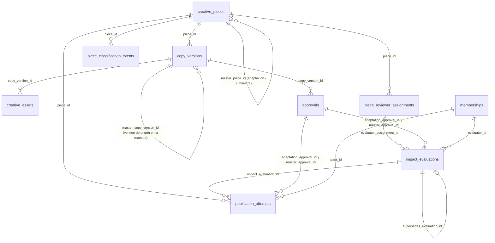

### 3.3 Diagrama de relaciones

```
  MAESTRA M (creative_pieces, master_piece_id NULL)
     |  copy_versions v1, v2, v3 ... (inmutables)   approvals de M (por version exacta)
     |
     |  master_piece_id (inmutable, un solo nivel)
     v
  ADAPTACION A1 ... A2 ... A3  (creative_pieces, master_piece_id = M; canal, formato, adaptation_key)
     |   copy_versions de A: cada una guarda (M, version exacta de M, arte de M si existe)
     |   approvals de A (por version exacta de A)
     |   piece_classification_events (propuesta, confirmacion, no_confirmada, reversion)
     |   piece_reviewer_assignments  (asignado, retirado)
     v
  impact_evaluations: par (V-D origen -> V-B aprobada de M) sobre la version aprobada V-A de A
     |   cadena por supersedes_evaluation_id (segunda evaluacion, correccion)
     v
  publication_attempts: un registro por solicitud de publicacion, con C1 a C9
     |   referencias a V-A, V-B, V-D, approvals y evaluacion vigente
     v
  transition_piece_status(... 'publicado')  ->  unica ruta que deja status = publicado
```

### 3.4 Entidades y atributos

Ajustes a tablas existentes y tablas nuevas de G-1:

| Tabla o función | Cambio | Tipo de cambio | Detalle |
|---|---|---|---|
| creative_pieces | master_piece_id uuid NULL | Columna nueva | NULL = pieza que no es adaptación (puede ser una maestra con adaptaciones o una pieza sin ellas); NO NULL = adaptación (candidata o independiente). Inmutable una vez asignada |
| creative_pieces | is_adaptation boolean NOT NULL, generada como (master_piece_id IS NOT NULL) | Columna nueva (generada) | Sustituye al nombre «is_master» de la v1: una pieza con master_piece_id NULL no es necesariamente maestra. «Maestra» es un rol derivado: pieza que tiene al menos una adaptación |
| creative_pieces | master_ref_is_adaptation boolean, generada (false si master_piece_id no es NULL; NULL si lo es) | Columna nueva (generada) | Valor constante que permite la FK compuesta de un solo nivel (ver 3.4) |
| creative_pieces | adaptation_key text NOT NULL DEFAULT '' | Columna nueva | Normalizada (minúsculas; letras, dígitos, guion y guion bajo; máximo 40). Vacía en piezas sin maestra (CHECK). La clave vacía es la adaptación principal del canal y formato |
| creative_pieces | replaces_piece_id uuid NULL (opcional, sujeto a DG-18) | Columna nueva opcional | Pieza anterior que esta pieza nueva reemplaza comercialmente (DG-15). Inmutable, FK compuesta, no autorreferente. Sin ella el diseño funciona; solo se pierde la trazabilidad estructural del reemplazo |
| creative_pieces | unique(organization_id, id, is_adaptation) | Restricción | Destino de la FK compuesta de un solo nivel |
| creative_pieces | unique parcial (organization_id, master_piece_id, channel, format, adaptation_key) WHERE master_piece_id IS NOT NULL AND status <> Archivado | Restricción + índice | Impide dos adaptaciones activas con la misma clave en el mismo canal y formato; claves distintas sí conviven (DG-14). «Archivado» es el valor del enum de estados |
| creative_pieces | CHECK: master_piece_id <> id; (master_piece_id IS NOT NULL) OR adaptation_key = '' | Restricción | No autorreferencia; la clave solo tiene sentido en adaptaciones |
| copy_versions | master_piece_id, master_copy_version_id, master_creative_asset_id (las tres NULL en piezas sin maestra) | Columnas nuevas | uuid. Versión exacta de la maestra de la que deriva esta versión; inmutables porque copy_versions es inmutable |
| copy_versions | unique(organization_id, piece_id, id) | Restricción | Destino de FK compuestas desde adaptaciones, evaluaciones e intentos |
| creative_assets | unique(organization_id, piece_id, id, copy_version_id) | Restricción | Destino de la FK compuesta que valida que el arte acompaña a esa versión de copy |
| transition_piece_status (función) | Ampliación de la rama «Publicado» | Ajuste de función existente | Incorpora C1 a C9, el registro del intento y el bloqueo de estado (ver 6) |
| role_permissions | — | Sin cambio | Las 17 claves físicas no cambian; ninguna operación nueva requiere una clave 18 |
| activity_logs | — | Sin cambio | Sigue siendo auditoría general; no es la fuente de verdad de los registros nuevos |
| approvals | decision text NOT NULL con CHECK (decision = 'aprobada') | Columna nueva propuesta (v3.3 no la fija; RR-17 resuelto) | Discriminador explícito: toda fila de approvals es una aprobación positiva. El rechazo (T-02 #8), la solicitud de cambios (#4 y #6) y el registro de revisión (#3) NO se guardan en approvals: son transiciones con comentario o motivo (comments y activity_logs). Una fila con otro valor es imposible por el CHECK y, si apareciera, la función de publicación la trata como evidencia no verificable y bloquea |
| approvals | unique(organization_id, id, copy_version_id) | Restricción | Destino de FK compuestas desde impact_evaluations y publication_attempts. La versión de arte se contrasta con un trigger BEFORE INSERT (IS NOT DISTINCT FROM) porque una FK con columnas anulables no distingue «sin arte» de «otro arte» |
| approvals | Trigger BEFORE INSERT adicional: asset_match | Trigger propuesto | En impact_evaluations y publication_attempts compara creative_asset_id de la aprobación con el arte citado (IS NOT DISTINCT FROM) y rechaza si difiere |
| creative_pieces | channel text NOT NULL, format text NOT NULL | Columnas nuevas o ajuste | v3.3 dice «pieza por canal y formato» sin fijar columnas ni tipos. Tipo: texto normalizado (minúsculas, sin espacios en los extremos, no vacío, máximo 40 caracteres). Fuente de verdad: el catálogo channel_rules + channel_formats (3.14). FK compuesta (organization_id, channel, format) hacia channel_formats desde la primera creación de una pieza. No se inventa ningún valor |
| creative_pieces | channel y format inmutables; FK (organization_id, channel, format) -> channel_formats(organization_id, channel, format) RESTRICT | Restricción + trigger | Cambiar de canal o formato es una pieza nueva. El trigger BEFORE INSERT exige canal y formato activos; el UPDATE de ambas columnas se rechaza |
| channel_rules | Estructura mínima desde 1.8: id, organization_id, channel, active boolean NOT NULL DEFAULT true, created_at, created_by | Tabla existente en v3.3 (27); creación adelantada de 5.1 a 1.8 | v3.3 describe channel_rules como reglas por canal con una fila por organización y canal, sin columnas. Las columnas de reglas (extensión, tono, estructura, CTA) se agregan en 5.1 con ALTER ... ADD COLUMN anulables; no hay migración de piezas |
| channel_rules | unique(organization_id, channel); sin DELETE; sin UPDATE de channel | Restricción | Destino de la FK compuesta desde channel_formats. Baja lógica por active = false mediante manage_channel_catalog (org.manage) |

#### `piece_classification_events`

**Propósito:** Historial inmutable de la clasificación de una pieza con maestra: propuesta de independencia, confirmación o no confirmación, y reversión a variación interna. **Brecha:** G-1 (y G-4). **Fase propuesta:** 5.3. **Estado:** aprobada conceptualmente (DG-01), sujeta a la aceptación de esta especificación.

| Columna | Tipo | NULL | Descripción |
|---|---|---|---|
| id | uuid | NO | PK |
| organization_id | uuid | NO | Aislamiento |
| piece_id | uuid | NO | Pieza candidata o adaptación |
| seq | integer | NO | Orden por pieza, desde 1 |
| event_type | text | NO | propuesta \| confirmacion \| no_confirmada \| reversion |
| proposal_event_id | uuid | SÍ | Solo en confirmacion y no_confirmada: la propuesta que responden |
| actor_id | uuid | NO | Lo escribe el servidor con auth.uid() |
| justification | text | NO | No vacío. El mínimo de 30 caracteres es una propuesta pendiente de T-03, sin carácter obligatorio (DG-16) |
| created_at | timestamptz | NO | now() del servidor |

**Clave primaria:** `id`.

**Claves foráneas:**

| Columnas | Referencia | Borrado |
|---|---|---|
| (organization_id, piece_id) | creative_pieces(organization_id, id) | RESTRICT |
| (organization_id, actor_id) | memberships(organization_id, user_id) | RESTRICT |
| (organization_id, proposal_event_id) | piece_classification_events(organization_id, id) | RESTRICT |

**Restricciones únicas:**

- unique(organization_id, id)
- unique(piece_id, seq)
- unique(proposal_event_id) donde event_type IN ('confirmacion','no_confirmada')

**Restricciones CHECK:**

- event_type IN ('propuesta','confirmacion','no_confirmada','reversion')
- (event_type IN ('confirmacion','no_confirmada')) = (proposal_event_id IS NOT NULL)
- char_length(btrim(justification)) >= 1 (no vacío; sin mínimo numérico aprobado)
- seq >= 1

**Índices:**

- (organization_id, piece_id, seq DESC)
- (organization_id, event_type, created_at DESC)

Claves foráneas e integridad de los ajustes a tablas existentes:

| Tabla | Restricción | Borrado | Nota |
|---|---|---|---|
| creative_pieces | (organization_id, master_piece_id) → creative_pieces(organization_id, id) | RESTRICT | Misma organización; maestra existente |
| creative_pieces | Un solo nivel: la maestra referenciada no puede ser una adaptación | — | FK compuesta (organization_id, master_piece_id, master_ref_is_adaptation) → creative_pieces(organization_id, id, is_adaptation): la columna hija vale «falso» cuando hay maestra (NULL si no la hay, y entonces la FK no aplica), de modo que solo se puede apuntar a una pieza cuyo is_adaptation sea falso. Opción B: trigger. Que PostgreSQL admita columnas generadas como destino y origen de esta FK **no está verificado**; se decide en 1.8 (T-09) y la prueba T-04 cubre ambas opciones |
| copy_versions | (organization_id, master_piece_id, master_copy_version_id) → copy_versions(organization_id, piece_id, id) | RESTRICT | La versión de origen existe y pertenece a esa maestra |
| copy_versions | (organization_id, master_piece_id, master_creative_asset_id, master_copy_version_id) → creative_assets(organization_id, piece_id, id, copy_version_id) | RESTRICT (MATCH SIMPLE) | El arte de origen acompaña a esa versión; se omite si no hay arte |
| copy_versions | CHECK: (master_piece_id IS NULL) = (master_copy_version_id IS NULL); el arte de origen exige versión de origen | — | Todo o nada |
| copy_versions | Trigger BEFORE INSERT: master_piece_id de la versión = master_piece_id de su pieza; la pieza debe tener maestra | — | Regla entre tablas que una FK no expresa (IG1-11) |
| creative_pieces | Trigger BEFORE UPDATE: master_piece_id inmutable; una maestra con adaptaciones no pasa a adaptación | — | IG1-06 e IG1-07 |
| creative_pieces | Trigger en #7 y #10: una pieza con maestra sin clasificación independiente vigente no avanza | — | IG1-16; se implementa dentro de transition_piece_status |

### 3.5 Autoría y contribuciones heredadas (G-3)

Los contribuyentes de una versión de adaptación son: el autor del copy y quien subió el arte de **esa** versión (T-04), más los contribuyentes de la versión exacta de la maestra de la que deriva (`master_copy_version_id` y `master_creative_asset_id`). La unión se **calcula** al verificar independencia (función propuesta `version_contributors`) y no se copia en columnas, de modo que no puede desincronizarse. Sin la FK de versión de origen, la contribución heredada no podría ni calcularse: por eso G-3 queda cerrada por G-1.

### 3.6 Clasificación: variación interna o adaptación independiente (G-4)

| Evento | Regla |
|---|---|
| Propuesta | El autor o responsable de la pieza registra `propuesta` con justificación (PO-20) |
| Confirmación | El revisor asignado, distinto del proponente, registra `confirmacion` o `no_confirmada` referida a esa propuesta. Si no se confirma, se mantiene como variación interna: la candidata no avanza por #7 ni #10 y puede archivarse (#13) después de incorporar su contenido en una versión de la maestra |
| Reversión | Una independiente puede volver a variación interna con evento `reversion`; no borra aprobaciones ni versiones; la pieza deja de ser publicable |
| Vigente | La clasificación vigente es el evento de mayor `seq`: independiente solo si es `confirmacion` |
| Permisos | Clasificar no concede permisos de aprobación ni de publicación (PO-20) |

### 3.7 Reglas de integridad de G-1

| ID | Regla |
|---|---|
| IG1-01 | Toda pieza, maestra o adaptación, es una fila de creative_pieces con identidad, estado, responsable y versiones propias |
| IG1-02 | master_piece_id es NULL en una maestra o pieza sin adaptaciones y NO NULL en una adaptación |
| IG1-03 | CHECK: master_piece_id distinto del id de la propia pieza |
| IG1-04 | Un solo nivel: la maestra referenciada no puede ser a su vez una adaptación (FK compuesta con is_adaptation, o trigger si la FK no es viable) |
| IG1-05 | Maestra y adaptación son de la misma organización (FK compuesta con organization_id) |
| IG1-06 | master_piece_id es inmutable una vez asignado |
| IG1-07 | Una maestra que tiene adaptaciones no puede convertirse en adaptación |
| IG1-08 | Cada versión de copy de una adaptación guarda la versión exacta de la maestra de origen y debe existir en esa maestra (FK compuesta) |
| IG1-09 | El arte de origen debe acompañar a esa versión de copy de la maestra (FK compuesta con copy_version_id) |
| IG1-10 | El vínculo de cada versión es inmutable porque copy_versions es inmutable |
| IG1-11 | El master_piece_id de la versión coincide con el de su pieza (trigger) |
| IG1-12 | Los contribuyentes de una versión de adaptación incluyen, por derivación y sin copiarlos, los de la versión de maestra de origen |
| IG1-13 | Una maestra admite varias adaptaciones; solo se impiden duplicados activos con el mismo canal, formato y clave |
| IG1-14 | Cada adaptación tiene su estado y sus versiones; T-02 se aplica por pieza |
| IG1-15 | Una adaptación es independiente solo si su último evento de clasificación es una confirmación |
| IG1-16 | Una adaptación no independiente no pasa por T-02 #7 ni #10 |
| IG1-17 | Quien propone la independencia no la confirma; confirma el revisor asignado con piece.review |
| IG1-18 | El historial de clasificación es de solo inserción con secuencia contigua por pieza |
| IG1-19 | La reversión a variación interna no borra aprobaciones ni versiones |
| IG1-20 | Ninguna pieza, versión ni arte con dependientes se borra (RESTRICT); se archiva |
| IG1-22 | channel y format son texto normalizado y no vacío (máximo 40); (organization_id, channel, format) tiene FK compuesta a channel_formats(organization_id, channel, format) desde la primera creación de una pieza (3.14); no se usa un arreglo de formatos en channel_rules |
| IG1-23 | adaptation_key normalizada; vacía en piezas sin maestra; única entre adaptaciones activas del mismo canal y formato; claves distintas conviven |
| IG1-24 | Una nueva versión comercial de una pieza Publicada es una pieza nueva; la anterior y su historial se conservan (DG-15) |
| IG1-21 | La aprobación sigue ligada a la versión exacta; aprobar la maestra no aprueba la adaptación ni al revés |
| IG1-25 | El catálogo channel_rules y channel_formats existe desde la subfase 1.8, antes de la primera creación de una pieza; en 5.1 solo se agregan columnas de reglas anulables |
| IG1-26 | FK compuesta (organization_id, channel, format) de creative_pieces hacia channel_formats(organization_id, channel, format) RESTRICT: no hay periodo con piezas de canal o formato no registrado |
| IG1-27 | Crear una pieza exige canal y formato activos (trigger BEFORE INSERT con el catálogo bloqueado FOR SHARE); canal inexistente, formato inexistente, formato no permitido y canal o formato inactivo se rechazan con códigos distintos |
| IG1-28 | channel y format de una pieza son inmutables; cambiar de canal o formato es una pieza nueva |
| IG1-29 | Dar de baja un canal o un formato (active = false) se rechaza mientras exista una pieza que lo use en un estado distinto de Publicado y Archivado; no hay DELETE; ninguna modificación del catálogo invalida silenciosamente piezas existentes |
| IG1-30 | Un formato pertenece a un canal; el mismo texto de formato puede existir en dos canales (una fila por canal) y un canal puede tener varios formatos |
| IG1-31 | Una adaptación valida canal y formato contra el mismo catálogo; no se exige igualdad con la maestra |
| IG1-32 | No se inventan valores: los canales y formatos reales siguen pendientes de la organización (DG-19); sin filas en el catálogo no se crean piezas |
| IG1-33 | Las piezas históricas conservan canal y formato y su FK aunque el canal o el formato se den de baja (el catálogo no se borra) |

### 3.8 Índices necesarios

- `creative_pieces (organization_id, master_piece_id)` donde `master_piece_id IS NOT NULL`: listar adaptaciones de una maestra y bloquear conflictos.
- `copy_versions (organization_id, master_piece_id, master_copy_version_id)`: encontrar qué versiones de adaptación derivan de una versión de la maestra (cálculo de evaluaciones pendientes).
- Los índices de `piece_classification_events` y los únicos parciales descritos arriba.

### 3.9 Borrado y conservación histórica

Todas las claves foráneas nuevas son `ON DELETE RESTRICT` y `ON UPDATE NO ACTION`. Las aplicaciones no tienen `DELETE` sobre piezas, versiones, artes con dependientes ni sobre las tablas nuevas. Una pieza se archiva (T-02 #13), no se borra; una adaptación archivada conserva su vínculo y sus versiones. No hay cascadas. Una pieza Publicada no se modifica y una nueva versión comercial es una pieza nueva (DG-15, 6.3).

### 3.10 Estrategia de migración desde el modelo de 27 tablas

Ver sección 14. Resumen: como no existe esquema ejecutado (Fase 1 no iniciada), la ruta correcta es **enmendar el diseño de línea base** para que `creative_pieces` y `copy_versions` nazcan con las columnas nuevas (nullable, sin migración de datos); las tablas nuevas se crean en la fase que crea sus destinos.

### 3.11 Por qué no se fuerza dentro de las 27 tablas

| Alternativa descartada | Motivo |
|---|---|
| Vínculo adaptación → maestra | Un campo de texto o JSON en `creative_pieces` o `briefs` no tiene integridad referencial: permite apuntar a una pieza inexistente, de otra organización o a sí misma |
| Versión exacta de origen | `copy_versions.parent_version_id` describe la ascendencia dentro de **una misma pieza**; reutilizarlo entre piezas rompería `unique(piece_id, version)` y su significado |
| Historial de clasificación | `activity_logs` es genérico e inmutable, pero no demuestra el contenido de la clasificación ni permite una restricción de «distinto del proponente»; los CHECK y únicos deben vivir en una tabla propia |
| Revisor asignado | No existe campo documentado (D-02); una columna única perdería el historial de reasignaciones que sirve de evidencia de independencia |

### 3.12 Resumen de cambios de G-1

| Tipo | Elementos |
|---|---|
| Tabla nueva | `piece_classification_events`; `piece_reviewer_assignments` (compartida con G-5) |
| Columnas nuevas | creative_pieces: master_piece_id, is_adaptation, master_ref_is_adaptation, channel, format, adaptation_key (y replaces_piece_id si se aprueba DG-18); channel_rules (creación adelantada a 1.8) y channel_formats (tabla nueva); copy_versions: master_piece_id, master_copy_version_id, master_creative_asset_id |
| Relaciones nuevas | pieza → maestra (autorreferencia compuesta); versión → versión de maestra; versión → arte de maestra |
| Restricciones | CHECK de no autorreferencia y todo-o-nada; únicos compuestos; un único parcial de adaptaciones activas; triggers de inmutabilidad y coherencia |
| Índices | Los de 3.8 |
| Ajustes a existentes | unique compuestos en copy_versions, creative_assets, approvals; ampliación de transition_piece_status |

### 3.13 Canal, formato, identidad de la clave y revisión de G-1

| Requisito de la revisión | Resolución |
|---|---|
| Tipos de channel y format | Texto normalizado (minúsculas, sin espacios en los extremos, no vacío, máximo 40 caracteres) en `creative_pieces`, para todas las piezas. No se fija un catálogo: los canales y formatos reales siguen pendientes (v3.3: reglas reales por canal sin entregar) |
| Relación con channel_rules | Sustituida por el ciclo de vida completo de la sección 3.14: `channel_rules` (fuente de verdad del canal) y `channel_formats` (fuente de verdad del formato) existen desde la subfase 1.8 y la FK compuesta de `creative_pieces` rige desde la primera pieza. La columna `allowed_formats` de la v2 se retiró: un arreglo no puede ser destino de una FK |
| Desfase de fases | Resuelto: no hay periodo con piezas sin catálogo (3.14). Se adelanta la estructura mínima de `channel_rules` de 5.1 a 1.8 |
| Identidad y unicidad de adaptation_key | Normalizada; vacía en piezas sin maestra; la vacía es la adaptación principal. Único parcial entre adaptaciones no archivadas del mismo (maestra, canal, formato, clave). Claves distintas conviven (DG-14); al archivar una adaptación su clave queda libre |
| Una sola jerarquía | FK compuesta con is_adaptation (o trigger), master_piece_id inmutable y una maestra con adaptaciones no pasa a adaptación |
| Integridad de la versión de origen | FK compuesta (organización, maestra, versión) hacia copy_versions; la versión de la adaptación no se puede apuntar a otra pieza ni a una versión inexistente |
| Arte de origen y su versión | FK compuesta con copy_version_id hacia creative_assets: el arte acompaña exactamente a esa versión |
| Organización | Todas las FK incluyen organization_id |
| Conservación histórica | RESTRICT, sin DELETE de la aplicación, versiones inmutables y archivo en lugar de borrado |
| Nombre is_master | **Se reemplaza por `is_adaptation`**: una pieza con master_piece_id NULL puede ser una maestra o una pieza sin adaptaciones, así que «is_master» describía mal su función. «Maestra» pasa a ser un rol derivado (pieza con al menos una adaptación) |

### 3.14 Catálogo de canales y formatos: ciclo de vida completo (G-1, DG-19)

**Hallazgo.** El roadmap de v3.3 crea `creative_pieces` en la Fase 1 (estructura en 1.8) y las piezas se usan desde 2.5 y 2.7, pero `channel_rules` nace en 5.1 y el primer validador que lo necesita es 5.2/5.3. Con la v2, entre la Fase 1 y la Fase 4 `channel` y `format` eran texto libre sin validación y la FK se agregaba después: un periodo con datos posiblemente inválidos. Esta versión elimina ese periodo.

**Alternativas evaluadas**

| Alternativa | Integridad | Extensibilidad | Trazabilidad | Migración | Veredicto |
|---|---|---|---|---|---|
| 1. Catálogo en base de datos desde la Fase 1 (`channel_rules` más una tabla de formatos) | Alta: FK desde la primera pieza | Alta: alta y baja lógica sin DDL | created_by, created_at y retired_at | 5.1 solo agrega columnas anulables a `channel_rules` | **ELEGIDA** |
| 2. Tabla de referencia separada, creada antes de las piezas | Alta | Media | Buena | Duplica la fuente de verdad con `channel_rules`: hay que sincronizar o migrar en 5.1 | Descartada |
| 3. Catálogo en código con migración posterior a `channel_rules` | Baja: la validación solo está en la aplicación y no es un control (IS-08); periodo con datos inválidos | Baja: cada cambio es un despliegue | Baja | Hay que limpiar datos al migrar | Rechazada |
| 4. Tipo enumerado o CHECK con lista fija | Media | Baja: cada canal o formato exige DDL y no distingue organizaciones | Baja | Reescribir el tipo | Rechazada |

**Solución única:** el catálogo es `channel_rules` (canal) y `channel_formats` (formato por canal), ambos de la organización, creados en la subfase 1.8 antes de la primera pieza. No se eligió por minimizar tablas: cuesta una tabla más (32 en total) y adelanta la estructura mínima de `channel_rules`, que v3.3 calificó «justificada, pero diferible»; esa decisión queda para tu aceptación (DG-19).

| Aspecto | Decisión |
|---|---|
| Fuente de verdad del canal | `channel_rules(organization_id, channel)`; `active` indica si admite piezas nuevas |
| Fuente de verdad del formato | `channel_formats(organization_id, channel, format)`; un formato pertenece a un canal |
| Valores válidos | Los que la organización registre con `org.manage`. **Pendiente de la organización:** los valores reales; no se inventa ninguno. Sin filas no se crean piezas (IG1-32) |
| Relación canal-formato | Uno a muchos: un canal tiene varios formatos y el mismo texto de formato puede existir en dos canales como dos filas (IG1-30) |
| Momento de creación | Ambas tablas y la FK de `creative_pieces` en la subfase 1.8, en la misma migración que `creative_pieces` |
| Momento en que se activa la validación | Desde la primera pieza: FK compuesta (organization_id, channel, format) más el trigger de actividad al crear (IG1-26, IG1-27) |
| Piezas creadas antes de la Fase 5 | No hay un antes: ninguna pieza existe sin catálogo. En 5.1 solo se agregan columnas de reglas (extensión, tono, estructura, CTA) anulables a `channel_rules`; ninguna fila de piezas ni de formatos cambia |
| Canales desactivados | `active = false` impide piezas nuevas (CANAL_INACTIVO); las existentes conservan su FK. La baja se rechaza mientras haya piezas en estados distintos de Publicado y Archivado (IG1-29) |
| Formatos retirados | Igual: `active = false` y `retired_at`; no hay DELETE; nunca invalida una pieza existente |
| Cambios de configuración | Solo por `manage_channel_catalog` (org.manage), que muestra el recuento de piezas afectadas y rechaza la baja si hay piezas no terminales. El nombre de canal o formato no se modifica: se da de baja y se crea otro |
| Integridad de piezas históricas | La FK RESTRICT y la ausencia de DELETE garantizan que toda pieza, aun archivada o publicada, conserva su canal y formato (IG1-33) |
| Reglas de migración | Del catálogo inicial a la estructura definitiva (5.1): `ALTER TABLE ... ADD COLUMN` anulables; sin reescritura de datos ni de FK. Documental hasta que exista infraestructura autorizada |
| Compatibilidad con adaptaciones | Una adaptación valida canal y formato contra el mismo catálogo; no se exige igualdad con su maestra (IG1-31). Adaptaciones de un mismo canal con claves distintas conviven (DG-14) |
| Cuándo se evalúa la restricción | **Al crear:** FK y trigger. **Al modificar:** canal y formato son inmutables en la pieza (IG1-28); cambiarlos es una pieza nueva. **Al publicar:** no se revalida porque la baja del catálogo se rechaza mientras exista una pieza no terminal; la carrera se resuelve con el bloqueo del catálogo (4.10.1) |
| Permisos y RLS | SELECT para miembros de la organización (RLS por organización); INSERT, UPDATE, DELETE y TRUNCATE revocados a anon, authenticated y service_role; escritura solo mediante `manage_channel_catalog` bajo `cci_records_owner` |

**Distinciones y códigos de rechazo**

| Caso | Condición | Código | Mecanismo |
|---|---|---|---|
| Canal inexistente | No hay fila en `channel_rules` para la organización y el canal | CANAL_INEXISTENTE | FK compuesta |
| Canal inactivo | Fila con `active = false` | CANAL_INACTIVO | Trigger BEFORE INSERT |
| Formato inexistente | El formato no figura en ningún canal de la organización | FORMATO_INEXISTENTE | FK compuesta |
| Formato no permitido para ese canal | Existe para otro canal, no para este | FORMATO_NO_PERMITIDO_PARA_CANAL | FK compuesta |
| Formato retirado | Fila con `active = false` | FORMATO_RETIRADO (piezas nuevas); la pieza previa se conserva | Trigger |
| Pieza histórica | Pieza ya creada con un par posteriormente dado de baja | Sin rechazo: conserva canal, formato y FK | RESTRICT y sin DELETE |
| Baja con piezas activas | Hay piezas no terminales con ese canal o formato | RETIRO_CON_PIEZAS_ACTIVAS | Función con el catálogo bloqueado FOR UPDATE |

**Roadmap.** Cambios de dependencia (sin alterar el número de 76 subfases): la subfase 1.8 incorpora `channel_rules` (estructura mínima) y `channel_formats` y depende de 1.6 (permisos, `org.manage`); la subfase 5.1 deja de crear la tabla y solo agrega columnas de reglas, con dependencia de 1.8. Detalle en `ROADMAP_Y_TRAZABILIDAD_G1_G5_G10.md`.


## 4. G-5 — Registro de evaluación de impacto

### 4.1 Modelo de datos

La evaluación es una **actividad de revisión** (PO-21 A), no un estado ni una transición. Se registra en `impact_evaluations`, que une exactamente: la versión evaluada de la adaptación (V-A) y su aprobación histórica, el par de versiones de la maestra (V-D, de la que derivó la adaptación, y V-B, la versión aprobada posterior) con su aprobación, el evaluador y la asignación que lo acredita, el resultado, la justificación, la evidencia, la fecha, la acción posterior y la cadena de reemplazo.

**Precisión propuesta a G-7 (DG-05):** la evaluación se hace sobre versiones **aprobadas** de la maestra, no sobre borradores. Mientras la maestra se corrige (T-02 #11) deja de estar aprobada y C3 ya bloquea; cuando se aprueba de nuevo, V-B queda definida y se evalúa V-D → V-B. Así el par es inmutable y no se evalúa un texto que luego cambiaría.

#### `piece_reviewer_assignments`

**Propósito:** Historial inmutable de quién es el revisor asignado de una pieza o adaptación; necesario para que la evaluación de impacto y la confirmación de independencia tengan un ejecutor identificable. **Brecha:** G-5 (dependencia) y parte de G-9. **Fase propuesta:** 5.3. **Estado:** aprobada conceptualmente (DG-01), sujeta a la aceptación de esta especificación.

| Columna | Tipo | NULL | Descripción |
|---|---|---|---|
| id | uuid | NO | PK |
| organization_id | uuid | NO | Aislamiento |
| piece_id | uuid | NO | Pieza o adaptación |
| seq | integer | NO | Orden por pieza |
| action | text | NO | asignado \| retirado |
| reviewer_id | uuid | NO | Persona asignada o retirada |
| assigned_by | uuid | NO | Quien registra; auth.uid() del servidor |
| reason | text | NO | No vacío. El mínimo de 10 caracteres es una propuesta pendiente, sin carácter obligatorio (DG-16) |
| created_at | timestamptz | NO | now() del servidor |

**Clave primaria:** `id`.

**Claves foráneas:**

| Columnas | Referencia | Borrado |
|---|---|---|
| (organization_id, piece_id) | creative_pieces(organization_id, id) | RESTRICT |
| (organization_id, reviewer_id) | memberships(organization_id, user_id) | RESTRICT |
| (organization_id, assigned_by) | memberships(organization_id, user_id) | RESTRICT |

**Restricciones únicas:**

- unique(organization_id, id)
- unique(piece_id, seq)
- unique(organization_id, piece_id, id)
- unique(organization_id, piece_id, id, reviewer_id, action)

**Restricciones CHECK:**

- action IN ('asignado','retirado')
- char_length(btrim(reason)) >= 1 (no vacío; sin mínimo numérico aprobado)
- seq >= 1

**Índices:**

- (organization_id, piece_id, seq DESC)
- (organization_id, reviewer_id, created_at DESC)

#### `impact_evaluations`

**Propósito:** Registro permanente e inmutable de cada evaluación humana de impacto de un cambio de la maestra sobre una versión aprobada de una adaptación independiente. **Brecha:** G-5. **Fase propuesta:** 5.4 y 6.5. **Estado:** aprobada conceptualmente (DG-01), sujeta a la aceptación de esta especificación.

| Columna | Tipo | NULL | Descripción |
|---|---|---|---|
| id | uuid | NO | PK |
| organization_id | uuid | NO | Aislamiento |
| adaptation_piece_id | uuid | NO | Adaptación evaluada |
| adaptation_copy_version_id | uuid | NO | Versión de copy de la adaptación evaluada |
| adaptation_creative_asset_id | uuid | SÍ | Arte de esa versión, si existe |
| adaptation_approval_id | uuid | NO | Aprobación histórica relacionada; no se modifica |
| master_piece_id | uuid | NO | Maestra (debe coincidir con la de la adaptación) |
| master_basis_copy_version_id | uuid | NO | Versión de la maestra de la que derivó la adaptación evaluada (V-D) |
| master_basis_creative_asset_id | uuid | SÍ | Arte de V-D, si existe |
| master_changed_copy_version_id | uuid | NO | Versión aprobada posterior de la maestra que se evalúa (V-B) |
| master_changed_creative_asset_id | uuid | SÍ | Arte de V-B, si existe |
| master_approval_id | uuid | NO | Aprobación de esa versión de la maestra |
| evaluator_id | uuid | NO | Persona evaluadora; auth.uid() del servidor |
| evaluator_assignment_id | uuid | NO | Asignación que acredita al evaluador como revisor asignado |
| evaluator_assignment_action | text | NO | Constante «asignado»: permite que la FK exija una fila de asignación, no de retiro |
| evaluator_review_permission_verified | boolean | NO | Constante verdadero: constancia de que la función comprobó piece.review (no es la garantía; lo es la función) |
| result | text | NO | sin_impacto_material \| requiere_revision \| invalida \| desconocido |
| follow_up_action | text | NO | Acción posterior determinada por el resultado |
| justification | text | NO | No vacío (el mínimo de 30 caracteres es una propuesta pendiente de T-03; DG-16) |
| dimension_findings | jsonb | NO | Siete dimensiones evaluadas (evidencia mínima) |
| unknown_reason | text | SÍ | Obligatoria si el resultado es desconocido |
| evidence_refs | jsonb | SÍ | Referencias adicionales (comentarios, auditorías, artes) por tipo e id |
| kind | text | NO | inicial \| segunda_evaluacion \| correccion |
| supersedes_evaluation_id | uuid | SÍ | Evaluación que esta reemplaza en vigencia, sin borrarla |
| correction_reason | text | SÍ | Obligatoria si kind no es inicial |
| evaluated_at | timestamptz | NO | now() del servidor |
| idempotency_key | text | NO | Evita duplicar la operación |
| adaptation_asset_key | uuid | NO | Clave de arte de V-A: el arte o el uuid nulo si no hay (CHECK de igualdad); permite FK y UNIQUE exactos sobre el par |
| master_basis_asset_key | uuid | NO | Igual para V-D |
| master_changed_asset_key | uuid | NO | Igual para V-B |
| correlation_id | uuid | NO | Correlación de la solicitud, generada por el servidor (3.15) |
| client_correlation_id | uuid | SÍ | Identificador opcional enviado por el cliente, solo si es un uuid canónico; no es evidencia |
| request_fingerprint | text | NO | sha-256 hexadecimal calculado por el servidor con evaluador, adaptación, versiones citadas y resultado solicitado; detecta una clave reutilizada con otros datos |

**Clave primaria:** `id`.

**Claves foráneas:**

| Columnas | Referencia | Borrado |
|---|---|---|
| (organization_id, adaptation_piece_id) | creative_pieces(organization_id, id) | RESTRICT |
| (organization_id, adaptation_piece_id, adaptation_copy_version_id) | copy_versions(organization_id, piece_id, id) | RESTRICT |
| (organization_id, adaptation_piece_id, adaptation_creative_asset_id, adaptation_copy_version_id) | creative_assets(organization_id, piece_id, id, copy_version_id) | RESTRICT (MATCH SIMPLE: se omite si el arte es NULL) |
| (organization_id, adaptation_approval_id, adaptation_copy_version_id) | approvals(organization_id, id, copy_version_id) | RESTRICT |
| (organization_id, master_piece_id, master_basis_copy_version_id) | copy_versions(organization_id, piece_id, id) | RESTRICT |
| (organization_id, master_piece_id, master_changed_copy_version_id) | copy_versions(organization_id, piece_id, id) | RESTRICT |
| (organization_id, master_approval_id, master_changed_copy_version_id) | approvals(organization_id, id, copy_version_id) | RESTRICT |
| (organization_id, evaluator_id) | memberships(organization_id, user_id) | RESTRICT |
| (organization_id, adaptation_piece_id, evaluator_assignment_id, evaluator_id, evaluator_assignment_action) | piece_reviewer_assignments(organization_id, piece_id, id, reviewer_id, action) | RESTRICT |
| (organization_id, supersedes_evaluation_id, adaptation_piece_id, adaptation_copy_version_id, adaptation_asset_key, master_piece_id, master_basis_copy_version_id, master_basis_asset_key, master_changed_copy_version_id, master_changed_asset_key) | impact_evaluations(organization_id, id, adaptation_piece_id, adaptation_copy_version_id, adaptation_asset_key, master_piece_id, master_basis_copy_version_id, master_basis_asset_key, master_changed_copy_version_id, master_changed_asset_key) | RESTRICT: una evaluación solo sustituye a otra del mismo par exacto |

**Restricciones únicas:**

- unique(organization_id, evaluator_id, idempotency_key)
- unique(supersedes_evaluation_id) donde no es NULL
- unique(organization_id, id)
- unique(organization_id, id, adaptation_piece_id, adaptation_copy_version_id, adaptation_asset_key, master_piece_id, master_basis_copy_version_id, master_basis_asset_key, master_changed_copy_version_id, master_changed_asset_key) (destino de la FK de sustitución)
- unique parcial de raíz por par: (organization_id, adaptation_piece_id, adaptation_copy_version_id, adaptation_asset_key, master_piece_id, master_basis_copy_version_id, master_basis_asset_key, master_changed_copy_version_id, master_changed_asset_key) donde supersedes_evaluation_id IS NULL

**Restricciones CHECK:**

- result IN ('sin_impacto_material','requiere_revision','invalida','desconocido')
- follow_up_action coherente con result: sin_impacto_material -> conservar_aprobacion; requiere_revision o invalida -> nueva_version_y_workflow; desconocido -> evaluacion_humana_pendiente
- (kind = 'inicial') = (supersedes_evaluation_id IS NULL)
- kind IN ('inicial','segunda_evaluacion','correccion')
- las dos versiones de la maestra son distintas (copia o arte)
- dimension_findings válido según la función validadora (siete dimensiones; coherencia con result)
- evaluator_assignment_action = 'asignado'
- evaluator_review_permission_verified = true
- adaptation_asset_key = COALESCE(adaptation_creative_asset_id, '00000000-0000-0000-0000-000000000000'); ídem master_basis_asset_key y master_changed_asset_key
- supersedes_evaluation_id <> id
- kind = 'inicial' OR char_length(btrim(correction_reason)) >= 1 (no vacío; el mínimo de 30 queda como propuesta pendiente de T-03)
- char_length(btrim(justification)) >= 1 (no vacío; sin mínimo numérico aprobado)
- result <> 'desconocido' OR char_length(btrim(unknown_reason)) >= 1
- client_correlation_id: tipo uuid (el formato lo impone el tipo)
- request_fingerprint ~ '^[0-9a-f]{64}$'

**Índices:**

- (organization_id, adaptation_piece_id, adaptation_copy_version_id)
- (organization_id, master_piece_id, master_changed_copy_version_id)
- (organization_id, evaluator_id, evaluated_at DESC)
- (organization_id, result, evaluated_at DESC)

### 4.2 Evidencia mínima obligatoria

| Elemento | Regla |
|---|---|
| Versiones exactas | V-A, V-D y V-B con su arte, validadas por FK compuestas |
| Aprobaciones | La aprobación histórica de V-A y la de V-B (FK a approvals); no se modifican |
| Dimensiones | `dimension_findings`: siete elementos exactamente — beneficios, precios, condiciones comerciales, afirmaciones, claims, información legal, elementos de marca — cada uno con `afectada` (si, no, desconocida) y una nota |
| Coherencia | sin_impacto_material: las siete en «no»; requiere_revision o invalida: al menos una en «si»; desconocido: al menos una en «desconocida» y `unknown_reason` no vacío |
| Justificación | No vacía. El umbral de 30 caracteres es una propuesta pendiente de T-03 y no es restricción (DG-16) |
| Evaluador | Persona, asignación vigente y fecha del servidor |

### 4.3 Estados de la evaluación

**No se almacena ningún estado** (P2). Se derivan:

| Estado derivado | Condición |
|---|---|
| Pendiente (sin evaluación) | Existe una adaptación aprobada con V-D distinta de V-B y ninguna fila para ese par |
| Vigente sin impacto | La cabeza de la cadena es sin_impacto_material; la aprobación de V-A se conserva |
| Abierta desfavorable | La cabeza es requiere_revision o invalida y no existe una versión aprobada de la adaptación derivada de V-B |
| Resuelta por nueva versión | La cabeza es desfavorable y existe una versión de la adaptación derivada de V-B con aprobación (#11 y el workflow normal) |
| Desconocida pendiente | La cabeza es desconocido; bloquea hasta una evaluación humana documentada |
| Reemplazada | La fila tiene otra que la reemplaza (`supersedes`): historia, no vigente |

### 4.4 Quién evalúa, independencia y autoevaluación

| Pregunta | Regla |
|---|---|
| Quién puede evaluar | El **revisor asignado** vigente de la adaptación (última fila de `piece_reviewer_assignments` de esa pieza, con acción `asignado`) que tenga `piece.review`. La asignación no concede el permiso |
| Independencia (DG-04 y DG-17) | El evaluador no pertenece al conjunto excluido E = Ctr(V-A) ∪ Inh(V-A) ∪ Ctr(v) para toda versión v del intervalo [V-D, V-B] de la maestra, incluidas las intermedias (4.4.2). «Evaluar su propia modificación» equivale a pertenecer a E por V-B o por una versión intermedia. DG-17 quedó decidida por el propietario |
| Autoevaluación | Imposible por lo anterior; `evaluator_id` es `auth.uid()`, no un parámetro |
| Revisor no elegible | Se registra una asignación nueva (`asignado`) para otra persona elegible; la anterior queda; la evaluación referencia la asignación que acredita al evaluador |
| Sin revisor elegible | La evaluación no se registra y la publicación sigue bloqueada por C4/C6. No pasa autoridad a Admin, al propietario ni a otro rol (PO-21 F) |
| Quién asigna (DG-07) | Persona con `org.manage`, con historial; asignar no concede permisos ni sustituye la independencia |

#### 4.4.1 Elegibilidad: qué garantiza cada mecanismo

Ninguna FK aislada garantiza la elegibilidad: las FK garantizan identidad y correspondencia; la vigencia, el permiso y la independencia dependen de datos que cambian y se comprueban en la función bajo bloqueo, repetidos por un trigger BEFORE INSERT.

| Garantía requerida | Cómo se obtiene | Tipo de mecanismo | Regla |
|---|---|---|---|
| La asignación corresponde a la adaptación evaluada | FK compuesta (organización, adaptation_piece_id, evaluator_assignment_id) hacia piece_reviewer_assignments(organization_id, piece_id, id) | FK | IG5-21 |
| El evaluador coincide con el usuario asignado y la fila es de asignación | La misma FK, ampliada con evaluator_id y la columna constante «asignado» hacia unique(organización, pieza, id, revisor, acción) | FK + UNIQUE + CHECK de la constante | IG5-22 |
| La asignación está vigente al evaluar | Se compara con la última fila de la secuencia de esa pieza, bajo bloqueo de la fila de la adaptación | Función transaccional + trigger | IG5-23 |
| El evaluador tiene piece.review | Se lee de los roles de su membresía con esa fila bloqueada `FOR SHARE`; `evaluator_review_permission_verified` solo deja constancia | Función transaccional + trigger | IG5-24 |
| No es contribuyente de V-A, incluida la herencia | `version_contributors` sobre V-A y su versión de origen | Función + trigger | IG5-05 |
| No es contribuyente de V-B ni evalúa su propia modificación | `version_contributors` sobre V-B | Función + trigger | IG5-05, IG5-06 |
| La reasignación conserva la historia | Tabla de solo inserción con secuencia contigua por pieza; ninguna fila se edita | UNIQUE(piece_id, seq) + trigger + privilegios | IG5-08 |
| Evaluación ligada a versiones exactas aprobadas | FK compuestas a copy_versions, creative_assets y approvals | FK | IG5-01, IG5-02 |
| Una corrección no elimina ni modifica la anterior | Fila nueva con supersedes; la anterior no se toca; sin UPDATE ni DELETE | FK + UNIQUE + CHECK + trigger + privilegios | IG5-12, IG5-13 |
| Si la persona levanta su propio dictamen | Debe ser otra persona (DG-06) | Función + trigger | IG5-15 |

#### 4.4.2 Independencia respecto de versiones intermedias (DG-17, decidida por el propietario)

**Decisión incorporada:** la evaluación debe ser independiente de todos los contribuyentes relevantes de la adaptación evaluada y de todas las versiones de la maestra que intervienen en el cambio evaluado, incluidas las versiones intermedias entre V-D y V-B.

| Elemento | Definición |
|---|---|
| Intervalo I(V-D, V-B) | Todas las versiones de la maestra cuyo orden de versión está entre el de V-D (versión de origen de V-A) y el de V-B (versión actual evaluada), ambas incluidas, con sus artes (IG5-31). **Dependencia:** el orden de versión es el número de versión de `copy_versions`; v3.3 no fija esa columna (RR-24) |
| Contribuyentes de una versión v: Ctr(v) | Según T-04: quien creó la versión de copy (si la generó la IA, quien la pidió) y quien subió su arte. **T-04 está pendiente en v3.3 (propuesta técnica, no aprobada):** la regla se aplica con esa definición y cambia con ella si el propietario la modifica (RR-21) |
| Heredados Inh(V-A) | Contribuyentes de las versiones de la maestra de las que deriva V-A (3.5); V-D está en I y por tanto queda incluida |
| Conjunto excluido E | E = Ctr(V-A) ∪ Inh(V-A) ∪ la unión de Ctr(v) para v en I (V-D, intermedias y V-B). Cubre contribuyentes directos de V-A, heredados, de V-D, de V-B y de las intermedias |
| Quién no queda excluido | Quien no figura en Ctr por T-04: un editor menor o comentarista que no creó una versión ni subió un arte. No se amplía la definición aprobada de contribución (IG5-32) |
| «Contenido materialmente relevante» | T-04 no distingue relevancia: se materializa en haber creado una versión. No se agrega una noción nueva |
| Regla de elegibilidad | Elegible = miembro activo, con `piece.review`, revisor asignado vigente de la adaptación y fuera de E. Se calcula en backend con `eligible_evaluators` y `version_contributors` (8.9) |
| Revalidación | Al asignar y reasignar (informativa), al registrar la evaluación (decisiva, bajo los bloqueos de 4.10 y repetida por el trigger BEFORE INSERT) y al registrar una segunda evaluación o corrección. La interfaz no es un control (IG5-33) |
| Contribuyentes incorporados después | Las versiones son inmutables, por lo que no se agregan contribuyentes a una versión existente: una versión nueva de la maestra crea otro par (otro V-B). La evaluación ya registrada no cambia; el nuevo par recalcula E (IG5-35) |
| Sin persona elegible | No se permite la evaluación, no se presume independencia y no se asigna autoridad automática a Admin ni al propietario. Queda un bloqueo operativo: C4 impide publicar. La salida es incorporar o habilitar, con `org.manage`, a una persona independiente con `piece.review` (IG5-34) |

### 4.5 Historial, segunda evaluación y corrección

| Tema | Regla |
|---|---|
| Conservación | Las filas no se editan ni se borran |
| Segunda evaluación | Fila nueva `kind = segunda_evaluacion` con `supersedes_evaluation_id` de la anterior y motivo no vacío |
| Corrección | Fila nueva `kind = correccion`, mismo mecanismo; la equivocada sigue visible como historia |
| Cadena | `unique(supersedes_evaluation_id)` impide dos reemplazos de la misma fila; la raíz única por par impide dos cadenas. La vigente es la cabeza. Si por cualquier razón se detectaran dos cabezas, el resultado es **no verificable** y bloquea |
| Levantar un bloqueo | Pasar de desfavorable o desconocida a sin impacto exige una persona distinta del evaluador reemplazado (DG-06) |
| Qué evaluación corresponde a cada versión | La del par exacto (V-A, V-D, V-B). Una versión nueva de la adaptación derivada de V-B ya no necesita evaluación; si la maestra cambia otra vez, hay un par nuevo y las evaluaciones antiguas siguen asociadas a sus pares |

### 4.6 Relación con el workflow y no sustitución de la aprobación

| Tema | Regla |
|---|---|
| Con T-02 | Sin transición ni estado nuevos. «Requiere revisión» o «invalida» se resuelve con la transición #11 existente y el flujo normal; «desconocido» bloquea la publicación; «sin impacto» conserva la aprobación |
| No sustituye una aprobación | (1) C2 exige una aprobación de la versión exacta y no lee evaluaciones; (2) las aprobaciones solo las inserta `record_approval`; (3) la función de evaluación no tiene acceso de escritura a `approvals` ni a `creative_pieces.status`; (4) ninguna política ni trigger de `approvals` consulta `impact_evaluations` |
| Adaptación ya Publicada | Se registra evidencia y se avisa (N-22); no hay transición, igual que el precedente de T-02 #12 para piezas Publicadas |

### 4.7 Reglas de integridad de G-5

| ID | Regla |
|---|---|
| IG5-01 | La evaluación registra la versión evaluada de la adaptación y el par exacto de versiones de la maestra (origen V-D y aprobada V-B) |
| IG5-02 | Solo se evalúa una versión de adaptación con aprobación positiva vigente y una versión de maestra con aprobación positiva (FK compuestas a approvals más el trigger de arte; decision = 'aprobada') |
| IG5-03 | Solo existe evaluación de un par cuando V-D es distinta de V-B |
| IG5-04 | El evaluador es el revisor asignado vigente y tiene piece.review |
| IG5-05 | El evaluador no pertenece al conjunto excluido E = Ctr(V-A) ∪ Inh(V-A) ∪ Ctr(v) para toda versión v de la maestra del intervalo [V-D, V-B] (4.4.2, DG-17) |
| IG5-06 | No hay autoevaluación: quien contribuyó a V-B o a cualquier versión intermedia entre V-D y V-B no evalúa ese cambio |
| IG5-07 | Sin revisor elegible no se registra evaluación y la publicación sigue bloqueada; no pasa autoridad a Admin, propietario ni otro rol |
| IG5-08 | La reasignación del revisor crea una asignación nueva y conserva la anterior |
| IG5-09 | Evidencia mínima: siete dimensiones, justificación no vacía y motivo no vacío cuando el resultado es desconocido; el mínimo de 30 caracteres es una propuesta pendiente de T-03 y no es restricción (DG-16) |
| IG5-10 | El resultado es coherente con las dimensiones (todas no afectadas, alguna afectada o alguna desconocida) |
| IG5-11 | La acción posterior la determina el resultado (CHECK) |
| IG5-12 | Las evaluaciones son de solo inserción |
| IG5-13 | Una segunda evaluación o una corrección es una fila nueva que sustituye en vigencia a la anterior del mismo par exacto (FK compuesta de sustitución, IG5-37), con motivo no vacío, sin borrarla |
| IG5-14 | La evaluación vigente de un par es la única sin sucesor de su cadena lineal; no hay ramas, ciclos ni dos vigentes (IG5-38); una ambigüedad bloquea |
| IG5-15 | Una evaluación que levanta un bloqueo (de desfavorable o desconocida a sin impacto) la hace una persona distinta del evaluador reemplazado |
| IG5-16 | Una evaluación sobre una versión de la maestra que dejó de ser la aprobada vigente se rechaza al confirmar, bajo bloqueo |
| IG5-17 | La evaluación no cambia el estado de ninguna pieza, no inserta aprobaciones y no crea transiciones |
| IG5-18 | El estado de resolución se deriva y no se almacena |
| IG5-19 | Idempotencia por evaluador y clave |
| IG5-20 | Sobre una adaptación ya Publicada la evaluación deja evidencia y aviso, sin transición |
| IG5-21 | La asignación que acredita al evaluador es de la adaptación evaluada (FK compuesta con piece_id) |
| IG5-22 | El evaluador es el revisor de esa asignación y la fila es de asignación, no de retiro (FK compuesta con constante) |
| IG5-23 | La asignación es la vigente (última de la secuencia) al momento de evaluar; se comprueba bajo bloqueo (función y trigger, no FK) |
| IG5-24 | El evaluador tiene piece.review al momento de evaluar; se comprueba con la fila de membresía bloqueada |
| IG5-25 | Reasignación, evaluación, cambio de la maestra y publicación usan el mismo orden de bloqueo y revalidan lo que leyeron |
| IG5-26 | approvals.decision es NOT NULL con CHECK = 'aprobada': toda fila es una aprobación positiva; el rechazo, la solicitud de cambios y el registro de revisión no se guardan en approvals |
| IG5-27 | C2 y C3 solo aceptan una aprobación de la pieza exacta y de la versión exacta (copy y arte) con decision = 'aprobada', con la pieza Aprobada o Publicada y esa versión como vigente |
| IG5-28 | El arte de la aprobación coincide con el arte citado por la evaluación o el intento (trigger BEFORE INSERT con IS NOT DISTINCT FROM), porque la FK compuesta solo fija la versión de copy |
| IG5-29 | Una decisión desconocida, ausente, ambigua o no verificable bloquea; nunca se interpreta como aprobación |
| IG5-30 | Una versión nueva después de una aprobación exige una aprobación nueva; la aprobación de V-A no valida V-A-1 ni V-A-2 ni la de otra pieza |
| IG5-31 | El intervalo evaluado I(V-D, V-B) contiene todas las versiones de la maestra con orden entre V-D y V-B, ambas incluidas, y sus artes |
| IG5-32 | El conjunto excluido E reúne a los contribuyentes según T-04 (autor del copy o solicitante si lo generó la IA, y quien subió el arte) de V-A, de su herencia y de cada versión de I; un editor menor que T-04 no considera contribuyente no queda excluido |
| IG5-33 | La elegibilidad se calcula en backend (eligible_evaluators) y se revalida bajo bloqueo al registrar la evaluación (función y trigger BEFORE INSERT); la interfaz no es un control |
| IG5-34 | Si no existe una persona elegible no se permite la evaluación, no se presume independencia y no se asigna autoridad a Admin ni al propietario; queda un bloqueo operativo documentado (C4 bloquea la publicación) |
| IG5-35 | La independencia se recalcula en cada asignación, reasignación, evaluación y corrección; un contribuyente incorporado después no altera una evaluación ya registrada y sí condiciona toda evaluación nueva |
| IG5-36 | El par evaluado se identifica por nueve columnas: organization_id, adaptation_piece_id, adaptation_copy_version_id, adaptation_asset_key, master_piece_id, master_basis_copy_version_id y su arte, master_changed_copy_version_id y su arte |
| IG5-37 | supersedes_evaluation_id solo apunta a una evaluación del mismo par (FK compuesta con las ocho columnas del par) |
| IG5-38 | Hay a lo sumo una evaluación raíz por par (UNIQUE parcial) y a lo sumo un sucesor por evaluación (UNIQUE): la cadena es lineal, sin ramas, sin ciclos (CHECK id distinto y solo inserción) y con una sola vigente |
| IG5-39 | Los reemplazos concurrentes bloquean la cabeza de la cadena FOR UPDATE; el segundo falla por UNIQUE o por versión obsoleta y reintenta revalidando |

### 4.8 Reglas de auditoría

- Cada operación registra `correlation_id`, evaluador y fecha del servidor en la propia fila (fuente de verdad).
- Se escribe además una fila puntero en `activity_logs` (`impact.evaluated`, `reviewer.assigned`, `classification.event`) dentro de la misma transacción; su ausencia no invalida el registro, porque `activity_logs` es genérico y su suficiencia no está demostrada (DA-01).
- Un aviso N-22 se genera cuando el resultado exige una decisión humana; el aviso no concede permisos ni sustituye el registro (evento ≠ entrega).

### 4.9 Permisos de G-5

Ver matriz de permisos (sección 10). Resumen: asignar revisor `org.manage`; proponer independencia el autor o responsable; confirmar y evaluar `piece.review` con asignación e independencia; leer, quien puede ver la adaptación (RLS). Ninguna clave nueva.

### 4.10 Concurrencia de G-5: orden de bloqueo y revalidación

**Orden único de bloqueo** para toda operación que toque una adaptación: (1) la fila de la maestra `FOR SHARE` (o `FOR UPDATE` si la operación cambia la maestra); (2) la fila de la adaptación `FOR UPDATE`, y entre varias adaptaciones por `id` ascendente; (3) la fila de membresía del actor `FOR SHARE`; (4) las inserciones. La revocación de un permiso actualiza la membresía y no toma bloqueos de piezas, por lo que no puede formar un ciclo.

| Operación | Bloqueos | Qué revalida bajo bloqueo | Si cambió |
|---|---|---|---|
| Reasignación del revisor | Maestra FOR SHARE, adaptación FOR UPDATE | El nuevo revisor tiene piece.review; la secuencia no cambió desde la lectura | Si cambió, se rechaza y se reintenta con la secuencia nueva |
| Evaluación | Maestra FOR SHARE, adaptación FOR UPDATE, membresía FOR SHARE | La asignación sigue siendo la vigente; piece.review; independencia; V-B sigue siendo la versión aprobada vigente de la maestra; no hay cabeza nueva en la cadena | Rechazo con motivo; la persona evalúa el estado actual |
| Cambio de la maestra (nueva versión, #11, aprobación) | Maestra FOR UPDATE | Estado y versión vigente de la maestra al terminar | Las evaluaciones y publicaciones que esperaban revalidan al obtener su bloqueo |
| Publicación de una adaptación | Maestra FOR SHARE, adaptación FOR UPDATE, membresía FOR SHARE | C1 a C9 completas con los datos tal como están tras obtener los bloqueos | Resultado bloqueado y registrado, o permitido |
| Publicación de una maestra o pieza sin relación | Solo su fila FOR UPDATE | C1, C2, C7, C8 y C9 | Igual |
| Aprobación de una adaptación | Maestra FOR SHARE, adaptación FOR UPDATE | Independencia y clasificación vigente | Rechazo |

Otros escenarios:

| Escenario | Resolución |
|---|---|
| Dos evaluadores sobre el mismo par | Se serializan por la fila de la adaptación; el segundo choca con la raíz única y debe registrar una segunda evaluación a propósito |
| La maestra se aprueba en otra versión mientras se evalúa | Se rechaza por versión obsoleta (IG5-16) |
| Reintento de red | `unique(evaluador, idempotency_key)` devuelve la fila existente |
| Dos correcciones de la misma evaluación | `unique(supersedes_evaluation_id)`: una prospera |
| Límite | READ COMMITTED sin bloqueo de la fila relevante no basta; el diseño depende de los bloqueos explícitos y las restricciones, no del nivel de aislamiento |

#### 4.10.1 Matriz ampliada de concurrencia (v3)

**Orden único extendido:** (1) maestra, (2) adaptaciones por `id` ascendente, (3) membresía del actor, (4) catálogo (`channel_rules`, `channel_formats`). La operación que toma el catálogo no toma después bloqueos de piezas (solo lee), por lo que no hay ciclos.

| Operación | Bloqueos (orden) | Qué revalida | Si cambió |
|---|---|---|---|
| Reasignación de revisor | 1, 2 | Secuencia de asignaciones, piece.review y pertenencia a E | Rechazo y reintento con la secuencia nueva |
| Cambio de membresía o de permisos | 3 (FOR UPDATE) | Quien espera una evaluación o publicación revalida su permiso al obtener el bloqueo | Bloqueo por falta de permisos |
| Cambio de contribuyentes (versión nueva) | 1 FOR UPDATE | Una versión nueva crea otro par; las operaciones en curso sobre el par anterior ven V-B obsoleta | Rechazo por versión obsoleta (IG5-16) |
| Aprobación | 1 FOR SHARE, 2 | Independencia, clasificación vigente y versión vigente; inserta con decision = 'aprobada' | Rechazo |
| Rechazo (#8) y solicitud de cambios | 2 | Estado y comentario obligatorio; no inserta en approvals | Rechazo si cambió el estado |
| Nueva versión (#11) | 2 FOR UPDATE | Estado de la pieza; invalida la aprobación anterior | Las publicaciones esperando revalidan |
| Evaluación de impacto | 1 FOR SHARE, 2, 3 y la cabeza de la cadena FOR UPDATE | Asignación, permiso, E, V-B vigente, par y cabeza | Rechazo; el segundo reemplazo falla por UNIQUE (IG5-39) |
| Clasificación independiente | 1 FOR SHARE, 2 | Secuencia de eventos y estado | Rechazo y reintento |
| Publicación | 1 FOR SHARE, 2, 3 | C1 a C9 con los datos bloqueados; inserta el intento y cambia el estado en la misma transacción | Bloqueo registrado o fallo de la transacción |
| Cambios en canal y formato | 4 (FOR UPDATE al dar de baja; FOR SHARE al crear una pieza) | La baja cuenta las piezas no terminales tras obtener el bloqueo; la creación ve el catálogo estable | Rechazo RETIRO_CON_PIEZAS_ACTIVAS o CANAL_INACTIVO |

**Condiciones de carrera identificadas:** doble evaluación del mismo par (UNIQUE de raíz y de sucesor), evaluación con asignación retirada (revalidación de la secuencia), publicación con permiso retirado (membresía bloqueada), baja de formato frente a creación de pieza (bloqueo del catálogo) y publicación frente a cambio de la maestra (maestra FOR SHARE). **No verificado:** el comportamiento real de los bloqueos bajo READ COMMITTED en Supabase (RR-20).

### 4.11 Estrategia de versionado

La evaluación está ligada a **un par de versiones inmutables**; no tiene versión propia: cada reevaluación es una fila nueva en una cadena. Que la maestra cambie crea un par nuevo; que la adaptación cambie crea una versión nueva con su propio vínculo. Nada se reescribe.

### 4.12 Casos de prueba de G-5

Ver sección 11 (T-12 a T-25, T-46, T-49, T-51 a T-56).

### 4.13 Aprobación positiva, inequívoca y versionada (G-5)

**Inspección de v3.3.** `approvals` se describe como «decisión humana sobre una versión exacta (copy_version_id y creative_asset_id)» con la auditoría considerada, `exception_ids` y `unreviewed_ai_findings`; solo se inserta, sin UPDATE ni DELETE; `decided_by` es una persona con `piece.approve` que no contribuyó a la versión (función `record_approval` y trigger). En T-02 (propuesta), la fila se inserta únicamente en la transición #7 (Pendiente de aprobación a Aprobado); el rechazo (#8) y las solicitudes de cambio (#4 y #6) son transiciones con motivo o comentario. **v3.3 no define una columna que distinga aprobación de rechazo** (RR-17): la fila no demuestra por sí sola que la decisión sea positiva.

| Pregunta | Respuesta |
|---|---|
| Cómo se representa la decisión | No hay columna en v3.3; la convención es que `record_approval` solo inserta en #7 |
| Relación con la pieza y con la versión exacta | Por `copy_version_id` y `creative_asset_id`; la pieza se deduce de la versión (`copy_versions` es de una sola pieza) |
| Identificación del aprobador | `decided_by`, por `auth.uid()` dentro de la función; independencia por función y trigger BEFORE INSERT |
| Positiva o rechazo | **Ampliación mínima propuesta:** `approvals.decision text NOT NULL` con CHECK `decision = 'aprobada'`. No existe en v3.3 y no se afirma que exista |
| Si una versión fue rechazada y luego corregida | El rechazo no deja fila en `approvals`; #9 exige una versión nueva; la versión nueva necesita su propia aprobación. La versión rechazada nunca tiene fila positiva |

**Ampliación mínima (DG-20, para tu aceptación)**

| Aspecto | Propuesta |
|---|---|
| Campo | `approvals.decision` |
| Tipo y valores válidos | text; un único valor, `aprobada`. El rechazo no es un valor porque no se almacena en `approvals` |
| Restricciones | NOT NULL; CHECK (decision = 'aprobada'); una fila con otro valor es imposible y, si apareciera (CHECK retirado, importación, error), C2 y C3 la tratan como no verificable y bloquean (IG5-29) |
| Relación con pieza y versión | FK de las tablas nuevas a `approvals(organization_id, id, copy_version_id)` más el trigger `asset_match` para el arte (IG5-28) |
| Unicidad | Una versión puede tener más de una fila positiva a lo largo del tiempo (ciclo Aprobado, revocación de excepción #12, nueva aprobación); la vigencia no depende de la unicidad sino del estado de la pieza (abajo) |
| Compatibilidad histórica | `approvals` nace en 6.1 y 6.5 con la columna: no hay filas históricas que migrar |
| Función autorizada de escritura | `record_approval` (propietario `cci_records_owner`), con permiso `piece.approve`; ningún cliente inserta directamente |
| Permisos y RLS | SELECT para miembros de la organización (RLS por organización); sin INSERT, UPDATE, DELETE ni TRUNCATE para anon, authenticated y service_role |

**Vigencia (derivada, no almacenada).** Una aprobación satisface C2 o C3 solo si: pertenece a la pieza exacta, tiene `decision = 'aprobada'`, su `copy_version_id` y su arte (IS NOT DISTINCT FROM) coinciden con la versión vigente de la pieza y la pieza está Aprobada o Publicada. Una nueva versión (#11) deja la aprobación anterior sin efecto porque la versión vigente cambia (IG5-30). Si la evidencia es ambigua, contradictoria o no verificable, la condición bloquea.

**Registros que no se confunden**

| Registro | Dónde queda | approvals | Efecto |
|---|---|---|---|
| Registro de revisión | Transición #3 por `piece.review` | Sin fila en approvals | No satisface C2 |
| Solicitud de cambios | Transiciones #4 y #6 con comentario obligatorio | Sin fila en approvals | No satisface C2 |
| Rechazo | Transición #8 con motivo | Sin fila en approvals | No satisface C2 |
| Aprobación positiva | Transición #7 con `record_approval` | Fila con decision = 'aprobada' | Satisface C2 si es vigente y exacta |
| Aprobación de una versión concreta | Columnas de versión de la fila | FK y trigger de arte | No valida otra versión ni otra pieza |

C2 y C3 de G-10 leen exclusivamente esas aprobaciones; ninguna evaluación de impacto sustituye una aprobación (IG5-17). Pruebas: T-74 a T-84.

### 4.14 Cadena de evaluaciones del mismo par (G-5)

**Identidad del par evaluado.** Nueve columnas de `impact_evaluations`: `organization_id`, `adaptation_piece_id`, `adaptation_copy_version_id`, `adaptation_asset_key`, `master_piece_id`, `master_basis_copy_version_id` (V-D), `master_basis_asset_key`, `master_changed_copy_version_id` (V-B) y `master_changed_asset_key`. Las `*_asset_key` son el arte o un uuid nulo constante si no hay arte (CHECK de igualdad con COALESCE), de modo que la FK y el UNIQUE sean exactos aunque el arte sea nulo. Cada evaluación también registra evaluador, asignación vigente (FK compuesta, 4.4.1), resultado, evidencias y la evaluación sustituida.

**Regla de sustitución.** `supersedes_evaluation_id` solo puede apuntar a una evaluación con exactamente la misma organización, adaptación, versión de adaptación, maestra, versión de origen y versión actual evaluada: FK compuesta `(organization_id, supersedes_evaluation_id, ocho columnas del par)` hacia `impact_evaluations(organization_id, id, ocho columnas del par)`, con ese UNIQUE como destino. Enlazar pares distintos es imposible por FK (IG5-37).

| Garantía | Mecanismo |
|---|---|
| Evaluación vigente del par | La única sin sucesor: derivada, no almacenada |
| Dos vigentes para el mismo par | Imposible: UNIQUE parcial de raíz (una evaluación sin sustituida por par) y UNIQUE de sucesor producen una cadena lineal con una sola cabeza |
| Ramas | `unique(supersedes_evaluation_id)` donde no es NULL: cada evaluación tiene a lo sumo un sucesor |
| Ciclos | La tabla es de solo inserción (sin UPDATE) y la FK apunta a una fila ya existente; CHECK `supersedes_evaluation_id <> id`; una fila no puede apuntar a una posterior |
| Evaluaciones duplicadas | UNIQUE de raíz del par y `unique(organización, evaluador, idempotency_key)` |
| Reemplazos concurrentes | La función bloquea la cabeza FOR UPDATE antes de insertar; si dos intentan sustituir la misma, una choca con el UNIQUE de sucesor, falla y reintenta revalidando (IG5-39) |
| Reemplazo de una evaluación de otro par | FK compuesta: violación |
| Evaluación nueva sin referencia previa | Solo es válida si el par no tiene raíz; si ya existe, el UNIQUE de raíz la rechaza y debe registrarse como segunda evaluación o corrección |
| Conservación | Nada se sobrescribe ni se borra; la corrección es otra fila (append-only por privilegios y trigger) |


## 5. G-10 — Registro de intentos de publicación

### 5.1 Modelo de datos

#### `publication_attempts`

**Propósito:** Registro permanente e inmutable de cada intento de publicación (permitido o bloqueado) con el resultado de cada condición C1 a C9. **Brecha:** G-10. **Fase propuesta:** 6.1, 6.6 y 2.7. **Estado:** aprobada conceptualmente (DG-01), sujeta a la aceptación de esta especificación.

| Columna | Tipo | NULL | Descripción |
|---|---|---|---|
| id | uuid | NO | PK |
| organization_id | uuid | NO | Aislamiento |
| idempotency_key | text | NO | Obligatoria en la solicitud |
| actor_id | uuid | NO | auth.uid(); nunca un parámetro |
| actor_publish_permission | boolean | NO | Si tenía piece.publish en el instante del intento |
| piece_id | uuid | NO | Pieza o adaptación que se intentó publicar |
| piece_kind | text | NO | sin_relacion \| maestra \| adaptacion |
| channel | text | SÍ | Canal de la pieza |
| target_copy_version_id | uuid | SÍ | Versión vigente evaluada (V-A); NULL si no se pudo resolver |
| target_creative_asset_id | uuid | SÍ | Arte de V-A |
| master_piece_id | uuid | SÍ | Maestra, si hay vínculo |
| master_declared_copy_version_id | uuid | SÍ | V-D declarada por la adaptación |
| master_reference_copy_version_id | uuid | SÍ | V-B: versión aprobada de la maestra de referencia |
| master_current_copy_version_id | uuid | SÍ | V-C: versión vigente de la maestra |
| cited_versions | jsonb | NO | V-E: versiones citadas por el cliente tal como llegaron |
| adaptation_approval_id | uuid | SÍ | Aprobación de V-A si se encontró |
| master_approval_id | uuid | SÍ | Aprobación de V-B si se encontró |
| impact_evaluation_id | uuid | SÍ | Evaluación vigente considerada |
| result | text | NO | permitido \| bloqueado |
| primary_block_category | text | SÍ | Categoría principal por orden de precedencia |
| block_categories | text[] | NO | Todas las categorías aplicables |
| condition_results | jsonb | NO | Un elemento por condición C1 a C9 |
| blocking_rule_refs | text[] | NO | Reglas incumplidas |
| verification_complete | boolean | NO | false si alguna condición no pudo verificarse |
| error_code | text | SÍ | Código controlado; nunca texto de excepción ni datos sensibles |
| request_origin | text | NO | app \| api |
| app_version | text | SÍ | Versión de la aplicación |
| correlation_id | uuid | NO | Correlación de la solicitud, generada por el servidor (3.15); no es única ni clave |
| client_correlation_id | uuid | SÍ | Identificador opcional del cliente (uuid canónico); no es evidencia ni autorización |
| request_fingerprint | text | NO | sha-256 hexadecimal del servidor con actor, pieza y versiones citadas (V-E); una clave reutilizada con otros datos se rechaza |
| attempted_at | timestamptz | NO | transaction_timestamp() asignado por trigger BEFORE INSERT; ningún valor del cliente |
| db_txid | bigint | NO | (pg_current_xact_id())::text::bigint asignado por trigger BEFORE INSERT; ver 5.11 |

**Clave primaria:** `id`.

**Claves foráneas:**

| Columnas | Referencia | Borrado |
|---|---|---|
| (organization_id, piece_id) | creative_pieces(organization_id, id) | RESTRICT |
| (organization_id, actor_id) | memberships(organization_id, user_id) | RESTRICT |
| (organization_id, piece_id, target_copy_version_id) | copy_versions(organization_id, piece_id, id) | RESTRICT |
| (organization_id, master_piece_id, master_reference_copy_version_id) | copy_versions(organization_id, piece_id, id) | RESTRICT |
| (organization_id, adaptation_approval_id, target_copy_version_id) | approvals(organization_id, id, copy_version_id) | RESTRICT |
| (organization_id, master_approval_id, master_reference_copy_version_id) | approvals(organization_id, id, copy_version_id) | RESTRICT |
| (organization_id, impact_evaluation_id) | impact_evaluations(organization_id, id) | RESTRICT |

**Restricciones únicas:**

- unique(organization_id, id)
- unique(organization_id, actor_id, idempotency_key)
- unique(db_txid, piece_id) donde result = permitido (una fila permitida por pieza y transacción)

**Restricciones CHECK:**

- result IN ('permitido','bloqueado')
- result = 'bloqueado' IMPLIES primary_block_category IS NOT NULL
- result = 'permitido' IMPLIES (primary_block_category IS NULL AND block_categories = '{}' AND verification_complete)
- result = 'permitido' IMPLIES todas las condiciones en cumple o no_aplica (función validadora)
- block_categories contenido en las nueve categorías permitidas
- primary_block_category pertenece a block_categories
- error_code IS NULL OR primary_block_category = 'error_tecnico'
- verification_complete = false IMPLIES result = 'bloqueado'
- piece_kind IN ('sin_relacion','maestra','adaptacion')
- request_fingerprint ~ '^[0-9a-f]{64}$'
- db_txid > 0

**Índices:**

- (organization_id, piece_id, attempted_at DESC)
- (organization_id, correlation_id)
- (organization_id, result, primary_block_category, attempted_at DESC)
- (organization_id, actor_id, attempted_at DESC)

### 5.2 Categorías de bloqueo y orden de precedencia

| Categoría | Significado | Precedencia para la categoría principal |
|---|---|---|
| sin_aprobacion_maestra | Falta de aprobación de la maestra | 6 |
| sin_aprobacion_adaptacion | Falta de aprobación de la adaptación | 5 |
| evaluacion_pendiente | Evaluación de impacto pendiente (incluye resultado desconocido) | 7 |
| evaluacion_desfavorable | Evaluación desfavorable (requiere revisión o invalida) | 8 |
| bloqueo_comercial_critico | Bloqueo comercial crítico sin excepción vigente | 9 |
| falta_de_permisos | Falta de permisos o impedimento de independencia | 1 |
| inconsistencia_versiones | Inconsistencia de versiones o de artes | 4 |
| error_tecnico | Error técnico durante la validación | 2 |
| imposibilidad_verificar | Condición que no pudo verificarse | 3 |

Un intento puede incumplir varias condiciones: la fila lista **todas** las categorías en `block_categories` y fija `primary_block_category` según la precedencia (permisos primero porque revela menos; errores y no verificables antes que las de negocio).

### 5.3 Un intento, una fila

Cada solicitud **aceptada** genera como máximo **una** fila (permitido o bloqueado) con un elemento por condición en `condition_results` (`cumple`, `no_cumple`, `no_verificable`, `no_aplica` o `no_evaluada`, esta última solo si C1 falló). No hay filas por condición: se evalúa y registra todo en una operación. Registrar también los intentos permitidos (DG-10) da un libro completo y hace detectable una publicación sin fila. «Aceptada» significa: persona autenticada, miembro de la organización de la pieza, pieza visible para ella y solicitud con forma válida (pieza, versiones citadas y clave de idempotencia).

### 5.4 Reglas de integridad de G-10

| ID | Regla |
|---|---|
| IG10-01 | Toda solicitud autenticada, de un miembro de la organización y aceptada por el mecanismo de publicación termina en una de dos formas excluyentes: (a) exactamente una fila confirmada de publication_attempts, permitida o bloqueada, o (b) la transacción falla, sin publicación y sin fila confirmada |
| IG10-02 | Se evalúan todas las condiciones aplicables aunque una falle; si C1 falla, las demás se registran como no evaluadas para no revelar información |
| IG10-03 | El resultado es permitido solo si las nueve condiciones son cumple o no_aplica y la verificación está completa |
| IG10-04 | Una condición que no puede verificarse bloquea |
| IG10-05 | Actor, fecha y hora, correlation_id y db_txid los fija el servidor; el cliente solo puede enviar client_correlation_id opcional, que no es evidencia (IG10-28) |
| IG10-06 | Idempotencia: la misma clave devuelve el resultado almacenado sin repetir efectos |
| IG10-07 | Un intento con otra clave sobre una pieza ya Publicada queda bloqueado y registrado |
| IG10-08 | La fila del intento permitido y el cambio de estado ocurren en la misma transacción |
| IG10-09 | Un intento bloqueado devuelve un resultado normal tras escribir su fila, sin lanzar excepción que la revierta |
| IG10-10 | Un error técnico dentro de la verificación se captura en un subbloque, se registra como error_tecnico y bloquea |
| IG10-11 | Si falla la inserción del registro falla toda la transacción: el estado no cambia y no existe fila confirmada; cualquier evidencia fuera de la transacción es evidencia de plataforma y no se presenta como fila de publication_attempts |
| IG10-12 | Ningún rol de aplicación escribe directamente en la tabla de intentos |
| IG10-13 | Un trigger BEFORE UPDATE OF status (y BEFORE INSERT) sobre creative_pieces rechaza status = publicado salvo que se cumplan conjuntamente las ocho condiciones de la guarda (IG10-24) |
| IG10-14 | Los registros son de solo inserción por privilegios y por trigger |
| IG10-15 | El usuario ve categoría y motivos de su intento; el detalle completo solo lo ve org.manage; cada actor ve sus propios intentos |
| IG10-16 | Sin secretos: error_code controlado, sin texto de excepción, tokens ni dirección IP |
| IG10-17 | El registro no crea ni modifica aprobaciones ni evaluaciones; solo las referencia |
| IG10-18 | Sin borrado desde la aplicación; no se define política de retención (DG-09 diferida) |
| IG10-19 | Una solicitud sin autenticación o de una persona sin membresía no publica y no genera fila de negocio: es un evento de seguridad de plataforma; no se inventa un actor |
| IG10-20 | Una clave de idempotencia identifica una acción del usuario: repetirla devuelve el resultado almacenado; una acción nueva tras corregir condiciones usa una clave nueva; si no hubo fila confirmada, el reintento con la misma clave se evalúa desde cero |
| IG10-21 | La guarda exige una fila permitida cuyo db_txid y attempted_at son los de la transacción actual, de la misma pieza y de las mismas versiones (IG10-22 a IG10-24) |
| IG10-22 | db_txid se asigna con (pg_current_xact_id())::text::bigint en un trigger BEFORE INSERT que sobrescribe cualquier valor recibido; el cliente no puede suministrarlo |
| IG10-23 | attempted_at se asigna con transaction_timestamp() en el mismo trigger; la guarda exige db_txid y attempted_at de la transacción actual, de modo que ni un valor de db_txid repetido tras una restauración autoriza nada |
| IG10-24 | La guarda verifica conjuntamente: (1) fila de la transacción actual, (2) pieza exacta, (3) versión exacta de la adaptación (copy y arte), (4) versión exacta de la maestra cuando aplica, (5) resultado permitido, (6) C1 a C9 verificadas por completo, (7) actor igual a auth.uid() con membresía y piece.publish, (8) ausencia de ruta alterna |
| IG10-25 | Solo transition_piece_status inserta filas permitidas; ninguna función auxiliar tiene INSERT en publication_attempts ni UPDATE sobre status |
| IG10-26 | Publicado solo se alcanza desde Aprobado (T-02 #10); una pieza no puede insertarse con status = publicado |
| IG10-27 | Una pieza Publicada solo admite pasar a Archivado (#13) sin cambiar su versión vigente ni su canal y formato |
| IG10-28 | correlation_id lo genera siempre el servidor; el cliente puede enviar client_correlation_id opcional (uuid canónico); si no es válido se descarta; ninguno es evidencia, ni autoriza, ni sustituye a la clave de idempotencia |
| IG10-29 | request_fingerprint liga actor, pieza y versiones citadas a la clave de idempotencia: la misma clave con otros datos se rechaza y no crea fila |
| IG10-30 | El comportamiento ante publicación permitida, bloqueada, error de validación, error al insertar el intento, error al actualizar el estado, cancelación, pérdida de conexión y reintento está definido en 5.10 sin prometer filas en transacciones abortadas |

### 5.5 Idempotencia, correlación, errores y reintentos

| Elemento | Regla |
|---|---|
| idempotency_key | Obligatoria; la genera el cliente por **acción del usuario** (un clic en «Publicar»); alcance (organización, actor). Es lo que evita duplicados |
| correlation_id | Lo genera siempre el servidor (5.12). Identifica una solicitud en la aplicación y en los registros de la plataforma. **No** es única, no sirve de clave, no sustituye a la clave de idempotencia y no es evidencia de autorización. El cliente solo puede enviar `client_correlation_id` opcional, que el servidor valida y guarda aparte |
| Misma clave y existe una fila | Se devuelve el resultado almacenado, con su correlación, sin repetir efectos |
| Misma clave y no existe fila (la transacción abortó) | Se evalúa desde cero: no hay resultado que reutilizar (IG10-20) |
| Reintento tras un resultado bloqueado | Con la misma clave devuelve el mismo bloqueo almacenado (evita que un reintento de red cambie el resultado). Tras corregir la causa, la interfaz usa una **clave nueva** |
| Misma clave con otra pieza o versiones citadas distintas | Se rechaza como solicitud inválida: `request_fingerprint` (actor, pieza y versiones citadas) difiere del de la fila existente; la clave identifica otra acción; no genera fila (IG10-29) |
| Doble clic con claves distintas | Bloqueo de la fila de la pieza; la segunda ve la pieza ya Publicada y queda bloqueada y registrada (T-45) |
| Errores | Se distinguen: bloqueo de negocio (fila bloqueada), error técnico capturado (fila bloqueada con error_tecnico y código controlado) y fallo de la transacción (sin fila; el cliente recibe un error genérico con la correlación generada por el servidor) |

### 5.6 Política de permisos y exposición

| Aspecto | Regla |
|---|---|
| Escribir | Nadie desde la aplicación: solo la función de transición (su propietario dedicado tiene la inserción) |
| Leer el propio intento | Cada actor ve sus filas: resultado, categoría, motivos y mensaje (DG-08) |
| Leer detalle completo | `org.manage`: condiciones, identificadores de versiones, aprobaciones y correlación (DG-08) |
| Qué se muestra al usuario | Categoría y códigos de motivo con mensaje, solo de datos que ya puede ver; no el contenido de justificaciones ajenas |
| Qué queda restringido | `condition_results` completo, `blocking_rule_refs`, `cited_versions`, `error_code`, `db_txid` y correlación |
| Sin secretos | No se guarda texto de excepciones, tokens, claves, dirección IP ni agente de usuario (DG-11) |

### 5.7 Retención y protección

- **Retención:** no se habilita borrado desde la aplicación y **no se define política de retención** (DG-09 diferida; no se propone plazo alguno). Cualquier depuración o archivo requiere una decisión futura expresa.
- **Protección:** privilegios revocados (anon, authenticated y service_role sin INSERT, UPDATE, DELETE ni TRUNCATE); trigger que rechaza UPDATE y DELETE; la función de transición es la única con inserción; RLS solo de lectura.
- **Hash encadenado:** diferido a la subfase 6.6 (DG-12); **no** es requisito de este diseño.
- **Límite honesto:** el propietario de la base o un superusuario de la plataforma puede alterar cualquier tabla; no se afirma protección contra ellos (RR-04).

### 5.8 Registro y garantía de los intentos (corrige IG10-01, IG10-11 y la 5.8 de la v1)

**Contradicción corregida.** La v1 decía a la vez que cada solicitud deja una fila y que, si falla el registro, el intento «queda» en los registros de la plataforma. PostgreSQL no puede confirmar una fila de auditoría dentro de una transacción que abortó: si la transacción falla, ninguna de sus filas existe. La plataforma, a lo sumo, conserva evidencia **fuera** de la base transaccional, y eso no es una fila de `publication_attempts`.

**Formulación final de IG10-01:** «Toda solicitud autenticada, de un miembro de la organización y aceptada por el mecanismo de publicación termina en una de dos formas excluyentes: (a) exactamente una fila confirmada de `publication_attempts`, permitida o bloqueada, o (b) la transacción falla, sin publicación y sin fila confirmada».

**Justificación.** La fórmula que propusiste, «deja exactamente una fila confirmada, o no produce publicación», es correcta en lo esencial y la adopto, con dos precisiones: (1) debe decir que, en el segundo caso, **tampoco hay fila confirmada**, para que nadie interprete que el intento quedó registrado; (2) debe delimitar «aceptada» y excluir lo no autenticado o sin membresía, que no es un intento de negocio. Así la regla no promete evidencia imposible y conserva la garantía que importa: nunca hay publicación sin una fila permitida confirmada en la misma transacción.

| Escenario | Qué ocurre | Evidencia que queda | Límite o qué no se afirma |
|---|---|---|---|
| A. Solicitud autenticada y procesada | Se evalúan C1 a C9; se inserta exactamente una fila (permitida o bloqueada); si es permitida, el estado cambia en la misma transacción; el bloqueo devuelve un resultado normal para que la transacción confirme | Una fila confirmada de publication_attempts | La clave de idempotencia evita duplicados |
| B. Error técnico durante la validación | El error se captura en un subbloque (savepoint); la condición queda `no_verificable`; se inserta la fila con `error_tecnico`, la categoría y un `error_code` de una lista cerrada, y se bloquea | Una fila confirmada, sin texto de excepción | Solo cubre errores capturables; un tiempo de espera agotado, una cancelación o la pérdida de conexión abortan toda la transacción y caen en C |
| C. Falla la inserción de publication_attempts (o aborta la transacción) | La transacción falla: el estado **no** cambia a Publicado y no hay fila confirmada. El cliente recibe un error genérico y puede reintentar con la misma clave | Evidencia alternativa **si está disponible y no verificada**: la propia respuesta de error con la correlación enviada por el cliente y los registros de la plataforma (API y base de datos), cuya conservación y contenido no están comprobados. Ninguna se presenta como fila de publication_attempts ni aparece en la consulta de auditoría de intentos | No se crea una tabla de respaldo escrita fuera de la transacción: sería otro registro con otra garantía y no se propone |
| D. Sin autenticación o sin membresía | La función rechaza antes de la verificación; no se inserta fila; RLS no muestra la pieza a quien no es miembro | Evento de seguridad de plataforma (registros de autenticación y de la API), no un intento de publicación de negocio; su disponibilidad no está verificada | No se inventa un actor: `actor_id` es NOT NULL con FK a memberships, de modo que una fila sin persona miembro es estructuralmente imposible |

### 5.9 Casos de prueba de G-10

Ver sección 11 (T-26 a T-45, T-50, T-57 a T-61, T-68 a T-72).

### 5.10 Comportamiento ante fallos y reintentos (IG10-30)

Distinción que se mantiene: **transacción abortada** (no hay fila confirmada ni publicación), **validación comercial bloqueada** (la fila del intento se confirma como bloqueada, sin publicar) y **error técnico capturado y registrable** (se registra con error_tecnico y un código controlado, sin convertirlo en éxito). No se promete conservar una fila dentro de una transacción que terminó abortada.

| Caso | Causa | Estado persistido | Respuesta o siguiente paso |
|---|---|---|---|
| Publicación permitida | C1 a C9 cumplen o no aplican | Una fila permitida y el estado Publicado, confirmados juntos | Respuesta con el resultado y la correlación del servidor |
| Publicación bloqueada | Alguna condición no cumple o no pudo verificarse | Una fila bloqueada confirmada; el estado no cambia | Categoría y motivos; clave nueva tras corregir |
| Error de validación | (a) Parámetros inválidos (clave ausente o mal formada): rechazo antes de cualquier intento, sin fila. (b) Error técnico capturado dentro de C1 a C9: sub-bloque con savepoint y fila bloqueada con error_tecnico | (a) Sin fila, no es un intento de negocio. (b) Fila confirmada | (a) Error de parámetro. (b) Bloqueo con código controlado |
| Error al insertar publication_attempts | Falla el INSERT (restricción, trigger, privilegios, espacio) | La transacción falla: no hay Publicado ni fila confirmada | Error genérico; reintento con la misma clave (no hay fila): se evalúa desde cero |
| Error al actualizar el estado | Falla el UPDATE de status (guarda, restricción, bloqueo) | Se revierte toda la transacción, incluida la fila permitida que se había insertado: ni estado ni fila | Error genérico; reintento posible |
| Cancelación | El cliente o el servidor cancelan la sentencia o expira un tiempo de espera | Si ocurre antes del COMMIT, aborta todo; si ocurre después, el resultado ya está confirmado | El reintento con la misma clave devuelve la fila si existe, o evalúa desde cero si no |
| Pérdida de conexión | La conexión cae durante la transacción o tras el COMMIT sin respuesta | Antes del COMMIT: abortada, sin fila. Tras el COMMIT: confirmada aunque el cliente no lo sepa | El reintento con la misma clave distingue ambos casos por la existencia de la fila |
| Reintento idempotente | Misma clave, mismo `request_fingerprint` | Con fila: se devuelve el resultado almacenado sin efectos nuevos. Sin fila: se evalúa desde cero | Respuesta con la correlación de la fila original; la del reintento solo queda en los registros de plataforma (no verificados) |
| Clave reutilizada con otros datos | Misma clave, otro `request_fingerprint` | Rechazo; no hay fila nueva | Error de solicitud inválida |

**Evidencia fuera de la transacción.** Si la transacción aborta pueden existir registros de la plataforma o de la aplicación; su existencia y conservación no están verificadas (RR-16) y no se presentan como una fila confirmada de `publication_attempts`.

### 5.11 `db_txid` y guarda del estado Publicado (G-10)

**Garantía buscada.** Una fila permitida de `publication_attempts` solo puede autorizar el cambio de estado de la misma pieza y de las mismas versiones dentro de la misma transacción de PostgreSQL; una fila antigua nunca se reutiliza y el cliente no puede suministrar ni alterar el identificador.

**Semántica de los identificadores (documentación de PostgreSQL 15, tabla 9.78 y sección de tipos de identificador de objetos; no son intercambiables)**

| Alternativa | Tipo | Semántica | Compatibilidad | Decisión |
|---|---|---|---|---|
| `txid_current()` | bigint | 64 bits con época; asigna un identificador si no existe | La documentación indica que las funciones `txid_*` se conservan por compatibilidad y «pueden eliminarse en una versión futura» | No elegida: depende de una función en desuso |
| `pg_current_xact_id()` | xid8 | 64 bits; asigna un identificador si no existe; los valores «aumentan estrictamente de forma monótona y no se reutilizan en la vida del clúster» | Disponible desde PostgreSQL 13 | **Elegida** como origen |
| `pg_current_xact_id_if_assigned()` | xid8 | Devuelve NULL si aún no hay identificador; no lo consume | Desde PostgreSQL 13 | No elegida: NULL sería ambiguo en la guarda |
| `xid` (p. ej. `xmin`) | 32 bits | Se reinicia por envoltura (wraparound) | — | Excluido |

**Solución técnica única:** la columna `db_txid bigint NOT NULL` se asigna con la expresión `(pg_current_xact_id())::text::bigint` en un trigger BEFORE INSERT; la guarda compara con la misma expresión evaluada en su propia transacción. Se elige `bigint` por conversión desde `xid8` (y no `xid8` como tipo de columna) para depender solo de operaciones documentadas: igualdad de enteros y el índice único de `bigint`; el soporte de `xid8` como clase de operadores de un índice no se verificó.

| Aspecto | Definición |
|---|---|
| Función exacta de generación | `pg_current_xact_id()` |
| Tipo de dato exacto | `bigint` en la columna; `xid8` en el origen |
| Compatibilidad con PostgreSQL y Supabase | Requiere PostgreSQL 13 o posterior. **No verificado:** la versión del proyecto de Supabase que se use; si fuera anterior a 13, esta solución no aplica y debe revisarse (RR-19) |
| Conversión | `xid8` a texto y de texto a `bigint`. Si el valor superara 9 223 372 036 854 775 807 la conversión falla y con ella la transacción (fail-closed); es inalcanzable en la práctica |
| Transacciones abortadas | La fila desaparece con el ROLLBACK: no queda evidencia confirmada (escenario C) |
| Subtransacciones y bloques de excepción | La documentación consultada describe la función como el identificador de «la transacción actual». **No verificado:** su valor dentro de un savepoint o bloque EXCEPTION. La guarda no depende de ello: si el valor difiriera entre el INSERT y la guarda, la guarda rechaza (fail-closed). Se cubre con una prueba de infraestructura real |
| Semántica de comparación | Igualdad exacta de enteros; no se compara orden |
| Reutilización y desbordamiento | El identificador no se reutiliza en la vida del clúster, pero una restauración desde copia lógica o un clon pueden reiniciar la numeración y repetir un valor guardado. Por eso la guarda exige además `attempted_at = transaction_timestamp()`: un valor repetido en el tiempo no coincide. El desbordamiento de `bigint` no es alcanzable |
| Migración futura | Si PostgreSQL cambia o retira la función, se sustituye la expresión en el trigger y en la guarda a la vez con una migración revisada; las filas históricas conservan su valor y no se reutilizan |

**Generación exclusiva del servidor.** Clientes sin INSERT sobre `publication_attempts`. Un trigger BEFORE INSERT sobrescribe `db_txid`, `attempted_at` y el actor (`auth.uid()`) y rechaza el INSERT si `current_user` no es el propietario de `transition_piece_status`. El cliente no suministra `db_txid`, actor, resultado, fecha ni condiciones C1 a C9: la función calcula el resultado y las condiciones con datos leídos del servidor (IS-05, IS-08).

**Guarda del trigger** (BEFORE INSERT y BEFORE UPDATE OF status sobre `creative_pieces`; mismo propietario `cci_state_owner`). Solo permite `status = publicado` si se cumplen **todas** estas ocho condiciones (IG10-24):

| N.º | Condición | Cómo se comprueba |
|---|---|---|
| 1 | La fila de intento pertenece a la transacción actual | `db_txid` igual a `(pg_current_xact_id())::text::bigint` y `attempted_at` igual a `transaction_timestamp()` |
| 2 | Corresponde a la pieza exacta | `piece_id` igual a la pieza actualizada |
| 3 | Corresponde a la versión exacta de la adaptación | `target_copy_version_id` y arte iguales a la versión vigente de la pieza |
| 4 | Corresponde a la versión exacta de la maestra, cuando aplica | `master_reference_copy_version_id` igual a la versión vigente de la maestra bloqueada |
| 5 | El resultado es permitido | `result = 'permitido'` |
| 6 | C1 a C9 verificadas por completo | `verification_complete` verdadero y todas las condiciones en cumple o no aplica (el CHECK de la tabla ya lo exige) |
| 7 | Actor y membresía válidos | `actor_id` igual a `auth.uid()`, membresía activa con `piece.publish`, leídos bajo bloqueo |
| 8 | No hay ruta alterna | Privilegios: nadie más tiene UPDATE sobre `status`; el INSERT con `status = publicado` se rechaza; las funciones auxiliares carecen de privilegio (IG10-25 y IG10-26) |

**Impedimentos y su mecanismo**

| Impedimento | Mecanismo | Prueba |
|---|---|---|
| Reutilizar una fila permitida de una transacción anterior | Condición 1 (db_txid y attempted_at) | T-86 |
| Reutilizar un intento de otra pieza | Condición 2 | T-87 |
| Reutilizar un intento de otra versión | Condiciones 3 y 4 | T-88 |
| Alterar el identificador desde el cliente | Trigger BEFORE INSERT sobrescribe; sin INSERT para el cliente | T-94 |
| Insertar una fila permitida desde una función auxiliar | Propietario sin INSERT en `publication_attempts`; el trigger exige `current_user` | T-93 |
| Actualizar `creative_pieces.status` directamente | REVOKE UPDATE (status); guarda | T-92 |
| Publicar por un camino alternativo | Única función con privilegio; INSERT con publicado rechazado; Publicado solo desde Aprobado; una pieza Publicada solo se archiva (IG10-26, IG10-27) | T-103, T-104 |

**Ruta única.** La función transaccional autorizada `transition_piece_status` es la única que puede realizar la transición a Publicado (T-02 #10): reúne el bloqueo, la verificación de C1 a C9, el INSERT del intento y el UPDATE del estado en una sola transacción. Ninguna prueba se ejecutó; lo que depende de Supabase real está marcado como no verificado.

### 5.12 Política de `correlation_id` e idempotencia (IG10-28 y IG10-29)

La v2 decía a la vez que el servidor fija la correlación (IG10-05) y que el cliente la envía (5.1 y 5.5). Política única:

| Aspecto | Política |
|---|---|
| `correlation_id` (servidor) | uuid; lo genera siempre el servidor (`gen_random_uuid()`); NOT NULL; no es única ni clave |
| `client_correlation_id` (cliente) | uuid opcional; el cliente puede enviarlo; el servidor lo guarda en una columna aparte, sin que sustituya a `correlation_id` |
| Formato y longitud | UUID canónico de 36 caracteres (32 hexadecimales y 4 guiones); minúsculas o mayúsculas se normalizan a minúsculas |
| Validación | El servidor intenta convertirlo a uuid; si falla o excede la longitud, se **descarta** (no se guarda), la solicitud continúa y la respuesta indica que se ignoró. No es evidencia, por lo que su ausencia o invalidez no puede bloquear ni permitir nada |
| Qué no puede hacer | Cambiar actor, resultado, pieza, versión ni condiciones; sustituir a la clave de idempotencia; probar autorización |
| Persistencia | `correlation_id` y `client_correlation_id` en `publication_attempts` y en `impact_evaluations` |
| Reintentos | Un reintento idempotente devuelve la fila original con su `correlation_id`; el `correlation_id` del reintento solo existe en los registros de plataforma (no verificados) |
| Trazabilidad solicitud-registro | Por `correlation_id` de la fila y, si se envió, `client_correlation_id`; las coincidencias con los registros de plataforma no están verificadas |
| Valores inválidos | Se descartan como se indicó; no generan un escenario nuevo ni una fila adicional |

**Clave de idempotencia.** `idempotency_key`: obligatoria, texto de 1 a 128 caracteres del conjunto `A-Z a-z 0-9 _ -` (límites técnicos propuestos, no decisiones de negocio); la genera el cliente por acción del usuario; ámbito (organización, actor). El servidor calcula `request_fingerprint` (sha-256 hexadecimal de actor, pieza y versiones citadas; en evaluaciones, además el resultado solicitado). La misma clave con el mismo fingerprint devuelve el resultado almacenado; con otro fingerprint se rechaza y no crea fila. Así la idempotencia queda ligada a actor, pieza, versiones y clave, y es independiente de la correlación.


## 6. Arquitectura integrada

### 6.1 Flujo de publicación de extremo a extremo

La arquitectura une las tres piezas: **G-1** identifica y relaciona (qué maestra, qué versión), **G-5** da la evidencia del impacto sobre versiones exactas, **G-10** registra cada intento y sus razones, y la **publicación** valida las tres antes de cambiar el estado. El flujo, en una sola transacción de base de datos:

1. El cliente envía la solicitud con la pieza, las versiones que cree estar publicando (V-E), una clave de idempotencia y, opcionalmente, un `client_correlation_id`. **No envía** actor, fecha ni resultado.
2. La ampliación de `transition_piece_status` toma el actor de `auth.uid()`. Sin persona autenticada o sin membresía rechaza **sin escribir fila de negocio** (escenario D de 5.8); no inventa actor.
3. Busca un intento previo con la misma clave y actor; si existe, devuelve su resultado almacenado sin repetir efectos; si la clave se usó para otra pieza o versiones, rechaza la solicitud.
4. Toma los bloqueos en el orden de 4.10: maestra (`FOR SHARE`), adaptación (`FOR UPDATE`), membresía del actor (`FOR SHARE`).
5. Lee del servidor V-A, V-B, V-C, V-D, aprobaciones, clasificación vigente, evaluación vigente, bloqueos y excepciones. Nada de lo enviado por el cliente se usa como dato, salvo V-E para compararlo.
6. Evalúa C1 a C9 en un subbloque con captura de errores. Cada condición termina en `cumple`, `no_cumple`, `no_verificable`, `no_aplica` o `no_evaluada` (solo tras fallar C1). Un error capturado deja la condición en `no_verificable` y el intento como `error_tecnico`.
7. Calcula el resultado: **permitido** solo si todas son `cumple` o `no_aplica` y la verificación está completa; si no, **bloqueado**, con todas las categorías y la principal por precedencia.
8. Inserta la fila de `publication_attempts` (el trigger BEFORE INSERT fija `db_txid`, `attempted_at` y el actor). Si es permitido, cambia el estado a Publicado (T-02 #10) y la guarda del trigger comprueba, **conjuntamente**, las ocho condiciones de 5.11 (fila de la misma transacción, pieza, versiones, resultado, C1 a C9, actor, ausencia de ruta alterna).
9. Escribe la fila puntero en `activity_logs` y confirma. Un bloqueo devuelve un resultado normal con categoría y motivos visibles, sin lanzar excepción.
10. Si falla la inserción de la fila, el cambio de estado o la transacción aborta (tiempo de espera, conexión), no hay publicación ni fila confirmada (escenario C de 5.8); el cliente reintenta con la misma clave.

Defensa en profundidad: aunque algo omitiera la función, la guarda del trigger y la revocación de privilegios impiden dejar `status = publicado` sin una fila permitida de la misma transacción.

### 6.2 Reglas de publicación: C1 a C9 precisadas

Precisan las condiciones conceptuales de G-7 (v9, no aceptada). Los cambios respecto de v9 están marcados en la sección 12 (DG-05).

| # | Condición (todas obligatorias) | Información | Categoría de bloqueo | Códigos de motivo |
|---|---|---|---|---|
| C1 | El actor tiene piece.publish, es miembro activo y no tiene impedimento de independencia | I9 | falta_de_permisos | SIN_PERMISO; IMPEDIMENTO_INDEPENDENCIA |
| C2 | La pieza está Aprobado en su versión vigente V-A y existe una aprobación positiva (approvals.decision = 'aprobada') de esa pieza y de esa versión exacta (copy y arte), con la pieza Aprobada o Publicada y V-A como versión vigente | I1, I2 | sin_aprobacion_adaptacion / inconsistencia_versiones | ESTADO_NO_APROBADO; SIN_APROBACION_V_A; APROBACION_DE_OTRA_VERSION; APROBACION_NO_POSITIVA |
| C3 | Si la pieza tiene maestra: la clasificación vigente es «independiente»; la maestra está Aprobado o Publicado con su versión vigente V-B y existe una aprobación positiva (decision = 'aprobada') de esa maestra y de esa versión exacta | I3, I4 | sin_aprobacion_maestra / sin_aprobacion_adaptacion / imposibilidad_verificar | CLASIFICACION_NO_CONFIRMADA; MAESTRA_SIN_APROBACION; MAESTRA_NO_VIGENTE_APROBADA; VINCULO_NO_VERIFICABLE; APROBACION_NO_POSITIVA |
| C4 | Si V-D (versión de la maestra de origen de V-A) es distinta de V-B: existe una evaluación vigente de ese par | I5, I6 | evaluacion_pendiente | EVALUACION_INEXISTENTE; EVALUACION_AMBIGUA |
| C5 | La evaluación vigente del par no es «requiere revisión» ni «invalida» | I6 | evaluacion_desfavorable | EVALUACION_DESFAVORABLE |
| C6 | La evaluación vigente del par no es «desconocido» | I6 | evaluacion_pendiente | EVALUACION_DESCONOCIDA |
| C7 | No hay bloqueo comercial confirmado sin excepción vigente en V-A ni en V-B | I7 | bloqueo_comercial_critico | BLOQUEO_SIN_EXCEPCION |
| C8 | Los artes de V-A (y de V-B) existen, con hash y objeto registrados y sin resultado de integridad adverso | I8 | inconsistencia_versiones / imposibilidad_verificar | ARTE_INCONSISTENTE; INTEGRIDAD_NO_VERIFICABLE |
| C9 | Las versiones citadas en la solicitud (V-E) coinciden con V-A y V-B leídas del servidor | V-E | inconsistencia_versiones | VERSION_CITADA_DISTINTA |

| Regla | Alcance |
|---|---|
| Maestra con aprobación válida | La maestra está Aprobado o Publicado, su versión vigente es la aprobada y existe la aprobación de esa versión exacta. Como cualquier cambio sale de Aprobado por #11, el estado basta para saber si la aprobación sigue vigente |
| Cuándo hay que evaluar | Cuando la versión de origen V-D de la adaptación difiere de la versión aprobada V-B. Si la adaptación ya deriva de V-B no hay cambio que evaluar |
| Piezas sin relación | Una pieza sin maestra ni adaptaciones evalúa C3 a C6 como `no_aplica`; solo si no tiene `master_piece_id`. Una pieza con maestra y sin clasificación independiente vigente falla C3 |
| Maestra que se publica | C3 a C6 no aplican a una maestra: no depende de sus adaptaciones |
| Condición no verificable | Se trata como no cumplida (regla 8 de PO-20) |

### 6.3 Piezas publicadas (DG-15)

T-02 conserva sus 13 transiciones: **una pieza Publicada no se modifica**; solo admite #13 (Archivado). No se crea ninguna transición nueva.

| Concepto | Definición |
|---|---|
| Estado interno de la pieza | Es el estado de T-02 en la base de datos (Publicado, Archivado, etc.). Lo cambian solo las transiciones aprobadas |
| Disponibilidad en canales externos | Es si el contenido sigue visible en el canal. **El modelo no la representa ni la controla**: no hay integración con canales ni estado de retiro. No se presume que archivar o reemplazar una pieza retire el contenido externo |
| Dependencia identificada | **DEP-RET-01:** no existe procedimiento operativo documentado, ni responsable, para retirar contenido externo cuando una pieza se reemplaza. Se identifica como dependencia; no se inventa un estado ni una transición |

| Paso | Qué ocurre | Efecto o registro |
|---|---|---|
| 1 | Cambia una maestra que **no** está Publicada y tiene adaptaciones Publicadas (si la maestra estuviera Publicada no podría cambiar) | La maestra sale de Aprobado por #11 y crea una versión nueva |
| 2 | Las adaptaciones Publicadas conservan su estado, su artefacto, su versión y su aprobación histórica | Nada se modifica ni se elimina |
| 3 | Cuando la maestra vuelve a aprobarse, se registra la evaluación de impacto de cada adaptación aprobada afectada (IG5-20), también de las Publicadas | Evidencia en `impact_evaluations`; sin transición |
| 4 | Se genera el aviso N-22 al responsable cuando el resultado exige una decisión humana | Evento no es entrega (DA-01) |
| 5 | Se bloquean nuevas publicaciones de las demás adaptaciones mientras C3 a C6 no se cumplan | Registro en publication_attempts |
| 6 | Si hace falta una nueva versión comercial, se crea una **pieza nueva** (con su maestra o adaptaciones nuevas); si se aprueba DG-18, la pieza nueva guarda `replaces_piece_id` | Se aplican C1 a C9 a la pieza nueva |
| 7 | La pieza anterior se conserva con su historial y puede archivarse por #13 cuando corresponda | Archivar es un cambio interno; no retira contenido externo |
| 8 | El retiro externo, si se necesita, depende de DEP-RET-01 | Fuera del alcance de este diseño |

## 7. Diagramas de secuencia

Son diagramas de diseño; ninguna operación descrita existe todavía.

### 7.1 Crear una adaptación

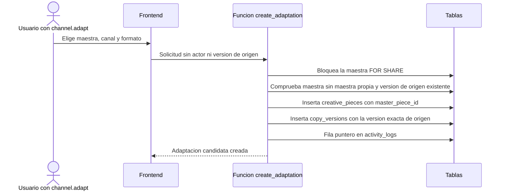

### 7.2 Aprobar una adaptación

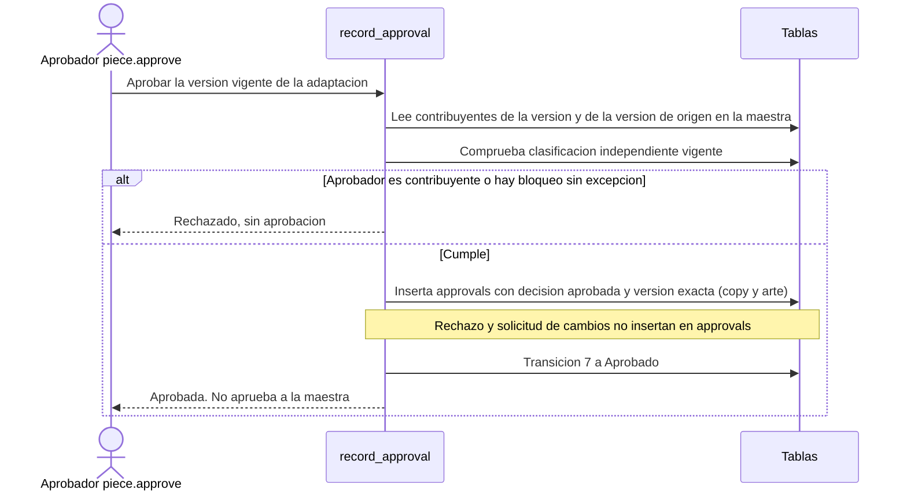

### 7.3 Modificar una maestra

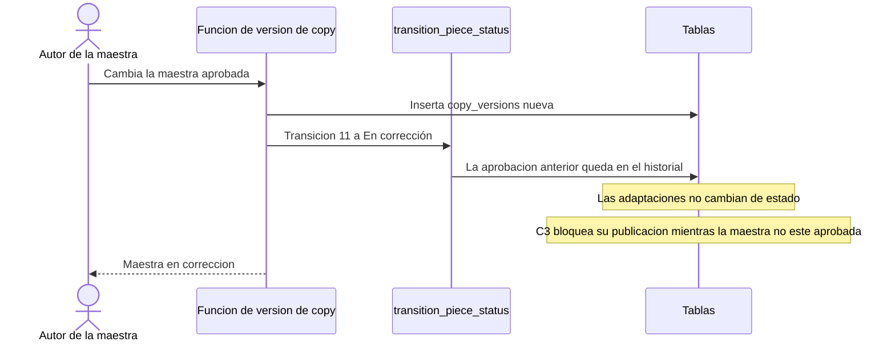

### 7.4 Evaluar impacto

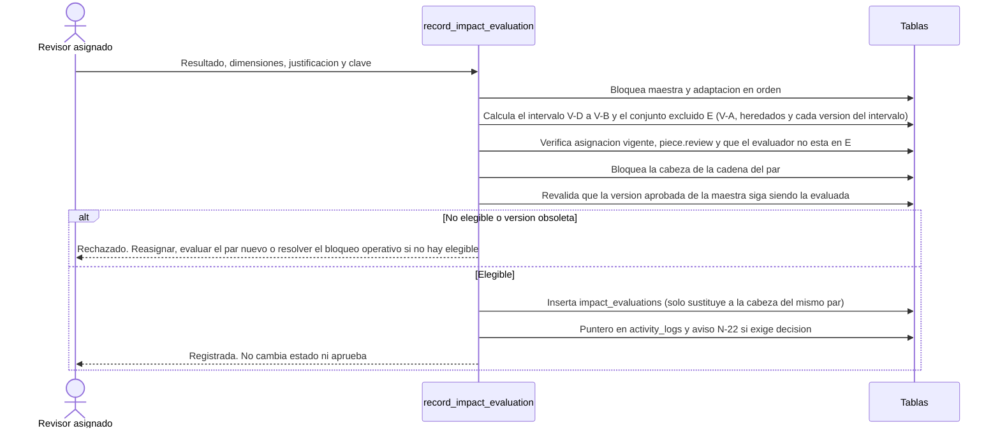

### 7.5 Reabrir una adaptación

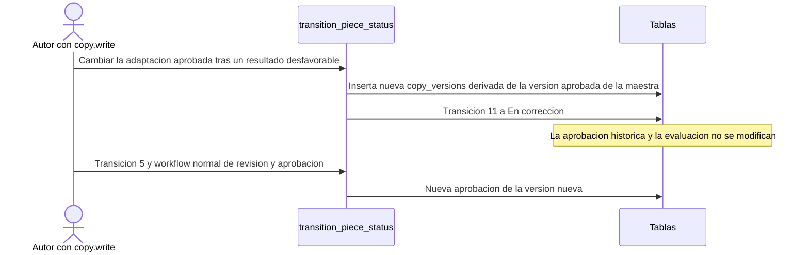

### 7.6 Intentar publicar sin aprobación

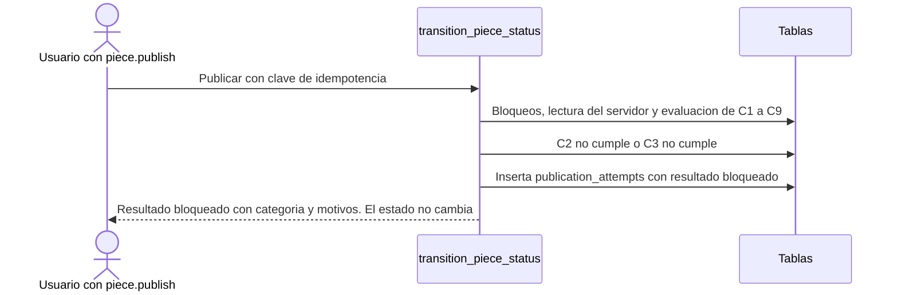

### 7.7 Intentar publicar con impacto desconocido

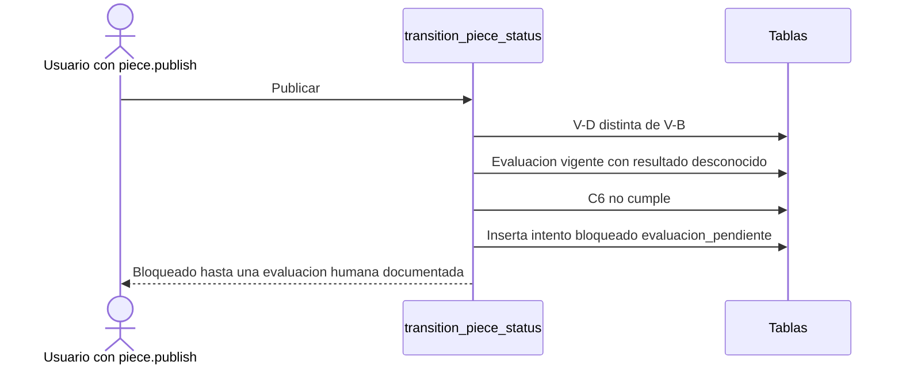

### 7.8 Publicar correctamente

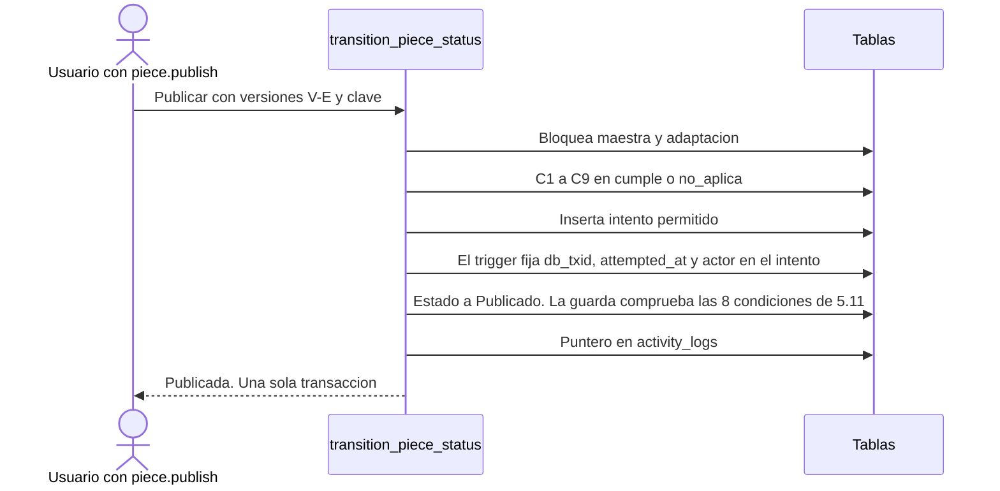

### 7.9 Fallo técnico durante la validación

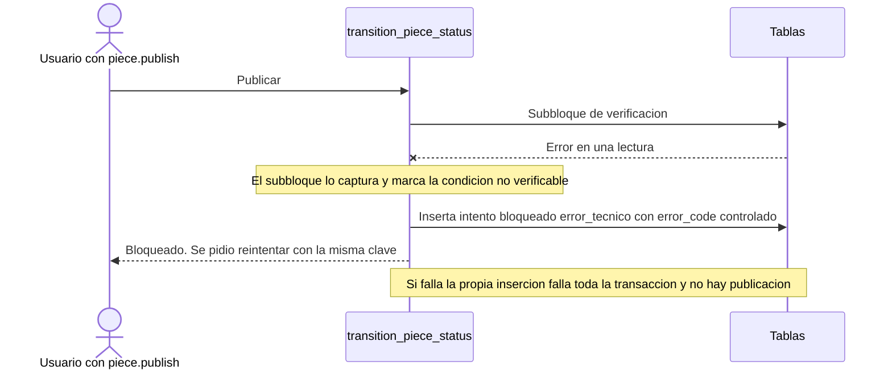

### 7.10 Falla la inserción del intento (escenario C)

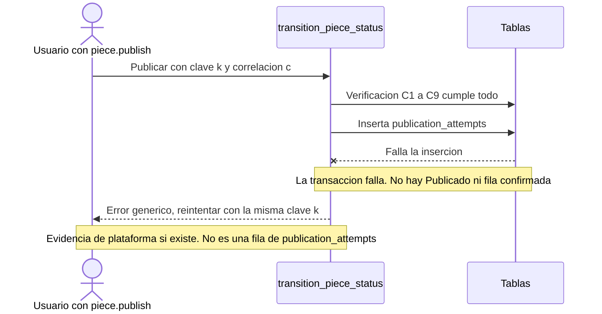

### 7.11 Solicitud sin autenticación o sin membresía (escenario D)

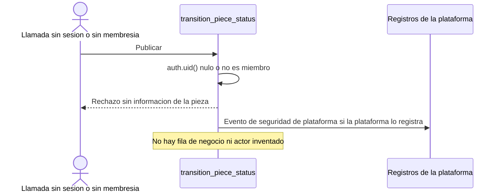

### 7.12 Cambia la maestra con una adaptación ya publicada (DG-15)

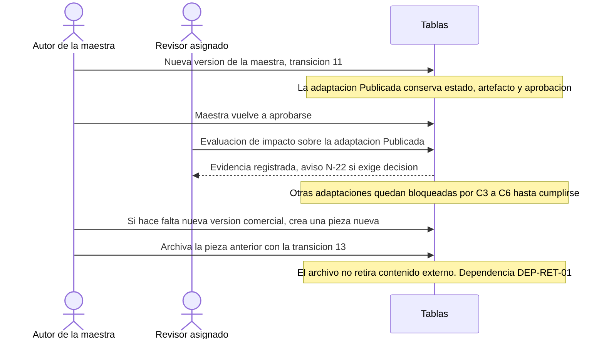

### 7.13 Crear una pieza con canal y formato del catálogo (G-1)

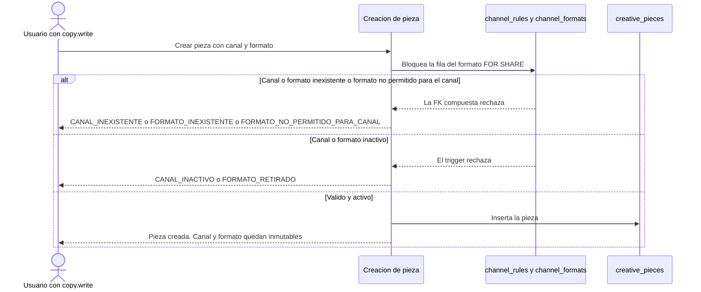

### 7.14 Dar de baja un canal o un formato (G-1)

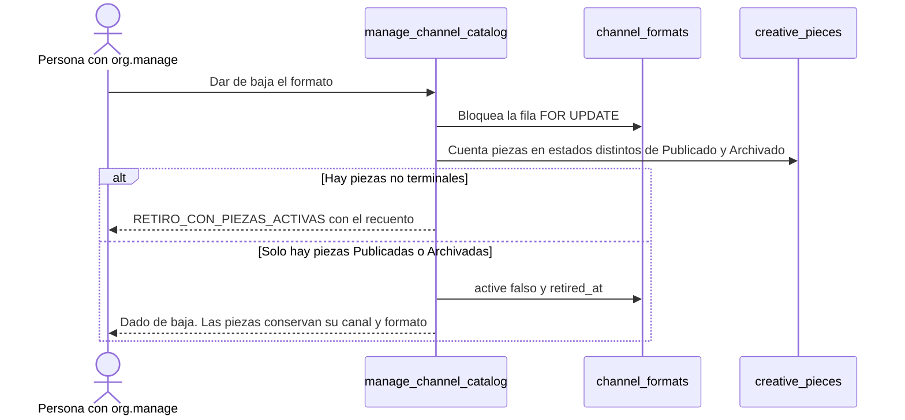

### 7.15 Sustituir una evaluación del mismo par (G-5)

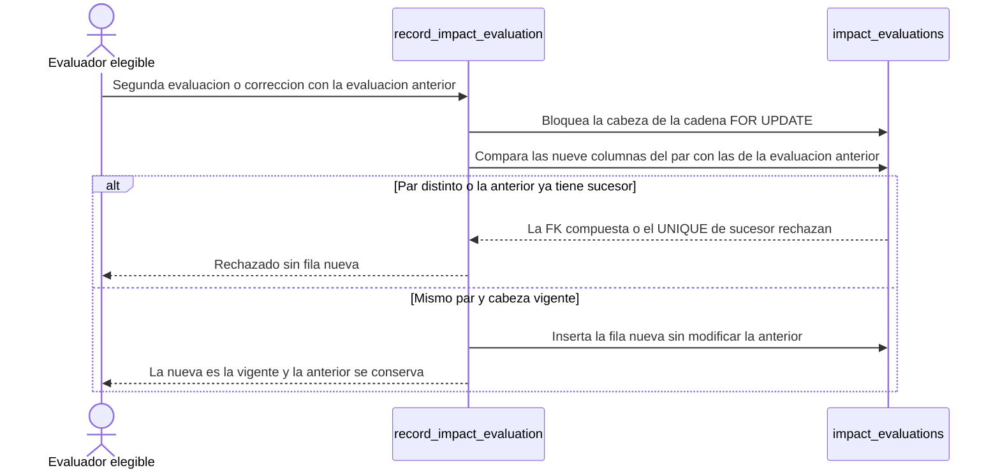

### 7.16 Guarda de db_txid y límites transaccionales (G-10)

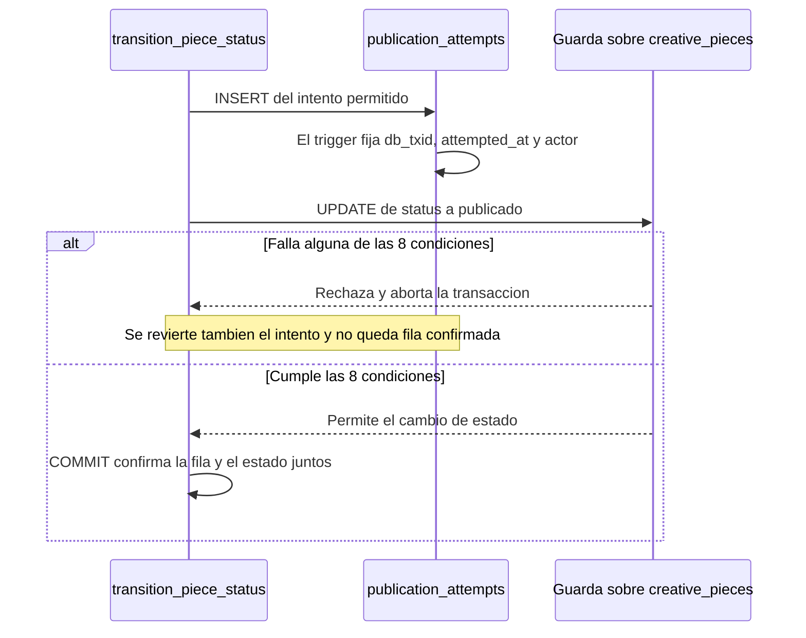


## 8. Seguridad, PostgreSQL y Supabase

### 8.1 Responsabilidades: qué garantiza cada mecanismo y qué no

| Mecanismo | Garantiza | No garantiza |
|---|---|---|
| Restricciones (FK, CHECK, UNIQUE) | Integridad estructural: versiones existentes, misma organización, un solo nivel, cadenas sin ramas, resultados coherentes | Quién actúa, independencia, orden de operaciones ni reglas entre varias filas |
| Triggers | Reglas entre filas y tablas: coherencia de vínculos, inmutabilidad, protección del historial, guarda del estado publicado | Autorización por sí mismos; se pueden deshabilitar con privilegios altos |
| Funciones transaccionales de backend | La lógica de C1 a C9, bloqueos, actor, idempotencia y registro en una transacción | Atomicidad con sistemas externos; protegerse de un privilegio de superusuario |
| RLS | Aislamiento por organización y visibilidad de lectura | **La lógica de publicación**; no controla lo que una función de seguridad definer hace por dentro ni a los roles con BYPASSRLS |
| Privilegios (GRANT y REVOKE) | Que ningún rol de aplicación escriba directamente en los registros ni en `status` | La corrección de la función a la que sí se le concede |
| Aplicación y Edge Functions | Orquestación, mensajes, clave de idempotencia, correlación | Ninguna autoridad: nada que dependa de ellas es un control |

### 8.2 Funciones de backend propuestas

| Función (nombre propuesto) | Qué hace | Permiso |
|---|---|---|
| create_adaptation | Crea la pieza candidata y su primera versión con el vínculo | channel.adapt |
| propose_independence / resolve_independence | Registra propuesta, confirmación, no confirmación o reversión | autor o responsable / piece.review asignado |
| assign_reviewer | Registra asignaciones y retiros | org.manage |
| record_impact_evaluation | Registra la evaluación con todas las validaciones | piece.review asignado |
| version_contributors / eligible_evaluators | Auxiliares de solo lectura que calculan contribuyentes y elegibles | internas |
| transition_piece_status (ampliada) | Verificación C1 a C9, registro del intento y cambio de estado | según la transición |

Todas son `SECURITY DEFINER` con `search_path` vacío y propietario dedicado; ninguna recibe el actor, la fecha ni el resultado como parámetro. Las existentes `record_approval`, `review_finding` y `verify_assets_integrity` no pueden publicar (R-4 de G-7).

### 8.3 Prevención de escrituras directas y de manipulación del actor

- `REVOKE` de INSERT, UPDATE, DELETE y TRUNCATE sobre las cinco tablas nuevas (incluida `channel_formats`) y sobre `channel_rules` a `anon`, `authenticated` y `service_role`; `REVOKE UPDATE (status)` sobre `creative_pieces` a los mismos roles. Los privilegios por defecto de Supabase conceden permisos amplios a esos roles en el esquema público: debe **verificarse y revocarse expresamente** (T-60, T-73; requieren infraestructura real).
- **Dos propietarios de funciones** (nombres propuestos; su creación y viabilidad en Supabase no están verificadas): `cci_state_owner`, dueño solo de `transition_piece_status`, con UPDATE sobre `status` e INSERT en `publication_attempts`; y `cci_records_owner`, dueño de las demás funciones (aprobación, hallazgos, clasificación, asignación, evaluación), con INSERT en sus tablas y **sin** UPDATE sobre `status` ni INSERT en `publication_attempts`. Así ninguna auxiliar puede publicar por privilegios, no solo por no contener el código.
- `REVOKE EXECUTE ... FROM PUBLIC`; EXECUTE de las funciones de usuario solo para `authenticated`. `service_role` no las ejecuta, y las funciones rechazan `auth.uid()` nulo.
- El actor se toma de `auth.uid()`; ninguna función recibe actor, fecha ni resultado. **Dependencia no verificada:** `auth.uid()` lee la identidad de la sesión de la solicitud; quien tenga credenciales de base de datos de administración puede fijarla. Por eso las credenciales de administración de la base no pueden estar en el navegador, en una Edge Function ni en la aplicación.
- El frontend usa solo la clave pública con la sesión del usuario. Una Edge Function que invoque estas funciones debe reenviar el token del usuario, no la clave de servicio: con la de servicio no puede ejecutarlas ni actualizar `status`.

### 8.4 Protección de registros históricos

Privilegios revocados, trigger que rechaza UPDATE y DELETE incluso al propietario de la función y RLS de solo lectura. Contra un superusuario de la plataforma, la mitigación es el hash encadenado opcional y la exportación periódica (DG-12, RR-04).

### 8.5 Concurrencia y bloqueo de versiones

Orden único de bloqueo y matriz de revalidación en 4.10: maestra, adaptaciones por `id`, membresía del actor. Las unicidades parciales y la clave de idempotencia son una segunda barrera. No se presupone aislamiento serializable.

### 8.6 Límites transaccionales y fallos parciales

| Situación | Comportamiento y límite |
|---|---|
| Límite de la transacción | Una llamada a una función es una transacción de PostgreSQL. Dos llamadas encadenadas desde una Edge Function son **dos** transacciones; una Edge Function no da atomicidad entre ellas ni con sistemas externos |
| Storage | Los bytes de un arte no están dentro de la transacción de la base. C8 comprueba filas, hash registrado y objeto, y el resultado de `verify_assets_integrity`; una alteración fuera de la aplicación solo se descarta si el bucket impide sobrescribir objetos (RR-05, prueba T-50) |
| Sistemas externos | El diseño no incluye publicación a canales externos. Si se agregara, requeriría un patrón de bandeja de salida y un estado intermedio no previsto en T-02; no se inventa |
| IA (Cohere) | No participa en ninguna condición; no hay análisis semántico automático |
| Verificación fallida | Bloquea; nunca se supone cumplida |
| Registro fallido | Falla toda la operación; ver 5.8 |
| Reintento | Con la misma clave devuelve el resultado almacenado |

### 8.7 Matriz de acceso por rol

Lo que el diseño **propone** conceder (todo lo demás está revocado). La verificación real de los privilegios exige infraestructura que no existe.

| Objeto | anon | authenticated | service_role | Propietario de funciones de estado (cci_state_owner) | Propietario de funciones de registros (cci_records_owner) | Roles internos de la plataforma (postgres, administración) |
|---|---|---|---|---|---|---|
| creative_pieces.status | Ninguno | SELECT por RLS; sin UPDATE | Sin UPDATE (revocado) | UPDATE (solo transition_piece_status) | Sin UPDATE | No se afirma control (RR-04) |
| creative_pieces, otras columnas | Ninguno | Según las políticas vigentes de v3.3 | Sin escritura directa | Lo necesario para la transición | Lo necesario para sus funciones | No restringido |
| publication_attempts | Ninguno | SELECT propio o con org.manage | Sin acceso de escritura; sin SELECT | INSERT | Sin INSERT | No restringido |
| impact_evaluations | Ninguno | SELECT según visibilidad de la adaptación | Sin escritura | Sin INSERT | INSERT | No restringido |
| piece_classification_events | Ninguno | SELECT según visibilidad de la pieza | Sin escritura | Sin INSERT | INSERT | No restringido |
| piece_reviewer_assignments | Ninguno | SELECT según visibilidad de la pieza | Sin escritura | Sin INSERT | INSERT | No restringido |
| approvals | Ninguno | SELECT según v3.3; sin escritura directa | Sin escritura | Lectura | INSERT (record_approval) | No restringido |
| EXECUTE de transition_piece_status | Ninguno | Sí | No | Propietaria | No | No restringido |
| EXECUTE de funciones de registros | Ninguno | Sí, con sus permisos de negocio | No | No | Propietaria | No restringido |

### 8.8 Demostración documental de las rutas de publicación

Es una demostración **sobre el diseño**: cada fila indica el mecanismo, la regla y la prueba, y si depende de infraestructura no verificada.

| Garantía | Mecanismo | Reglas | Pruebas | Depende de infraestructura no verificada |
|---|---|---|---|---|
| La única ruta que deja Publicado es la función transaccional autorizada | Único propietario con UPDATE(status) más guarda de trigger con db_txid | IS-01, IG10-21 | T-60, T-70 | Sí: roles y privilegios de Supabase |
| Ningún usuario actualiza status directamente | Revocación de UPDATE(status) a anon, authenticated y service_role | IS-02 | T-60 | Sí: privilegios por defecto |
| Ninguna función auxiliar publica | Propietario distinto sin UPDATE(status) ni INSERT en intentos | IS-03 | T-40, T-71 | Sí: creación de roles |
| La Edge Function no suplanta con una clave privilegiada | EXECUTE revocado a service_role; la función rechaza auth.uid() nulo | IS-04 | T-61 | Sí; y que las credenciales de administración no estén en la Edge Function |
| El actor sale de la identidad autenticada | auth.uid() dentro de la función; sin parámetro de actor | IS-05 | T-43 | Sí: modelo de sesión de la plataforma |
| Los registros no admiten escritura directa | Privilegios revocados más trigger | IS-06 | T-38, T-73 | Sí |
| RLS y privilegios se distinguen | RLS: lectura y aislamiento; privilegios y funciones: escritura y lógica | IS-07 | T-73 | No: es una distinción de diseño |
| C1 a C9 se verifican en backend | Dentro de la función, con datos del servidor | IS-08 | T-72 | No: diseño; Sí para probarlo |
| Una condición no verificable bloquea | Tres valores; solo cumple o no aplica permiten | IS-09 | T-33, T-46, T-50 | No |
| Un fallo de registro nunca habilita la publicación | Fila y estado en la misma transacción; guarda de trigger | IS-10, IG10-08 | T-34, T-57 | Sí: comportamiento real de la base |

### 8.9 Definición de las funciones (propuesta; ninguna existe en v3.3 salvo las indicadas)

**Atributos comunes de las funciones de usuario:** `SECURITY DEFINER` con `SET search_path = ''` (objetos con esquema explícito); `REVOKE ALL ... FROM PUBLIC`; `EXECUTE` solo para `authenticated`; la identidad es `auth.uid()` (nulo se rechaza) y ningún parámetro es actor, fecha, resultado, `db_txid` ni condición; el error al cliente es un código controlado, sin texto de excepción. Atomicidad: cada función es una sola transacción. Propietarios propuestos: `cci_state_owner` y `cci_records_owner` (8.3; viabilidad en Supabase no verificada).

| Función | Propietario | Parámetros (sin actor) | Validaciones y bloqueos | Resultado |
|---|---|---|---|---|
| create_adaptation | records_owner | organización, maestra, canal, formato, clave, texto de la primera versión, versión de origen | channel.adapt; maestra Aprobado o Publicado con versión vigente aprobada; catálogo activo (3.14); clave única. Bloqueos: maestra FOR SHARE, catálogo FOR SHARE | Pieza y versión; errores de catálogo o clave |
| propose_independence | records_owner | adaptación, justificación no vacía | Autor o responsable; secuencia vigente. Bloqueos: maestra FOR SHARE, adaptación FOR UPDATE | Evento de propuesta |
| resolve_independence | records_owner | evento de propuesta, decisión, justificación no vacía | piece.review asignado y fuera del conjunto excluido; revalida la secuencia. Bloqueos: 1, 2, 3 | Evento de confirmación, no confirmación o reversión |
| assign_reviewer | records_owner | adaptación, revisor, acción, motivo no vacío | org.manage (DG-07); el revisor tiene piece.review y no está en E (informativo); no concede permisos. Bloqueos: 1, 2 | Fila de asignación; historial |
| version_contributors | records_owner, interna | pieza, versión | Solo lectura (STABLE); aplica T-04; EXECUTE solo para otras funciones, no para authenticated | Conjunto Ctr(v) |
| eligible_evaluators | records_owner | adaptación, V-A, V-D y V-B | Solo lectura; el llamador necesita org.manage o piece.review en la organización; usa version_contributors sobre el intervalo (4.4.2) | Identificadores de miembros elegibles; vacío si no hay (IG5-34) |
| record_approval (existente en v3.3, ampliada) | records_owner | pieza, versión, auditoría considerada, excepciones | piece.approve; independencia; estado; bloqueos confirmados; escribe `decision = 'aprobada'`. Bloqueos: 1 FOR SHARE, 2 | Fila de approvals; no cambia el estado por sí sola |
| record_impact_evaluation | records_owner | adaptación, versiones citadas, resultado, siete dimensiones, justificación, motivo si desconocido, clave, `client_correlation_id` opcional y, si sustituye, la evaluación anterior | Asignación vigente, piece.review, fuera de E, V-B vigente aprobada, par y cabeza de la cadena; trigger repite la comprobación. Bloqueos: 1 FOR SHARE, 2, 3 y cabeza FOR UPDATE | Fila de impact_evaluations; errores de elegibilidad, versión obsoleta o par |
| transition_piece_status (existente, ampliada) | state_owner | pieza, transición pedida, comentario o motivo, versiones citadas y clave cuando es Publicado | Permiso de T-02 por transición; para #10, C1 a C9 y la guarda (5.11). Bloqueos: 1 FOR SHARE, 2, 3 | Estado nuevo; fila de publication_attempts en #10 |
| manage_channel_catalog | records_owner | acción (crear, dar de baja, reactivar), canal, formato | org.manage; normalización; baja solo sin piezas no terminales. Bloqueo: 4 (catálogo FOR UPDATE) | Fila del catálogo; recuento de piezas afectadas |

`record_approval`, `review_finding` y `verify_assets_integrity` no pueden publicar (R-4 de G-7). Los triggers de guarda y de asset_match pertenecen a `cci_state_owner` y `cci_records_owner` respectivamente.


## 9. Impacto en las 27 tablas

| Requisito | Tabla actual relacionada | Capacidad existente | Brecha | Cambio requerido |
|---|---|---|---|---|
| Identidad de maestra y adaptación | creative_pieces | Pieza por canal y formato, con estado y versión vigente | Sin vínculo a maestra; columnas de canal y formato sin tipos (G-2) | Columnas master_piece_id, is_adaptation, master_ref_is_adaptation, channel, format, adaptation_key y restricciones |
| Canal y formato válidos | channel_rules y channel_formats | channel_rules: una fila por organización y canal (v3.3); channel_formats es tabla nueva propuesta | v3.3 no define formatos | Estructura mínima de ambas en 1.8; unique(organización, canal) y unique(organización, canal, formato); FK compuesta desde creative_pieces desde la primera pieza |
| Versión exacta de la maestra de origen | copy_versions | Versiones inmutables; parent_version_id solo dentro de una pieza | No hay versión de origen entre piezas | Tres columnas y FK compuestas |
| Arte de origen | creative_assets | Arte por versión con hash SHA-256 | Sin FK compuesta que valide arte y copy | unique(organization_id, piece_id, id, copy_version_id) |
| Integridad entre organizaciones | Todas (T-09, no aprobada) | FK compuestas propuestas | T-09 sin aprobar | Mismo patrón en las tablas nuevas; si T-09 no se aprueba, se mantiene en estas |
| Autoría heredada | copy_versions.created_by; creative_assets (quien sube) | Autoría por versión (T-04) | No hay herencia desde la maestra | Cálculo derivado; sin columnas |
| Clasificación y su historial | activity_logs | Auditoría general e inmutable | No demuestra contenido ni impone «distinto del proponente» | piece_classification_events |
| Revisor asignado | memberships, role_permissions | Roles y permisos por clave | Sin asignación por pieza (D-02) | piece_reviewer_assignments |
| Aprobación positiva ligada a la versión exacta | approvals | Inmutable, versión exacta, independencia (record_approval y trigger) | v3.3 no distingue aprobación de rechazo en la fila (RR-17) y la FK no fija el arte | decision text NOT NULL CHECK = 'aprobada' (DG-20), unique(organization_id, id, copy_version_id) y trigger asset_match (4.13) |
| Registro de evaluación de impacto | activity_logs | Genérico | Sin estructura (G-5) | impact_evaluations |
| Control de publicación | creative_pieces.status y transition_piece_status | Única vía de cambio de estado; #10 solo pide que la versión aprobada sea la vigente | No verifica maestra, evaluación ni registra intentos | Ampliar la función; guarda de trigger |
| Bloqueos comerciales | audit_findings, commercial_block_exceptions | Hallazgo confirmado y excepción por versión | Ninguna | Se reutiliza para C7 |
| Integridad de artes | creative_assets, verify_assets_integrity | Hash y verificación | No es transaccional con Storage | C8 con límite declarado |
| Registro de intentos | activity_logs | Registra transiciones | No demuestra intentos rechazados ni sobrevive a una reversión (G-10) | publication_attempts |
| Permisos | role_permissions (17 claves) | channel.adapt, piece.review, piece.publish, org.manage | Ninguna | Sin claves nuevas |
| Aislamiento y lectura | RLS por organization_id | Aislamiento por organización | Tablas nuevas | Mismo patrón |
| Notificaciones | Matriz de notificaciones (N-22) | Definidas con limitación | Ninguna estructural | Sin cambio |

**Reutilizable sin cambio (22 de 27):** organizations, profiles, memberships, role_permissions, membership_permission_grants, brand_guidelines, brand_guideline_versions, campaigns, briefs, audits, audit_findings, comments, promotion_rules, performance_metrics, ab_tests, ai_runs, ai_prompt_versions, activity_logs, audit_rubric_versions, validation_settings_versions, ai_quotas y commercial_block_exceptions. **Con cambio:** creative_pieces y copy_versions (columnas), channel_rules (una columna y una única), creative_assets y approvals (solo una restricción única) y la función transition_piece_status. **Nuevas:** 4. Total propuesto: **32 tablas**; las 27 permanecen como línea base histórica.

**Justificación de cada elemento nuevo:**

| Elemento | Por qué es necesario |
|---|---|
| piece_classification_events | Historial con restricción de proponente distinto y secuencia; no cabe en activity_logs genérico |
| piece_reviewer_assignments | Sin asignación no hay «revisor asignado»; una columna perdería el historial de reasignaciones que prueba la independencia |
| impact_evaluations | Evidencia ligada a un par exacto de versiones con claves y CHECK; no cabe en comments ni en activity_logs |
| publication_attempts | Debe sobrevivir a la no publicación; activity_logs no demuestra intentos rechazados ni su persistencia |
| master_piece_id, is_adaptation, master_ref_is_adaptation | Vínculo y garantía de un nivel |
| replaces_piece_id (opcional, DG-18) | Trazabilidad estructural de una pieza nueva que reemplaza a una Publicada |
| channel_formats (tabla nueva) | Validar el formato de cada pieza contra su canal mediante FK |
| channel, format, adaptation_key | Identificar canal y formato (G-2) y distinguir adaptaciones múltiples |
| master_copy_version_id y master_creative_asset_id en copy_versions | Versión exacta de origen; sin ellas no existen V-D ni contribuciones heredadas |

## 10. Matriz de permisos y matriz RLS

### 10.1 Permisos

| Operación | Función propuesta | Permiso | Restricciones | Quién no puede |
|---|---|---|---|---|
| Crear adaptación | create_adaptation | channel.adapt (copy.write y asset.upload para el contenido) | Maestra de su organización y sin maestra propia | Quien no vea la maestra |
| Proponer independencia | propose_independence | Autor o responsable de la pieza (sin clave nueva) | No concede permisos | Cualquier otro |
| Confirmar, no confirmar o revertir | resolve_independence | piece.review del revisor asignado | Distinto del proponente; la reversión no procede si está Publicada | El proponente, Admin y el propietario por ese solo título |
| Asignar o retirar revisor | assign_reviewer | org.manage | El asignado debe tener piece.review; asignar no concede permisos | Quien no tenga org.manage |
| Evaluar impacto | record_impact_evaluation | piece.review y asignación vigente | Fuera del conjunto excluido E (V-A, herencia y versiones del intervalo V-D a V-B); otro evaluador para levantar un bloqueo; solo sustituye a la cabeza del mismo par | Contribuyentes, Admin, propietario, cualquier rol sin asignación |
| Aprobar la adaptación | record_approval (existente, escribe decision = 'aprobada') | piece.approve | Independencia con contribución heredada; la evaluación no la sustituye; el rechazo no inserta en approvals | Contribuyentes |
| Publicar | transition_piece_status | piece.publish | C1 a C9 | Cualquiera que incumpla una condición |
| Leer clasificaciones, asignaciones y evaluaciones | Consulta con RLS | content.read y visibilidad de la pieza | Mismos límites que la pieza | Otras organizaciones |
| Leer detalle de intentos | Consulta con RLS | org.manage; cada actor sus propios intentos | Sin clave nueva | Resto |
| Administrar el catálogo de canales y formatos | manage_channel_catalog | org.manage | Baja solo sin piezas no terminales; sin DELETE | Quien no tenga org.manage |
| Escribir en los registros | — | Ninguno | Solo las funciones | Todos los roles de aplicación |

Las 17 claves físicas quedan igual; ninguna operación requiere una clave 18. `delegation.manage` y `block.exception.revoke` siguen siendo capacidades conceptuales.

### 10.2 RLS

| Tabla | SELECT | INSERT | UPDATE | DELETE |
|---|---|---|---|---|
| piece_classification_events | Miembros que pueden ver la pieza (misma organización) | Sin política; solo la función | Sin política; privilegio revocado y trigger | Sin política; privilegio revocado y trigger |
| piece_reviewer_assignments | Ídem | Ídem | Ídem | Ídem |
| impact_evaluations | Miembros que pueden ver la adaptación | Ídem | Ídem | Ídem |
| publication_attempts | El propio actor, o quien tenga org.manage en la organización | Ídem | Ídem | Ídem |
| channel_rules y channel_formats | Miembros de la organización (RLS por organización) | Sin política; solo manage_channel_catalog; privilegio revocado | Sin política; privilegio revocado y trigger (channel y format no se modifican) | Sin política; privilegio revocado y trigger |
| approvals | Miembros de la organización según v3.3 | Sin política; solo record_approval | Sin UPDATE | Sin DELETE |
| creative_pieces y copy_versions | Sin cambio de política | Sin cambio; las columnas de vínculo las valida la función y los triggers | master_piece_id inmutable; status solo por la función | Sin DELETE desde la aplicación |

RLS es **lectura y aislamiento**; la autoridad sobre la publicación es de la función, no de RLS (8.1).

## 11. Matriz de pruebas

Tipos: **Diseño** (comprobable documentalmente), **Ejecutable futura** (pruebas con esquema local cuando se autorice) e **Infraestructura real** (requieren Supabase real, concurrencia real o Storage). **Ninguna se ha ejecutado**: lo que sí se hizo es una validación documental por script (11.2).

**Nota de nomenclatura.** Los identificadores T-01 a T-11 de esta matriz coinciden con los de las decisiones técnicas de v3.3 (T-01 a T-11). En el texto, T-02 (transiciones), T-03, T-04, T-05, T-06 y T-09 sin otra indicación se refieren a v3.3; las filas de la tabla siguiente son pruebas. A partir de T-12 no hay ambigüedad.

| ID | Requisito cubierto | Condición inicial | Acción | Resultado esperado | Riesgo cubierto | Criterio de aceptación | Tipo | Reglas |
|---|---|---|---|---|---|---|---|---|
| T-01 | Relación maestra–adaptación válida | Maestra M aprobada; adaptación A creada por quien tiene channel.adapt | Crear A con master_piece_id = M y primera versión derivada de la versión 1 de M | Se crean A y su versión con vínculo a M v1 | Adaptación sin vínculo trazable | Fila creada; la versión guarda M, v1 y arte si lo hay | Ejecutable futura | IG1-01, IG1-02, IG1-08 |
| T-02 | Adaptación sin maestra | Pieza marcada como adaptación (candidata) sin master_piece_id | Intentar crear una versión con master_copy_version_id y sin maestra en la pieza | Rechazo por trigger de coherencia | Versión derivada de una maestra inexistente | La operación falla; no queda fila | Ejecutable futura | IG1-02, IG1-11 |
| T-03 | Referencia a versión inexistente | Maestra M con versiones 1 y 2 | Crear versión de A derivada de una versión 9 o de una versión de otra pieza | Rechazo por la FK compuesta | Referencia colgante o cruzada | La operación falla por violación de FK | Ejecutable futura | IG1-08, IG1-09, IG1-05 |
| T-04 | Referencia circular | A es adaptación de M | Poner M como adaptación de A, o A como maestra de sí misma | Rechazo: CHECK, FK compuesta de un nivel y trigger | Ciclos y cadenas | Ninguna actualización prospera | Ejecutable futura | IG1-03, IG1-04, IG1-06, IG1-07 |
| T-05 | Varias adaptaciones de una maestra | M aprobada | Crear A1 (Instagram), A2 (WhatsApp) y A3 (Instagram, otra clave) | Las tres existen; un duplicado con la misma clave se rechaza | Colisión de adaptaciones | Tres filas; la cuarta con clave repetida falla | Ejecutable futura | IG1-13, IG1-14 |
| T-06 | Versiones independientes | A1 en v3 y A2 en v1; M en v2 | Crear versión nueva de A1 | Solo A1 avanza; A2 y M no cambian | Versionado acoplado | Contadores y estados independientes por pieza | Ejecutable futura | IG1-14, IG1-10 |
| T-07 | — | Adaptación propuesta por su autor | El autor intenta confirmar su propia propuesta | Rechazo | Autoconfirmación de independencia | Rechazo con motivo; sin evento de confirmación | Ejecutable futura | IG1-17 |
| T-08 | — | Adaptación candidata sin confirmación | Intentar #7 o publicar | Rechazo de T-02 #7 y #10 | Publicar variación como pieza independiente | Ambas transiciones bloqueadas y la de publicación registrada | Ejecutable futura | IG1-15, IG1-16, IG10-01 |
| T-09 | — | Adaptación independiente aprobada | Reversión a variación interna | Evento de reversión; aprobaciones y versiones intactas; no publicable | Pérdida de historial | El historial muestra los eventos en orden; hash de aprobaciones sin cambio | Ejecutable futura | IG1-18, IG1-19, IG1-16 |
| T-10 | — | Versión de A derivada de v1 de M escrita por X; v1 de M escrita por Y | Y intenta aprobar la versión de A | Rechazo por contribución heredada | Aprobación no independiente | El conjunto de contribuyentes de la versión incluye a Y | Ejecutable futura | IG1-12, IG1-21 |
| T-11 | — | Maestra con adaptaciones | Intentar borrar la maestra, una versión o un arte | Rechazo RESTRICT | Pérdida de versiones históricas | Sin DELETE posible; solo archivado | Ejecutable futura | IG1-20 |
| T-12 | Evaluación sin impacto | A v1 aprobada derivada de M v1; M v2 aprobada; revisor asignado independiente | Registrar evaluación sin_impacto_material con siete dimensiones no afectadas | Fila inmutable; la aprobación de A se conserva; C4 satisfecha | Aprobación sin evidencia | Evaluación vigente; ningún cambio de estado | Ejecutable futura | IG5-01, IG5-09, IG5-10, IG5-11, IG5-17 |
| T-13 | Evaluación con impacto | Igual que T-12 | Registrar requiere_revision con precio afectado | A no se publica; se exige nueva versión (#11) y workflow | Publicar con contenido desactualizado | C5 bloquea; tras versión nueva derivada de M v2 y aprobada, C4 deja de aplicar | Ejecutable futura | IG5-10, IG5-11, IG5-17, IG10-03 |
| T-14 | Impacto desconocido | Igual que T-12 | Registrar desconocido con motivo | Publicación bloqueada hasta una evaluación documentada | Suponer validez sin evidencia | C6 bloquea; sin motivo la inserción falla | Ejecutable futura | IG5-09, IG5-14, IG10-04 |
| T-15 | Evaluador que contribuyó a la versión | El revisor asignado escribió el copy de V-A, o de la versión de M evaluada | Intentar registrar la evaluación | Rechazo | Autoevaluación | Sin fila; el motivo es de independencia | Ejecutable futura | IG5-05, IG5-06 |
| T-16 | Revisor no elegible | El revisor asignado no es independiente; existe otro elegible | Registrar con el no elegible; luego reasignar y registrar con el otro | Primera rechazada; segunda aceptada; ambas asignaciones conservadas | Revisor no autorizado | Historial de asignaciones con dos filas; una evaluación | Ejecutable futura | IG5-04, IG5-08 |
| T-17 | Revisor no elegible | Nadie elegible en la organización | Intentar registrar y publicar | No se registra nada; la publicación sigue bloqueada; ningún rol obtiene la facultad | Escalada de autoridad | Intento de publicación bloqueado con evaluacion_pendiente | Ejecutable futura | IG5-07, IG10-01 |
| T-18 | Segunda evaluación | Evaluación desconocida vigente | Registrar segunda evaluación sin_impacto_material por otra persona | Nueva fila; la anterior se conserva; la nueva es la vigente | Perder el rastro | Cadena de dos filas; cabeza correcta | Ejecutable futura | IG5-13, IG5-14, IG5-15 |
| T-19 | Segunda evaluación | Evaluación desfavorable del evaluador P | P intenta levantarla con sin_impacto_material | Rechazo | Un solo evaluador cambia su dictamen para desbloquear | Debe ser otra persona elegible | Ejecutable futura | IG5-15 |
| T-20 | Corrección de evaluación | Evaluación equivocada | Registrar corrección con motivo no vacío (el mínimo de 30 caracteres es propuesta pendiente de T-03) | Nueva fila kind = correccion; la anterior intacta | Reescritura del historial | Dos filas; sin UPDATE ni DELETE posible | Ejecutable futura | IG5-12, IG5-13 |
| T-21 | Corrección de evaluación | Evaluación vigente | Dos correcciones simultáneas sobre la misma evaluación | Una prospera; la otra falla por unique(supersedes) | Ramas de la cadena | Cadena lineal | Ejecutable futura | IG5-14, IG5-19 |
| T-22 | — | Evaluación sin_impacto vigente y A aprobada | Intentar usar la evaluación para publicar con A sin aprobación de su versión | Bloqueo por C2 | Evaluación que sustituye una aprobación | La evaluación nunca satisface C2 | Ejecutable futura | IG5-17, IG10-17 |
| T-23 | — | Una evaluación se prepara sobre M v2 | M se aprueba en v3 antes de confirmar | Rechazo por versión obsoleta | Evaluar una versión que ya no es la vigente | Se pide evaluar el par V-D → v3 | Ejecutable futura | IG5-16 |
| T-24 | — | Reintento de la misma evaluación con la misma clave | Repetir la solicitud | Se devuelve la fila existente | Duplicados por reintento | Una sola fila | Ejecutable futura | IG5-19 |
| T-25 | — | A ya Publicada; M cambia y se aprueba | Registrar evaluación | Se registra evidencia y aviso; el estado de A no cambia | Transición inventada | Sin cambio en T-02; 13 transiciones | Ejecutable futura | IG5-20, IG5-17 |
| T-26 | Intento de publicación sin aprobación maestra | A aprobada; M en En corrección | Publicar A | Bloqueado; categoría sin_aprobacion_maestra | Publicar sin maestra aprobada | Fila bloqueada con C3 en no_cumple | Ejecutable futura | IG10-01, IG10-03, IS-08 |
| T-27 | Intento sin aprobación de adaptación | A en Pendiente de aprobación; M aprobada | Publicar A | Bloqueado; C2 | Publicar sin aprobación | Estado de A intacto | Ejecutable futura | IG10-01, IG10-03 |
| T-28 | Intento con impacto pendiente | A aprobada; M aprobada en versión posterior; sin evaluación | Publicar A | Bloqueado; evaluacion_pendiente | Publicar con maestra cambiada | C4 no_cumple | Ejecutable futura | IG10-03, IG10-04 |
| T-29 | Intento con impacto desfavorable | Evaluación requiere_revision vigente sobre el par | Publicar A | Bloqueado; evaluacion_desfavorable | Publicar sin revisar impacto | C5 no_cumple | Ejecutable futura | IG10-03 |
| T-30 | Intento con bloqueo comercial | Hallazgo crítico confirmado sin excepción en A o en M | Publicar | Bloqueado; bloqueo_comercial_critico; con excepción vigente, C7 cumple | Burlar bloqueos comerciales | C7 según PO-02, PO-12 y PO-15 | Ejecutable futura | IG10-03 |
| T-31 | Intento sin permisos | Actor sin piece.publish | Publicar | Bloqueado; falta_de_permisos; las demás condiciones no se evalúan | Fuga de información a quien no puede publicar | Fila con C1 no_cumple y el resto no_evaluada | Ejecutable futura | IG10-02, IG10-15 |
| T-32 | Intento con versiones inconsistentes | A vigente v4 aprobada en v4; cliente cita v3 | Publicar | Bloqueado; inconsistencia_versiones | Publicar una versión distinta de la aprobada | C9 no_cumple con ambas versiones registradas | Ejecutable futura | IG10-03, IG10-05 |
| T-33 | Intento con error de backend | Se fuerza una falla dentro de la verificación (por ejemplo, un dato ilegible) | Publicar | Resultado bloqueado con error_tecnico; fila escrita; estado intacto | Publicar por falla de la verificación | Fila con error_code controlado | Ejecutable futura | IG10-04, IG10-09, IG10-10, IG10-16, IS-09 |
| T-34 | Fallo al registrar auditoría | Se fuerza una falla al insertar el intento | Publicar (que cumpliría todo) | Toda la transacción falla: A no queda Publicada y no existe fila confirmada | Publicar sin evidencia confirmada | Estado intacto; ninguna fila; la evidencia de plataforma, si existe, no se presenta como fila | Infraestructura real | IG10-08, IG10-11, IS-10, IG10-01 |
| T-35 | Duplicación concurrente | Dos solicitudes de publicación idénticas con distinta clave | Ejecutarlas a la vez | Una publica; la otra queda bloqueada y registrada | Doble publicación | Una transición #10; dos filas de intento | Infraestructura real | IG10-06, IG10-07, IG10-08, IG10-20 |
| T-36 | Duplicación concurrente | Misma clave repetida | Reenviar | Se devuelve el resultado almacenado | Reintentos que repiten efectos | Una fila; efectos únicos | Ejecutable futura | IG10-06, IG10-20 |
| T-37 | Modificación concurrente de maestra | A se publica mientras M se modifica o se revoca su aprobación | Ejecutarlas a la vez | Se serializan por el bloqueo maestra → adaptación; la verificación ve un estado consistente | Verificar y publicar con datos cambiados | Resultado válido en cualquier orden; sin interbloqueo | Infraestructura real | IG10-08, IG10-03, IG5-25 |
| T-38 | Intento de modificar historial | Filas existentes | UPDATE o DELETE por authenticated, service_role y por la función de un usuario | Rechazo por privilegios y trigger | Reescritura de auditoría | Ningún cambio; el intento de modificar queda en los registros de la plataforma | Ejecutable futura | IG10-14, IG5-12, IG1-18, IS-06 |
| T-39 | Intento de omitir validación por llamada directa | Sesión de usuario con piece.publish | UPDATE directo de creative_pieces.status a publicado o llamada con credencial de servicio | Rechazo: sin privilegio y por la guarda del trigger | Evadir C1 a C9 | Estado intacto | Infraestructura real | IG10-12, IG10-13, IS-01, IS-02 |
| T-40 | Intento de omitir validación por llamada directa | Función auxiliar record_approval o review_finding | Llamarla con la intención de publicar | No puede publicar; solo registra su resultado | Ruta alterna | R-4 de G-7 cumplido | Ejecutable futura | IG10-13, IG10-17, IS-03 |
| T-41 | Acceso no autorizado a registros | Usuario de otra organización | SELECT sobre las tablas nuevas | Cero filas | Fuga entre organizaciones | RLS devuelve vacío en las cuatro | Infraestructura real | IG10-15, IS-07 |
| T-42 | Acceso no autorizado a registros | Usuario sin org.manage | Consultar el detalle completo de intentos ajenos | Cero filas; solo ve sus propios intentos | Exposición de contexto de auditoría | Política por actor y por org.manage | Infraestructura real | IG10-15, IS-07 |
| T-43 | — | Parámetro actor_id en la llamada | Enviar un actor distinto | El parámetro no existe; se usa auth.uid() | Suplantación | Firma sin parámetro de actor | Ejecutable futura | IG10-05, IS-05 |
| T-44 | — | Intento permitido | Publicar con todo en regla | Fila permitido con C1 a C9 en cumple o no_aplica y la transición #10 | Cobertura sin ledger de éxitos | Una fila por publicación | Ejecutable futura | IG10-03, IG10-08, IG10-01 |
| T-45 | — | Pieza ya Publicada | Publicar de nuevo con otra clave | Bloqueado con ESTADO_NO_APROBADO | Re-publicación | Fila bloqueada | Ejecutable futura | IG10-07 |
| T-46 | — | Dos evaluaciones con la misma raíz o una cadena ramificada simulada | Publicar | Bloqueado por EVALUACION_AMBIGUA | Dictamen ambiguo | imposibilidad_verificar | Ejecutable futura | IG5-14, IG10-04, IS-09 |
| T-47 | — | Cinco tablas y columnas propuestas | Revisar claves, T-02 y 27 tablas | 17 claves y 13 transiciones sin cambio | Ampliación encubierta | Sin cambio en role_permissions ni en la tabla de transiciones | Diseño | IG5-17, IG1-21, IP-01 |
| T-48 | — | Registro de intentos bloqueados | Contar retención | Ningún mecanismo de borrado desde la aplicación | Pérdida de evidencia | Retención solo por archivo | Diseño | IG10-18 |
| T-49 | — | Evaluación con revisor asignado | Revisar estado de resolución | Derivado, no almacenado | Estado almacenado que se desincroniza | No hay columna de estado en impact_evaluations | Diseño | IG5-18 |
| T-50 | — | Candidata con arte de V-A | Alterar el arte en Storage fuera de la aplicación | C8 bloquea por INTEGRIDAD_NO_VERIFICABLE o ARTE_INCONSISTENTE | Publicar un arte alterado | Depende de la inmutabilidad del bucket y de verify_assets_integrity | Infraestructura real | IG10-04, IG10-03, IS-09 |
| T-51 | — | Versión de A sin aprobación, o versión de M sin aprobación | Registrar una evaluación sobre ellas | Rechazo por las FK compuestas a approvals | Evaluar versiones no aprobadas | Sin fila; el motivo cita la aprobación faltante | Ejecutable futura | IG5-02 |
| T-52 | — | La versión de origen V-D de A es igual a la versión aprobada V-B de M | Registrar una evaluación | Rechazo: no hay cambio que evaluar | Evaluaciones sin objeto | El CHECK de pares distintos falla | Ejecutable futura | IG5-03 |
| T-53 | Evaluador con asignación de otra pieza | Revisor asignado a la adaptación A2, no a A1 | Registrar una evaluación de A1 citando la asignación de A2 | Rechazo por la FK compuesta con piece_id | Credencial de elegibilidad prestada | La FK falla; no queda fila | Ejecutable futura | IG5-21 |
| T-54 | Asignación retirada antes de evaluar | El revisor tuvo asignación y se registró su retiro | Evaluar citando la asignación antigua o la fila de retiro | Rechazo: no es una fila «asignado» ni es la vigente | Evaluar sin asignación vigente | Sin fila; el historial conserva ambas asignaciones | Ejecutable futura | IG5-22, IG5-23, IG5-08 |
| T-55 | Evaluador que perdió piece.review | La persona estaba asignada pero perdió el rol Revisor/Aprobador | Intentar evaluar | Rechazo por la comprobación de permiso bajo bloqueo de la membresía | Autoridad residual de una asignación | Sin fila; la asignación sigue en el historial | Ejecutable futura | IG5-24 |
| T-56 | Reasignación concurrente con evaluación | Evaluación en curso y reasignación del revisor simultáneas | Ejecutarlas a la vez | Se serializan por el mismo orden de bloqueo: gana una y la otra revalida; nunca queda una evaluación con asignación no vigente | Evaluación posterior a la reasignación | Resultado válido en cualquier orden; sin interbloqueo | Infraestructura real | IG5-25, IG5-23, IG5-08 |
| T-57 | Error de inserción de publication_attempts | Se fuerza una falla en la inserción del intento | Publicar un caso que cumpliría todo | La transacción falla: no hay Publicado ni fila confirmada. Si la plataforma conserva registros, la solicitud queda en ellos como evidencia de plataforma, nunca como fila de publication_attempts | Presentar evidencia externa como registro confirmado | Estado intacto; ninguna fila; la respuesta indica error y reintento | Infraestructura real | IG10-11, IG10-01, IS-10 |
| T-58 | Solicitud no autenticada | Llamada sin sesión válida | Intentar publicar | Rechazo; ninguna fila de negocio; evento de seguridad de la plataforma | Inventar un actor | No existe fila con actor nulo (actor_id es NOT NULL con FK) | Infraestructura real | IG10-19, IS-04, IS-05 |
| T-59 | Solicitud autenticada sin membresía | Usuario autenticado que no es miembro de la organización de la pieza | Intentar publicar | Rechazo; ninguna fila de negocio; RLS no le muestra la pieza | Publicar en otra organización | Sin fila y sin cambio de estado | Infraestructura real | IG10-19, IS-07 |
| T-60 | Llamada directa que intenta cambiar status | Sesión de usuario con piece.publish | UPDATE directo de creative_pieces.status | Rechazo por privilegios de columna; aunque se concediera, la guarda lo rechaza | Evadir C1 a C9 | Estado intacto | Infraestructura real | IS-02, IS-01, IG10-21 |
| T-61 | Edge Function que intenta utilizar identidad de servicio | Edge Function con la clave de servicio | Invocar la función de publicación o actualizar status | service_role no tiene EXECUTE ni UPDATE(status); la función rechaza auth.uid() nulo | Publicar «como sistema» | Rechazo en ambos caminos | Infraestructura real | IS-04, IS-02, IS-05 |
| T-62 | Publicación de una pieza cuya maestra cambió después de publicarse | A1 Publicada; la maestra M (no Publicada) cambia y se corrige | Intentar publicar A2, otra adaptación de M, y registrar la evaluación sobre A1 | A2 bloqueada por C3 a C6; A1 conserva su estado, artefacto y aprobación; la evaluación deja evidencia y aviso | Publicar con una maestra distinta de la aprobada | Sin transición nueva; 13 transiciones | Ejecutable futura | IP-02, IG5-20, IG5-17 |
| T-63 | Creación de nueva pieza tras una pieza publicada | M1 y A1 Publicadas | Crear M2 como nueva versión comercial y archivar M1 y A1 por #13 | M2 es otra pieza; M1 y A1 conservan versiones, aprobaciones e historial | Modificar una pieza Publicada | T-02 sin cambios; replaces_piece_id solo si se aprueba DG-18 | Ejecutable futura | IP-03, IP-01, IG1-24, IG1-20, IG10-27 |
| T-64 | Diferencia entre archivo interno y retiro de contenido externo | A1 Publicada y archivada por #13 | Consultar su estado interno y la disponibilidad externa | El archivo cambia el estado interno; no existe en el modelo ni se presume retiro externo; queda como dependencia operativa sin procedimiento documentado | Creer que archivar retira contenido | El diseño no afirma ningún retiro externo | Diseño | IP-04, IP-03 |
| T-65 | Canal y formato fuera del catálogo | Canal X registrado; el formato F no figura para ese canal | Crear una pieza con un canal inexistente, un formato inexistente o un formato registrado en otro canal | Rechazo por la FK compuesta hacia channel_formats | Piezas con canal o formato no definidos | La operación falla con código distinto para canal inexistente, formato inexistente y formato no permitido | Ejecutable futura | IG1-22 |
| T-66 | Dos adaptaciones con la misma clave | A1 activa con (M, canal, formato, clave k) | Crear A2 con la misma maestra, canal, formato y clave | Rechazo por el único parcial; con A1 archivada sí se permite | Adaptaciones indistinguibles | Violación de único; reaparece tras archivar | Ejecutable futura | IG1-23 |
| T-67 | Adaptaciones con claves diferentes en el mismo canal | A1 con clave a | Crear A2 con la clave b y la misma maestra, canal y formato | Conviven | Falsos rechazos | Dos filas activas | Ejecutable futura | IG1-23, IG1-13 |
| T-68 | Reintento tras una transacción abortada | La primera solicitud con clave k abortó sin fila | Reenviar con la misma clave k | Se evalúa desde cero y deja una fila | Quedar atrapado por una clave sin fila | Una fila; resultado actual | Ejecutable futura | IG10-20, IG10-01 |
| T-69 | Clave repetida con resultado bloqueado | Intento bloqueado con clave k; luego se corrige la causa | Reenviar con k; después con una clave nueva | Con k: el mismo resultado bloqueado almacenado; con la clave nueva: nueva evaluación | Que un reintento de red cambie el resultado, o que una corrección quede bloqueada | Dos filas con claves distintas | Ejecutable futura | IG10-20, IG10-06 |
| T-70 | Guarda y transacción | Existe una fila permitida de otra transacción para la misma pieza | Intentar cambiar status a Publicado fuera de esa transacción | Rechazo: db_txid o attempted_at distintos de los de la transacción actual | Reutilizar un permiso antiguo | La guarda compara db_txid, attempted_at, pieza y versión | Infraestructura real | IG10-21, IS-01 |
| T-71 | Función auxiliar con intención de publicar | record_approval o review_finding bajo su propietario | Intentar UPDATE de status o INSERT en publication_attempts desde ellas | Rechazo por privilegios del propietario | Ruta alterna | Sin privilegio en el propietario de las auxiliares | Infraestructura real | IS-03, IS-01 |
| T-72 | Condiciones en la base de datos | Cliente que envía datos adulterados (versión, aprobación, resultado) | Publicar | Se ignoran; solo cuenta lo leído del servidor; V-E distinta bloquea por C9 | Confiar en el cliente | Ningún dato del cliente satisface una condición | Ejecutable futura | IS-08, IS-09, IS-05 |
| T-73 | RLS frente a privilegios | Usuario con política de lectura sobre las tablas nuevas | INSERT directo aunque la política lo permitiera | Rechazo por privilegio | Creer que RLS protege la escritura | Sin INSERT concedido; RLS solo SELECT | Infraestructura real | IS-07, IS-06 |
| T-74 | Aprobación positiva de la versión exacta | Pieza en Pendiente de aprobación con versión V; aprobador independiente con piece.approve | record_approval inserta la aprobación (#7) y se evalúa C2 | approvals tiene decision = 'aprobada' para V; C2 cumple | Confundir fila con decisión | C2 solo cumple con esa fila, la pieza Aprobada y V vigente | Ejecutable futura | IG5-26, IG5-27 |
| T-75 | Aprobación: rechazo de la versión exacta | Pieza Pendiente de aprobación con V | Rechazar (#8) con motivo | No se inserta fila en approvals; C2 no cumple | Tratar un rechazo como aprobación | approvals sin fila para V; la pieza queda Rechazado | Ejecutable futura | IG5-26, IG5-27 |
| T-76 | Aprobación: solicitud de cambios | Pieza Pendiente de aprobación con V | Enviar a En corrección (#6) con comentario | Sin fila en approvals; C2 no cumple | Tratar una solicitud de cambios como aprobación | Estado distinto de Aprobado y sin fila | Ejecutable futura | IG5-26, IG5-27 |
| T-77 | Aprobación de una versión anterior | V1 aprobada; V2 creada después | Publicar con la aprobación de V1 citada para V2 | C2 bloquea (APROBACION_DE_OTRA_VERSION) | Heredar una aprobación | Bloqueo; sin publicación | Ejecutable futura | IG5-27, IG5-30 |
| T-78 | Aprobación de otra pieza | Aprobación de la pieza P2; solicitud sobre P1 | Citar la aprobación de P2 en una evaluación o intento de P1 | Rechazo por las FK compuestas (la versión no es de P1) | Aprobación cruzada | Violación de FK | Ejecutable futura | IG5-27 |
| T-79 | Aprobación inexistente | Pieza sin fila en approvals | Publicar o evaluar | C2 bloquea (SIN_APROBACION_V_A) | Suponer aprobación | Bloqueo | Ejecutable futura | IG5-27, IG5-29 |
| T-80 | Aprobación de una persona que contribuyó | El aprobador creó la versión | record_approval o INSERT directo | Rechazo por la función y por el trigger de v3.3 | Autoaprobación | No hay fila | Ejecutable futura | IG5-27 |
| T-81 | Versión nueva después de una aprobación | V aprobada; alguien crea V-1 | Publicar V-1 sin nueva aprobación | Bloqueo: la aprobación de V no valida V-1 (#11) | Aprobación heredada | Requiere una aprobación nueva de V-1 | Ejecutable futura | IG5-30 |
| T-82 | Revisión duplicada o contradictoria | Dos filas positivas de la misma versión (ciclo #12) y un rechazo posterior | Evaluar C2 | Resultado único: cumple solo si la pieza está Aprobada o Publicada con esa versión; con el rechazo posterior no cumple | Resultado ambiguo | Un solo resultado determinista | Ejecutable futura | IG5-29, IG5-27 |
| T-83 | Registro con decisión desconocida | Fila con decision distinta de 'aprobada' (CHECK retirado hipotéticamente) | Evaluar C2 | Bloqueo por imposibilidad de verificar (APROBACION_NO_POSITIVA) | Interpretar lo desconocido como positivo | Fail-closed | Ejecutable futura | IG5-26, IG5-29 |
| T-84 | Arte distinto en la aprobación | Aprobación de (V, arte X); intento cita (V, arte Y) | Insertar el intento o la evaluación | Rechazo por el trigger asset_match | FK que no distingue el arte | Rechazo | Ejecutable futura | IG5-28 |
| T-85 | Publicación válida en una sola transacción | Pieza con C1 a C9 cumplidas | transition_piece_status a Publicado | Una fila permitida con db_txid de la transacción y el estado Publicado, ambos confirmados juntos | Estado sin evidencia | Una fila y un cambio de estado en la misma transacción | Infraestructura real | IG10-22, IG10-23, IG10-24, IS-01, IS-02, IG10-25, IG10-26 |
| T-86 | Fila permitida de otra transacción | Fila permitida confirmada antes para la misma pieza | UPDATE status = publicado en otra transacción | Rechazo por db_txid y attempted_at distintos | Reutilizar un permiso | Guarda rechaza | Infraestructura real | IG10-23, IG10-24 |
| T-87 | Fila permitida de otra pieza | Fila permitida de P2 en la transacción actual | UPDATE status de P1 a publicado | Rechazo: la fila no es de P1 | Reutilizar entre piezas | Guarda rechaza | Ejecutable futura | IG10-24 |
| T-88 | Fila permitida de otra versión | Fila permitida de la versión V1; la pieza ya vigente en V2 | UPDATE a publicado | Rechazo: versión distinta | Reutilizar entre versiones | Guarda rechaza | Ejecutable futura | IG10-24 |
| T-89 | Intento bloqueado | Una condición no se cumple | Solicitar publicación | Fila bloqueada confirmada; sin publicación | Publicar con un bloqueo | result = bloqueado y estado sin cambio | Ejecutable futura | IG10-24, IG10-30 |
| T-90 | Falla la inserción de publication_attempts | Se fuerza un error en el INSERT | Solicitar publicación | Falla la transacción: no hay Publicado ni fila confirmada | Publicar sin registro | Estado sin cambio y sin fila | Infraestructura real | IG10-30, IG10-01 |
| T-91 | Falla la actualización del estado | Se fuerza un error en el UPDATE de status | Solicitar publicación | Se revierte la fila del intento permitido: no queda fila ni estado | Fila permitida sin publicación | Ambos revertidos | Infraestructura real | IG10-30 |
| T-92 | Actualización directa del estado | Usuario authenticated | UPDATE creative_pieces SET status = 'publicado' | Rechazo por privilegio y por la guarda | Ruta alterna | Sin cambio | Ejecutable futura | IG10-26, IS-02 |
| T-93 | Función auxiliar que intenta publicar | record_approval o review_finding | INSERT en publication_attempts o UPDATE de status desde ellas | Rechazo por falta de privilegio del propietario | Ruta alterna | Sin privilegio | Infraestructura real | IG10-25, IS-03 |
| T-94 | db_txid enviado por el cliente | Cliente con un db_txid de otra transacción en el payload | Solicitar publicación | El valor se ignora; el trigger lo sobrescribe; ninguna ruta lo acepta | Manipular el identificador | El valor almacenado es el del servidor | Ejecutable futura | IG10-22, IS-05 |
| T-95 | Reintento tras aborto | La primera solicitud con clave k abortó | Reenviar con k | Se evalúa desde cero y deja una fila | Clave atrapada | Una fila | Ejecutable futura | IG10-20, IG10-30 |
| T-96 | Reintento idempotente tras resultado confirmado | Fila confirmada con clave k | Reenviar con k y los mismos datos | Se devuelve la fila almacenada; sin efectos nuevos | Duplicados | Una sola fila | Ejecutable futura | IG10-20, IG10-29 |
| T-97 | Clave idempotente reutilizada con otra pieza | Fila con k para P1 | Reenviar k para P2 | Rechazo por request_fingerprint distinto; sin fila | Colisión de claves | Rechazo | Ejecutable futura | IG10-29 |
| T-98 | Error técnico durante C1 a C9 | Una lectura de condición falla de forma capturada | Solicitar publicación | Fila bloqueada con error_tecnico y código controlado | Convertir un error en éxito | Bloqueo | Ejecutable futura | IG10-30, IS-09 |
| T-99 | Solicitud sin autenticación | Sin sesión válida | Invocar la función | Rechazo; sin fila de negocio; evento de plataforma | Actor inventado | Sin fila | Infraestructura real | IG10-19, IS-04 |
| T-100 | Solicitud sin membresía | Sesión válida de otra organización | Invocar la función | Rechazo; sin fila de negocio | Actor inventado | Sin fila | Infraestructura real | IG10-19 |
| T-101 | Actor que pierde permisos durante la operación | El actor pierde piece.publish mientras la función espera el bloqueo de su membresía | Continuar la publicación | Revalida bajo bloqueo y bloquea por falta de permisos | Publicar con permiso retirado | Bloqueo o espera según el orden de bloqueo | Infraestructura real | IG10-24, IS-08 |
| T-102 | Subtransacción o bloque de excepción | La función usa un bloque con EXCEPTION | Fila insertada y estado actualizado en la misma transacción | db_txid idéntico en el INSERT y en la guarda (valida la semántica de top-level) | Falso rechazo o falsa aceptación | Misma transacción; si difiriera, la guarda bloquea (fail-closed) | Infraestructura real | IG10-22, IG10-24 |
| T-103 | INSERT con estado publicado | Usuario con INSERT permitido en creative_pieces | Crear una pieza con status = publicado | Rechazo por trigger | Saltarse el flujo | Sin fila | Ejecutable futura | IG10-26 |
| T-104 | Pieza Publicada solo se archiva | Pieza Publicada | Intentar cambiar su versión vigente, canal o estado a Borrador | Rechazo; solo #13 es válido | Modificar una pieza Publicada | Sin cambio | Ejecutable futura | IG10-27 |
| T-105 | Catálogo: pieza con canal y formato válidos antes de la Fase 5 | channel_rules y channel_formats creados en 1.8 con un canal y un formato activos | Crear una pieza en Fase 2 | Se crea; FK satisfecha | Piezas antes del catálogo | Fila creada | Ejecutable futura | IG1-25, IG1-26 |
| T-106 | Catálogo: canal inexistente | Catálogo sin ese canal | Crear una pieza | Rechazo por FK | Texto arbitrario | Violación de FK | Ejecutable futura | IG1-26, IG1-27 |
| T-107 | Catálogo: formato inexistente | Canal existente sin ese formato | Crear una pieza | Rechazo por FK | Texto arbitrario | Violación de FK | Ejecutable futura | IG1-26, IG1-27 |
| T-108 | Catálogo: formato no permitido para el canal | Formato registrado solo en otro canal | Crear una pieza | Rechazo por FK compuesta | Combinación inválida | Violación de FK | Ejecutable futura | IG1-26, IG1-30 |
| T-109 | Catálogo: canal inactivo | Canal con active = false | Crear una pieza | Rechazo por trigger (CANAL_INACTIVO) | Piezas nuevas en canal retirado | Rechazo | Ejecutable futura | IG1-27 |
| T-110 | Catálogo: formato retirado | Formato con active = false | Crear una pieza nueva; revisar una existente | La nueva se rechaza; la existente conserva su FK | Invalidar piezas | La existente no cambia | Ejecutable futura | IG1-27, IG1-29, IG1-33 |
| T-111 | Catálogo: cambio del catálogo con piezas existentes | Hay piezas Aprobadas con el formato F | Retirar F | Rechazo mientras haya piezas no terminales; permitido si solo hay Publicadas o Archivadas | Invalidación silenciosa | Mensaje con el recuento | Ejecutable futura | IG1-29 |
| T-112 | Catálogo: adaptación con formato incompatible | Formato fuera del catálogo del canal | Crear la adaptación | Rechazo; igual a una pieza común | Adaptación fuera del catálogo | Rechazo | Ejecutable futura | IG1-31, IG1-26 |
| T-113 | Catálogo: piezas históricas | Pieza Publicada con formato luego retirado | Consultar y archivar la pieza | Conserva canal y formato; #13 funciona | Perder trazabilidad | Datos íntegros | Ejecutable futura | IG1-33 |
| T-114 | Catálogo: migración a la estructura definitiva | Catálogo estructural de 1.8 | Aplicar 5.1 (columnas de reglas anulables) | Las filas y las FK no cambian; no se tocan piezas | Migración que rompe piezas | Sin cambio en piezas | Diseño | IG1-25, IG1-33 |
| T-115 | Catálogo: dos formatos válidos para el mismo canal | Canal c con formatos f1 y f2 | Crear una pieza con cada uno | Ambas válidas | Un formato por canal | Dos filas | Ejecutable futura | IG1-30 |
| T-116 | Catálogo: dos canales que comparten un formato | Canales c1 y c2 con el formato f | Crear una pieza en cada uno | Ambas válidas | Formato exclusivo | Dos filas de channel_formats | Ejecutable futura | IG1-30 |
| T-117 | Catálogo vacío: no se crean piezas | Sin filas en channel_formats | Crear una pieza | Rechazo; no se inventan valores | Valores ficticios | Rechazo | Ejecutable futura | IG1-32 |
| T-118 | Catálogo: canal de otra organización | El canal c existe solo en la organización B | Crear en la organización A una pieza con el canal c de B | Rechazo por la FK compuesta con organization_id | Fuga entre organizaciones | Violación de FK | Ejecutable futura | IG1-26 |
| T-119 | channel y format inmutables | Pieza existente | UPDATE de channel o format | Rechazo | Cambiar canal sin pieza nueva | Sin cambio | Ejecutable futura | IG1-28 |
| T-120 | Justificación corta no vacía | Justificación de pocos caracteres | Registrar una evaluación | Se acepta: no existe un mínimo aprobado (T-03 pendiente); la propuesta de 30 no rige | Convertir una propuesta en decisión | Sin CHECK de longitud | Ejecutable futura | IP-05, IG5-09 |
| T-121 | Justificación vacía | Justificación vacía o solo espacios | Registrar una evaluación | Rechazo por el CHECK de no vacío | Evidencia vacía | Rechazo | Ejecutable futura | IG5-09, IP-05 |
| T-122 | Justificación válida | Justificación con contenido | Registrar una evaluación | Se conserva | Pérdida de evidencia | Fila creada | Ejecutable futura | IG5-09 |
| T-123 | Revisión de CHECK con 30 o 10 | Documentos activos | Buscar >= 30 y >= 10 | Ningún CHECK ni requisito los impone; solo propuestas identificadas | Contradicción entre documentos | Resultado de la búsqueda documental | Diseño | IP-05 |
| T-124 | Consistencia modelo, reglas, pruebas y roadmap de DG-16 | Los cuatro documentos | Contrastarlos | Coinciden | Contradicción | Sin diferencias | Diseño | IP-05, IG5-09 |
| T-125 | Evaluador que contribuyó a V-A | P creó la versión V-A | Asignar y evaluar | Rechazo (IG5-32) | Autoevaluación | Rechazo | Ejecutable futura | IG5-32, IG5-33 |
| T-126 | Evaluador que contribuyó a V-D | P creó la versión V-D de la maestra | Evaluar | Rechazo | Evaluar la base propia | Rechazo | Ejecutable futura | IG5-32 |
| T-127 | Evaluador que contribuyó a V-B | P creó V-B | Evaluar | Rechazo | Evaluar su cambio | Rechazo | Ejecutable futura | IG5-32, IG5-06 |
| T-128 | Evaluador que contribuyó solo a una versión intermedia | Maestra con V-D, V-D+1 (autor P) y V-B; P no contribuyó a V-D ni a V-B | Evaluar el par (V-D, V-B) | Rechazo: P pertenece a E por V-D+1 | El defecto original de DG-17 | Rechazo | Ejecutable futura | IG5-31, IG5-32 |
| T-129 | Evaluador con contribución heredada | P contribuyó a una versión de la que V-A hereda | Evaluar | Rechazo | Contribución heredada | Rechazo | Ejecutable futura | IG5-32 |
| T-130 | Evaluador sin contribución relevante | Q no contribuyó a V-A, V-D, intermedias ni V-B; Q tiene piece.review y asignación | Evaluar | Se registra | Excluir de más | Fila creada | Ejecutable futura | IG5-33 |
| T-131 | Evaluador que pierde permiso | Q pierde piece.review antes de confirmar | Evaluar | Rechazo bajo bloqueo de la membresía | Permiso retirado | Rechazo | Infraestructura real | IG5-33, IG5-24 |
| T-132 | Contribuyente incorporado después de una evaluación | Evaluación de Q registrada; luego Q crea una versión posterior de la maestra | Consultar la evaluación y pedir una nueva sobre el par siguiente | La evaluación anterior no cambia; para el par nuevo Q queda excluido | Reescribir historia | Fila anterior intacta | Ejecutable futura | IG5-35 |
| T-133 | Reasignación concurrente | Q evalúa mientras se reasigna a R | Ejecutar ambas | Serializadas por el orden de bloqueo; la que pierde revalida y se rechaza o procede según la secuencia | Evaluación con asignación retirada | Un solo resultado coherente | Infraestructura real | IG5-25, IG5-35 |
| T-134 | Ningún evaluador elegible | Todos los miembros con piece.review pertenecen a E | Asignar o evaluar | No se permite; sin autoridad automática a Admin o propietario; bloqueo operativo registrado | Presumir independencia | C4 bloquea la publicación | Ejecutable futura | IG5-34 |
| T-135 | Editor menor no contribuyente según T-04 | S solo comentó o editó sin crear versión | Evaluar | Se permite: T-04 no lo considera contribuyente | Excluir de más | Fila creada | Ejecutable futura | IG5-32 |
| T-136 | Cadena: sustitución correcta del mismo par | Evaluación e1 del par X | Registrar e2 con supersedes = e1 y el mismo par | Se acepta; e2 es la vigente | Sustitución inválida | Fila nueva; e1 intacta | Ejecutable futura | IG5-36, IG5-37 |
| T-137 | Cadena: sustitución de otro V-A | e1 del par con V-A1 | e2 con V-A2 y supersedes = e1 | Rechazo por la FK de sustitución | Enlazar pares distintos | Violación de FK | Ejecutable futura | IG5-37 |
| T-138 | Cadena: sustitución de otro V-D | e1 con V-D1 | e2 con V-D2 | Rechazo | Enlazar pares distintos | Violación de FK | Ejecutable futura | IG5-37 |
| T-139 | Cadena: sustitución de otro V-B | e1 con V-B1 | e2 con V-B2 | Rechazo | Enlazar pares distintos | Violación de FK | Ejecutable futura | IG5-37 |
| T-140 | Cadena: sustitución de otra adaptación | e1 de A1 | e2 de A2 con supersedes = e1 | Rechazo | Enlazar adaptaciones | Violación de FK | Ejecutable futura | IG5-37 |
| T-141 | Cadena: ciclo de evaluaciones | e1, e2 encadenadas | Intentar que e1 sustituya a e2 | Imposible: solo inserción, FK a fila existente y CHECK id distinto | Ciclos | Sin UPDATE posible | Ejecutable futura | IG5-38 |
| T-142 | Cadena: dos evaluaciones sustituyen a la misma | e1 vigente | e2 y e3 con supersedes = e1 a la vez | Una prospera; la otra falla por UNIQUE (supersedes) y reintenta | Ramas | Una cabeza | Infraestructura real | IG5-38, IG5-39 |
| T-143 | Cadena: dos vigentes para el mismo par | Par X con e1 | Insertar otra raíz del mismo par | Rechazo por UNIQUE parcial de raíz | Dos vigentes | Rechazo | Ejecutable futura | IG5-38 |
| T-144 | Cadena: evaluación nueva sin referencia previa | Par X sin evaluaciones | Registrar una inicial sin supersedes | Se acepta; si ya hay una, se rechaza | Doble raíz | Una raíz por par | Ejecutable futura | IG5-38 |
| T-145 | Cadena: evaluación histórica conservada | Cadena e1 a e3 | Consultar e1 | Intacta; vigente = e3 derivada | Pérdida de historia | Filas completas | Ejecutable futura | IG5-13, IG5-38 |
| T-146 | Correlación generada por el servidor | Solicitud sin correlación | Publicar o evaluar | El servidor genera correlation_id | Fila sin trazabilidad | correlation_id no nulo | Ejecutable futura | IG10-28 |
| T-147 | Correlación enviada y válida | client_correlation_id uuid canónico | Solicitar | Se guarda en client_correlation_id; correlation_id sigue siendo del servidor | Correlación impuesta | Ambos presentes | Ejecutable futura | IG10-28 |
| T-148 | Correlación inválida | client_correlation_id con formato inválido | Solicitar | Se descarta y la solicitud continúa; la respuesta indica que se ignoró | Fallar por un dato auxiliar | Sin valor guardado | Ejecutable futura | IG10-28 |
| T-149 | Correlación repetida | Misma correlación del cliente en dos solicitudes distintas | Solicitar dos veces | Ambas filas válidas; la correlación no es única | Tratarla como clave | Dos filas | Ejecutable futura | IG10-28 |
| T-150 | Correlación: reintento idempotente | Clave k con fila | Reenviar k con otra correlación | Se devuelve la fila original con su correlación; el reintento solo se traza en los registros de plataforma | Duplicar | Una fila | Ejecutable futura | IG10-28, IG10-29 |
| T-151 | Correlación distinta con la misma clave | k con fila | Reenviar k con otra correlación y datos distintos | Rechazo por request_fingerprint | Eludir la clave con otra correlación | Rechazo | Ejecutable futura | IG10-29, IG10-28 |
| T-152 | Manipulación de actor o resultado con correlación válida | Payload con actor y resultado falsos y una correlación válida | Solicitar | Se ignoran; el actor sale de auth.uid() y el resultado del servidor | Correlación como credencial | Sin efecto | Ejecutable futura | IG10-28, IS-05 |

### 11.1 Resumen

| Concepto | Cantidad |
|---|---|
| Pruebas totales | 152 |
| Diseño | 7 |
| Ejecutable futura | 117 |
| Infraestructura real | 28 |
| Reglas de integridad | 117 |
| Reglas con al menos una prueba | 117 |

### 11.2 Validación documental realizada (no técnica)

Un script (`work/g_verify.py`, resultados en `AUDITORIA_FINAL_G1_G5_G10.md`) verificó sobre los documentos activos: identificadores únicos y existentes, correspondencia regla-prueba y prueba-regla, coherencia de tablas, columnas, FK (origen, destino, aridad y clave única o primaria declarada), tipos de las columnas de pares, conteos de reglas, pruebas y diagramas, sintaxis de los diagramas Mermaid cuando la herramienta estuvo disponible, contradicciones entre documentos activos, y hashes de los documentos protegidos. Esto demuestra consistencia interna del diseño; **no** demuestra que funcione: ninguna prueba técnica se ejecutó.

**Cobertura regla → pruebas:**

| Regla | Texto | Pruebas |
|---|---|---|
| IG1-01 | Toda pieza, maestra o adaptación, es una fila de creative_pieces con identidad, estado, responsable y versiones propias | T-01 |
| IG1-02 | master_piece_id es NULL en una maestra o pieza sin adaptaciones y NO NULL en una adaptación | T-01, T-02 |
| IG1-03 | CHECK: master_piece_id distinto del id de la propia pieza | T-04 |
| IG1-04 | Un solo nivel: la maestra referenciada no puede ser a su vez una adaptación (FK compuesta con is_adaptation, o trigger si la FK no es viable) | T-04 |
| IG1-05 | Maestra y adaptación son de la misma organización (FK compuesta con organization_id) | T-03 |
| IG1-06 | master_piece_id es inmutable una vez asignado | T-04 |
| IG1-07 | Una maestra que tiene adaptaciones no puede convertirse en adaptación | T-04 |
| IG1-08 | Cada versión de copy de una adaptación guarda la versión exacta de la maestra de origen y debe existir en esa maestra (FK compuesta) | T-01, T-03 |
| IG1-09 | El arte de origen debe acompañar a esa versión de copy de la maestra (FK compuesta con copy_version_id) | T-03 |
| IG1-10 | El vínculo de cada versión es inmutable porque copy_versions es inmutable | T-06 |
| IG1-11 | El master_piece_id de la versión coincide con el de su pieza (trigger) | T-02 |
| IG1-12 | Los contribuyentes de una versión de adaptación incluyen, por derivación y sin copiarlos, los de la versión de maestra de origen | T-10 |
| IG1-13 | Una maestra admite varias adaptaciones; solo se impiden duplicados activos con el mismo canal, formato y clave | T-05, T-67 |
| IG1-14 | Cada adaptación tiene su estado y sus versiones; T-02 se aplica por pieza | T-05, T-06 |
| IG1-15 | Una adaptación es independiente solo si su último evento de clasificación es una confirmación | T-08 |
| IG1-16 | Una adaptación no independiente no pasa por T-02 #7 ni #10 | T-08, T-09 |
| IG1-17 | Quien propone la independencia no la confirma; confirma el revisor asignado con piece.review | T-07 |
| IG1-18 | El historial de clasificación es de solo inserción con secuencia contigua por pieza | T-09, T-38 |
| IG1-19 | La reversión a variación interna no borra aprobaciones ni versiones | T-09 |
| IG1-20 | Ninguna pieza, versión ni arte con dependientes se borra (RESTRICT); se archiva | T-11, T-63 |
| IG1-22 | channel y format son texto normalizado y no vacío (máximo 40); (organization_id, channel, format) tiene FK compuesta a channel_formats(organization_id, channel, format) desde la primera creación de una pieza (3.14); no se usa un arreglo de formatos en channel_rules | T-65 |
| IG1-23 | adaptation_key normalizada; vacía en piezas sin maestra; única entre adaptaciones activas del mismo canal y formato; claves distintas conviven | T-66, T-67 |
| IG1-24 | Una nueva versión comercial de una pieza Publicada es una pieza nueva; la anterior y su historial se conservan (DG-15) | T-63 |
| IG1-21 | La aprobación sigue ligada a la versión exacta; aprobar la maestra no aprueba la adaptación ni al revés | T-10, T-47 |
| IG1-25 | El catálogo channel_rules y channel_formats existe desde la subfase 1.8, antes de la primera creación de una pieza; en 5.1 solo se agregan columnas de reglas anulables | T-105, T-114 |
| IG1-26 | FK compuesta (organization_id, channel, format) de creative_pieces hacia channel_formats(organization_id, channel, format) RESTRICT: no hay periodo con piezas de canal o formato no registrado | T-105, T-106, T-107, T-108, T-112, T-118 |
| IG1-27 | Crear una pieza exige canal y formato activos (trigger BEFORE INSERT con el catálogo bloqueado FOR SHARE); canal inexistente, formato inexistente, formato no permitido y canal o formato inactivo se rechazan con códigos distintos | T-106, T-107, T-109, T-110 |
| IG1-28 | channel y format de una pieza son inmutables; cambiar de canal o formato es una pieza nueva | T-119 |
| IG1-29 | Dar de baja un canal o un formato (active = false) se rechaza mientras exista una pieza que lo use en un estado distinto de Publicado y Archivado; no hay DELETE; ninguna modificación del catálogo invalida silenciosamente piezas existentes | T-110, T-111 |
| IG1-30 | Un formato pertenece a un canal; el mismo texto de formato puede existir en dos canales (una fila por canal) y un canal puede tener varios formatos | T-108, T-115, T-116 |
| IG1-31 | Una adaptación valida canal y formato contra el mismo catálogo; no se exige igualdad con la maestra | T-112 |
| IG1-32 | No se inventan valores: los canales y formatos reales siguen pendientes de la organización (DG-19); sin filas en el catálogo no se crean piezas | T-117 |
| IG1-33 | Las piezas históricas conservan canal y formato y su FK aunque el canal o el formato se den de baja (el catálogo no se borra) | T-110, T-113, T-114 |
| IG5-01 | La evaluación registra la versión evaluada de la adaptación y el par exacto de versiones de la maestra (origen V-D y aprobada V-B) | T-12 |
| IG5-02 | Solo se evalúa una versión de adaptación con aprobación positiva vigente y una versión de maestra con aprobación positiva (FK compuestas a approvals más el trigger de arte; decision = 'aprobada') | T-51 |
| IG5-03 | Solo existe evaluación de un par cuando V-D es distinta de V-B | T-52 |
| IG5-04 | El evaluador es el revisor asignado vigente y tiene piece.review | T-16 |
| IG5-05 | El evaluador no pertenece al conjunto excluido E = Ctr(V-A) ∪ Inh(V-A) ∪ Ctr(v) para toda versión v de la maestra del intervalo [V-D, V-B] (4.4.2, DG-17) | T-15 |
| IG5-06 | No hay autoevaluación: quien contribuyó a V-B o a cualquier versión intermedia entre V-D y V-B no evalúa ese cambio | T-15, T-127 |
| IG5-07 | Sin revisor elegible no se registra evaluación y la publicación sigue bloqueada; no pasa autoridad a Admin, propietario ni otro rol | T-17 |
| IG5-08 | La reasignación del revisor crea una asignación nueva y conserva la anterior | T-16, T-54, T-56 |
| IG5-09 | Evidencia mínima: siete dimensiones, justificación no vacía y motivo no vacío cuando el resultado es desconocido; el mínimo de 30 caracteres es una propuesta pendiente de T-03 y no es restricción (DG-16) | T-12, T-14, T-120, T-121, T-122, T-124 |
| IG5-10 | El resultado es coherente con las dimensiones (todas no afectadas, alguna afectada o alguna desconocida) | T-12, T-13 |
| IG5-11 | La acción posterior la determina el resultado (CHECK) | T-12, T-13 |
| IG5-12 | Las evaluaciones son de solo inserción | T-20, T-38 |
| IG5-13 | Una segunda evaluación o una corrección es una fila nueva que sustituye en vigencia a la anterior del mismo par exacto (FK compuesta de sustitución, IG5-37), con motivo no vacío, sin borrarla | T-18, T-20, T-145 |
| IG5-14 | La evaluación vigente de un par es la única sin sucesor de su cadena lineal; no hay ramas, ciclos ni dos vigentes (IG5-38); una ambigüedad bloquea | T-14, T-18, T-21, T-46 |
| IG5-15 | Una evaluación que levanta un bloqueo (de desfavorable o desconocida a sin impacto) la hace una persona distinta del evaluador reemplazado | T-18, T-19 |
| IG5-16 | Una evaluación sobre una versión de la maestra que dejó de ser la aprobada vigente se rechaza al confirmar, bajo bloqueo | T-23 |
| IG5-17 | La evaluación no cambia el estado de ninguna pieza, no inserta aprobaciones y no crea transiciones | T-12, T-13, T-22, T-25, T-47, T-62 |
| IG5-18 | El estado de resolución se deriva y no se almacena | T-49 |
| IG5-19 | Idempotencia por evaluador y clave | T-21, T-24 |
| IG5-20 | Sobre una adaptación ya Publicada la evaluación deja evidencia y aviso, sin transición | T-25, T-62 |
| IG5-21 | La asignación que acredita al evaluador es de la adaptación evaluada (FK compuesta con piece_id) | T-53 |
| IG5-22 | El evaluador es el revisor de esa asignación y la fila es de asignación, no de retiro (FK compuesta con constante) | T-54 |
| IG5-23 | La asignación es la vigente (última de la secuencia) al momento de evaluar; se comprueba bajo bloqueo (función y trigger, no FK) | T-54, T-56 |
| IG5-24 | El evaluador tiene piece.review al momento de evaluar; se comprueba con la fila de membresía bloqueada | T-55, T-131 |
| IG5-25 | Reasignación, evaluación, cambio de la maestra y publicación usan el mismo orden de bloqueo y revalidan lo que leyeron | T-37, T-56, T-133 |
| IG5-26 | approvals.decision es NOT NULL con CHECK = 'aprobada': toda fila es una aprobación positiva; el rechazo, la solicitud de cambios y el registro de revisión no se guardan en approvals | T-74, T-75, T-76, T-83 |
| IG5-27 | C2 y C3 solo aceptan una aprobación de la pieza exacta y de la versión exacta (copy y arte) con decision = 'aprobada', con la pieza Aprobada o Publicada y esa versión como vigente | T-74, T-75, T-76, T-77, T-78, T-79, T-80, T-82 |
| IG5-28 | El arte de la aprobación coincide con el arte citado por la evaluación o el intento (trigger BEFORE INSERT con IS NOT DISTINCT FROM), porque la FK compuesta solo fija la versión de copy | T-84 |
| IG5-29 | Una decisión desconocida, ausente, ambigua o no verificable bloquea; nunca se interpreta como aprobación | T-79, T-82, T-83 |
| IG5-30 | Una versión nueva después de una aprobación exige una aprobación nueva; la aprobación de V-A no valida V-A-1 ni V-A-2 ni la de otra pieza | T-77, T-81 |
| IG5-31 | El intervalo evaluado I(V-D, V-B) contiene todas las versiones de la maestra con orden entre V-D y V-B, ambas incluidas, y sus artes | T-128 |
| IG5-32 | El conjunto excluido E reúne a los contribuyentes según T-04 (autor del copy o solicitante si lo generó la IA, y quien subió el arte) de V-A, de su herencia y de cada versión de I; un editor menor que T-04 no considera contribuyente no queda excluido | T-125, T-126, T-127, T-128, T-129, T-135 |
| IG5-33 | La elegibilidad se calcula en backend (eligible_evaluators) y se revalida bajo bloqueo al registrar la evaluación (función y trigger BEFORE INSERT); la interfaz no es un control | T-125, T-130, T-131 |
| IG5-34 | Si no existe una persona elegible no se permite la evaluación, no se presume independencia y no se asigna autoridad a Admin ni al propietario; queda un bloqueo operativo documentado (C4 bloquea la publicación) | T-134 |
| IG5-35 | La independencia se recalcula en cada asignación, reasignación, evaluación y corrección; un contribuyente incorporado después no altera una evaluación ya registrada y sí condiciona toda evaluación nueva | T-132, T-133 |
| IG5-36 | El par evaluado se identifica por nueve columnas: organization_id, adaptation_piece_id, adaptation_copy_version_id, adaptation_asset_key, master_piece_id, master_basis_copy_version_id y su arte, master_changed_copy_version_id y su arte | T-136 |
| IG5-37 | supersedes_evaluation_id solo apunta a una evaluación del mismo par (FK compuesta con las ocho columnas del par) | T-136, T-137, T-138, T-139, T-140 |
| IG5-38 | Hay a lo sumo una evaluación raíz por par (UNIQUE parcial) y a lo sumo un sucesor por evaluación (UNIQUE): la cadena es lineal, sin ramas, sin ciclos (CHECK id distinto y solo inserción) y con una sola vigente | T-141, T-142, T-143, T-144, T-145 |
| IG5-39 | Los reemplazos concurrentes bloquean la cabeza de la cadena FOR UPDATE; el segundo falla por UNIQUE o por versión obsoleta y reintenta revalidando | T-142 |
| IG10-01 | Toda solicitud autenticada, de un miembro de la organización y aceptada por el mecanismo de publicación termina en una de dos formas excluyentes: (a) exactamente una fila confirmada de publication_attempts, permitida o bloqueada, o (b) la transacción falla, sin publicación y sin fila confirmada | T-08, T-17, T-26, T-27, T-34, T-44, T-57, T-68, T-90 |
| IG10-02 | Se evalúan todas las condiciones aplicables aunque una falle; si C1 falla, las demás se registran como no evaluadas para no revelar información | T-31 |
| IG10-03 | El resultado es permitido solo si las nueve condiciones son cumple o no_aplica y la verificación está completa | T-13, T-26, T-27, T-28, T-29, T-30, T-32, T-37, T-44, T-50 |
| IG10-04 | Una condición que no puede verificarse bloquea | T-14, T-28, T-33, T-46, T-50 |
| IG10-05 | Actor, fecha y hora, correlation_id y db_txid los fija el servidor; el cliente solo puede enviar client_correlation_id opcional, que no es evidencia (IG10-28) | T-32, T-43 |
| IG10-06 | Idempotencia: la misma clave devuelve el resultado almacenado sin repetir efectos | T-35, T-36, T-69 |
| IG10-07 | Un intento con otra clave sobre una pieza ya Publicada queda bloqueado y registrado | T-35, T-45 |
| IG10-08 | La fila del intento permitido y el cambio de estado ocurren en la misma transacción | T-34, T-35, T-37, T-44 |
| IG10-09 | Un intento bloqueado devuelve un resultado normal tras escribir su fila, sin lanzar excepción que la revierta | T-33 |
| IG10-10 | Un error técnico dentro de la verificación se captura en un subbloque, se registra como error_tecnico y bloquea | T-33 |
| IG10-11 | Si falla la inserción del registro falla toda la transacción: el estado no cambia y no existe fila confirmada; cualquier evidencia fuera de la transacción es evidencia de plataforma y no se presenta como fila de publication_attempts | T-34, T-57 |
| IG10-12 | Ningún rol de aplicación escribe directamente en la tabla de intentos | T-39 |
| IG10-13 | Un trigger BEFORE UPDATE OF status (y BEFORE INSERT) sobre creative_pieces rechaza status = publicado salvo que se cumplan conjuntamente las ocho condiciones de la guarda (IG10-24) | T-39, T-40 |
| IG10-14 | Los registros son de solo inserción por privilegios y por trigger | T-38 |
| IG10-15 | El usuario ve categoría y motivos de su intento; el detalle completo solo lo ve org.manage; cada actor ve sus propios intentos | T-31, T-41, T-42 |
| IG10-16 | Sin secretos: error_code controlado, sin texto de excepción, tokens ni dirección IP | T-33 |
| IG10-17 | El registro no crea ni modifica aprobaciones ni evaluaciones; solo las referencia | T-22, T-40 |
| IG10-18 | Sin borrado desde la aplicación; no se define política de retención (DG-09 diferida) | T-48 |
| IG10-19 | Una solicitud sin autenticación o de una persona sin membresía no publica y no genera fila de negocio: es un evento de seguridad de plataforma; no se inventa un actor | T-58, T-59, T-99, T-100 |
| IG10-20 | Una clave de idempotencia identifica una acción del usuario: repetirla devuelve el resultado almacenado; una acción nueva tras corregir condiciones usa una clave nueva; si no hubo fila confirmada, el reintento con la misma clave se evalúa desde cero | T-35, T-36, T-68, T-69, T-95, T-96 |
| IG10-21 | La guarda exige una fila permitida cuyo db_txid y attempted_at son los de la transacción actual, de la misma pieza y de las mismas versiones (IG10-22 a IG10-24) | T-60, T-70 |
| IG10-22 | db_txid se asigna con (pg_current_xact_id())::text::bigint en un trigger BEFORE INSERT que sobrescribe cualquier valor recibido; el cliente no puede suministrarlo | T-85, T-94, T-102 |
| IG10-23 | attempted_at se asigna con transaction_timestamp() en el mismo trigger; la guarda exige db_txid y attempted_at de la transacción actual, de modo que ni un valor de db_txid repetido tras una restauración autoriza nada | T-85, T-86 |
| IG10-24 | La guarda verifica conjuntamente: (1) fila de la transacción actual, (2) pieza exacta, (3) versión exacta de la adaptación (copy y arte), (4) versión exacta de la maestra cuando aplica, (5) resultado permitido, (6) C1 a C9 verificadas por completo, (7) actor igual a auth.uid() con membresía y piece.publish, (8) ausencia de ruta alterna | T-85, T-86, T-87, T-88, T-89, T-101, T-102 |
| IG10-25 | Solo transition_piece_status inserta filas permitidas; ninguna función auxiliar tiene INSERT en publication_attempts ni UPDATE sobre status | T-85, T-93 |
| IG10-26 | Publicado solo se alcanza desde Aprobado (T-02 #10); una pieza no puede insertarse con status = publicado | T-85, T-92, T-103 |
| IG10-27 | Una pieza Publicada solo admite pasar a Archivado (#13) sin cambiar su versión vigente ni su canal y formato | T-63, T-104 |
| IG10-28 | correlation_id lo genera siempre el servidor; el cliente puede enviar client_correlation_id opcional (uuid canónico); si no es válido se descarta; ninguno es evidencia, ni autoriza, ni sustituye a la clave de idempotencia | T-146, T-147, T-148, T-149, T-150, T-151, T-152 |
| IG10-29 | request_fingerprint liga actor, pieza y versiones citadas a la clave de idempotencia: la misma clave con otros datos se rechaza y no crea fila | T-96, T-97, T-150, T-151 |
| IG10-30 | El comportamiento ante publicación permitida, bloqueada, error de validación, error al insertar el intento, error al actualizar el estado, cancelación, pérdida de conexión y reintento está definido en 5.10 sin prometer filas en transacciones abortadas | T-89, T-90, T-91, T-95, T-98 |
| IS-01 | La única ruta que deja status = Publicado es transition_piece_status, cuyo propietario es un rol dedicado con UPDATE sobre la columna status | T-39, T-60, T-70, T-71, T-85 |
| IS-02 | Ningún usuario ni rol de aplicación (anon, authenticated, service_role) puede actualizar creative_pieces.status directamente | T-39, T-60, T-61, T-85, T-92 |
| IS-03 | Ninguna función auxiliar puede publicar: pertenecen a otro propietario, sin UPDATE sobre status ni INSERT en publication_attempts | T-40, T-71, T-93 |
| IS-04 | EXECUTE sobre las funciones de publicación solo para authenticated; service_role no las ejecuta y las funciones rechazan auth.uid() nulo; una Edge Function reenvía el token del usuario | T-58, T-61, T-99 |
| IS-05 | El actor se obtiene de la identidad autenticada dentro de la función; ninguna función recibe actor, fecha ni resultado como parámetro | T-43, T-58, T-61, T-72, T-94, T-152 |
| IS-06 | Los registros (clasificación, asignación, evaluación, intentos) no admiten escritura directa | T-38, T-73 |
| IS-07 | RLS controla lectura y aislamiento; los privilegios controlan la escritura; ninguna política sustituye a la función | T-41, T-42, T-59, T-73 |
| IS-08 | Las condiciones C1 a C9 se verifican en la base de datos, con datos del servidor | T-26, T-72, T-101 |
| IS-09 | Una condición no verificable bloquea (tres valores; solo cumple o no aplica permiten) | T-33, T-46, T-50, T-72, T-98 |
| IS-10 | Un fallo de registro nunca habilita la publicación | T-34, T-57 |
| IP-01 | T-02 conserva sus 13 transiciones: una pieza Publicada no se modifica; solo puede archivarse (#13) | T-47, T-63 |
| IP-02 | Si cambia una maestra con adaptaciones ya Publicadas: se conservan artefacto y aprobación histórica, se registra la evaluación, se avisa (N-22) y se bloquean nuevas publicaciones de adaptaciones cuando C3 a C6 lo exigen | T-62 |
| IP-03 | Una nueva versión comercial es una pieza nueva; la anterior se conserva y se archiva por #13; el archivo interno no retira contenido externo | T-63, T-64 |
| IP-04 | El estado interno de la pieza y la disponibilidad en canales externos son cosas distintas; el retiro externo es una dependencia operativa sin procedimiento documentado (DEP-RET-01) | T-64 |
| IP-05 | Los mínimos de 30 y 10 caracteres son propuestas pendientes de T-03 (DG-16): no hay CHECK, regla de aceptación ni requisito que los imponga; la restricción vigente es no vacío | T-120, T-121, T-123, T-124 |

## 12. Decisiones del propietario

### 12.1 Decisiones recibidas e incorporadas

| ID | Decisión | Estado | Dónde se incorpora |
|---|---|---|---|
| DG-01 | Cuatro tablas nuevas y ajustes necesarios al modelo | APROBADA conceptualmente, sujeta a completar tipos, claves, restricciones y justificación | Completada en las secciones 3 a 5 y 9 (tipos de columnas, claves, únicos, CHECK, índices y justificación por elemento). Falta tu aceptación de la especificación |
| DG-02 | Jerarquía maestra–adaptación de un solo nivel | APROBADA | 3.4 y 3.13; reglas IG1-03 a IG1-07 |
| DG-03 | Las variaciones internas permanecen dentro de las versiones de la maestra | APROBADA | 3.1 y 3.6; IG1-15 y IG1-16 |
| DG-04 | Evaluador independiente de los contribuyentes de V-A y V-B | APROBADA | 4.4 y 4.4.1; IG5-05 y IG5-06. El caso de versiones intermedias de la maestra no está en DG-04 (DG-17) |
| DG-05 | Evaluaciones sobre versiones aprobadas y exactas | APROBADA | 4.1, 4.2; IG5-01 a IG5-03. Las precisiones de C3 a C5 (6.2) son consecuencia de DG-05; la v9 que contiene G-7 sigue sin aceptarse |
| DG-06 | Levantar una evaluación desfavorable o desconocida exige otro evaluador independiente | APROBADA | 4.5; IG5-15 |
| DG-07 | Asignación mediante org.manage, con historial y sin concesión automática de permisos | APROBADA | `piece_reviewer_assignments`; 4.4. Cierra solo la asignación de revisor: **G-9 completo sigue abierto** |
| DG-08 | El actor lee sus intentos; el detalle completo es de org.manage | APROBADA | 5.6; IG10-15 |
| DG-09 | Retención de 24 meses | DIFERIDA; no se habilita borrado desde la aplicación y no se inventa política | 5.7 y IG10-18; se eliminó el plazo de la v1 |
| DG-10 | Registrar intentos permitidos y bloqueados | APROBADA | 5.3; IG10-01 y IG10-03 |
| DG-11 | No almacenar IP ni agente de usuario | APROBADA | 5.6; IG10-16 |
| DG-12 | Hash encadenado | DIFERIDA a la subfase 6.6; no es requisito del cierre del diseño actual | 5.7; fuera del modelo |
| DG-13 | Distinguir arte alterado de imposibilidad de verificarlo | APROBADA | C8 en 6.2; categorías inconsistencia_versiones e imposibilidad_verificar |
| DG-14 | Varias adaptaciones por maestra, canal, formato y clave | APROBADA | 3.13 y 3.14; IG1-13 y IG1-23 |
| DG-15 | T-02 sin cambios; una pieza Publicada no se modifica; una nueva versión comercial es una pieza nueva | APROBADA | 6.3 y 7.12; IP-01 a IP-04; dependencia DEP-RET-01 para el retiro externo |
| DG-16 | Umbrales de texto | DIFERIDA hasta resolver T-03; 30 y 10 caracteres son **propuestas pendientes, no aprobadas** | Se retiraron todos los CHECK de longitud mínima (solo no vacío); IP-05 y IG5-09; 4.2 y 12.3. Los activaría una decisión expresa sobre T-03 |
| DG-17 | Independencia respecto de los contribuyentes de las versiones intermedias de la maestra entre V-D y V-B | DECIDIDA por el propietario en el encargo de corrección: se incluyen (no equivale a aceptar la especificación) | 4.4.2; IG5-05, IG5-06 e IG5-31 a IG5-35; T-125 a T-135 |

### 12.2 Precisiones que identifica esta revisión (no estaban en tu lista)

Ninguna bloquea la especificación: cada una tiene un comportamiento por defecto definido.

| ID | Precisión | Recomendación | Efecto de no decidir |
|---|---|---|---|
| DG-18 | Columna opcional `replaces_piece_id` para ligar la pieza nueva con la anterior (DG-15) | Aprobarla | PENDIENTE. Sin ella el reemplazo solo se reconstruye por campaña o texto; el diseño funciona igual. No bloquea |
| DG-19 | Representar el catálogo de canales y formatos | Recomendación técnica única: `channel_rules` más la tabla `channel_formats` desde la subfase 1.8 (3.14) | RESUELTA técnicamente; sujeta a tu aceptación porque adelanta channel_rules (v3.3: «diferible») y suma una tabla (32). Los valores reales de canales y formatos siguen PENDIENTES de la organización; no se inventan |
| DG-20 | Columna `approvals.decision` (CHECK = 'aprobada') para que la aprobación positiva sea inequívoca (RR-17) | Aprobarla | RESUELTA técnicamente; es una ampliación mínima de v3.3, sujeta a tu aceptación. Sin ella C2 y C3 dependerían de una convención del escritor |

### 12.3 Pendientes que se mantienen

DG-09 (retención), DG-12 (hash, 6.6), DG-16 (umbrales, T-03), DG-18 (`replaces_piece_id`), RP-01, P-01 a P-05, P-10, OD-13, PO-05 y la aceptación de la Adenda v9. G-9 completo sigue abierto.

**Efecto de la aceptación:** al aceptar esta especificación se habilita el diseño técnico detallado, no la implementación; sin ella, ninguna adaptación independiente puede publicarse.

## 13. Riesgos residuales

| ID | Riesgo | Tratamiento |
|---|---|---|
| RR-01 | La FK declarativa de un solo nivel con columnas generadas no está verificada | Trigger equivalente previsto; T-04 cubre ambas; se decide en 1.8 |
| RR-02 | Todo es diseño: ninguna restricción, trigger ni función se ejecutó | Validación técnica en 1.8, 6.1, 6.5 y 6.8 tras tu autorización |
| RR-03 | Si falla la inserción del registro, no hay fila confirmada del intento; la evidencia de plataforma, si existe, no es un registro confirmado y su conservación no está verificada | Comportamiento seguro (no publica); T-34 y T-57 |
| RR-04 | Un superusuario o propietario de la base puede alterar cualquier tabla | No se afirma protección contra ellos; el hash encadenado está diferido (DG-12) |
| RR-05 | Los bytes de un arte no son transaccionales con la base (C8) | Inmutabilidad del bucket y verify_assets_integrity; T-50 |
| RR-06 | No hay análisis semántico: el juicio de impacto es humano | La evidencia estructurada obliga a mirar siete dimensiones, no garantiza su calidad |
| RR-07 | Equipos pequeños pueden no tener un revisor elegible | Bloqueo aceptado por PO-21; decidir la dotación del equipo |
| RR-08 | El costo de verificar C1 a C9 en cada publicación no está medido | Medir en 6.8 |
| RR-09 | La suficiencia de activity_logs sigue sin demostrarse (DA-01) | Los registros nuevos son la fuente de verdad; activity_logs solo guarda punteros |
| RR-10 | Retiro de contenido externo sin procedimiento (DEP-RET-01) | Dependencia operativa; no se inventa estado ni transición |
| RR-11 | Los privilegios por defecto de Supabase pueden conceder escritura amplia | Revocar y probar en infraestructura real (T-60, T-73) |
| RR-12 | Una pieza escrita por IA cuenta como autoría de quien la pidió (T-04) | Regla aprobada; no cubre contribuciones externas no registradas |
| RR-13 | Los dos propietarios de funciones y la revocación de EXECUTE no se han comprobado en Supabase | Verificar antes de implementar; si no fuera viable, el diseño de privilegios se revisa |
| RR-14 | auth.uid() depende de la sesión de la solicitud: quien tenga credenciales de administración de la base puede fijar otra identidad | Esas credenciales no deben estar en el navegador ni en una Edge Function |
| RR-15 | Los tiempos de espera, cancelaciones y pérdidas de conexión abortan toda la transacción y no dejan fila | Es el caso C; el cliente reintenta con la misma clave |
| RR-16 | La conservación y el contenido de los registros de la plataforma no están verificados | No se usan como garantía |
| RR-17 | approvals.decision es una ampliación propuesta (DG-20): v3.3 no distingue aprobación de rechazo en la fila | Sujeta a aceptación; hasta entonces C2 y C3 dependerían de la convención del escritor (record_approval) |
| RR-18 | Los umbrales de 30 y 10 caracteres son propuestas pendientes de T-03 | DG-16; sin CHECK ni requisito |
| RR-19 | La versión de PostgreSQL del proyecto de Supabase no está verificada; pg_current_xact_id requiere la 13 o posterior | Verificar antes de implementar; si fuera anterior, revisar 5.11 |
| RR-20 | El comportamiento real de los bloqueos y del orden de bloqueo no se probó | Pruebas de concurrencia en 6.8 y 9.6 |
| RR-21 | T-04 (definición de contribuyentes) está pendiente en v3.3; DG-17 y la independencia dependen de ella | Si T-04 cambia, el conjunto E cambia con ella |
| RR-22 | Los valores reales de canales y formatos no existen: sin catálogo cargado no se crean piezas | Dependencia operativa de la organización (DG-19) |
| RR-23 | Tras restaurar una copia lógica, un db_txid guardado podría repetirse | Mitigado por attempted_at = transaction_timestamp() en la guarda; validar en infraestructura real |
| RR-24 | El orden de versión de la maestra (columna de copy_versions) no está fijado en v3.3 | Fijarlo al diseñar 2.7; el intervalo V-D a V-B depende de él |
| RR-25 | El valor de pg_current_xact_id dentro de un savepoint o bloque EXCEPTION no está verificado | La guarda rechaza si difiere (fail-closed); prueba de infraestructura real |
| RR-26 | La FK no distingue «sin arte» de «otro arte» con columnas anulables | Trigger asset_match y claves de arte no nulas en el par de evaluaciones |

## 14. Plan de migración, rollback y orden de implementación

### 14.1 Plan de migración

**Ruta vigente (no existe esquema ejecutado):** enmendar el diseño de línea base; no hay datos que migrar.

| Orden | Dónde | Qué |
|---|---|---|
| 1 | Fase 1 (1.x y 1.8) | channel_rules (estructura mínima) y channel_formats nacen antes que creative_pieces; creative_pieces nace con master_piece_id, is_adaptation, master_ref_is_adaptation, channel, format (con FK compuesta al catálogo), adaptation_key (y replaces_piece_id si se aprueba DG-18) y sus restricciones; se decide la forma de garantizar un solo nivel (T-09) |
| 2 | Fase 2 (2.x y 2.7) | copy_versions nace con las tres columnas de origen y sus FK; se demuestra la capacidad de activity_logs (DA-01) |
| 3 | Fase 3 | creative_assets con su clave única compuesta |
| 4 | Fase 5 (5.3) | piece_classification_events y piece_reviewer_assignments; funciones create_adaptation, propose/resolve_independence, assign_reviewer, version_contributors y eligible_evaluators; en 5.1 solo se agregan columnas de reglas a channel_rules |
| 5 | Fases 5.4 y 6.5 | impact_evaluations y record_impact_evaluation (sus FK a approvals exigen que approvals exista) |
| 6 | Fase 6 (6.1 y 6.6) | approvals con decision y su clave única; publication_attempts con db_txid y request_fingerprint; ampliación de transition_piece_status; guarda del estado publicado; revocación de privilegios |
| 7 | Pruebas (6.8) | Ejecutar la matriz de la sección 11 |

**Ruta alterna si ya existiera un esquema:** migraciones aditivas por expansión: agregar columnas nullables, agregar restricciones como no validadas y validarlas después, crear las tablas nuevas, no rellenar datos (las piezas existentes quedan como maestras: `master_piece_id` nulo) y activar la función ampliada tras probarla. Nunca se reescriben versiones ni aprobaciones.

### 14.2 Plan de rollback

| Situación | Acción |
|---|---|
| Documental | La v9 y las versiones históricas se conservan; si no apruebas DG-01 nada cambia y G-1, G-5 y G-10 siguen abiertas |
| Físico, antes de que existan datos | Retirar en orden inverso: intentos, evaluaciones, clasificaciones y asignaciones, columnas; restaurar la versión anterior de la función |
| Físico, con datos | No se borran registros de auditoría: se exportan y archivan; se deshabilita la creación y la publicación de adaptaciones independientes (fail-closed: sin las tablas, C3 a C6 no pueden verificarse y bloquean); las piezas sin maestra siguen su flujo. Volver a la función de v3.3 exige tu autorización expresa y que no haya adaptaciones independientes habilitadas |

### 14.3 Orden recomendado de implementación

1. Aceptar esta especificación (y resolver DG-17 a DG-19 o dejar sus valores por defecto).
2. Cerrar la decisión de un solo nivel con una prueba de concepto en 1.8.
3. Columnas y claves de las tablas existentes (Fases 1 a 3).
4. Clasificación y asignaciones (5.3).
5. Evaluaciones (5.4 y 6.5).
6. Intentos y ampliación de la transición, con la guarda y los privilegios (6.1 y 6.6).
7. Matriz de pruebas, incluidas las de infraestructura real (6.8).
8. Solo entonces, habilitar adaptaciones independientes.

## 15. Estado de validación y declaración

| Elemento | Resultado | Estado |
|---|---|---|
| G-1 | Modelo técnico **consistente en diseño**: identidad, un nivel, versión de origen, arte, ciclo de vida del catálogo de canales y formatos desde 1.8, clave, clasificación, autoría heredada y conservación | Decisiones DG-01 a DG-03, DG-14 y DG-15 incorporadas; DG-19 resuelta técnicamente (sujeta a aceptación); pendiente de aceptación formal y de validación técnica |
| G-5 | Aprobación positiva inequívoca (DG-20), registro y elegibilidad **verificables en diseño**: independencia incluida la de versiones intermedias (DG-17), par exacto, cadena lineal de evaluaciones del mismo par, asignación correspondiente, vigencia, permiso y bloqueo uniforme | DG-04 a DG-07 y DG-17 incorporadas; DG-20 sujeta a aceptación; pendiente de aceptación formal y de validación técnica |
| G-10 | Registro e idempotencia con **comportamiento de fallo honesto**: `db_txid` con mecanismo PostgreSQL concreto, guarda de ocho condiciones, ruta única de publicación, política única de `correlation_id` y cuatro escenarios | DG-08, DG-10, DG-11 y DG-13 incorporadas; DG-09 y DG-12 diferidas; pendiente de aceptación formal y de validación técnica |
| Flujo único | Las tres forman un solo flujo (6.1) con reglas, tablas, funciones y pruebas contrastadas por script | No se detectaron contradicciones en el contraste documental |
| G-9 | Solo la asignación de revisor | **G-9 completo sigue abierto** |
| Validación | Consistencia interna comprobada por script; ninguna prueba técnica ejecutada | No se marca nada como técnicamente validado |

**G-1, G-5 y G-10 no se declaran cerradas oficialmente:** están resueltas en diseño técnico consolidado, listo para tu aceptación formal. Fase 0 no se declara cerrada y no se inicia Fase 1.
