# ESPECIFICACIÓN TÉCNICA — CIERRE DE G-1, G-5 Y G-10

**Estado:** ESPECIFICACIÓN TÉCNICA v11 (revisión correctiva posterior a la v10, que se conserva como `historico/ESPECIFICACION_TECNICA_G1_G5_G10_v10_historica.md`). **Diseño técnico documental preparado para aceptación formal del propietario, con limitaciones documentadas; no aceptado por el propietario ni validado técnicamente.** Corrige los hallazgos H-01 a H-04 de la auditoría de la v10: identidad y elegibilidad del uploader, atribuciones atadas a la versión exacta del asset, identidad de los eventos de carga y reutilización, y mutaciones, pruebas adversariales y casos positivos de identidad (sección 4.4.13, IG5-100); conserva la inmutabilidad de resoluciones y la procedencia del arte de la v10 (sección 4.4.12), K45 (integridad semántica sobre un modelo relacional), K46 (independencia del resolutor) y K47 (conservación estructural) con regresión. La Fase 0 v3.3 conserva su estado: COMPLETADA Y ACEPTADA COMO LÍNEA BASE DOCUMENTAL, CON LIMITACIONES DOCUMENTADAS. Fase 1: NO INICIADA / NO AUTORIZADA.

**Estados por nivel (IE-01):** **Fase 0 v3.3:** COMPLETADA Y ACEPTADA COMO LÍNEA BASE DOCUMENTAL, CON LIMITACIONES DOCUMENTADAS (SHA-256 sin cambio; no se reabre). **Diseño complementario G-1, G-5 y G-10:** DISEÑO TÉCNICO DOCUMENTAL CORREGIDO Y PREPARADO PARA ACEPTACIÓN FORMAL, CON LIMITACIONES DOCUMENTADAS. **Fase 1:** NO INICIADA / NO AUTORIZADA. La aceptación de v3.3 no autoriza Fase 1, infraestructura, SQL ni implementación (IE-03). La Adenda v9 sigue sin aceptarse (PO-05) y no se modificó.

**Alcance de la autorización usada:** diseño, especificación, contraste y validación documental. No se escribió SQL ejecutable, ni migraciones, políticas RLS reales, Edge Functions, código, infraestructura, repositorios, Git, despliegues ni integración con RevNavigator. Los nombres de tablas, columnas, funciones y triggers son **propuestas de nombre**; los fragmentos de reglas están en español, no en SQL.

## 1. Línea base inspeccionada

SHA-256 de `fase0_v3_3_integral.md`: `b5dccdc73a8103966ab1e1b1e84b2e7ead68cd736fba666ec71d0e790d51c1da` (coincide con el SHA aceptado como línea base documental).

| Documento vigente v9 (no aceptado) | SHA-256 al iniciar (16 primeros) |
|---|---|
| ADDENDUM_DECISIONES_PROPIETARIO_OD01_OD16.md | `ccb1c546dfb62c1b…` |
| control_decisiones_propietario.md | `448a1387deefbb5f…` |
| matriz_decisiones_propietario.md | `b401580ad771754f…` |
| MATRIZ_TRAZABILIDAD_OD01_OD16.md | `1c5c5ea5d9a6026a…` |
| MATRIZ_NOTIFICACIONES_CCI.md | `6954adeb8d45d61e…` |
| AUDITORIA_CONSISTENCIA_OD01_OD16.md | `d27d7769162622ee…` |
| REGISTRO_HISTORICO_VERSIONES.md | `19b643d09f4de47e…` |
| INFORME_CIERRE_PO21_G7_AUDITORIA_V9.md | `cba4dcc29b766629…` |

| Elemento | Estado |
|---|---|
| Fase 0 v3.3 como línea base documental | COMPLETADA Y ACEPTADA COMO LÍNEA BASE DOCUMENTAL, CON LIMITACIONES DOCUMENTADAS; no se reabre |
| Diseño complementario G-1, G-5 y G-10 (esta especificación) | DISEÑO TÉCNICO DOCUMENTAL CORREGIDO Y PREPARADO PARA ACEPTACIÓN FORMAL, CON LIMITACIONES DOCUMENTADAS; no aceptado ni validado técnicamente |
| Fase 1 | NO INICIADA / NO AUTORIZADA |
| D-01 a D-08; 27 tablas; 17 claves físicas; T-02 con 13 transiciones | APROBADOS / vigentes; no se modifican |
| Decisiones PO-11 a PO-21 de la Adenda v9 (incluidas las condiciones de PO-20 y PO-21) | Decididas por el propietario; la Adenda v9 que las recoge NO está aceptada (PO-05) |
| G-7: mecanismo conceptual C1 a C9 y R-1 a R-8 | Diseño conceptual de v9, no aceptado; aquí se precisa (ver 6.2) |
| G-1, G-5 y G-10 | Eran brechas abiertas; esta especificación es su PROPUESTA de cierre técnico |
| Catorce tablas nuevas (`piece_classification_events`, `piece_reviewer_assignments`, `impact_evaluations`, `publication_attempts`, `channel_formats`, `brief_versions`, `contribution_events`, `copy_version_provenance`, `promotion_snapshots` y las cuatro tablas de cambio y atribución por campo material) y ajustes al modelo | DG-01: aprobados conceptualmente, sujetos a completar tipos, claves, restricciones y justificación (esta versión los completa; la aprobación de la especificación sigue pendiente) |
| Funciones, triggers y nombres de roles de este documento | Propuestas de diseño; no existen |
| Decisiones DG-01 a DG-16 (sección 12) | Aprobadas: 01 a 08, 10, 11, 13, 14 y 15. Diferidas: 09 (retención), 12 (hash encadenado, a 6.6) y 16 (umbrales, hasta resolver T-03) |

## 2. Principios de diseño

| # | Principio | Consecuencia |
|---|---|---|
| P1 | Fail-closed | Toda condición se evalúa con tres valores (cumple, no cumple, no verificable). Solo «cumple» o «no aplica» permiten publicar. La ausencia de un dato nunca habilita. |
| P2 | Lo calculable se deriva, no se almacena | «Evaluación pendiente», «clasificación vigente», «contribuyentes heredados» y «estado de resolución» se calculan desde registros inmutables. Un estado almacenado puede desincronizarse; un cálculo no. |
| P3 | Registros de solo inserción | Clasificación, asignación de revisor, evaluación e intento de publicación no se editan ni se borran. Corregir es insertar una fila que reemplaza en vigencia a otra. |
| P4 | Versiones exactas e inmutables | Toda relación apunta a una versión concreta mediante claves foráneas compuestas con la organización. No existe un apuntador a «la última». |
| P5 | El backend es la autoridad | La publicación solo ocurre en la ampliación de `transition_piece_status`. La interfaz, RLS y Edge Functions no sustituyen esa validación. |
| P6 | Separación de verificación y registro | El registro del intento se escribe después de calcular el resultado y no puede cambiarlo; el resultado «permitido» solo existe si se cumplieron las nueve condiciones. |
| P7 | Sin autoridad por defecto | Ninguna evaluación ni intento concede permisos, aprobaciones ni facultades; Admin, el propietario o cualquier rol no sustituyen a un revisor elegible. |
| P8 | Sin T-02 nueva ni clave 18 | Las 13 transiciones y las 17 claves permanecen. La evaluación es una actividad de revisión (PO-21). |
| P9 | Mínimo suficiente | Catorce tablas nuevas y columnas en las existentes; cada elemento se justifica en la sección 9. |
| P10 | Fallo seguro y honesto | Un fallo de verificación o de registro nunca publica; los límites de atomicidad se declaran (sección 8.6). |

## 3. G-1 — Relación maestra–adaptación

### 3.1 Decisión de representación

Una adaptación **no** es un campo de texto de la maestra ni una versión de ella: es una **pieza** (`creative_pieces`) con identidad, estado, responsable, canal, formato y versiones propias, que apunta a su maestra. Cada versión de la adaptación apunta a la **versión exacta** de la maestra de la que deriva. Una variación interna que no se aprueba ni publica por separado no es una fila de pieza: vive como contenido de la versión de la maestra (PO-19). Una pieza con maestra que no ha sido confirmada como independiente es una *candidata*: puede trabajarse, pero no aprobarse (#7) ni publicarse (#10).

### 3.2 Modelo entidad-relación

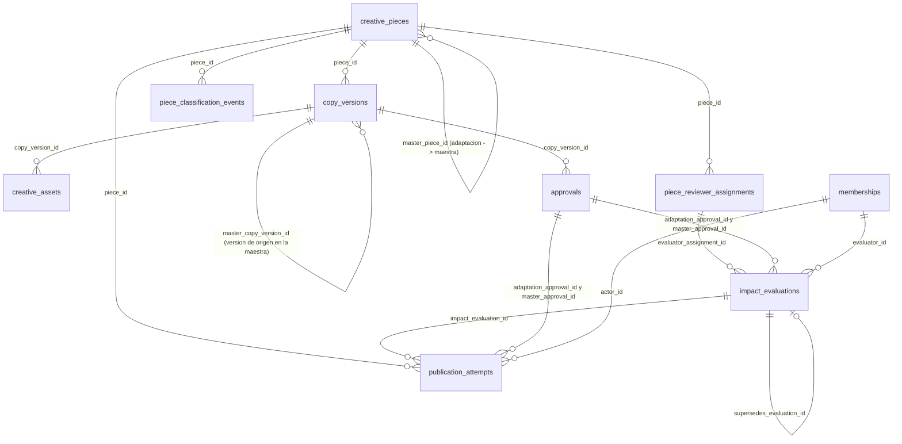

### 3.3 Diagrama de relaciones

```
  MAESTRA M (creative_pieces, master_piece_id NULL)
     |  copy_versions v1, v2, v3 ... (inmutables)   approvals de M (por version exacta)
     |
     |  master_piece_id (inmutable, un solo nivel)
     v
  ADAPTACION A1 ... A2 ... A3  (creative_pieces, master_piece_id = M; canal, formato, adaptation_key)
     |   copy_versions de A: cada una guarda (M, version exacta de M, arte de M si existe)
     |   approvals de A (por version exacta de A)
     |   piece_classification_events (propuesta, confirmacion, no_confirmada, reversion)
     |   piece_reviewer_assignments  (asignado, retirado)
     v
  impact_evaluations: par (V-D origen -> V-B aprobada de M) sobre la version aprobada V-A de A
     |   cadena por supersedes_evaluation_id (segunda evaluacion, correccion)
     v
  publication_attempts: un registro por solicitud de publicacion, con C1 a C9
     |   referencias a V-A, V-B, V-D, approvals y evaluacion vigente
     v
  transition_piece_status(... 'publicado')  ->  unica ruta que deja status = publicado
```

### 3.4 Entidades y atributos

Ajustes a tablas existentes y tablas nuevas de G-1:

| Tabla o función | Cambio | Tipo de cambio | Detalle |
|---|---|---|---|
| creative_pieces | master_piece_id uuid NULL | Columna nueva | NULL = pieza que no es adaptación (puede ser una maestra con adaptaciones o una pieza sin ellas); NO NULL = adaptación (candidata o independiente). Inmutable una vez asignada |
| creative_pieces | is_adaptation boolean NOT NULL, generada como (master_piece_id IS NOT NULL) | Columna nueva (generada) | Sustituye al nombre «is_master» de la v1: una pieza con master_piece_id NULL no es necesariamente maestra. «Maestra» es un rol derivado: pieza que tiene al menos una adaptación |
| creative_pieces | master_ref_is_adaptation boolean, generada (false si master_piece_id no es NULL; NULL si lo es) | Columna nueva (generada) | Valor constante que permite la FK compuesta de un solo nivel (ver 3.4) |
| creative_pieces | adaptation_key text NOT NULL DEFAULT '' | Columna nueva | Normalizada (minúsculas; letras, dígitos, guion y guion bajo; máximo 40). Vacía en piezas sin maestra (CHECK). La clave vacía es la adaptación principal del canal y formato |
| creative_pieces | replaces_piece_id uuid NULL (opcional, sujeto a DG-18) | Columna nueva opcional | Pieza anterior que esta pieza nueva reemplaza comercialmente (DG-15). Inmutable, FK compuesta, no autorreferente. Sin ella el diseño funciona; solo se pierde la trazabilidad estructural del reemplazo |
| creative_pieces | unique(organization_id, id, is_adaptation) | Restricción | Destino de la FK compuesta de un solo nivel |
| creative_pieces | unique parcial (organization_id, master_piece_id, channel, format, adaptation_key) WHERE master_piece_id IS NOT NULL AND status <> Archivado | Restricción + índice | Impide dos adaptaciones activas con la misma clave en el mismo canal y formato; claves distintas sí conviven (DG-14). «Archivado» es el valor del enum de estados |
| creative_pieces | CHECK: master_piece_id <> id; (master_piece_id IS NOT NULL) OR adaptation_key = '' | Restricción | No autorreferencia; la clave solo tiene sentido en adaptaciones |
| copy_versions | master_piece_id, master_copy_version_id, master_creative_asset_id (las tres NULL en piezas sin maestra) | Columnas nuevas | uuid. Versión exacta de la maestra de la que deriva esta versión; inmutables porque copy_versions es inmutable |
| copy_versions | unique(organization_id, piece_id, id) | Restricción | Destino de FK compuestas desde adaptaciones, evaluaciones e intentos |
| creative_assets | unique(organization_id, piece_id, id, copy_version_id) | Restricción | Destino de la FK compuesta que valida que el arte acompaña a esa versión de copy |
| transition_piece_status (función) | Ampliación de la rama «Publicado» | Ajuste de función existente | Incorpora C1 a C9, el registro del intento y el bloqueo de estado (ver 6) |
| role_permissions | — | Sin cambio | Las 17 claves físicas no cambian; ninguna operación nueva requiere una clave 18 |
| activity_logs | — | Sin cambio | Sigue siendo auditoría general; no es la fuente de verdad de los registros nuevos |
| approvals | decision text NOT NULL con CHECK (decision = 'aprobada') | Columna nueva propuesta (v3.3 no la fija; RR-17 resuelto) | Discriminador explícito: toda fila de approvals es una aprobación positiva. El rechazo (T-02 #8), la solicitud de cambios (#4 y #6) y el registro de revisión (#3) NO se guardan en approvals: son transiciones con comentario o motivo (comments y activity_logs). Una fila con otro valor es imposible por el CHECK y, si apareciera, la función de publicación la trata como evidencia no verificable y bloquea |
| approvals | unique(organization_id, id, copy_version_id) | Restricción | Destino de FK compuestas desde impact_evaluations y publication_attempts. La versión de arte se contrasta con un trigger BEFORE INSERT (IS NOT DISTINCT FROM) porque una FK con columnas anulables no distingue «sin arte» de «otro arte» |
| approvals | Trigger BEFORE INSERT adicional: asset_match | Trigger propuesto | En impact_evaluations y publication_attempts compara creative_asset_id de la aprobación con el arte citado (IS NOT DISTINCT FROM) y rechaza si difiere |
| creative_pieces | channel text NOT NULL, format text NOT NULL | Columnas nuevas o ajuste | v3.3 dice «pieza por canal y formato» sin fijar columnas ni tipos. Tipo: texto normalizado (minúsculas, sin espacios en los extremos, no vacío, máximo 40 caracteres). Fuente de verdad: el catálogo channel_rules + channel_formats (3.14). FK compuesta (organization_id, channel, format) hacia channel_formats desde la primera creación de una pieza. No se inventa ningún valor |
| creative_pieces | channel y format inmutables; FK (organization_id, channel, format) -> channel_formats(organization_id, channel, format) RESTRICT | Restricción + trigger | Cambiar de canal o formato es una pieza nueva. El trigger BEFORE INSERT exige canal y formato activos; el UPDATE de ambas columnas se rechaza |
| channel_rules | Estructura mínima desde 1.8: id, organization_id, channel, active boolean NOT NULL DEFAULT true, created_at, created_by | Tabla existente en v3.3 (27); creación adelantada de 5.1 a 1.8 | v3.3 describe channel_rules como reglas por canal con una fila por organización y canal, sin columnas. Las columnas de reglas (extensión, tono, estructura, CTA) se agregan en 5.1 con ALTER ... ADD COLUMN anulables; no hay migración de piezas |
| channel_rules | unique(organization_id, channel); sin DELETE; sin UPDATE de channel | Restricción | Destino de la FK compuesta desde channel_formats. Baja lógica por active = false mediante manage_channel_catalog (org.manage) |
| publication_attempts | attempt_nonce uuid NOT NULL UNIQUE | Columna nueva propuesta (H-04) | Identidad del intento generada por el servidor y verificada por la guarda además de db_txid; protege contra reutilización por una fila antigua, por un intento de otra operación y contra el valor repetido tras una restauración o un clon |
| copy_versions | brief_version_id uuid NOT NULL | Columna nueva (2.3) | Versión exacta del brief que usó la versión; FK compuesta (organization_id, brief_version_id) a brief_versions; sin referencia al «último» brief |
| copy_versions | promotion_snapshot_id uuid NULL | Columna nueva (4.x) | Snapshot promocional exacto que usó la versión, cuando aplica; FK compuesta a promotion_snapshots; la columna y su FK se agregan en 4.x |
| copy_versions | parent_version_id (existente en v3.3): referencia a la versión de copy anterior | Sin columna nueva | Se conserva como la referencia exacta a la versión anterior; no se cambia |
| creative_assets | reused_from_asset_id uuid NULL | Columna nueva (3.x) | Arte de origen cuando la versión reutiliza un arte ya cargado; NULL si es una carga nueva; quien reutiliza no es asset_uploader |
| creative_assets | unique(organization_id, id) | Restricción nueva (3.x) | Permite la FK compuesta de reutilización |
| copy_versions | unique(organization_id, id) | Restricción nueva (2.3) | Permite FK compuestas hacia la versión exacta de copy |
| creative_assets | unique(organization_id, copy_version_id, id) | Restricción nueva (3.x) | Permite que la procedencia de arte exija que la fila de arte pertenece a la versión de copy que la usa |
| creative_assets | asset_version int NOT NULL DEFAULT 1 | Columna nueva (3.x, IG5-99) | Versión del asset; un asset modificado o sustituido crea una fila nueva con asset_version + 1 y nunca sobrescribe la anterior |
| creative_assets | previous_asset_id uuid NULL | Columna nueva (3.x, IG5-99) | Fila de asset de la versión anterior (modificado o sustituido); FK compuesta (organization_id, previous_asset_id) hacia creative_assets(organization_id, id), misma pieza |
| creative_assets | asset_kind text NOT NULL DEFAULT 'nuevo' | Columna nueva (3.x, IG5-99) | 'nuevo', 'reutilizado', 'modificado' o 'sustituto'; CHECK: reutilizado exige reused_from_asset_id y modificado o sustituto exigen previous_asset_id |
| creative_assets | original_uploader_id uuid NULL | Columna nueva (3.x, IG5-99) | Uploader original, copiado de la raíz de la cadena de reutilización y fijado por el servidor; quien reutiliza nunca lo reemplaza; FK compuesta a memberships |
| copy_versions | art_status text NOT NULL | Columna nueva (2.3, IG5-99) | 'con_arte' o 'no_aplica' declarado de forma explícita en cada versión; la ausencia de registros no prueba 'no_aplica' y una versión sin declaración tiene procedencia incompleta; 'no_aplica' exige que ninguna fila de creative_assets use esa versión |
| creative_assets | uploader_id uuid NULL | Columna nueva (3.x, IG5-100) | Uploader del asset (carga nueva, modificación o sustitución); FK compuesta (organization_id, uploader_id) hacia memberships(organization_id, user_id); trigger: membresía activa y fijado desde auth.uid(); NULL solo en un asset reutilizado, cuyo uploader original vive en la raíz de la cadena |
| creative_assets | upload_event_id uuid NULL | Columna nueva (3.x, IG5-100) | Evento de carga; sin FK declarativa hacia contribution_events (la FK compuesta del evento hacia creative_assets ya existe y una segunda formaría un ciclo de creación); referencia validada por un trigger diferido y por verify_field_provenance: mismo organization_id, misma pieza, creative_asset_id igual a la fila (la FK compuesta del evento a creative_assets fija la versión exacta del asset y de copy), tipo asset_uploader y contributor_id igual a uploader_id |
| creative_assets | reuse_event_id uuid NULL | Columna nueva (3.x, IG5-100) | Evento de reutilización, propio de cada reutilización y único por fila; sin FK declarativa hacia contribution_events (evita el ciclo de creación); referencia validada por un trigger diferido y por verify_field_provenance: misma organización y pieza que la versión de copy, creative_asset_id igual a la fila, actor igual al reutilizador autenticado; obligatorio si reused_from_asset_id no es NULL |
| creative_assets | reused_from_asset_version int NULL | Columna nueva (3.x, IG5-100) | Versión exacta del asset reutilizado, igual a asset_version del asset de origen (trigger); NULL si es una carga nueva |

#### `piece_classification_events`

**Propósito:** Historial inmutable de la clasificación de una pieza con maestra: propuesta de independencia, confirmación o no confirmación, y reversión a variación interna. **Brecha:** G-1 (y G-4). **Fase propuesta:** 5.3. **Estado:** aprobada conceptualmente (DG-01), sujeta a la aceptación de esta especificación.

| Columna | Tipo | NULL | Descripción |
|---|---|---|---|
| id | uuid | NO | PK |
| organization_id | uuid | NO | Aislamiento |
| piece_id | uuid | NO | Pieza candidata o adaptación |
| seq | integer | NO | Orden por pieza, desde 1 |
| event_type | text | NO | propuesta \| confirmacion \| no_confirmada \| reversion |
| proposal_event_id | uuid | SÍ | Solo en confirmacion y no_confirmada: la propuesta que responden |
| actor_id | uuid | NO | Lo escribe el servidor con auth.uid() |
| justification | text | NO | No vacío. El mínimo de 30 caracteres es una propuesta pendiente de T-03, sin carácter obligatorio (DG-16) |
| created_at | timestamptz | NO | now() del servidor |

**Clave primaria:** `id`.

**Claves foráneas:**

| Columnas | Referencia | Borrado |
|---|---|---|
| (organization_id, piece_id) | creative_pieces(organization_id, id) | RESTRICT |
| (organization_id, actor_id) | memberships(organization_id, user_id) | RESTRICT |
| (organization_id, proposal_event_id) | piece_classification_events(organization_id, id) | RESTRICT |

**Restricciones únicas:**

- unique(organization_id, id)
- unique(piece_id, seq)
- unique(proposal_event_id) donde event_type IN ('confirmacion','no_confirmada')

**Restricciones CHECK:**

- event_type IN ('propuesta','confirmacion','no_confirmada','reversion')
- (event_type IN ('confirmacion','no_confirmada')) = (proposal_event_id IS NOT NULL)
- char_length(btrim(justification)) >= 1 (no vacío; sin mínimo numérico aprobado)
- seq >= 1

**Índices:**

- (organization_id, piece_id, seq DESC)
- (organization_id, event_type, created_at DESC)

Claves foráneas e integridad de los ajustes a tablas existentes:

| Tabla | Restricción | Borrado | Nota |
|---|---|---|---|
| creative_pieces | (organization_id, master_piece_id) → creative_pieces(organization_id, id) | RESTRICT | Misma organización; maestra existente |
| creative_pieces | Un solo nivel: la maestra referenciada no puede ser una adaptación | — | FK compuesta (organization_id, master_piece_id, master_ref_is_adaptation) → creative_pieces(organization_id, id, is_adaptation): la columna hija vale «falso» cuando hay maestra (NULL si no la hay, y entonces la FK no aplica), de modo que solo se puede apuntar a una pieza cuyo is_adaptation sea falso. Opción B: trigger. Que PostgreSQL admita columnas generadas como destino y origen de esta FK **no está verificado**; se decide en 1.8 (T-09) y la prueba T-04 cubre ambas opciones |
| copy_versions | (organization_id, master_piece_id, master_copy_version_id) → copy_versions(organization_id, piece_id, id) | RESTRICT | La versión de origen existe y pertenece a esa maestra |
| copy_versions | (organization_id, master_piece_id, master_creative_asset_id, master_copy_version_id) → creative_assets(organization_id, piece_id, id, copy_version_id) | RESTRICT (MATCH SIMPLE) | El arte de origen acompaña a esa versión; se omite si no hay arte |
| copy_versions | CHECK: (master_piece_id IS NULL) = (master_copy_version_id IS NULL); el arte de origen exige versión de origen | — | Todo o nada |
| copy_versions | Trigger BEFORE INSERT: master_piece_id de la versión = master_piece_id de su pieza; la pieza debe tener maestra | — | Regla entre tablas que una FK no expresa (IG1-11) |
| creative_pieces | Trigger BEFORE UPDATE: master_piece_id inmutable; una maestra con adaptaciones no pasa a adaptación | — | IG1-06 e IG1-07 |
| creative_pieces | Trigger en #7 y #10: una pieza con maestra sin clasificación independiente vigente no avanza | — | IG1-16; se implementa dentro de transition_piece_status |

### 3.5 Autoría y contribuciones heredadas (G-3)

Los contribuyentes de una versión de adaptación se determinan con la **definición única de contribuyente (4.4.3)**, con fuentes físicas propias (4.4.4): `contribution_events` y `copy_version_provenance` registran autoría, ediciones materiales, brief, datos promocionales, arte y herencia, de **esa** versión y de la versión exacta de la maestra de la que deriva (`master_copy_version_id` y `master_creative_asset_id`). La unión se **calcula** con `version_contributors` (4.4.5) y no se copia en columnas, de modo que no puede desincronizarse. Sin la FK de versión de origen la contribución heredada no podría calcularse: por eso G-3 queda cerrada por G-1. Si falta una fuente, el cálculo falla cerrado (IG5-42, IG5-64).

### 3.6 Clasificación: variación interna o adaptación independiente (G-4)

| Evento | Regla |
|---|---|
| Propuesta | El autor o responsable de la pieza registra `propuesta` con justificación (PO-20) |
| Confirmación | El revisor asignado, distinto del proponente, registra `confirmacion` o `no_confirmada` referida a esa propuesta. Si no se confirma, se mantiene como variación interna: la candidata no avanza por #7 ni #10 y puede archivarse (#13) después de incorporar su contenido en una versión de la maestra |
| Reversión | Una independiente puede volver a variación interna con evento `reversion`; no borra aprobaciones ni versiones; la pieza deja de ser publicable |
| Vigente | La clasificación vigente es el evento de mayor `seq`: independiente solo si es `confirmacion` |
| Permisos | Clasificar no concede permisos de aprobación ni de publicación (PO-20) |

### 3.7 Reglas de integridad de G-1

| ID | Regla |
|---|---|
| IG1-01 | Toda pieza, maestra o adaptación, es una fila de creative_pieces con identidad, estado, responsable y versiones propias |
| IG1-02 | master_piece_id es NULL en una maestra o pieza sin adaptaciones y NO NULL en una adaptación |
| IG1-03 | CHECK: master_piece_id distinto del id de la propia pieza |
| IG1-04 | Un solo nivel: la maestra referenciada no puede ser a su vez una adaptación (FK compuesta con is_adaptation, o trigger si la FK no es viable) |
| IG1-05 | Maestra y adaptación son de la misma organización (FK compuesta con organization_id) |
| IG1-06 | master_piece_id es inmutable una vez asignado |
| IG1-07 | Una maestra que tiene adaptaciones no puede convertirse en adaptación |
| IG1-08 | Cada versión de copy de una adaptación guarda la versión exacta de la maestra de origen y debe existir en esa maestra (FK compuesta) |
| IG1-09 | El arte de origen debe acompañar a esa versión de copy de la maestra (FK compuesta con copy_version_id) |
| IG1-10 | El vínculo de cada versión es inmutable porque copy_versions es inmutable |
| IG1-11 | El master_piece_id de la versión coincide con el de su pieza (trigger) |
| IG1-12 | Los contribuyentes de una versión de adaptación incluyen, por derivación y sin copiarlos, los de la versión de maestra de origen |
| IG1-13 | Una maestra admite varias adaptaciones; solo se impiden duplicados activos con el mismo canal, formato y clave |
| IG1-14 | Cada adaptación tiene su estado y sus versiones; T-02 se aplica por pieza |
| IG1-15 | Una adaptación es independiente solo si su último evento de clasificación es una confirmación |
| IG1-16 | Una adaptación no independiente no pasa por T-02 #7 ni #10 |
| IG1-17 | Quien propone la independencia no la confirma; confirma el revisor asignado con piece.review |
| IG1-18 | El historial de clasificación es de solo inserción con secuencia contigua por pieza |
| IG1-19 | La reversión a variación interna no borra aprobaciones ni versiones |
| IG1-20 | Ninguna pieza, versión ni arte con dependientes se borra (RESTRICT); se archiva |
| IG1-22 | channel y format son texto normalizado y no vacío (máximo 40); (organization_id, channel, format) tiene FK compuesta a channel_formats(organization_id, channel, format) desde la primera creación de una pieza (3.14); no se usa un arreglo de formatos en channel_rules |
| IG1-23 | adaptation_key normalizada; vacía en piezas sin maestra; única entre adaptaciones activas del mismo canal y formato; claves distintas conviven |
| IG1-24 | Una nueva versión comercial de una pieza Publicada es una pieza nueva; la anterior y su historial se conservan (DG-15) |
| IG1-21 | La aprobación sigue ligada a la versión exacta; aprobar la maestra no aprueba la adaptación ni al revés |
| IG1-25 | El catálogo channel_rules y channel_formats existe desde la subfase 1.8, antes de la primera creación de una pieza; en 5.1 solo se agregan columnas de reglas anulables |
| IG1-26 | FK compuesta (organization_id, channel, format) de creative_pieces hacia channel_formats(organization_id, channel, format) RESTRICT: no hay periodo con piezas de canal o formato no registrado |
| IG1-27 | Crear una pieza exige canal y formato activos (trigger BEFORE INSERT con el catálogo bloqueado FOR SHARE); canal inexistente, formato inexistente, formato no permitido y canal o formato inactivo se rechazan con códigos distintos |
| IG1-28 | channel y format de una pieza son inmutables; cambiar de canal o formato es una pieza nueva |
| IG1-29 | Dar de baja un canal o un formato (active = false) se rechaza mientras exista una pieza que lo use en un estado distinto de Publicado y Archivado; no hay DELETE; ninguna modificación del catálogo invalida silenciosamente piezas existentes |
| IG1-30 | Un formato pertenece a un canal; el mismo texto de formato puede existir en dos canales (una fila por canal) y un canal puede tener varios formatos |
| IG1-31 | Una adaptación valida canal y formato contra el mismo catálogo; no se exige igualdad con la maestra |
| IG1-32 | No se inventan valores: los canales y formatos reales siguen pendientes de la organización (DG-19); sin filas en el catálogo no se crean piezas |
| IG1-33 | Las piezas históricas conservan canal y formato y su FK aunque el canal o el formato se den de baja (el catálogo no se borra) |

### 3.8 Índices necesarios

- `creative_pieces (organization_id, master_piece_id)` donde `master_piece_id IS NOT NULL`: listar adaptaciones de una maestra y bloquear conflictos.
- `copy_versions (organization_id, master_piece_id, master_copy_version_id)`: encontrar qué versiones de adaptación derivan de una versión de la maestra (cálculo de evaluaciones pendientes).
- Los índices de `piece_classification_events` y los únicos parciales descritos arriba.

### 3.9 Borrado y conservación histórica

Todas las claves foráneas nuevas son `ON DELETE RESTRICT` y `ON UPDATE NO ACTION`. Las aplicaciones no tienen `DELETE` sobre piezas, versiones, artes con dependientes ni sobre las tablas nuevas. Una pieza se archiva (T-02 #13), no se borra; una adaptación archivada conserva su vínculo y sus versiones. No hay cascadas. Una pieza Publicada no se modifica y una nueva versión comercial es una pieza nueva (DG-15, 6.3).

### 3.10 Estrategia de migración desde el modelo de 27 tablas

Ver sección 14. Resumen: como no existe esquema ejecutado (Fase 1 no iniciada), la ruta correcta es **enmendar el diseño de línea base** para que `creative_pieces` y `copy_versions` nazcan con las columnas nuevas (nullable, sin migración de datos); las tablas nuevas se crean en la fase que crea sus destinos.

### 3.11 Por qué no se fuerza dentro de las 27 tablas

| Alternativa descartada | Motivo |
|---|---|
| Vínculo adaptación → maestra | Un campo de texto o JSON en `creative_pieces` o `briefs` no tiene integridad referencial: permite apuntar a una pieza inexistente, de otra organización o a sí misma |
| Versión exacta de origen | `copy_versions.parent_version_id` describe la ascendencia dentro de **una misma pieza**; reutilizarlo entre piezas rompería `unique(piece_id, version)` y su significado |
| Historial de clasificación | `activity_logs` es genérico e inmutable, pero no demuestra el contenido de la clasificación ni permite una restricción de «distinto del proponente»; los CHECK y únicos deben vivir en una tabla propia |
| Revisor asignado | No existe campo documentado (D-02); una columna única perdería el historial de reasignaciones que sirve de evidencia de independencia |

### 3.12 Resumen de cambios de G-1

| Tipo | Elementos |
|---|---|
| Tabla nueva | `piece_classification_events`; `piece_reviewer_assignments` (compartida con G-5) |
| Columnas nuevas | creative_pieces: master_piece_id, is_adaptation, master_ref_is_adaptation, channel, format, adaptation_key (y replaces_piece_id si se aprueba DG-18); channel_rules (creación adelantada a 1.8) y channel_formats (tabla nueva); copy_versions: master_piece_id, master_copy_version_id, master_creative_asset_id |
| Relaciones nuevas | pieza → maestra (autorreferencia compuesta); versión → versión de maestra; versión → arte de maestra |
| Restricciones | CHECK de no autorreferencia y todo-o-nada; únicos compuestos; un único parcial de adaptaciones activas; triggers de inmutabilidad y coherencia |
| Índices | Los de 3.8 |
| Ajustes a existentes | unique compuestos en copy_versions, creative_assets, approvals; ampliación de transition_piece_status |

### 3.13 Canal, formato, identidad de la clave y revisión de G-1

| Requisito de la revisión | Resolución |
|---|---|
| Tipos de channel y format | Texto normalizado (minúsculas, sin espacios en los extremos, no vacío, máximo 40 caracteres) en `creative_pieces`, para todas las piezas. No se fija un catálogo: los canales y formatos reales siguen pendientes (v3.3: reglas reales por canal sin entregar) |
| Relación con channel_rules | Sustituida por el ciclo de vida completo de la sección 3.14: `channel_rules` (fuente de verdad del canal) y `channel_formats` (fuente de verdad del formato) existen desde la subfase 1.8 y la FK compuesta de `creative_pieces` rige desde la primera pieza. La columna `allowed_formats` de la v2 se retiró: un arreglo no puede ser destino de una FK |
| Desfase de fases | Resuelto: no hay periodo con piezas sin catálogo (3.14). Se adelanta la estructura mínima de `channel_rules` de 5.1 a 1.8 |
| Identidad y unicidad de adaptation_key | Normalizada; vacía en piezas sin maestra; la vacía es la adaptación principal. Único parcial entre adaptaciones no archivadas del mismo (maestra, canal, formato, clave). Claves distintas conviven (DG-14); al archivar una adaptación su clave queda libre |
| Una sola jerarquía | FK compuesta con is_adaptation (o trigger), master_piece_id inmutable y una maestra con adaptaciones no pasa a adaptación |
| Integridad de la versión de origen | FK compuesta (organización, maestra, versión) hacia copy_versions; la versión de la adaptación no se puede apuntar a otra pieza ni a una versión inexistente |
| Arte de origen y su versión | FK compuesta con copy_version_id hacia creative_assets: el arte acompaña exactamente a esa versión |
| Organización | Todas las FK incluyen organization_id |
| Conservación histórica | RESTRICT, sin DELETE de la aplicación, versiones inmutables y archivo en lugar de borrado |
| Nombre is_master | **Se reemplaza por `is_adaptation`**: una pieza con master_piece_id NULL puede ser una maestra o una pieza sin adaptaciones, así que «is_master» describía mal su función. «Maestra» pasa a ser un rol derivado (pieza con al menos una adaptación) |

### 3.14 Catálogo de canales y formatos: ciclo de vida completo (G-1, DG-19)

**Hallazgo.** El roadmap de v3.3 crea `creative_pieces` en la Fase 1 (estructura en 1.8) y las piezas se usan desde 2.5 y 2.7, pero `channel_rules` nace en 5.1 y el primer validador que lo necesita es 5.2/5.3. Con la v2, entre la Fase 1 y la Fase 4 `channel` y `format` eran texto libre sin validación y la FK se agregaba después: un periodo con datos posiblemente inválidos. Esta versión elimina ese periodo.

**Alternativas evaluadas**

| Alternativa | Integridad | Extensibilidad | Trazabilidad | Migración | Veredicto |
|---|---|---|---|---|---|
| 1. Catálogo en base de datos desde la Fase 1 (`channel_rules` más una tabla de formatos) | Alta: FK desde la primera pieza | Alta: alta y baja lógica sin DDL | created_by, created_at y retired_at | 5.1 solo agrega columnas anulables a `channel_rules` | **ELEGIDA** |
| 2. Tabla de referencia separada, creada antes de las piezas | Alta | Media | Buena | Duplica la fuente de verdad con `channel_rules`: hay que sincronizar o migrar en 5.1 | Descartada |
| 3. Catálogo en código con migración posterior a `channel_rules` | Baja: la validación solo está en la aplicación y no es un control (IS-08); periodo con datos inválidos | Baja: cada cambio es un despliegue | Baja | Hay que limpiar datos al migrar | Rechazada |
| 4. Tipo enumerado o CHECK con lista fija | Media | Baja: cada canal o formato exige DDL y no distingue organizaciones | Baja | Reescribir el tipo | Rechazada |

**Solución única:** el catálogo es `channel_rules` (canal) y `channel_formats` (formato por canal), ambos de la organización, creados en la subfase 1.8 antes de la primera pieza. No se eligió por minimizar tablas: cuesta una tabla más y adelanta la estructura mínima de `channel_rules`, que v3.3 calificó «justificada, pero diferible»; esa decisión queda para tu aceptación (DG-19).

| Aspecto | Decisión |
|---|---|
| Fuente de verdad del canal | `channel_rules(organization_id, channel)`; `active` indica si admite piezas nuevas |
| Fuente de verdad del formato | `channel_formats(organization_id, channel, format)`; un formato pertenece a un canal |
| Valores válidos | Los que la organización registre con `org.manage`. **Pendiente de la organización:** los valores reales; no se inventa ninguno. Sin filas no se crean piezas (IG1-32) |
| Relación canal-formato | Uno a muchos: un canal tiene varios formatos y el mismo texto de formato puede existir en dos canales como dos filas (IG1-30) |
| Momento de creación | Ambas tablas y la FK de `creative_pieces` en la subfase 1.8, en la misma migración que `creative_pieces` |
| Momento en que se activa la validación | Desde la primera pieza: FK compuesta (organization_id, channel, format) más el trigger de actividad al crear (IG1-26, IG1-27) |
| Piezas creadas antes de la Fase 5 | No hay un antes: ninguna pieza existe sin catálogo. En 5.1 solo se agregan columnas de reglas (extensión, tono, estructura, CTA) anulables a `channel_rules`; ninguna fila de piezas ni de formatos cambia |
| Canales desactivados | `active = false` impide piezas nuevas (CANAL_INACTIVO); las existentes conservan su FK. La baja se rechaza mientras haya piezas en estados distintos de Publicado y Archivado (IG1-29) |
| Formatos retirados | Igual: `active = false` y `retired_at`; no hay DELETE; nunca invalida una pieza existente |
| Cambios de configuración | Solo por `manage_channel_catalog` (org.manage), que muestra el recuento de piezas afectadas y rechaza la baja si hay piezas no terminales. El nombre de canal o formato no se modifica: se da de baja y se crea otro |
| Integridad de piezas históricas | La FK RESTRICT y la ausencia de DELETE garantizan que toda pieza, aun archivada o publicada, conserva su canal y formato (IG1-33) |
| Reglas de migración | Del catálogo inicial a la estructura definitiva (5.1): `ALTER TABLE ... ADD COLUMN` anulables; sin reescritura de datos ni de FK. Documental hasta que exista infraestructura autorizada |
| Compatibilidad con adaptaciones | Una adaptación valida canal y formato contra el mismo catálogo; no se exige igualdad con su maestra (IG1-31). Adaptaciones de un mismo canal con claves distintas conviven (DG-14) |
| Cuándo se evalúa la restricción | **Al crear:** FK y trigger. **Al modificar:** canal y formato son inmutables en la pieza (IG1-28); cambiarlos es una pieza nueva. **Al publicar:** no se revalida porque la baja del catálogo se rechaza mientras exista una pieza no terminal; la carrera se resuelve con el bloqueo del catálogo (4.10.1) |
| Permisos y RLS | SELECT para miembros de la organización (RLS por organización); INSERT, UPDATE, DELETE y TRUNCATE revocados a anon, authenticated y service_role; escritura solo mediante `manage_channel_catalog` bajo `cci_records_owner` |

**Distinciones y códigos de rechazo**

| Caso | Condición | Código | Mecanismo |
|---|---|---|---|
| Canal inexistente | No hay fila en `channel_rules` para la organización y el canal | CANAL_INEXISTENTE | FK compuesta |
| Canal inactivo | Fila con `active = false` | CANAL_INACTIVO | Trigger BEFORE INSERT |
| Formato inexistente | El formato no figura en ningún canal de la organización | FORMATO_INEXISTENTE | FK compuesta |
| Formato no permitido para ese canal | Existe para otro canal, no para este | FORMATO_NO_PERMITIDO_PARA_CANAL | FK compuesta |
| Formato retirado | Fila con `active = false` | FORMATO_RETIRADO (piezas nuevas); la pieza previa se conserva | Trigger |
| Pieza histórica | Pieza ya creada con un par posteriormente dado de baja | Sin rechazo: conserva canal, formato y FK | RESTRICT y sin DELETE |
| Baja con piezas activas | Hay piezas no terminales con ese canal o formato | RETIRO_CON_PIEZAS_ACTIVAS | Función con el catálogo bloqueado FOR UPDATE |

**Roadmap.** Cambios de dependencia (sin alterar el número de 76 subfases): la subfase 1.8 incorpora `channel_rules` (estructura mínima) y `channel_formats` y depende de 1.6 (permisos, `org.manage`); la subfase 5.1 deja de crear la tabla y solo agrega columnas de reglas, con dependencia de 1.8. Detalle en `ROADMAP_Y_TRAZABILIDAD_G1_G5_G10.md`.


## 4. G-5 — Registro de evaluación de impacto

### 4.1 Modelo de datos

La evaluación es una **actividad de revisión** (PO-21 A), no un estado ni una transición. Se registra en `impact_evaluations`, que une exactamente: la versión evaluada de la adaptación (V-A) y su aprobación histórica, el par de versiones de la maestra (V-D, de la que derivó la adaptación, y V-B, la versión aprobada posterior) con su aprobación, el evaluador y la asignación que lo acredita, el resultado, la justificación, la evidencia, la fecha, la acción posterior y la cadena de reemplazo.

**Precisión propuesta a G-7 (DG-05):** la evaluación se hace sobre versiones **aprobadas** de la maestra, no sobre borradores. Mientras la maestra se corrige (T-02 #11) deja de estar aprobada y C3 ya bloquea; cuando se aprueba de nuevo, V-B queda definida y se evalúa V-D → V-B. Así el par es inmutable y no se evalúa un texto que luego cambiaría.

#### `piece_reviewer_assignments`

**Propósito:** Historial inmutable de quién es el revisor asignado de una pieza o adaptación; necesario para que la evaluación de impacto y la confirmación de independencia tengan un ejecutor identificable. **Brecha:** G-5 (dependencia) y parte de G-9. **Fase propuesta:** 5.3. **Estado:** aprobada conceptualmente (DG-01), sujeta a la aceptación de esta especificación.

| Columna | Tipo | NULL | Descripción |
|---|---|---|---|
| id | uuid | NO | PK |
| organization_id | uuid | NO | Aislamiento |
| piece_id | uuid | NO | Pieza o adaptación |
| seq | integer | NO | Orden por pieza |
| action | text | NO | asignado \| retirado |
| reviewer_id | uuid | NO | Persona asignada o retirada |
| assigned_by | uuid | NO | Quien registra; auth.uid() del servidor |
| reason | text | NO | No vacío. El mínimo de 10 caracteres es una propuesta pendiente, sin carácter obligatorio (DG-16) |
| created_at | timestamptz | NO | now() del servidor |

**Clave primaria:** `id`.

**Claves foráneas:**

| Columnas | Referencia | Borrado |
|---|---|---|
| (organization_id, piece_id) | creative_pieces(organization_id, id) | RESTRICT |
| (organization_id, reviewer_id) | memberships(organization_id, user_id) | RESTRICT |
| (organization_id, assigned_by) | memberships(organization_id, user_id) | RESTRICT |

**Restricciones únicas:**

- unique(organization_id, id)
- unique(piece_id, seq)
- unique(organization_id, piece_id, id)
- unique(organization_id, piece_id, id, reviewer_id, action)

**Restricciones CHECK:**

- action IN ('asignado','retirado')
- char_length(btrim(reason)) >= 1 (no vacío; sin mínimo numérico aprobado)
- seq >= 1

**Índices:**

- (organization_id, piece_id, seq DESC)
- (organization_id, reviewer_id, created_at DESC)

#### `impact_evaluations`

**Propósito:** Registro permanente e inmutable de cada evaluación humana de impacto de un cambio de la maestra sobre una versión aprobada de una adaptación independiente. **Brecha:** G-5. **Fase propuesta:** 6.5. **Estado:** aprobada conceptualmente (DG-01), sujeta a la aceptación de esta especificación.

| Columna | Tipo | NULL | Descripción |
|---|---|---|---|
| id | uuid | NO | PK |
| organization_id | uuid | NO | Aislamiento |
| adaptation_piece_id | uuid | NO | Adaptación evaluada |
| adaptation_copy_version_id | uuid | NO | Versión de copy de la adaptación evaluada |
| adaptation_creative_asset_id | uuid | SÍ | Arte de esa versión, si existe |
| adaptation_approval_id | uuid | NO | Aprobación histórica relacionada; no se modifica |
| master_piece_id | uuid | NO | Maestra (debe coincidir con la de la adaptación) |
| master_basis_copy_version_id | uuid | NO | Versión de la maestra de la que derivó la adaptación evaluada (V-D) |
| master_basis_creative_asset_id | uuid | SÍ | Arte de V-D, si existe |
| master_changed_copy_version_id | uuid | NO | Versión aprobada posterior de la maestra que se evalúa (V-B) |
| master_changed_creative_asset_id | uuid | SÍ | Arte de V-B, si existe |
| master_approval_id | uuid | NO | Aprobación de esa versión de la maestra |
| evaluator_id | uuid | NO | Persona evaluadora; auth.uid() del servidor |
| evaluator_assignment_id | uuid | NO | Asignación que acredita al evaluador como revisor asignado |
| evaluator_assignment_action | text | NO | Constante «asignado»: permite que la FK exija una fila de asignación, no de retiro |
| evaluator_review_permission_verified | boolean | NO | Constante verdadero: constancia de que la función comprobó piece.review (no es la garantía; lo es la función) |
| result | text | NO | sin_impacto_material \| requiere_revision \| invalida \| desconocido |
| follow_up_action | text | NO | Acción posterior determinada por el resultado |
| justification | text | NO | No vacío (el mínimo de 30 caracteres es una propuesta pendiente de T-03; DG-16) |
| dimension_findings | jsonb | NO | Siete dimensiones evaluadas (evidencia mínima) |
| unknown_reason | text | SÍ | Obligatoria si el resultado es desconocido |
| evidence_refs | jsonb | SÍ | Referencias adicionales (comentarios, auditorías, artes) por tipo e id |
| kind | text | NO | inicial \| segunda_evaluacion \| correccion |
| supersedes_evaluation_id | uuid | SÍ | Evaluación que esta reemplaza en vigencia, sin borrarla |
| correction_reason | text | SÍ | Obligatoria si kind no es inicial |
| evaluated_at | timestamptz | NO | now() del servidor |
| idempotency_key | text | NO | Evita duplicar la operación |
| adaptation_asset_key | uuid | NO | Clave de arte de V-A: el arte o el uuid nulo si no hay (CHECK de igualdad); permite FK y UNIQUE exactos sobre el par |
| master_basis_asset_key | uuid | NO | Igual para V-D |
| master_changed_asset_key | uuid | NO | Igual para V-B |
| correlation_id | uuid | NO | Correlación de la solicitud, generada por el servidor (3.15) |
| client_correlation_id | uuid | SÍ | Identificador opcional enviado por el cliente, solo si es un uuid canónico; no es evidencia |
| request_fingerprint | text | NO | sha-256 hexadecimal calculado por el servidor con evaluador, adaptación, versiones citadas y resultado solicitado; detecta una clave reutilizada con otros datos |

**Clave primaria:** `id`.

**Claves foráneas:**

| Columnas | Referencia | Borrado |
|---|---|---|
| (organization_id, adaptation_piece_id) | creative_pieces(organization_id, id) | RESTRICT |
| (organization_id, adaptation_piece_id, adaptation_copy_version_id) | copy_versions(organization_id, piece_id, id) | RESTRICT |
| (organization_id, adaptation_piece_id, adaptation_creative_asset_id, adaptation_copy_version_id) | creative_assets(organization_id, piece_id, id, copy_version_id) | RESTRICT (MATCH SIMPLE: se omite si el arte es NULL) |
| (organization_id, adaptation_approval_id, adaptation_copy_version_id) | approvals(organization_id, id, copy_version_id) | RESTRICT |
| (organization_id, master_piece_id, master_basis_copy_version_id) | copy_versions(organization_id, piece_id, id) | RESTRICT |
| (organization_id, master_piece_id, master_changed_copy_version_id) | copy_versions(organization_id, piece_id, id) | RESTRICT |
| (organization_id, master_approval_id, master_changed_copy_version_id) | approvals(organization_id, id, copy_version_id) | RESTRICT |
| (organization_id, evaluator_id) | memberships(organization_id, user_id) | RESTRICT |
| (organization_id, adaptation_piece_id, evaluator_assignment_id, evaluator_id, evaluator_assignment_action) | piece_reviewer_assignments(organization_id, piece_id, id, reviewer_id, action) | RESTRICT |
| (organization_id, supersedes_evaluation_id, adaptation_piece_id, adaptation_copy_version_id, adaptation_asset_key, master_piece_id, master_basis_copy_version_id, master_basis_asset_key, master_changed_copy_version_id, master_changed_asset_key) | impact_evaluations(organization_id, id, adaptation_piece_id, adaptation_copy_version_id, adaptation_asset_key, master_piece_id, master_basis_copy_version_id, master_basis_asset_key, master_changed_copy_version_id, master_changed_asset_key) | RESTRICT: una evaluación solo sustituye a otra del mismo par exacto |

**Restricciones únicas:**

- unique(organization_id, evaluator_id, idempotency_key)
- unique(supersedes_evaluation_id) donde no es NULL
- unique(organization_id, id)
- unique(organization_id, id, adaptation_piece_id, adaptation_copy_version_id, adaptation_asset_key, master_piece_id, master_basis_copy_version_id, master_basis_asset_key, master_changed_copy_version_id, master_changed_asset_key) (destino de la FK de sustitución)
- unique parcial de raíz por par: (organization_id, adaptation_piece_id, adaptation_copy_version_id, adaptation_asset_key, master_piece_id, master_basis_copy_version_id, master_basis_asset_key, master_changed_copy_version_id, master_changed_asset_key) donde supersedes_evaluation_id IS NULL

**Restricciones CHECK:**

- result IN ('sin_impacto_material','requiere_revision','invalida','desconocido')
- follow_up_action coherente con result: sin_impacto_material -> conservar_aprobacion; requiere_revision o invalida -> nueva_version_y_workflow; desconocido -> evaluacion_humana_pendiente
- (kind = 'inicial') = (supersedes_evaluation_id IS NULL)
- kind IN ('inicial','segunda_evaluacion','correccion')
- las dos versiones de la maestra son distintas (copia o arte)
- dimension_findings válido según la función validadora (siete dimensiones; coherencia con result)
- evaluator_assignment_action = 'asignado'
- evaluator_review_permission_verified = true
- adaptation_asset_key = COALESCE(adaptation_creative_asset_id, '00000000-0000-0000-0000-000000000000'); ídem master_basis_asset_key y master_changed_asset_key
- supersedes_evaluation_id <> id
- kind = 'inicial' OR char_length(btrim(correction_reason)) >= 1 (no vacío; el mínimo de 30 queda como propuesta pendiente de T-03)
- char_length(btrim(justification)) >= 1 (no vacío; sin mínimo numérico aprobado)
- result <> 'desconocido' OR char_length(btrim(unknown_reason)) >= 1
- client_correlation_id: tipo uuid (el formato lo impone el tipo)
- request_fingerprint ~ '^[0-9a-f]{64}$'

**Índices:**

- (organization_id, adaptation_piece_id, adaptation_copy_version_id)
- (organization_id, master_piece_id, master_changed_copy_version_id)
- (organization_id, evaluator_id, evaluated_at DESC)
- (organization_id, result, evaluated_at DESC)

### 4.2 Evidencia mínima obligatoria

| Elemento | Regla |
|---|---|
| Versiones exactas | V-A, V-D y V-B con su arte, validadas por FK compuestas |
| Aprobaciones | La aprobación histórica de V-A y la de V-B (FK a approvals); no se modifican |
| Dimensiones | `dimension_findings`: siete elementos exactamente — beneficios, precios, condiciones comerciales, afirmaciones, claims, información legal, elementos de marca — cada uno con `afectada` (si, no, desconocida) y una nota |
| Coherencia | sin_impacto_material: las siete en «no»; requiere_revision o invalida: al menos una en «si»; desconocido: al menos una en «desconocida» y `unknown_reason` no vacío |
| Justificación | No vacía. El umbral de 30 caracteres es una propuesta pendiente de T-03 y no es restricción (DG-16) |
| Evaluador | Persona, asignación vigente y fecha del servidor |

### 4.3 Estados de la evaluación

**No se almacena ningún estado** (P2). Se derivan:

| Estado derivado | Condición |
|---|---|
| Pendiente (sin evaluación) | Existe una adaptación aprobada con V-D distinta de V-B y ninguna fila para ese par |
| Vigente sin impacto | La cabeza de la cadena es sin_impacto_material; la aprobación de V-A se conserva |
| Abierta desfavorable | La cabeza es requiere_revision o invalida y no existe una versión aprobada de la adaptación derivada de V-B |
| Resuelta por nueva versión | La cabeza es desfavorable y existe una versión de la adaptación derivada de V-B con aprobación (#11 y el workflow normal) |
| Desconocida pendiente | La cabeza es desconocido; bloquea hasta una evaluación humana documentada |
| Reemplazada | La fila tiene otra que la reemplaza (`supersedes`): historia, no vigente |

### 4.4 Quién evalúa, independencia y autoevaluación

| Pregunta | Regla |
|---|---|
| Quién puede evaluar | El **revisor asignado** vigente de la adaptación (última fila de `piece_reviewer_assignments` de esa pieza, con acción `asignado`) que tenga `piece.review`. La asignación no concede el permiso |
| Independencia (DG-04 y DG-17) | El evaluador no pertenece al conjunto excluido E = Ctr(V-A) ∪ Inh(V-A) ∪ ⋃ Ctr(v) para v ∈ [V-D, V-B] ∪ P (4.4.3, IG5-56), incluidas las versiones intermedias. «Evaluar su propia modificación» equivale a pertenecer a E. DG-17 quedó decidida por el propietario; P es el proponente de la clasificación independiente vigente (DT-02) |
| Autoevaluación | Imposible por lo anterior; `evaluator_id` es `auth.uid()`, no un parámetro |
| Revisor no elegible | Se registra una asignación nueva (`asignado`) para otra persona elegible; la anterior queda; la evaluación referencia la asignación que acredita al evaluador |
| Sin revisor elegible | La evaluación no se registra y la publicación sigue bloqueada por C4/C6. No pasa autoridad a Admin, al propietario ni a otro rol (PO-21 F) |
| Quién asigna (DG-07) | Persona con `org.manage`, con historial; asignar no concede permisos ni sustituye la independencia |

#### 4.4.1 Elegibilidad: qué garantiza cada mecanismo

Ninguna FK aislada garantiza la elegibilidad: las FK garantizan identidad y correspondencia; la vigencia, el permiso y la independencia dependen de datos que cambian y se comprueban en la función bajo bloqueo, repetidos por un trigger BEFORE INSERT.

| Garantía requerida | Cómo se obtiene | Tipo de mecanismo | Regla |
|---|---|---|---|
| La asignación corresponde a la adaptación evaluada | FK compuesta (organización, adaptation_piece_id, evaluator_assignment_id) hacia piece_reviewer_assignments(organization_id, piece_id, id) | FK | IG5-21 |
| El evaluador coincide con el usuario asignado y la fila es de asignación | La misma FK, ampliada con evaluator_id y la columna constante «asignado» hacia unique(organización, pieza, id, revisor, acción) | FK + UNIQUE + CHECK de la constante | IG5-22 |
| La asignación está vigente al evaluar | Se compara con la última fila de la secuencia de esa pieza, bajo bloqueo de la fila de la adaptación | Función transaccional + trigger | IG5-23 |
| El evaluador tiene piece.review | Se lee de los roles de su membresía con esa fila bloqueada `FOR SHARE`; `evaluator_review_permission_verified` solo deja constancia | Función transaccional + trigger | IG5-24 |
| No es contribuyente de V-A, incluida la herencia | `version_contributors` sobre V-A y su versión de origen | Función + trigger | IG5-05 |
| No es contribuyente de V-B ni evalúa su propia modificación | `version_contributors` sobre V-B | Función + trigger | IG5-05, IG5-06 |
| La reasignación conserva la historia | Tabla de solo inserción con secuencia contigua por pieza; ninguna fila se edita | UNIQUE(piece_id, seq) + trigger + privilegios | IG5-08 |
| Evaluación ligada a versiones exactas aprobadas | FK compuestas a copy_versions, creative_assets y approvals | FK | IG5-01, IG5-02 |
| Una corrección no elimina ni modifica la anterior | Fila nueva con supersedes; la anterior no se toca; sin UPDATE ni DELETE | FK + UNIQUE + CHECK + trigger + privilegios | IG5-12, IG5-13 |
| Si la persona levanta su propio dictamen | Debe ser otra persona (DG-06) | Función + trigger | IG5-15 |

#### 4.4.2 Independencia respecto de versiones intermedias (DG-17, decidida por el propietario)

**Decisión incorporada:** la evaluación debe ser independiente de todos los contribuyentes relevantes de la adaptación evaluada y de todas las versiones de la maestra que intervienen en el cambio evaluado, incluidas las versiones intermedias entre V-D y V-B.

| Elemento | Definición |
|---|---|
| Intervalo I(V-D, V-B) | Todas las versiones de la maestra cuyo orden de versión está entre el de V-D (versión de origen de V-A) y el de V-B (versión actual evaluada), ambas incluidas, con sus artes (IG5-31). **Dependencia:** el orden de versión es el número de versión de `copy_versions`; v3.3 no fija esa columna (RR-24) |
| Contribuyentes de una versión v: Ctr(v) | Según la definición única de 4.4.3, calculada por `version_contributors` desde las fuentes físicas de 4.4.4. T-04 de v3.3 no fue aprobada y no se aprueba retroactivamente; la definición es diseño complementario de esta revisión (DT-01, RR-27) |
| Heredados Inh(V-A) | Contribuyentes de las versiones de la maestra de las que deriva V-A (3.5); V-D está en I y por tanto queda incluida |
| Conjunto excluido E | **E = Ctr(V-A) ∪ Inh(V-A) ∪ ⋃ Ctr(v) para v ∈ [V-D, V-B] ∪ P** (IG5-56): P es la persona que propuso la clasificación independiente vigente (DT-02). Incluye el arte exacto de cada versión usada |
| Quién no queda excluido | Quien solo realizó controles o actos administrativos (comentar, consultar, revisar, aprobar, asignar) o fue la IA o el sistema (IG5-41). Quien edita contenido crea una versión y es contribuyente de esa versión |
| «Contribución material» | Quien crea, edita o modifica contenido que forma parte de la versión (copy, brief, arte, datos promocionales), según 4.4.3. En duda sobre la herencia sustantiva se conserva la atribución (IG5-43) |
| Regla de elegibilidad | Seis condiciones de IG5-57 (4.4.3): miembro activo, `piece.review`, asignación vigente, fuera de E, sin impedimento de DG-06 y revalidación bajo bloqueo al guardar. Se calcula en backend con `eligible_evaluators` y `version_contributors` (8.9) |
| Revalidación | Al asignar y reasignar (informativa), al registrar la evaluación (decisiva, bajo los bloqueos de 4.10 y repetida por el trigger BEFORE INSERT) y al registrar una segunda evaluación o corrección. La interfaz no es un control (IG5-33) |
| Contribuyentes incorporados después | Las versiones son inmutables, por lo que no se agregan contribuyentes a una versión existente: una versión nueva de la maestra crea otro par (otro V-B). La evaluación ya registrada no cambia; el nuevo par recalcula E (IG5-35) |
| Sin persona elegible | No se permite la evaluación, no se presume independencia y no se asigna autoridad automática a Admin ni al propietario. Queda un bloqueo operativo: C4 impide publicar. La salida es incorporar o habilitar, con `org.manage`, a una persona independiente con `piece.review` (IG5-34) |

#### 4.4.3 Definición única de contribuyente y elegibilidad (DT-01, DT-02, T-04)

**Fuentes inspeccionadas.** v3.3 (T-04: «NO APROBADA», con la propuesta técnica de autor del copy y de quien subió el arte), Adenda v9 (OD-03, PO-08, PO-11, PO-16 y la lista de actos que no son contribuciones) y la especificación v4. **Estatus de esta definición:** las instrucciones de esta revisión definen el **diseño complementario**; no aprueban T-04 de v3.3 de forma retroactiva ni aceptan la Adenda v9 (PO-05). Pendiente: aceptación formal del propietario.

**Principio.** La atribución es determinista y verificable: no depende de una opinión libre del evaluador ni de una estimación subjetiva de la IA, ni de porcentajes de similitud, embeddings o puntuaciones semánticas.

| Figura | Definición | Tipo de evento | Fuente física y regla |
|---|---|---|---|
| A. Autoría de copy | Quien crea una versión de copy; identidad del servidor (`auth.uid()`), conservada en `created_by`; una modificación crea una versión nueva y no sobrescribe la autoría anterior; si la versión la generó la IA, la contribuyente es quien solicitó y guardó la propuesta; la IA no es persona contribuyente | copy_author | copy_versions.created_by y contribution_events (IG5-50) |
| B. Edición material del contenido | Quien crea una versión nueva y modifica al menos un campo de contenido evaluable. Se normalizan exclusivamente Unicode NFKC, saltos de línea, espacios repetidos y espacios al inicio o final; si tras normalizar cambia el contenido de un campo, se registra la contribución. No es contribución un cambio exclusivo de `updated_at`, metadatos técnicos, identificadores, orden visual sin cambio de contenido, espacios o saltos de línea, ni el registro de consulta. Si hay cambio de contenido y no se puede determinar con certeza que sea exclusivamente mecánico, se conserva la atribución anterior y se añade al nuevo editor; la IA no decide por sí sola que un cambio carece de importancia | copy_editor | contribution_events y copy_version_provenance (IG5-49) |
| C. Contribución al brief | Quien crea o modifica una versión del brief y cambia al menos uno de: objetivo comercial; audiencia o segmento; producto o servicio promovido; propuesta de valor; beneficio principal; mensajes o claims obligatorios; restricciones o claims prohibidos; oferta o condición comercial solicitada; CTA; canal o formato solicitado; tono o directriz que afecte el contenido. Los cambios administrativos o técnicos que no alteren esos campos no son contribución | brief_editor | brief_versions, brief_field_changes, brief_field_attributions y contribution_events: atribución **por campo material** (IG5-51, IG5-69, IG5-72; 4.4.8) |
| D. Contribución a datos promocionales | Quien crea o modifica un snapshot y cambia código de promoción, SKU o productos incluidos, precio de referencia, precio promocional, descuento, vigencia, condiciones, moneda o restricciones comerciales. Un cambio administrativo que no modifique datos comerciales no es contribución. No se inventa integración con inventario ni disponibilidad de existencias | promotion_editor | promotion_snapshots, promotion_field_changes, promotion_field_attributions y contribution_events: atribución **por campo material** (IG5-52, IG5-69, IG5-72; 4.4.8) |
| E. Contribución de arte | Quien carga o reemplaza el archivo de arte asociado a una versión; identidad del servidor; arte de identidad y versión exactas; se conserva mientras el arte siga asociado a la versión evaluada o se herede en una posterior; reemplazar el arte genera una contribución nueva y no modifica el registro del arte anterior; quien solo reutiliza un arte no es quien lo cargó | asset_uploader | creative_assets.uploaded_by y contribution_events (IG5-53) |
| F. Contribución heredada | Quien contribuyó a una versión anterior y cuya aportación permanece en la versión por procedencia verificable (reglas de herencia) | inherited_contributor | copy_version_provenance para copy y arte (IG5-54, IG5-83) y atribuciones heredadas por campo para brief y promoción (IG5-72, IG5-73) |

**Actos que NO son contribución (IG5-41).** Consultar, comentar, comparar versiones, revisar, registrar hallazgos, solicitar cambios, aprobar o rechazar, confirmar o descartar hallazgos, conceder o revocar excepciones, asignar revisores, delegar permisos, administrar la organización y ejecutar operaciones automáticas. Siguen sujetos a las reglas de independencia correspondientes, pero no convierten a una persona en contribuyente de contenido. Los triggers, las funciones, el sistema y la IA no son personas contribuyentes.

**Distinciones.** *Autoría* (A), *contribución material* (B a E), *intervención administrativa* (asignar, delegar, conceder excepciones: no contribuye), *revisión* y *aprobación* (controles: no contribuyen, pero deben ser independientes) y *operación automática* (no es persona). La clasificación de la propuesta de independencia se trata aparte (DT-02, 4.4.6).

**Reglas de herencia (IG5-54, IG5-55).** Cada unidad de contenido evaluable conserva referencias a sus contribuciones de origen en `copy_version_provenance`. (1) El contenido conservado sin cambios materiales conserva sus referencias. (2) El contenido modificado materialmente registra al nuevo editor. (3) El contenido nuevo que reemplaza a otro conserva provisionalmente la atribución anterior si no existe evidencia verificable de que la aportación anterior se descartó por completo. (4) Un bloque o campo eliminado conserva provisionalmente la atribución anterior como activa y su historial no se borra; solo una resolución independiente (IG5-92) puede pasarla a histórica. (5) Si el contenido se transforma o reescribe y no puede determinarse objetivamente si conserva una aportación anterior, se conserva la atribución anterior. (6) La eliminación de una atribución heredada exige una decisión documentada de una persona independiente, con motivo y evidencia, registrada como una resolución nueva en `attribution_discard_resolutions` (IG5-92, IG5-93); nunca modifica versiones anteriores. (7) La persona que hizo la aportación original no puede validar su propia exclusión. (8) La IA no puede eliminar, reducir ni modificar atribuciones. **Regla operativa de PO-16: en caso de duda, se conserva la atribución.**

**Contribuyentes de la maestra.** E incluye a los contribuyentes de la versión exacta de la adaptación, los heredados que siguen presentes, los de la versión de la maestra de origen, los de todas las versiones intermedias dentro del intervalo definido por V-D y V-B (ambas incluidas), el arte exacto de cada versión usada y quien propuso la clasificación vigente. No incluye automáticamente a los autores de versiones descartadas fuera del intervalo, salvo que su aportación siga presente por herencia material. No cambia la definición de V-D ni V-B: la referencia a la versión exacta y el orden de versión se fijan antes de implementar 2.7 (RR-24).

**Fórmula obligatoria (IG5-56).** **E = Ctr(V-A) ∪ Inh(V-A) ∪ ⋃ Ctr(v) para v ∈ [V-D, V-B] ∪ P**, donde Ctr(V-A) son los contribuyentes directos de la versión exacta de la adaptación, Inh(V-A) los contribuyentes heredados cuya procedencia permanece en esa versión, Ctr(v) los contribuyentes directos de cada versión de la maestra dentro del intervalo y P la persona que propuso la clasificación independiente vigente.

**Elegibilidad (IG5-57).** Una persona solo puede evaluar si (1) es miembro activo de la organización; (2) tiene `piece.review`; (3) está asignada a esa adaptación y su asignación sigue vigente; (4) no pertenece a E; (5) no está impedida por las reglas de sustitución de DG-06 (IG5-44); y (6) mantiene todos los requisitos al guardar, revalidados bajo bloqueo (4.10). Si no existe una persona elegible, no hay evaluación válida ni publicación; no se asigna la facultad a Admin, al propietario de la organización ni a quien concedió una excepción (IG5-34). Las versiones son inmutables: una contribución «nueva» es una versión nueva y un par nuevo (IG5-35). Dos evaluadores sobre el mismo par se serializan por el bloqueo de la cabeza (IG5-47).

**Pruebas:** T-165 a T-178 (v4, ajustadas) y las pruebas de DT-01, PC-02, DT-02 e integración de esta revisión (T-202 a T-226; T-227 a T-268; T-251 a T-262; T-263 a T-335).

#### 4.4.4 Representación física de las contribuciones (PC-02, H-02, H-03)

`version_contributors` no es una descripción: lee **nueve fuentes físicas versionadas, consultables y verificables**, todas entidades propias, más `copy_versions` y `creative_assets`; `activity_logs` no es fuente de contribuciones ni de procedencia y no se le atribuye contenido ni columnas que v3.3 no define (IG5-65, IS-15).

**Tablas nuevas y su subfase de creación (orden único de 14.1):** `brief_versions`, `brief_field_changes`, `brief_field_attributions` y `contribution_events` en 2.1 (primer registro de brief); `attribution_discard_resolutions` en 5.3 (resolución independiente de descarte, después de todas las tablas de atribución y procedencia que referencia); `copy_version_provenance` en 2.3 (adelantada desde 2.7 por dependencia real: la primera versión de copy necesita su procedencia; 2.7 completa la cadena formal de versiones); `promotion_snapshots`, `promotion_field_changes` y `promotion_field_attributions` en 4.x (Fase 4). Las columnas de origen de `contribution_events` y de `copy_version_provenance` se agregan con su fuente (copy 2.3, arte 3.x, promoción 4.x), cada una con su FK compuesta, y la restricción de exactamente un origen se redefine al agregarla.

#### `brief_versions`

**Propósito:** Versiones inmutables del brief. Un brief no se modifica en sitio: cada cambio es una fila nueva. Fuente de verdad de quién cambió cada campo material (2.1.C). **Brecha:** G-3 / PC-02. **Fase propuesta:** 2.1. **Estado:** aprobada conceptualmente (DG-01), sujeta a la aceptación de esta especificación.

| Columna | Tipo | NULL | Descripción |
|---|---|---|---|
| id | uuid | NO | PK |
| organization_id | uuid | NO | Aislamiento |
| brief_id | uuid | NO | Brief al que pertenece |
| version_number | integer | NO | Consecutivo por brief; lo asigna el servidor |
| previous_version_id | uuid | SÍ | Versión anterior del mismo brief; NULL solo en la primera |
| objective | text | NO | Campo material: objetivo comercial |
| audience | text | NO | Campo material: audiencia o segmento |
| promoted_item | text | NO | Campo material: producto o servicio promovido |
| value_proposition | text | NO | Campo material: propuesta de valor |
| main_benefit | text | NO | Campo material: beneficio principal |
| required_claims | text | SÍ | Campo material: mensajes o claims obligatorios |
| prohibited_claims | text | SÍ | Campo material: restricciones o claims prohibidos |
| commercial_offer | text | SÍ | Campo material: oferta o condición comercial solicitada |
| cta | text | SÍ | Campo material: CTA |
| requested_channel | text | SÍ | Campo material: canal solicitado (catálogo, DG-19) |
| requested_format | text | SÍ | Campo material: formato solicitado (catálogo, DG-19) |
| tone_directive | text | SÍ | Campo material: tono o directriz que afecta el contenido |
| snapshot_hash | text | NO | Hash SHA-256 del contenido normalizado de los campos materiales; lo calcula el servidor |
| integrity_status | text | NO | 'verificado' o 'no_verificable'; solo el servidor lo fija; 'no_verificable' bloquea (BRIEF_VERSION_NO_VERIFICABLE) |
| created_by | uuid | NO | Persona; la fija el servidor con auth.uid() (trigger BEFORE INSERT); el valor enviado se descarta |
| created_at | timestamptz | NO | Fecha del servidor |

**Clave primaria:** `id`.

**Claves foráneas:**

| Columnas | Referencia | Borrado |
|---|---|---|
| (organization_id, brief_id) | briefs(organization_id, id) | RESTRICT |
| (organization_id, created_by) | memberships(organization_id, user_id) | RESTRICT |
| (organization_id, brief_id, previous_version_id) | brief_versions(organization_id, brief_id, id) | RESTRICT |

**Restricciones únicas:**

- unique(organization_id, id)
- unique(organization_id, brief_id, id)
- unique(brief_id, version_number)
- unique(previous_version_id)

**Restricciones CHECK:**

- version_number >= 1
- (previous_version_id IS NULL) = (version_number = 1)
- integrity_status IN ('verificado', 'no_verificable')
- char_length(btrim(objective)) >= 1 y lo mismo para los demás campos materiales NOT NULL (no vacío; sin mínimo numérico aprobado)
- snapshot_hash NOT NULL con 64 caracteres hexadecimales

**Índices:**

- (organization_id, brief_id, version_number DESC)
- (organization_id, created_by, created_at DESC)


#### `brief_field_changes`

**Propósito:** Hecho inmutable por versión y campo material: qué cambió respecto de la versión anterior, con hash anterior y nuevo, segmentos retenidos, evento y persona. Una fila por campo material en cada versión (12 por versión). Base de la atribución por campo; no usa IA, similitud ni embeddings. **Brecha:** G-3 / PC-02 / H-02. **Fase propuesta:** 2.1. **Estado:** aprobada conceptualmente (DG-01), sujeta a la aceptación de esta especificación.

| Columna | Tipo | NULL | Descripción |
|---|---|---|---|
| id | uuid | NO | PK |
| organization_id | uuid | NO | Aislamiento |
| brief_id | uuid | NO | Identidad que agrupa la cadena de versiones (brief) |
| brief_version_id | uuid | NO | Versión exacta cuyo cambio se registra |
| field_key | text | NO | Campo material (catálogo cerrado de 12 campos) |
| change_kind | text | NO | 'introducido', 'modificado', 'sustituido', 'eliminado' o 'sin_cambio' respecto de la versión anterior; lo calcula el servidor por la regla de segmentos exactos |
| prior_value_hash | text | SÍ | SHA-256 del valor normalizado de la versión anterior; NULL si el campo no existía |
| new_value_hash | text | SÍ | SHA-256 del valor normalizado de esta versión; NULL si el campo no existe o se eliminó |
| prior_segments | integer | NO | Cantidad de segmentos del valor anterior |
| retained_segments | integer | NO | Segmentos del valor anterior que aparecen idénticos (tras normalizar) en el valor nuevo |
| contribution_event_id | uuid | SÍ | Evento de modificación; NULL si y solo si change_kind = 'sin_cambio' |
| actor_id | uuid | SÍ | Persona del evento; igual al contribuyente del evento (FK compuesta); NULL si y solo si sin_cambio |
| created_by | uuid | NO | Persona; la fija el servidor con auth.uid() (trigger BEFORE INSERT); el valor enviado se descarta |
| created_at | timestamptz | NO | Fecha del servidor |

**Clave primaria:** `id`.

**Claves foráneas:**

| Columnas | Referencia | Borrado |
|---|---|---|
| (organization_id, brief_id, brief_version_id) | brief_versions(organization_id, brief_id, id) | RESTRICT |
| (organization_id, contribution_event_id, brief_version_id, actor_id) | contribution_events(organization_id, id, brief_version_id, contributor_id) | RESTRICT |
| (organization_id, created_by) | memberships(organization_id, user_id) | RESTRICT |

**Restricciones únicas:**

- unique(organization_id, id)
- unique(organization_id, brief_version_id, field_key)

**Restricciones CHECK:**

- field_key pertenece al catálogo cerrado de campos materiales de brief_versions
- change_kind IN ('introducido', 'modificado', 'sustituido', 'eliminado', 'sin_cambio')
- (change_kind = 'sin_cambio') = (contribution_event_id IS NULL) = (actor_id IS NULL)
- introducido exige prior_value_hash NULL y new_value_hash NOT NULL; eliminado exige new_value_hash NULL y prior_value_hash NOT NULL; modificado y sustituido exigen ambos NOT NULL y distintos
- modificado exige retained_segments >= 1; sustituido exige retained_segments = 0 y prior_segments >= 1; retained_segments <= prior_segments
- hashes NULL o de 64 caracteres hexadecimales
- sin_cambio exige prior_value_hash = new_value_hash (ambos NULL o iguales)

**Índices:**

- (organization_id, brief_version_id)
- (organization_id, contribution_event_id)


#### `brief_field_attributions`

**Propósito:** Atribución materializada por versión exacta y campo material: personas cuya aportación se conserva activa. Cada versión recibe sus filas completas en la misma transacción; las filas anteriores se heredan siempre (IG5-72), también cuando el campo se modifica, se sustituye o se elimina. Una atribución pasa a histórica solo por una resolución independiente aceptada (IG5-92), nunca por una fila nueva ni por una modificación de esta. Inmutable. **Brecha:** G-3 / PC-02 / H-02. **Fase propuesta:** 2.1. **Estado:** aprobada conceptualmente (DG-01), sujeta a la aceptación de esta especificación.

| Columna | Tipo | NULL | Descripción |
|---|---|---|---|
| id | uuid | NO | PK |
| organization_id | uuid | NO | Aislamiento |
| brief_id | uuid | NO | Identidad que agrupa la cadena |
| brief_version_id | uuid | NO | Versión exacta a la que pertenece la atribución |
| field_key | text | NO | Campo material |
| contribution_event_id | uuid | NO | Evento de origen de la atribución |
| contributor_id | uuid | NO | Persona; igual al contribuyente del evento (FK compuesta) |
| origin_version_id | uuid | NO | Versión en la que ocurrió el evento (igual a la versión si es directa; anterior si es heredada) |
| relation | text | NO | 'directa' o 'heredada' |
| previous_attribution_id | uuid | SÍ | Fila equivalente en la versión anterior; NOT NULL si es heredada |
| created_by | uuid | NO | Persona; la fija el servidor con auth.uid() (trigger BEFORE INSERT); el valor enviado se descarta |
| created_at | timestamptz | NO | Fecha del servidor |

**Clave primaria:** `id`.

**Claves foráneas:**

| Columnas | Referencia | Borrado |
|---|---|---|
| (organization_id, brief_version_id, field_key) | brief_field_changes(organization_id, brief_version_id, field_key) | RESTRICT |
| (organization_id, contribution_event_id, origin_version_id, contributor_id) | contribution_events(organization_id, id, brief_version_id, contributor_id) | RESTRICT |
| (organization_id, previous_attribution_id) | brief_field_attributions(organization_id, id) | RESTRICT |
| (organization_id, created_by) | memberships(organization_id, user_id) | RESTRICT |

**Restricciones únicas:**

- unique(organization_id, id)
- unique(organization_id, brief_version_id, field_key, contribution_event_id)
- unique(organization_id, id, field_key, contributor_id)

**Restricciones CHECK:**

- relation IN ('directa', 'heredada')
- relation = 'directa' exige origin_version_id = brief_version_id y previous_attribution_id NULL; relation = 'heredada' exige origin_version_id <> brief_version_id y previous_attribution_id NOT NULL
- previous_attribution_id <> id
- la fila nunca almacena un estado de descarte: la condición de histórica se deriva únicamente de una resolución aceptada en attribution_discard_resolutions (IG5-92); ninguna comparación de texto, hash o segmentos la produce (IG5-72)

**Índices:**

- (organization_id, brief_version_id, field_key)
- (organization_id, contributor_id)


#### `promotion_snapshots`

**Propósito:** Snapshots inmutables de datos promocionales y comerciales. Congelan lo que usó una pieza; no se consulta una promoción mutable para reconstruir una auditoría. Sin integración con inventario. **Brecha:** G-3 / PC-02. **Fase propuesta:** 4.x. **Estado:** aprobada conceptualmente (DG-01), sujeta a la aceptación de esta especificación.

| Columna | Tipo | NULL | Descripción |
|---|---|---|---|
| id | uuid | NO | PK |
| organization_id | uuid | NO | Aislamiento |
| promotion_line_id | uuid | NO | Identidad estable de la promoción a lo largo de sus snapshots; la asigna el servidor en el primer snapshot y se hereda en los siguientes; no es un campo material |
| promotion_code | text | NO | Código de promoción |
| promotion_rule_id | uuid | SÍ | Promoción de origen (promotion_rules), cuando exista |
| included_items | jsonb | NO | SKU o productos incluidos (lista no vacía) |
| reference_price | numeric(14,2) | SÍ | Precio de referencia |
| promotional_price | numeric(14,2) | SÍ | Precio promocional |
| discount | numeric(14,4) | SÍ | Descuento |
| valid_from | timestamptz | SÍ | Inicio de vigencia |
| valid_to | timestamptz | SÍ | Fin de vigencia |
| conditions | text | SÍ | Condiciones |
| currency | text | NO | Moneda (código de tres letras) |
| commercial_restrictions | text | SÍ | Restricciones comerciales |
| previous_snapshot_id | uuid | SÍ | Snapshot anterior de la misma promoción; NULL en el primero |
| snapshot_hash | text | NO | Hash SHA-256 del contenido normalizado; lo calcula el servidor |
| integrity_status | text | NO | 'verificado' o 'no_verificable'; 'no_verificable' bloquea (PROMOTION_SNAPSHOT_NO_VERIFICABLE) |
| created_by | uuid | NO | Persona; la fija el servidor con auth.uid() (trigger BEFORE INSERT); el valor enviado se descarta |
| created_at | timestamptz | NO | Fecha del servidor |

**Clave primaria:** `id`.

**Claves foráneas:**

| Columnas | Referencia | Borrado |
|---|---|---|
| (organization_id, promotion_rule_id) | promotion_rules(organization_id, id) | RESTRICT |
| (organization_id, created_by) | memberships(organization_id, user_id) | RESTRICT |
| (organization_id, promotion_line_id, previous_snapshot_id) | promotion_snapshots(organization_id, promotion_line_id, id) | RESTRICT |

**Restricciones únicas:**

- unique(organization_id, id)
- unique(organization_id, promotion_line_id, id)
- unique(previous_snapshot_id)

**Restricciones CHECK:**

- char_length(btrim(promotion_code)) >= 1
- currency ~ '^[A-Z]{3}$'
- valid_to IS NULL OR valid_from IS NULL OR valid_to >= valid_from
- integrity_status IN ('verificado', 'no_verificable')
- previous_snapshot_id <> id
- snapshot_hash NOT NULL con 64 caracteres hexadecimales
- (previous_snapshot_id IS NULL) o el snapshot anterior pertenece a la misma promotion_line_id (la FK compuesta lo exige)

**Índices:**

- (organization_id, promotion_code, created_at DESC)
- (organization_id, promotion_rule_id)


#### `promotion_field_changes`

**Propósito:** Hecho inmutable por versión y campo material: qué cambió respecto de la versión anterior, con hash anterior y nuevo, segmentos retenidos, evento y persona. Una fila por campo material en cada versión (9 por versión). Base de la atribución por campo; no usa IA, similitud ni embeddings. **Brecha:** G-3 / PC-02 / H-02. **Fase propuesta:** 4.x. **Estado:** aprobada conceptualmente (DG-01), sujeta a la aceptación de esta especificación.

| Columna | Tipo | NULL | Descripción |
|---|---|---|---|
| id | uuid | NO | PK |
| organization_id | uuid | NO | Aislamiento |
| promotion_line_id | uuid | NO | Identidad que agrupa la cadena de versiones (promoción) |
| promotion_snapshot_id | uuid | NO | Versión exacta cuyo cambio se registra |
| field_key | text | NO | Campo material (catálogo cerrado de 9 campos) |
| change_kind | text | NO | 'introducido', 'modificado', 'sustituido', 'eliminado' o 'sin_cambio' respecto de la versión anterior; lo calcula el servidor por la regla de segmentos exactos |
| prior_value_hash | text | SÍ | SHA-256 del valor normalizado de la versión anterior; NULL si el campo no existía |
| new_value_hash | text | SÍ | SHA-256 del valor normalizado de esta versión; NULL si el campo no existe o se eliminó |
| prior_segments | integer | NO | Cantidad de segmentos del valor anterior |
| retained_segments | integer | NO | Segmentos del valor anterior que aparecen idénticos (tras normalizar) en el valor nuevo |
| contribution_event_id | uuid | SÍ | Evento de modificación; NULL si y solo si change_kind = 'sin_cambio' |
| actor_id | uuid | SÍ | Persona del evento; igual al contribuyente del evento (FK compuesta); NULL si y solo si sin_cambio |
| created_by | uuid | NO | Persona; la fija el servidor con auth.uid() (trigger BEFORE INSERT); el valor enviado se descarta |
| created_at | timestamptz | NO | Fecha del servidor |

**Clave primaria:** `id`.

**Claves foráneas:**

| Columnas | Referencia | Borrado |
|---|---|---|
| (organization_id, promotion_line_id, promotion_snapshot_id) | promotion_snapshots(organization_id, promotion_line_id, id) | RESTRICT |
| (organization_id, contribution_event_id, promotion_snapshot_id, actor_id) | contribution_events(organization_id, id, promotion_snapshot_id, contributor_id) | RESTRICT |
| (organization_id, created_by) | memberships(organization_id, user_id) | RESTRICT |

**Restricciones únicas:**

- unique(organization_id, id)
- unique(organization_id, promotion_snapshot_id, field_key)

**Restricciones CHECK:**

- field_key pertenece al catálogo cerrado de campos materiales de promotion_snapshots
- change_kind IN ('introducido', 'modificado', 'sustituido', 'eliminado', 'sin_cambio')
- (change_kind = 'sin_cambio') = (contribution_event_id IS NULL) = (actor_id IS NULL)
- introducido exige prior_value_hash NULL y new_value_hash NOT NULL; eliminado exige new_value_hash NULL y prior_value_hash NOT NULL; modificado y sustituido exigen ambos NOT NULL y distintos
- modificado exige retained_segments >= 1; sustituido exige retained_segments = 0 y prior_segments >= 1; retained_segments <= prior_segments
- hashes NULL o de 64 caracteres hexadecimales
- sin_cambio exige prior_value_hash = new_value_hash (ambos NULL o iguales)

**Índices:**

- (organization_id, promotion_snapshot_id)
- (organization_id, contribution_event_id)


#### `promotion_field_attributions`

**Propósito:** Atribución materializada por versión exacta y campo material: personas cuya aportación se conserva activa. Cada versión recibe sus filas completas en la misma transacción; las filas anteriores se heredan siempre (IG5-72), también cuando el campo se modifica, se sustituye o se elimina. Una atribución pasa a histórica solo por una resolución independiente aceptada (IG5-92), nunca por una fila nueva ni por una modificación de esta. Inmutable. **Brecha:** G-3 / PC-02 / H-02. **Fase propuesta:** 4.x. **Estado:** aprobada conceptualmente (DG-01), sujeta a la aceptación de esta especificación.

| Columna | Tipo | NULL | Descripción |
|---|---|---|---|
| id | uuid | NO | PK |
| organization_id | uuid | NO | Aislamiento |
| promotion_line_id | uuid | NO | Identidad que agrupa la cadena |
| promotion_snapshot_id | uuid | NO | Versión exacta a la que pertenece la atribución |
| field_key | text | NO | Campo material |
| contribution_event_id | uuid | NO | Evento de origen de la atribución |
| contributor_id | uuid | NO | Persona; igual al contribuyente del evento (FK compuesta) |
| origin_version_id | uuid | NO | Versión en la que ocurrió el evento (igual a la versión si es directa; anterior si es heredada) |
| relation | text | NO | 'directa' o 'heredada' |
| previous_attribution_id | uuid | SÍ | Fila equivalente en la versión anterior; NOT NULL si es heredada |
| created_by | uuid | NO | Persona; la fija el servidor con auth.uid() (trigger BEFORE INSERT); el valor enviado se descarta |
| created_at | timestamptz | NO | Fecha del servidor |

**Clave primaria:** `id`.

**Claves foráneas:**

| Columnas | Referencia | Borrado |
|---|---|---|
| (organization_id, promotion_snapshot_id, field_key) | promotion_field_changes(organization_id, promotion_snapshot_id, field_key) | RESTRICT |
| (organization_id, contribution_event_id, origin_version_id, contributor_id) | contribution_events(organization_id, id, promotion_snapshot_id, contributor_id) | RESTRICT |
| (organization_id, previous_attribution_id) | promotion_field_attributions(organization_id, id) | RESTRICT |
| (organization_id, created_by) | memberships(organization_id, user_id) | RESTRICT |

**Restricciones únicas:**

- unique(organization_id, id)
- unique(organization_id, promotion_snapshot_id, field_key, contribution_event_id)
- unique(organization_id, id, field_key, contributor_id)

**Restricciones CHECK:**

- relation IN ('directa', 'heredada')
- relation = 'directa' exige origin_version_id = promotion_snapshot_id y previous_attribution_id NULL; relation = 'heredada' exige origin_version_id <> promotion_snapshot_id y previous_attribution_id NOT NULL
- previous_attribution_id <> id
- la fila nunca almacena un estado de descarte: la condición de histórica se deriva únicamente de una resolución aceptada en attribution_discard_resolutions (IG5-92); ninguna comparación de texto, hash o segmentos la produce (IG5-72)

**Índices:**

- (organization_id, promotion_snapshot_id, field_key)
- (organization_id, contributor_id)


#### `contribution_events`

**Propósito:** Fuente de verdad relacional y append-only de las contribuciones de personas. Un origen tipado por evento, con FK compuesta; sin referencia polimórfica. Nace en 2.1 con el origen brief; las columnas de origen de copy, arte y datos promocionales se agregan con su fuente (2.3, 3.x y 4.x). **Brecha:** G-3 / PC-02. **Fase propuesta:** 2.1. **Estado:** aprobada conceptualmente (DG-01), sujeta a la aceptación de esta especificación.

| Columna | Tipo | NULL | Descripción |
|---|---|---|---|
| id | uuid | NO | PK |
| organization_id | uuid | NO | Aislamiento |
| contributor_id | uuid | NO | Persona contribuyente (membresía de la organización); la fija el servidor |
| origin_kind | text | NO | 'brief', 'copy', 'asset' o 'promotion'; lo deriva el servidor de la columna de origen informada; permite FK compuestas que impiden asociar un evento a una fuente de otro tipo |
| contribution_type | text | NO | copy_author, copy_editor, brief_editor, promotion_editor, asset_uploader o inherited_contributor |
| brief_version_id | uuid | SÍ | Origen brief (2.1) |
| copy_version_piece_id | uuid | SÍ | Pieza de la versión de copy de origen (agregada en 2.3) |
| copy_version_id | uuid | SÍ | Origen versión de copy (agregada en 2.3) |
| asset_piece_id | uuid | SÍ | Pieza del arte de origen (agregada en 3.x) |
| creative_asset_id | uuid | SÍ | Origen arte exacto (agregada en 3.x) |
| asset_copy_version_id | uuid | SÍ | Versión de copy a la que está asociado el arte (agregada en 3.x) |
| promotion_snapshot_id | uuid | SÍ | Origen snapshot promocional exacto (agregada en 4.x) |
| modified_fields | text[] | NO | Campos materiales modificados (vacío solo en copy_author, asset_uploader e inherited_contributor) |
| occurred_at | timestamptz | NO | Fecha del servidor |
| operation_id | uuid | NO | Identidad de la operación; la genera el servidor y se comparte por todos los eventos de la misma operación |
| source_hash | text | NO | Hash o referencia de integridad del origen: snapshot_hash del brief o snapshot, o el hash de la versión de copy o del arte |
| previous_event_id | uuid | SÍ | Evento al que corrige o continúa; NULL si no existe |
| recorded_by | uuid | NO | Persona que ejecutó la operación; auth.uid() del servidor (no es el contribuyente en la herencia) |

**Clave primaria:** `id`.

**Claves foráneas:**

| Columnas | Referencia | Borrado |
|---|---|---|
| (organization_id, contributor_id) | memberships(organization_id, user_id) | RESTRICT |
| (organization_id, brief_version_id) | brief_versions(organization_id, id) | RESTRICT |
| (organization_id, previous_event_id) | contribution_events(organization_id, id) | RESTRICT |

**Restricciones únicas:**

- unique(organization_id, id)
- unique(organization_id, operation_id, contribution_type, contributor_id)
- unique(organization_id, id, contributor_id, origin_kind)
- unique(organization_id, id, brief_version_id, contributor_id)
- unique(organization_id, id, copy_version_id)
- unique(organization_id, id, creative_asset_id)
- unique(organization_id, id, promotion_snapshot_id, contributor_id)
- unique(organization_id, id, contributor_id)

**Restricciones CHECK:**

- contribution_type IN ('copy_author', 'copy_editor', 'brief_editor', 'promotion_editor', 'asset_uploader', 'inherited_contributor')
- num_nonnulls(brief_version_id, copy_version_id, creative_asset_id, promotion_snapshot_id) = 1 (exactamente un origen; se redefine al agregar cada columna de origen)
- brief_editor exige brief_version_id; copy_author, copy_editor e inherited_contributor exigen copy_version_id; asset_uploader exige creative_asset_id; promotion_editor exige promotion_snapshot_id
- (copy_version_id IS NULL) = (copy_version_piece_id IS NULL); (creative_asset_id IS NULL) = (asset_piece_id IS NULL) = (asset_copy_version_id IS NULL)
- cardinality(modified_fields) >= 1 para copy_editor, brief_editor y promotion_editor
- previous_event_id <> id
- inherited_contributor exige previous_event_id NOT NULL
- source_hash NOT NULL con 64 caracteres hexadecimales
- origin_kind = 'brief' si y solo si brief_version_id NOT NULL; 'copy' si y solo si copy_version_id NOT NULL; 'asset' si y solo si creative_asset_id NOT NULL; 'promotion' si y solo si promotion_snapshot_id NOT NULL
- recorded_by = contributor_id salvo en inherited_contributor y en copy_author de una versión generada por IA, donde contributor_id es quien solicitó y guardó (la IA no es persona) y recorded_by sigue siendo auth.uid()

**Índices:**

- (organization_id, contributor_id, occurred_at DESC)
- (organization_id, brief_version_id)
- (organization_id, copy_version_piece_id, copy_version_id)
- (organization_id, creative_asset_id)
- (organization_id, promotion_snapshot_id)
- (organization_id, operation_id)


#### `copy_version_provenance`

**Propósito:** Procedencia por versión de copy, directa o heredada, append-only, de dos orígenes tipados: contenido de copy y arte. La procedencia de brief y de datos promocionales vive en sus tablas de atribución por campo material (brief_field_attributions y promotion_field_attributions). Nace en 2.3 (adelantada desde 2.7 por dependencia real); las columnas de arte se agregan en 3.x. **Brecha:** G-3 / PC-02. **Fase propuesta:** 2.3. **Estado:** aprobada conceptualmente (DG-01), sujeta a la aceptación de esta especificación.

| Columna | Tipo | NULL | Descripción |
|---|---|---|---|
| id | uuid | NO | PK |
| organization_id | uuid | NO | Aislamiento |
| piece_id | uuid | NO | Pieza de la versión que usa la procedencia |
| copy_version_id | uuid | NO | Versión exacta de copy que recibe la procedencia |
| origin_kind | text | NO | 'copy' o 'asset' |
| content_unit | text | NO | Unidad de contenido evaluable (por ejemplo headline, cuerpo, cta) o 'arte' |
| contribution_event_id | uuid | NO | Evento de contribución de origen |
| contributor_id | uuid | NO | Persona del evento; debe coincidir con el contribuyente del evento (FK compuesta) |
| origin_piece_id | uuid | SÍ | Pieza de la versión de copy de origen (origin_kind = 'copy') |
| origin_copy_version_id | uuid | SÍ | Versión de copy de origen (origin_kind = 'copy') |
| used_asset_id | uuid | SÍ | Fila de arte de esta versión de copy que usa el arte (origin_kind = 'asset'; agregada en 3.x) |
| origin_asset_id | uuid | SÍ | Arte de origen: igual a used_asset_id si es directa; alcanzable por reused_from_asset_id si es heredada (origin_kind = 'asset'; agregada en 3.x) |
| relation | text | NO | 'directa' o 'heredada' |
| presence_state | text | NO | 'vigente' o 'no_presente' en esa versión; la exclusión por resolución no se almacena en la fila: se deriva de attribution_discard_resolutions (IG5-92) |
| previous_provenance_id | uuid | SÍ | Fila de procedencia de la versión anterior de la que procede esta (herencia); NOT NULL si es heredada |
| created_by | uuid | NO | Persona; la fija el servidor con auth.uid() (trigger BEFORE INSERT); el valor enviado se descarta |
| created_at | timestamptz | NO | Fecha del servidor |

**Clave primaria:** `id`.

**Claves foráneas:**

| Columnas | Referencia | Borrado |
|---|---|---|
| (organization_id, piece_id, copy_version_id) | copy_versions(organization_id, piece_id, id) | RESTRICT |
| (organization_id, contribution_event_id, contributor_id, origin_kind) | contribution_events(organization_id, id, contributor_id, origin_kind) | RESTRICT |
| (organization_id, contribution_event_id, origin_copy_version_id) | contribution_events(organization_id, id, copy_version_id) | RESTRICT |
| (organization_id, origin_piece_id, origin_copy_version_id) | copy_versions(organization_id, piece_id, id) | RESTRICT |
| (organization_id, previous_provenance_id) | copy_version_provenance(organization_id, id) | RESTRICT |
| (organization_id, created_by) | memberships(organization_id, user_id) | RESTRICT |

**Restricciones únicas:**

- unique(organization_id, id)
- unique(copy_version_id, origin_kind, content_unit, contribution_event_id, presence_state)
- unique(organization_id, id, content_unit, contributor_id)

**Restricciones CHECK:**

- origin_kind IN ('copy', 'asset')
- relation IN ('directa', 'heredada')
- presence_state IN ('vigente', 'no_presente')
- origin_kind = 'copy' exige origin_piece_id y origin_copy_version_id NOT NULL y used_asset_id, origin_asset_id NULL; origin_kind = 'asset' exige used_asset_id y origin_asset_id NOT NULL y origin_copy_version_id NULL
- relation = 'directa' exige origin_copy_version_id = copy_version_id (copy) o origin_asset_id = used_asset_id (arte); relation = 'heredada' exige previous_provenance_id NOT NULL y origen distinto del de esta versión
- previous_provenance_id <> id
- char_length(btrim(content_unit)) >= 1
- origin_kind = 'asset' exige content_unit = 'arte'

**Índices:**

- (organization_id, piece_id, copy_version_id)
- (organization_id, contribution_event_id)
- (organization_id, origin_piece_id, origin_copy_version_id)
- (organization_id, used_asset_id)


#### `attribution_discard_resolutions`

**Propósito:** Resolución independiente, documentada y respaldada por evidencia que determina que la contribución anterior de una persona fue realmente descartada. Es la única vía por la que una atribución activa pasa a histórica. Registro nuevo e inmutable: no reescribe la atribución original, que se conserva como evidencia. Sin evidencia suficiente o sin resolutor independiente elegible no existe fila aceptada y la atribución permanece activa (fail-closed). **Brecha:** G-3 / H-02. **Fase propuesta:** 5.3. **Estado:** aprobada conceptualmente (DG-01), sujeta a la aceptación de esta especificación.

| Columna | Tipo | NULL | Descripción |
|---|---|---|---|
| id | uuid | NO | PK; es la referencia que version_contributors devuelve como causa del cambio de estado |
| organization_id | uuid | NO | Aislamiento |
| source_kind | text | NO | Fuente de la atribución: 'brief', 'promotion', 'copy' o 'asset' |
| brief_attribution_id | uuid | SÍ | Atribución de brief que se propone retirar (source_kind = 'brief') |
| promotion_attribution_id | uuid | SÍ | Atribución promocional que se propone retirar (source_kind = 'promotion') |
| copy_provenance_id | uuid | SÍ | Fila de copy_version_provenance que se propone retirar (source_kind = 'copy' o 'asset') |
| field_key | text | NO | Campo material o unidad de contenido; igual al de la atribución referenciada (FK compuesta) |
| affected_contributor_id | uuid | NO | Persona cuya atribución se propone retirar; igual a la de la atribución referenciada (FK compuesta) |
| requested_by | uuid | NO | Actor que solicita la exclusión (membresía de la organización) |
| resolved_by | uuid | NO | Actor independiente que resuelve; lo fija el servidor con auth.uid() |
| reason | text | NO | Motivo documentado |
| evidence | text | NO | Evidencia concreta y verificable de que la contribución anterior dejó de estar presente en el contenido vigente |
| trigger_event_id | uuid | NO | Evento de contribución que motivó la solicitud (la modificación material que sustituyó o eliminó el contenido) |
| change_actor_id | uuid | NO | Actor que ejecutó el cambio que motivó la solicitud; igual al contribuyente del evento motivador (FK compuesta) |
| evidence_attribution_id | uuid | NO | Atribución a la que se refiere la evidencia; igual a la atribución informada (CHECK) |
| evidence_version_id | uuid | NO | Versión exacta a la que se refiere la evidencia; igual a la versión de la atribución referenciada (trigger de versión) |
| outcome | text | NO | 'aceptada' (la atribución pasa a histórica) o 'rechazada' (permanece activa) |
| previous_resolution_id | uuid | SÍ | Resolución anterior que esta reconsidera (solo si la anterior es 'rechazada', de la misma organización y de la misma atribución); NULL en la primera decisión. La reconsideración es siempre una fila nueva (IG5-98) |
| record_seal | text | NO | SHA-256 del contenido canónico de la fila, calculado por el servidor al insertar; permite comprobar que ninguna resolución fue alterada, sustituida o reescrita (IG5-98) |
| resolved_at | timestamptz | NO | Fecha del servidor |
| created_by | uuid | NO | Persona; la fija el servidor con auth.uid() (trigger BEFORE INSERT); el valor enviado se descarta |
| created_at | timestamptz | NO | Fecha del servidor |

**Clave primaria:** `id`.

**Claves foráneas:**

| Columnas | Referencia | Borrado |
|---|---|---|
| (organization_id, brief_attribution_id, field_key, affected_contributor_id) | brief_field_attributions(organization_id, id, field_key, contributor_id) | RESTRICT |
| (organization_id, promotion_attribution_id, field_key, affected_contributor_id) | promotion_field_attributions(organization_id, id, field_key, contributor_id) | RESTRICT |
| (organization_id, copy_provenance_id, field_key, affected_contributor_id) | copy_version_provenance(organization_id, id, content_unit, contributor_id) | RESTRICT |
| (organization_id, requested_by) | memberships(organization_id, user_id) | RESTRICT |
| (organization_id, resolved_by) | memberships(organization_id, user_id) | RESTRICT |
| (organization_id, created_by) | memberships(organization_id, user_id) | RESTRICT |
| (organization_id, trigger_event_id, change_actor_id) | contribution_events(organization_id, id, contributor_id) | RESTRICT |
| (organization_id, previous_resolution_id) | attribution_discard_resolutions(organization_id, id) | RESTRICT |

**Restricciones únicas:**

- unique(organization_id, id)
- unique(organization_id, brief_attribution_id) cuando outcome = 'aceptada'
- unique(organization_id, promotion_attribution_id) cuando outcome = 'aceptada'
- unique(organization_id, copy_provenance_id) cuando outcome = 'aceptada'

**Restricciones CHECK:**

- source_kind IN ('brief', 'promotion', 'copy', 'asset')
- outcome IN ('aceptada', 'rechazada')
- num_nonnulls(brief_attribution_id, promotion_attribution_id, copy_provenance_id) = 1 y la columna informada corresponde a source_kind
- resolved_by <> affected_contributor_id (el contribuyente afectado no resuelve su propia exclusión)
- resolved_by <> requested_by (quien solicita no resuelve)
- char_length(btrim(reason)) >= 1 y char_length(btrim(evidence)) >= 1 (sin evidencia no hay resolución)
- created_by = resolved_by
- resolved_by <> change_actor_id (quien ejecutó la sustitución o eliminación no resuelve)
- evidence_attribution_id = coalesce(brief_attribution_id, promotion_attribution_id, copy_provenance_id) (la evidencia cita la misma atribución)
- trigger BEFORE INSERT (elegibilidad del resolutor, IG5-95): reconstruye la cadena completa de versiones y los eventos de la fuente y exige que resolved_by sea miembro activo de la organización con piece.review, y que no sea el contribuyente afectado, el solicitante, el actor del cambio, contribuyente directo del campo en ninguna versión de la cadena, contribuyente heredado activo del campo, excluido por otra contribución relevante de la misma cadena ni beneficiario directo ni indirecto de la atribución; no se concede autoridad por ser propietario, Admin, creador de la organización o asignador del revisor; sin persona elegible se rechaza y la atribución permanece activa
- trigger BEFORE INSERT: resolved_by coincide con auth.uid() (identidad autenticada); la versión actual declarada y evidence_version_id son las de la atribución referenciada; una resolución sobre otra versión o con evidencia de otra atribución se rechaza (IG5-93)
- previous_resolution_id <> id; la resolución anterior existe, es de la misma organización y de la misma atribución, tiene outcome = 'rechazada' y es anterior en el tiempo; no hay ciclos (IG5-98)
- outcome nace definitivo ('aceptada' o 'rechazada'): no existe estado provisional persistido, ni solicitud pendiente dentro de esta tabla (IG5-98)
- trigger BEFORE UPDATE OR DELETE y BEFORE TRUNCATE: la resolución es inmutable; resultado, evidencia, resolutor, solicitante, atribución, versión, campo e identificador no cambian, ninguna fila se reemplaza ni se elimina y no hay UPDATE ni DELETE concedido (IG5-98)
- trigger BEFORE INSERT: record_seal coincide con el SHA-256 del contenido canónico; la decisión vigente de una atribución se deriva recorriendo la cadena previous_resolution_id y nunca se almacena (IG5-98)
- la reconsideración se evalúa como una resolución nueva: vuelve a comprobar la independencia del resolutor (R1 a R9) y exige evidencia válida; reutilizar una resolución aceptada para otra atribución se rechaza (IG5-98)

**Índices:**

- (organization_id, affected_contributor_id)
- (organization_id, brief_attribution_id)
- (organization_id, promotion_attribution_id)
- (organization_id, copy_provenance_id)
- (organization_id, previous_resolution_id)


**Columnas agregadas a tablas históricas (solo se agregan, IM-12):**

| Tabla | Cambio | Tipo de cambio | Detalle |
|---|---|---|---|
| copy_versions | unique(organization_id, piece_id, id) | Restricción | Destino de FK compuestas desde adaptaciones, evaluaciones e intentos |
| creative_assets | unique(organization_id, piece_id, id, copy_version_id) | Restricción | Destino de la FK compuesta que valida que el arte acompaña a esa versión de copy |
| copy_versions | brief_version_id uuid NOT NULL | Columna nueva (2.3) | Versión exacta del brief que usó la versión; FK compuesta (organization_id, brief_version_id) a brief_versions; sin referencia al «último» brief |
| copy_versions | promotion_snapshot_id uuid NULL | Columna nueva (4.x) | Snapshot promocional exacto que usó la versión, cuando aplica; FK compuesta a promotion_snapshots; la columna y su FK se agregan en 4.x |
| copy_versions | parent_version_id (existente en v3.3): referencia a la versión de copy anterior | Sin columna nueva | Se conserva como la referencia exacta a la versión anterior; no se cambia |
| creative_assets | reused_from_asset_id uuid NULL | Columna nueva (3.x) | Arte de origen cuando la versión reutiliza un arte ya cargado; NULL si es una carga nueva; quien reutiliza no es asset_uploader |
| creative_assets | unique(organization_id, id) | Restricción nueva (3.x) | Permite la FK compuesta de reutilización |
| copy_versions | unique(organization_id, id) | Restricción nueva (2.3) | Permite FK compuestas hacia la versión exacta de copy |
| creative_assets | unique(organization_id, copy_version_id, id) | Restricción nueva (3.x) | Permite que la procedencia de arte exija que la fila de arte pertenece a la versión de copy que la usa |
| creative_assets | asset_version int NOT NULL DEFAULT 1 | Columna nueva (3.x, IG5-99) | Versión del asset; un asset modificado o sustituido crea una fila nueva con asset_version + 1 y nunca sobrescribe la anterior |
| creative_assets | previous_asset_id uuid NULL | Columna nueva (3.x, IG5-99) | Fila de asset de la versión anterior (modificado o sustituido); FK compuesta (organization_id, previous_asset_id) hacia creative_assets(organization_id, id), misma pieza |
| creative_assets | asset_kind text NOT NULL DEFAULT 'nuevo' | Columna nueva (3.x, IG5-99) | 'nuevo', 'reutilizado', 'modificado' o 'sustituto'; CHECK: reutilizado exige reused_from_asset_id y modificado o sustituto exigen previous_asset_id |
| creative_assets | original_uploader_id uuid NULL | Columna nueva (3.x, IG5-99) | Uploader original, copiado de la raíz de la cadena de reutilización y fijado por el servidor; quien reutiliza nunca lo reemplaza; FK compuesta a memberships |
| copy_versions | art_status text NOT NULL | Columna nueva (2.3, IG5-99) | 'con_arte' o 'no_aplica' declarado de forma explícita en cada versión; la ausencia de registros no prueba 'no_aplica' y una versión sin declaración tiene procedencia incompleta; 'no_aplica' exige que ninguna fila de creative_assets use esa versión |
| creative_assets | uploader_id uuid NULL | Columna nueva (3.x, IG5-100) | Uploader del asset (carga nueva, modificación o sustitución); FK compuesta (organization_id, uploader_id) hacia memberships(organization_id, user_id); trigger: membresía activa y fijado desde auth.uid(); NULL solo en un asset reutilizado, cuyo uploader original vive en la raíz de la cadena |
| creative_assets | upload_event_id uuid NULL | Columna nueva (3.x, IG5-100) | Evento de carga; sin FK declarativa hacia contribution_events (la FK compuesta del evento hacia creative_assets ya existe y una segunda formaría un ciclo de creación); referencia validada por un trigger diferido y por verify_field_provenance: mismo organization_id, misma pieza, creative_asset_id igual a la fila (la FK compuesta del evento a creative_assets fija la versión exacta del asset y de copy), tipo asset_uploader y contributor_id igual a uploader_id |
| creative_assets | reuse_event_id uuid NULL | Columna nueva (3.x, IG5-100) | Evento de reutilización, propio de cada reutilización y único por fila; sin FK declarativa hacia contribution_events (evita el ciclo de creación); referencia validada por un trigger diferido y por verify_field_provenance: misma organización y pieza que la versión de copy, creative_asset_id igual a la fila, actor igual al reutilizador autenticado; obligatorio si reused_from_asset_id no es NULL |
| creative_assets | reused_from_asset_version int NULL | Columna nueva (3.x, IG5-100) | Versión exacta del asset reutilizado, igual a asset_version del asset de origen (trigger); NULL si es una carga nueva |

**Versionado del brief.** Un brief no se modifica en sitio: cada cambio es una fila de `brief_versions` con `created_by` fijado por el servidor a partir de `auth.uid()`, sin posibilidad de cambiar de autor ni de borrarse; se conserva el historial completo. Cada versión de copy fija `brief_version_id` exacto; ninguna pieza depende de «el último brief» (IG5-58, IG5-62, IG5-79).

**Snapshots promocionales.** Los datos promocionales que usa una pieza quedan congelados en un `promotion_snapshots` exacto; cada cambio comercial genera un snapshot nuevo con su referencia al anterior dentro de la misma `promotion_line_id`; no se publica con un snapshot que no pueda recuperarse o verificarse (IG5-59).

**Registro de contribuciones.** `contribution_events` es append-only y sin referencia polimórfica: cada origen tiene una columna tipada con FK compuesta, `origin_kind` lo deriva el servidor y la restricción `num_nonnulls(...) = 1` garantiza exactamente un origen; la corrección es un evento nuevo con `previous_event_id`; UPDATE, DELETE y TRUNCATE se rechazan (IG5-60, IG5-81, IS-13).

**Procedencia por campo material y por versión de copy.** Brief y promoción se atribuyen por campo en sus tablas de cambio y atribución (4.4.8); copy y arte, en `copy_version_provenance` (IG5-61, IG5-83, IG5-84). La procedencia de una versión nueva nunca reescribe la de una anterior.

**Seguridad (IS-12 a IS-16).** Las catorce tablas nuevas nacen con RLS activada y sin privilegios para `anon`, `authenticated` y `service_role`; solo escriben funciones del propietario dedicado `cci_records_owner`, con `search_path` fijo, `EXECUTE` mínimo y validación interna del actor con `auth.uid()`; triggers BEFORE UPDATE, DELETE y TRUNCATE las protegen; RLS no es la única defensa. **No se afirma que una función `SECURITY DEFINER` sea segura por sí sola** (IS-15). Los límites de IS-11 (superusuario, propietario, desactivación de triggers, edición manual de la base) se declaran y no se resuelven documentalmente.

**Funciones de escritura (8.9):** `create_brief_version` (2.1), `record_contribution_event` (interna, 2.1), `create_copy_version` (2.3), `detect_material_change` (2.5, interna), `verify_version_chain` (2.7, interna), `register_asset_contribution` (3.x), `create_promotion_snapshot` (4.x), `resolve_attribution_discard` (5.3) y `verify_field_provenance` (5.3, interna, solo lectura). Ninguna crea permisos, estados ni transiciones.

**Diagrama de relaciones de la representación física.**

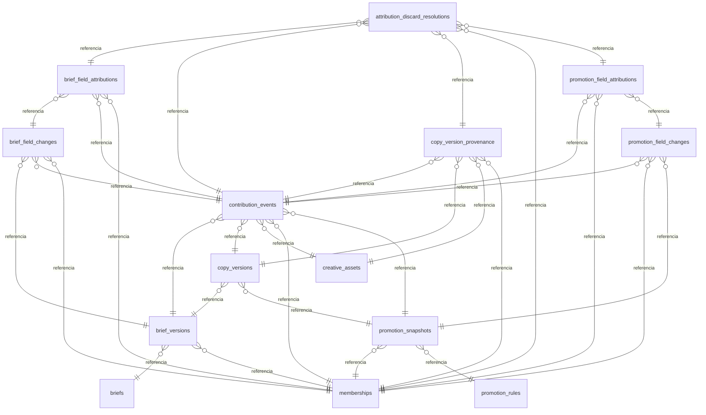

#### 4.4.5 Contrato de `version_contributors`

| Elemento | Contrato |
|---|---|
| Naturaleza | Función interna, determinista, STABLE y de solo lectura; propietario `cci_records_owner`; `EXECUTE` solo para otras funciones; no invocable por `authenticated` (IG5-63, IS-15) |
| Entradas | Organización, pieza y versión exacta de copy; sin actor ni fecha del cliente |
| Fuentes físicas | copy_versions (created_by, brief_version_id, promotion_snapshot_id, parent_version_id), brief_versions, brief_field_changes, brief_field_attributions, promotion_snapshots, promotion_field_changes, promotion_field_attributions, creative_assets (versión exacta, uploaded_by, reused_from_asset_id), contribution_events, copy_version_provenance |
| Procedimiento | 1 recibe organización, pieza y versión exacta. 2 lee la fila de copy_versions y sus referencias fijadas; si falta, CONTRIBUYENTES_NO_DETERMINABLES. 3 `verify_version_chain` sobre parent_version_id; VERSION_CHAIN_INCONSISTENTE. 4 lee la autoría, los eventos de copy y la procedencia de copy; COPY_PROVENANCE_INCOMPLETA si falta alguna unidad. 5 brief: comprueba integrity_status de la versión fijada (BRIEF_VERSION_NO_VERIFICABLE) y ejecuta `verify_field_provenance` (BRIEF_CHAIN_INCONSISTENTE, BRIEF_FIELD_PROVENANCE_INCOMPLETE). 6 promoción, si hay snapshot fijado: PROMOTION_SNAPSHOT_NO_VERIFICABLE, PROMOTION_CHAIN_INCONSISTENTE, PROMOTION_FIELD_PROVENANCE_INCOMPLETE. 7 arte: filas de arte de la versión y su procedencia; ASSET_PROVENANCE_NO_VERIFICABLE. 8 reúne las filas de atribución de cada fuente y aplica las resoluciones aceptadas de `attribution_discard_resolutions`: solo ellas producen históricos. 9 clasifica cada persona en una de cinco categorías (IG5-77). 10 elimina duplicados por identidad de persona sin eliminar evidencia. 11 calcula el indicador de completitud: verdadero solo si 2 a 7 terminaron sin error. 12 devuelve el conjunto de contribuyentes activos, las evidencias, los históricos, los actores no contribuyentes, la cadena consultada, el estado de integridad, la completitud y los errores |
| Salidas por persona | contributor_id; tipo de contribución; campo material; versión de origen; evento de origen; relación (directa o heredada); categoría; evidencia; cadena de versiones consultada |
| Salidas globales | Estado de integridad; indicador de completitud; lista de errores; **nunca** un conjunto parcial presentado como completo |
| Categorías | (1) contribuyente directo; (2) contribuyente heredado activo; (3) contribuyente histórico por resolución independiente aceptada (se devuelve como evidencia separada con la referencia a la resolución; integra E solo si conserva otra contribución activa); (4) actor no contribuyente (recorded_by sin aportación: revisores, comentaristas, Admin, operaciones automáticas); (5) procedencia no verificable (fuerza un error) |
| Errores (10) | CONTRIBUYENTES_NO_DETERMINABLES; BRIEF_VERSION_NO_VERIFICABLE; PROMOTION_SNAPSHOT_NO_VERIFICABLE; BRIEF_CHAIN_INCONSISTENTE; PROMOTION_CHAIN_INCONSISTENTE; BRIEF_FIELD_PROVENANCE_INCOMPLETE; PROMOTION_FIELD_PROVENANCE_INCOMPLETE; ASSET_PROVENANCE_NO_VERIFICABLE; COPY_PROVENANCE_INCOMPLETA; VERSION_CHAIN_INCONSISTENTE |
| Bloqueos ante un error | Evaluación de impacto; confirmación de independencia; aprobación o publicación que dependan de esa evaluación; ninguna ausencia de evidencia se convierte en ausencia de contribuyente |
| Levantamiento | Solo cuando la fuente faltante esté representada y verificada; nunca por excepción administrativa ni por intervención de Admin (IG5-64, IG5-78) |

#### 4.4.6 Elegibilidad de quien propone la clasificación (DT-02)

**Regla sin alternativas:** la persona que propuso la clasificación independiente vigente de una adaptación no puede evaluar el impacto de esa misma adaptación (IG5-45). La exclusión es por adaptación y por clasificación vigente. (1) `propose_independence` registra al actor autenticado y la clasificación propuesta; (2) la identidad del proponente queda vinculada al evento de clasificación; (3) mientras esa clasificación siga vigente, el proponente está excluido (P en E); (4) si la clasificación se reemplaza o revierte, deja de aplicarse la exclusión derivada de esa propuesta; (5) la exclusión histórica no desaparece de la auditoría; (6) quien confirma o revierte la clasificación no queda excluido solo por esa operación; (7) si es contribuyente por otra causa, queda excluido por esa causa; (8) el proponente no puede confirmar su propia propuesta (IG5-67); (9) no se crea permiso; (10) no se modifica T-02; (11) no se concede autoridad automática a Admin, al propietario ni a quien asigna el revisor. La evaluación revalida bajo bloqueo la clasificación vigente y la identidad de su proponente antes de guardar (IG5-68). Sin evaluador elegible la operación falla cerrada.

#### 4.4.7 Flujo integrado de DT-01, PC-02, DT-02, H-02 y H-03

1 Se crea una versión inmutable del brief con sus filas de cambio y atribución por campo. 2 Se crea un snapshot promocional inmutable cuando corresponde, con sus filas por campo. 3 Se registran los assets exactos usados. 4 Se crea una versión inmutable de copy con referencias exactas a esas fuentes. 5 Se registran las contribuciones directas. 6 Se registra y conserva la procedencia heredada. 7 `verify_version_chain` y `verify_field_provenance` validan las cadenas. 8 Se ejecuta `version_contributors`. 9 Se obtiene el conjunto completo E. 10 Se recupera la clasificación vigente y su proponente. 11 Se comprueba la elegibilidad del evaluador. 12 Se verifica que es miembro activo, tiene `piece.review`, tiene asignación vigente y no pertenece a E. 13 Se revalidan las condiciones bajo el mecanismo de concurrencia (4.10). 14 Se verifica el par exacto de versiones aprobadas de master y adaptación. 15 Se registra la evaluación de impacto. 16 Se comprueban C1 a C9 de G-7. 17 Se registra el intento de publicación y sus resultados (G-10). 18 Se bloquea cualquier publicación cuando falte una evidencia o condición requerida. 19 Se exige la aprobación humana independiente de la versión exacta. Una modificación material posterior requiere una versión o registro nuevo y repetir las verificaciones que correspondan (IG5-89).

La evaluación solo se registra cuando la procedencia está completa, el evaluador es elegible, la asignación y la clasificación están vigentes, las versiones exactas coinciden y se cumplen las reglas de concurrencia y bloqueo. No agrega estado ni transición a T-02, no cambia el requisito de aprobación independiente de la versión y no sustituye la aprobación humana de la pieza.

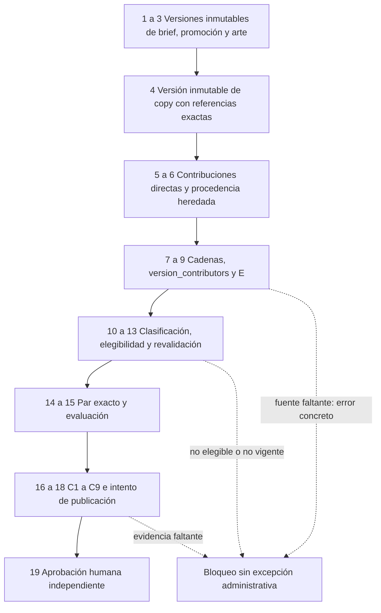

#### 4.4.8 Reconstrucción determinista de contribuyentes de brief y promociones (H-02)

**Defecto de la v5.** `brief_versions` y `promotion_snapshots` existían, pero no se definía cómo se reconstruyen los contribuyentes de versiones anteriores cuyos campos permanecen en la versión usada por el copy. La cadena de versiones no resuelve la atribución por sí sola: la procedencia se reconstruye **por campo material** (IG5-69). No se usa IA, embeddings, similitud semántica ni inferencias probabilísticas como autoridad (IG5-43, IG5-70).

**Qué se identifica para cada campo material y dónde está.**

| Requisito | Representación física |
|---|---|
| Valor anterior | `prior_value_hash` (y `prior_segments`) en la fila de cambio de la versión |
| Valor nuevo | `new_value_hash` |
| Versión de origen | `origin_version_id` de cada fila de atribución |
| Evento de modificación | `contribution_event_id` de la fila de cambio y de cada atribución |
| Persona que realizó el cambio | `actor_id` (fila de cambio) y `contributor_id` (atribución); ambos iguales al contribuyente del evento por FK compuesta |
| El contenido sigue presente en la versión exacta | Fila de atribución de la versión exacta; permanece activa mientras no exista una resolución aceptada de descarte (IG5-92) |
| Fue sustituido o eliminado | `change_kind` = sustituido o eliminado (clasificación técnica, IG5-91); la atribución solo es histórica si existe una resolución aceptada en `attribution_discard_resolutions` |
| Atribución completa y verificable | `integrity_status` de la versión y el resultado de `verify_field_provenance` (IG5-76) |

**Campos materiales del brief (12).** | Clave | Campo material | Tratamiento de segmentos |
|---|---|---|
| objective | Objetivo comercial | texto por segmentos |
| audience | Audiencia | texto por segmentos |
| promoted_item | Producto o servicio | valor único |
| value_proposition | Propuesta de valor | texto por segmentos |
| main_benefit | Beneficio principal | texto por segmentos |
| required_claims | Claims obligatorios | lista (un claim por línea) |
| prohibited_claims | Claims prohibidos | lista (un claim por línea) |
| commercial_offer | Oferta y condiciones solicitadas | texto por segmentos |
| cta | CTA | valor único |
| requested_channel | Canal | valor único |
| requested_format | Formato | valor único |
| tone_directive | Tono y directrices que afectan al contenido | texto por segmentos |

**Campos materiales de la promoción (9).** | Clave | Campo material | Tratamiento de segmentos |
|---|---|---|
| promotion_code | Promotion code | valor único |
| included_items | SKU y productos | lista (un SKU por línea) |
| reference_price | Precio de referencia | valor único |
| promotional_price | Precio promocional | valor único |
| discount | Descuento | valor único |
| validity | Vigencia (valid_from y valid_to) | valor único |
| conditions | Condiciones | texto por segmentos |
| currency | Moneda | valor único |
| commercial_restrictions | Restricciones aplicables | texto por segmentos |

**Regla de cambio por campo (IG5-70).** Normalización exclusiva: Unicode NFKC, saltos de línea, espacios repetidos y espacios al inicio o final. Segmento: cada línea no vacía; un campo de valor único tiene un solo segmento. `retained_segments` cuenta los segmentos del valor anterior que aparecen idénticos en el valor nuevo.

| change_kind | Condición exacta | Efecto |
|---|---|---|
| sin_cambio | El hash nuevo es igual al anterior (o ambos ausentes) | Sin evento; las atribuciones pasan sin cambio |
| introducido | No había valor anterior y hay valor nuevo | Evento de quien introdujo el campo |
| modificado | El valor cambia y retained_segments >= 1 | Evento de quien modificó; se conservan las atribuciones activas |
| sustituido | El valor cambia y retained_segments = 0 con valor anterior | Evento de quien sustituyó; las atribuciones activas anteriores se conservan (IG5-72, IG5-90) |
| eliminado | Había valor anterior y el valor nuevo está vacío o ausente | Evento de quien eliminó; las atribuciones activas anteriores se conservan provisionalmente (IG5-72, IG5-90) |

**Cálculo de atribuciones de la versión V_n (IG5-72).** Cada versión recibe en la misma transacción todas sus filas de atribución, calculadas desde las de V_n-1 y nunca modificando filas de versiones anteriores:

| change_kind | Filas de V_n-1 | Fila nueva en V_n |
|---|---|---|
| sin_cambio | Hereda todas las filas de V_n-1 con su condición activa o histórica | Ninguna |
| introducido | — | Directa activa para el evento de V_n |
| modificado | Activas heredadas activas; históricas por resolución siguen históricas | Directa activa para quien modificó |
| sustituido | Activas heredadas activas provisionalmente; históricas por resolución siguen históricas | Directa activa para quien sustituyó |
| eliminado | Activas heredadas activas provisionalmente; históricas por resolución siguen históricas | Directa activa para quien eliminó (modificó materialmente el contenido) |

**Garantías.** (1) Una modificación de un campo no altera las atribuciones de otro: cambiar el descuento no borra a quien definió las condiciones que permanecen. (2) El historial se conserva íntegro: ninguna fila se borra ni se reescribe y una atribución histórica por resolución no vuelve a activa (IG5-73). (3) No se atribuye automáticamente todo cambio de una versión a su creador ni se elimina a los autores anteriores por existir una versión nueva ni por una comparación textual (IG5-90, IG5-91). (4) La regla es conservadora y se declara como limitación: en un campo `modificado` se conservan todas las atribuciones activas del campo aunque la parte conservada provenga de una sola persona; esa sobreinclusión excluye a más personas de evaluar y nunca a menos (PO-16, doubt ⇒ se conserva).

**Resolución independiente de descarte (IG5-90 a IG5-94).** Principio: una atribución activa anterior se conserva cuando el campo se modifica o se sustituye, salvo que exista una resolución humana independiente, documentada y respaldada por evidencia que determine que la contribución anterior fue realmente descartada. La clasificación técnica del cambio y el estado de la atribución son conceptos separados: `sustituido` no permite excluir a nadie y `eliminado` no borra la procedencia. Una atribución pasa a histórica únicamente por una resolución aceptada en `attribution_discard_resolutions`; la fila de atribución no se modifica (la condición se deriva) y el descarte no puede deducirse por comparación textual, hash, similitud, embeddings ni coincidencia de segmentos.

**Contenido obligatorio de la resolución y su representación.**

| Contenido exigido | Representación física |
|---|---|
| Organización | `organization_id` |
| Fuente | `source_kind` ('brief', 'promotion', 'copy' o 'asset') |
| Versión de origen | `origin_version_id` de la atribución referenciada (FK compuesta) |
| Versión actual | Versión de la atribución referenciada; una resolución sobre otra versión se rechaza (IG5-93) |
| Campo material | `field_key` (igual al de la atribución por FK compuesta) |
| Persona cuya atribución se propone retirar | `affected_contributor_id` (igual al de la atribución por FK compuesta) |
| Actor que solicita | `requested_by` |
| Actor independiente que resuelve | `resolved_by` (= `created_by`; lo fija el servidor con `auth.uid()`) |
| Motivo | `reason` (no vacío) |
| Evidencia concreta | `evidence` (no vacía) |
| Fecha | `resolved_at` |
| Resultado | `outcome` ('aceptada' o 'rechazada') |
| Referencia a la atribución anterior | `brief_attribution_id`, `promotion_attribution_id` o `copy_provenance_id` (exactamente una) |
| Referencia a la resolución que produce el cambio de estado | `id` de la resolución aceptada; `version_contributors` la devuelve en cada atribución histórica |

**Reglas de independencia (IG5-92).** 1 El contribuyente afectado no puede resolver su propia exclusión. 2 El autor de la modificación que motivó la solicitud no puede resolver nunca, ni solo ni con otros (R5, IG5-95). 3 El resolutor es independiente de la contribución y de la solicitud: no es contribuyente directo del campo en ninguna versión de la cadena. 4 Tiene autoridad de revisión conforme a las reglas vigentes (`piece.review`, miembro activo). 5 No se crea una clave de permiso. 6 No se modifica T-02. 7 La resolución no reescribe registros históricos. 8 La corrección es un registro nuevo. 9 La atribución original se conserva como evidencia. 10 Sin evidencia suficiente la atribución permanece activa. El propietario y Admin no eliminan contribuyentes por su cargo. Si las reglas vigentes no permiten identificar un resolutor independiente, el resultado es fail-closed: la atribución permanece activa.

**Relación con el conjunto E (IG5-94).** E incorpora los contribuyentes directos de la versión exacta de adaptación, los heredados activos, los de la versión exacta de la maestra y de las versiones intermedias del intervalo definido, los de briefs y promociones exactos con sus atribuciones activas por campo, los de los assets exactos usados y el proponente de la clasificación de independencia vigente. Las atribuciones históricas por resolución se entregan como evidencia separada y no integran E solo cuando la resolución es válida, completa, verificable e independiente. E nunca se calcula como completo si una de sus fuentes está incompleta.

**Algoritmo para una versión exacta B_n del brief (IG5-74, IG5-76).** 1 Obtener la cadena desde B_n por `previous_version_id` hasta la raíz. 2 Comprobar que todas las versiones pertenecen a la misma organización y al mismo brief (las FK compuestas lo imponen en la escritura; se recomprueba en la lectura). 3 Comprobar que no hay ciclos (el recorrido se detiene tras n pasos), saltos de `version_number` ni referencias rotas, y una sola raíz. 4 Para cada versión y cada uno de los 12 campos, leer la fila de `brief_field_changes` y comprobar que existen exactamente 12. 5 Relacionar cada cambio con su evento y su persona (FK compuesta evento-versión-actor). 6 Conservar las atribuciones de quienes introdujeron campos que siguen presentes. 7 Incorporar a quienes modificaron materialmente esos campos. 8 Conservar activas las atribuciones anteriores de los campos modificados, sustituidos o eliminados y aplicar solo las resoluciones aceptadas de `attribution_discard_resolutions` (IG5-72, IG5-92). 9 Conservar el historial de atribución. 10 Recalcular las atribuciones esperadas desde la raíz y compararlas con las filas almacenadas; si no se puede demostrar qué ocurrió con un campo o hay diferencia, BRIEF_FIELD_PROVENANCE_INCOMPLETE; si la cadena falla, BRIEF_CHAIN_INCONSISTENTE.

**Algoritmo para un snapshot exacto S_n de la promoción (IG5-75, IG5-76).** 1 Recorrer `previous_snapshot_id` hasta la raíz. 2 Comprobar organización y pertenencia a la misma `promotion_line_id`. 3 Comprobar continuidad (una raíz, sin ciclos ni referencias rotas). 4 Comparar los 9 campos materiales con su predecesor. 5 Relacionar cada modificación con su evento y actor. 6 Conservar la atribución de campos sin cambios. 7 Incorporar a quienes modifican materialmente campos. 8 Conservar activas las atribuciones de los campos modificados, sustituidos o eliminados y aplicar solo las resoluciones aceptadas (IG5-92). 9 Conservar la historia de los snapshots anteriores. 10 Bloquear si la procedencia no puede reconstruirse (PROMOTION_CHAIN_INCONSISTENTE o PROMOTION_FIELD_PROVENANCE_INCOMPLETE).

**Ejemplo (cadena de cuatro versiones de brief).** B1 (A) introduce objetivo, audiencia, producto, propuesta de valor y beneficio; B2 (C) modifica la propuesta de valor conservando una línea; B3 (D) sustituye el CTA; B4 (E) elimina los claims prohibidos que C había introducido. Atribuciones activas en B4: objetivo, audiencia, producto y beneficio de A; propuesta de valor de A (heredada) y C (directa); CTA de D; los claims prohibidos conservan la atribución activa de C provisionalmente y E figura además como contribuyente directo de la eliminación; el CTA original conserva la atribución activa de su autor y D se incorpora como directo; ninguna atribución pasa a histórica sin una resolución independiente aceptada. `version_contributors` de un copy que fija B4 devuelve A, C, D y E con su evidencia, y, aparte, los históricos por resolución aceptada si existieran.

**Pruebas:** T-275 a T-300 (26 escenarios, ninguno ejecutado).

#### 4.4.9 Contrato de integridad entre eventos, versiones, snapshots, assets y personas (H-03)

**Defecto de la v5.** Describía relaciones con FK y triggers, pero no fijaba todas las condiciones que impiden asociar un evento a una fuente que no le corresponde. Una FK simple no basta cuando la integridad depende de la organización, de la versión exacta, del tipo de origen y del actor (IG5-80).

**Qué valida cada relación (A).** Organización (`organization_id` en toda clave), identificador de la entidad, versión exacta, tipo de origen (`origin_kind` y columna tipada), actor autenticado (`contributor_id` igual al del evento) y evento correspondiente. **Claves únicas de destino que respaldan las FK compuestas:** `contribution_events`: (organization_id, id, contributor_id, origin_kind), (organization_id, id, brief_version_id, contributor_id), (organization_id, id, promotion_snapshot_id, contributor_id), (organization_id, id, copy_version_id), (organization_id, id, creative_asset_id); `brief_versions`: (organization_id, brief_id, id); `promotion_snapshots`: (organization_id, promotion_line_id, id); `brief_field_changes` y `promotion_field_changes`: (organization_id, versión, field_key); `copy_versions`: (organization_id, id) y (organization_id, piece_id, id); `creative_assets`: (organization_id, id) y (organization_id, copy_version_id, id).

**Claves de destino de las tablas históricas referenciadas (G).** Las claves únicas se agregan a las tablas históricas (IM-12); las columnas son uuid salvo is_adaptation (boolean). El verificador exige que las columnas referenciadas de cada FK coincidan, en el mismo orden, con la clave primaria o una clave única del destino.

| Tabla | Columnas y tipos | Claves únicas |
|---|---|---|
| memberships | organization_id uuid, user_id uuid | unique(organization_id, user_id) |
| briefs | organization_id uuid, id uuid | unique(organization_id, id) |
| copy_versions | organization_id uuid, id uuid, piece_id uuid | unique(organization_id, id); unique(organization_id, piece_id, id) |
| creative_assets | organization_id uuid, id uuid, copy_version_id uuid, piece_id uuid | unique(organization_id, id); unique(organization_id, copy_version_id, id); unique(organization_id, piece_id, id, copy_version_id) |
| promotion_rules | organization_id uuid, id uuid | unique(organization_id, id) |
| creative_pieces | organization_id uuid, id uuid, is_adaptation boolean | unique(organization_id, id); unique(organization_id, id, is_adaptation) |
| approvals | organization_id uuid, id uuid, copy_version_id uuid | unique(organization_id, id, copy_version_id) |

**Contrato de integridad (F).** Cada fila es una relación; toda FK es compuesta e incluye `organization_id`.

| Relación | Tabla origen | Tabla destino | FK o restricción | Columnas | Condición de integridad | Mecanismo de validación | Momento de validación | Error si falla | Consecuencia funcional |
|---|---|---|---|---|---|---|---|---|---|
| brief_versions → briefs | brief_versions | briefs | FK compuesta: (organization_id, brief_id) → briefs(organization_id, id) | organization_id, brief_id | El brief o la promoción pertenece a la misma organización | FK declarativa respaldada por clave única de destino | Al insertar (BEFORE/AFTER INSERT, comprobación de la FK) | BRIEF_FIELD_PROVENANCE_INCOMPLETE (rechazo de la escritura) | La escritura no se confirma; la versión no pasa las validaciones dependientes |
| brief_versions → memberships | brief_versions | memberships | FK compuesta: (organization_id, created_by) → memberships(organization_id, user_id) | organization_id, created_by | La persona es miembro de la misma organización | FK declarativa respaldada por clave única de destino | Al insertar (BEFORE/AFTER INSERT, comprobación de la FK) | Violación de integridad referencial (rechazo de la escritura) | La escritura no se confirma; la versión no pasa las validaciones dependientes |
| brief_versions → brief_versions | brief_versions | brief_versions | FK compuesta: (organization_id, brief_id, previous_version_id) → brief_versions(organization_id, brief_id, id) | organization_id, brief_id, previous_version_id | La versión exacta existe en la misma organización y en la misma cadena (brief o promoción) | FK declarativa respaldada por clave única de destino | Al insertar (BEFORE/AFTER INSERT, comprobación de la FK) | BRIEF_FIELD_PROVENANCE_INCOMPLETE (rechazo de la escritura) | La escritura no se confirma; la versión no pasa las validaciones dependientes |
| brief_field_changes → brief_versions | brief_field_changes | brief_versions | FK compuesta: (organization_id, brief_id, brief_version_id) → brief_versions(organization_id, brief_id, id) | organization_id, brief_id, brief_version_id | La versión exacta existe en la misma organización y en la misma cadena (brief o promoción) | FK declarativa respaldada por clave única de destino | Al insertar (BEFORE/AFTER INSERT, comprobación de la FK) | BRIEF_FIELD_PROVENANCE_INCOMPLETE (rechazo de la escritura) | La escritura no se confirma; la versión no pasa las validaciones dependientes |
| brief_field_changes → contribution_events | brief_field_changes | contribution_events | FK compuesta: (organization_id, contribution_event_id, brief_version_id, actor_id) → contribution_events(organization_id, id, brief_version_id, contributor_id) | organization_id, contribution_event_id, brief_version_id, actor_id | El evento existe en la misma organización, corresponde al origen tipado y su contribuyente coincide con la persona de la fila | FK declarativa respaldada por clave única de destino | Al insertar (BEFORE/AFTER INSERT, comprobación de la FK) | Violación de integridad referencial (rechazo de la escritura) | La escritura no se confirma; la versión no pasa las validaciones dependientes |
| brief_field_changes → memberships | brief_field_changes | memberships | FK compuesta: (organization_id, created_by) → memberships(organization_id, user_id) | organization_id, created_by | La persona es miembro de la misma organización | FK declarativa respaldada por clave única de destino | Al insertar (BEFORE/AFTER INSERT, comprobación de la FK) | Violación de integridad referencial (rechazo de la escritura) | La escritura no se confirma; la versión no pasa las validaciones dependientes |
| brief_field_attributions → brief_field_changes | brief_field_attributions | brief_field_changes | FK compuesta: (organization_id, brief_version_id, field_key) → brief_field_changes(organization_id, brief_version_id, field_key) | organization_id, brief_version_id, field_key | La fila de cambio del mismo campo y de la misma versión existe | FK declarativa respaldada por clave única de destino | Al insertar (BEFORE/AFTER INSERT, comprobación de la FK) | BRIEF_FIELD_PROVENANCE_INCOMPLETE (rechazo de la escritura) | La escritura no se confirma; la versión no pasa las validaciones dependientes |
| brief_field_attributions → contribution_events | brief_field_attributions | contribution_events | FK compuesta: (organization_id, contribution_event_id, origin_version_id, contributor_id) → contribution_events(organization_id, id, brief_version_id, contributor_id) | organization_id, contribution_event_id, origin_version_id, contributor_id | El evento existe en la misma organización, corresponde al origen tipado y su contribuyente coincide con la persona de la fila | FK declarativa respaldada por clave única de destino | Al insertar (BEFORE/AFTER INSERT, comprobación de la FK) | Violación de integridad referencial (rechazo de la escritura) | La escritura no se confirma; la versión no pasa las validaciones dependientes |
| brief_field_attributions → brief_field_attributions | brief_field_attributions | brief_field_attributions | FK compuesta: (organization_id, previous_attribution_id) → brief_field_attributions(organization_id, id) | organization_id, previous_attribution_id | La fila antecesora existe en la misma organización y pertenece a la versión anterior de la misma cadena | FK declarativa respaldada por clave única de destino | Al insertar (BEFORE/AFTER INSERT, comprobación de la FK) | BRIEF_FIELD_PROVENANCE_INCOMPLETE (rechazo de la escritura) | La escritura no se confirma; la versión no pasa las validaciones dependientes |
| brief_field_attributions → memberships | brief_field_attributions | memberships | FK compuesta: (organization_id, created_by) → memberships(organization_id, user_id) | organization_id, created_by | La persona es miembro de la misma organización | FK declarativa respaldada por clave única de destino | Al insertar (BEFORE/AFTER INSERT, comprobación de la FK) | Violación de integridad referencial (rechazo de la escritura) | La escritura no se confirma; la versión no pasa las validaciones dependientes |
| promotion_snapshots → promotion_rules | promotion_snapshots | promotion_rules | FK compuesta: (organization_id, promotion_rule_id) → promotion_rules(organization_id, id) | organization_id, promotion_rule_id | El brief o la promoción pertenece a la misma organización | FK declarativa respaldada por clave única de destino | Al insertar (BEFORE/AFTER INSERT, comprobación de la FK) | PROMOTION_FIELD_PROVENANCE_INCOMPLETE (rechazo de la escritura) | La escritura no se confirma; la versión no pasa las validaciones dependientes |
| promotion_snapshots → memberships | promotion_snapshots | memberships | FK compuesta: (organization_id, created_by) → memberships(organization_id, user_id) | organization_id, created_by | La persona es miembro de la misma organización | FK declarativa respaldada por clave única de destino | Al insertar (BEFORE/AFTER INSERT, comprobación de la FK) | PROMOTION_FIELD_PROVENANCE_INCOMPLETE (rechazo de la escritura) | La escritura no se confirma; la versión no pasa las validaciones dependientes |
| promotion_snapshots → promotion_snapshots | promotion_snapshots | promotion_snapshots | FK compuesta: (organization_id, promotion_line_id, previous_snapshot_id) → promotion_snapshots(organization_id, promotion_line_id, id) | organization_id, promotion_line_id, previous_snapshot_id | La versión exacta existe en la misma organización y en la misma cadena (brief o promoción) | FK declarativa respaldada por clave única de destino | Al insertar (BEFORE/AFTER INSERT, comprobación de la FK) | PROMOTION_FIELD_PROVENANCE_INCOMPLETE (rechazo de la escritura) | La escritura no se confirma; la versión no pasa las validaciones dependientes |
| promotion_field_changes → promotion_snapshots | promotion_field_changes | promotion_snapshots | FK compuesta: (organization_id, promotion_line_id, promotion_snapshot_id) → promotion_snapshots(organization_id, promotion_line_id, id) | organization_id, promotion_line_id, promotion_snapshot_id | La versión exacta existe en la misma organización y en la misma cadena (brief o promoción) | FK declarativa respaldada por clave única de destino | Al insertar (BEFORE/AFTER INSERT, comprobación de la FK) | PROMOTION_FIELD_PROVENANCE_INCOMPLETE (rechazo de la escritura) | La escritura no se confirma; la versión no pasa las validaciones dependientes |
| promotion_field_changes → contribution_events | promotion_field_changes | contribution_events | FK compuesta: (organization_id, contribution_event_id, promotion_snapshot_id, actor_id) → contribution_events(organization_id, id, promotion_snapshot_id, contributor_id) | organization_id, contribution_event_id, promotion_snapshot_id, actor_id | El evento existe en la misma organización, corresponde al origen tipado y su contribuyente coincide con la persona de la fila | FK declarativa respaldada por clave única de destino | Al insertar (BEFORE/AFTER INSERT, comprobación de la FK) | PROMOTION_FIELD_PROVENANCE_INCOMPLETE (rechazo de la escritura) | La escritura no se confirma; la versión no pasa las validaciones dependientes |
| promotion_field_changes → memberships | promotion_field_changes | memberships | FK compuesta: (organization_id, created_by) → memberships(organization_id, user_id) | organization_id, created_by | La persona es miembro de la misma organización | FK declarativa respaldada por clave única de destino | Al insertar (BEFORE/AFTER INSERT, comprobación de la FK) | PROMOTION_FIELD_PROVENANCE_INCOMPLETE (rechazo de la escritura) | La escritura no se confirma; la versión no pasa las validaciones dependientes |
| promotion_field_attributions → promotion_field_changes | promotion_field_attributions | promotion_field_changes | FK compuesta: (organization_id, promotion_snapshot_id, field_key) → promotion_field_changes(organization_id, promotion_snapshot_id, field_key) | organization_id, promotion_snapshot_id, field_key | La fila de cambio del mismo campo y de la misma versión existe | FK declarativa respaldada por clave única de destino | Al insertar (BEFORE/AFTER INSERT, comprobación de la FK) | PROMOTION_FIELD_PROVENANCE_INCOMPLETE (rechazo de la escritura) | La escritura no se confirma; la versión no pasa las validaciones dependientes |
| promotion_field_attributions → contribution_events | promotion_field_attributions | contribution_events | FK compuesta: (organization_id, contribution_event_id, origin_version_id, contributor_id) → contribution_events(organization_id, id, promotion_snapshot_id, contributor_id) | organization_id, contribution_event_id, origin_version_id, contributor_id | El evento existe en la misma organización, corresponde al origen tipado y su contribuyente coincide con la persona de la fila | FK declarativa respaldada por clave única de destino | Al insertar (BEFORE/AFTER INSERT, comprobación de la FK) | PROMOTION_FIELD_PROVENANCE_INCOMPLETE (rechazo de la escritura) | La escritura no se confirma; la versión no pasa las validaciones dependientes |
| promotion_field_attributions → promotion_field_attributions | promotion_field_attributions | promotion_field_attributions | FK compuesta: (organization_id, previous_attribution_id) → promotion_field_attributions(organization_id, id) | organization_id, previous_attribution_id | La fila antecesora existe en la misma organización y pertenece a la versión anterior de la misma cadena | FK declarativa respaldada por clave única de destino | Al insertar (BEFORE/AFTER INSERT, comprobación de la FK) | PROMOTION_FIELD_PROVENANCE_INCOMPLETE (rechazo de la escritura) | La escritura no se confirma; la versión no pasa las validaciones dependientes |
| promotion_field_attributions → memberships | promotion_field_attributions | memberships | FK compuesta: (organization_id, created_by) → memberships(organization_id, user_id) | organization_id, created_by | La persona es miembro de la misma organización | FK declarativa respaldada por clave única de destino | Al insertar (BEFORE/AFTER INSERT, comprobación de la FK) | PROMOTION_FIELD_PROVENANCE_INCOMPLETE (rechazo de la escritura) | La escritura no se confirma; la versión no pasa las validaciones dependientes |
| contribution_events → memberships | contribution_events | memberships | FK compuesta: (organization_id, contributor_id) → memberships(organization_id, user_id) | organization_id, contributor_id | La persona es miembro de la misma organización | FK declarativa respaldada por clave única de destino | Al insertar (BEFORE/AFTER INSERT, comprobación de la FK) | Violación de integridad referencial (rechazo de la escritura) | La escritura no se confirma; la versión no pasa las validaciones dependientes |
| contribution_events → brief_versions | contribution_events | brief_versions | FK compuesta: (organization_id, brief_version_id) → brief_versions(organization_id, id) | organization_id, brief_version_id | La versión exacta existe en la misma organización y en la misma cadena (brief o promoción) | FK declarativa respaldada por clave única de destino | Al insertar (BEFORE/AFTER INSERT, comprobación de la FK) | Violación de integridad referencial (rechazo de la escritura) | La escritura no se confirma; la versión no pasa las validaciones dependientes |
| contribution_events → contribution_events | contribution_events | contribution_events | FK compuesta: (organization_id, previous_event_id) → contribution_events(organization_id, id) | organization_id, previous_event_id | El evento existe en la misma organización, corresponde al origen tipado y su contribuyente coincide con la persona de la fila | FK declarativa respaldada por clave única de destino | Al insertar (BEFORE/AFTER INSERT, comprobación de la FK) | Violación de integridad referencial (rechazo de la escritura) | La escritura no se confirma; la versión no pasa las validaciones dependientes |
| copy_version_provenance → copy_versions | copy_version_provenance | copy_versions | FK compuesta: (organization_id, piece_id, copy_version_id) → copy_versions(organization_id, piece_id, id) | organization_id, piece_id, copy_version_id | La versión exacta de copy existe en la misma organización y pertenece a la pieza indicada | FK declarativa respaldada por clave única de destino | Al insertar (BEFORE/AFTER INSERT, comprobación de la FK) | COPY_PROVENANCE_INCOMPLETA (rechazo de la escritura) | La escritura no se confirma; la versión no pasa las validaciones dependientes |
| copy_version_provenance → contribution_events | copy_version_provenance | contribution_events | FK compuesta: (organization_id, contribution_event_id, contributor_id, origin_kind) → contribution_events(organization_id, id, contributor_id, origin_kind) | organization_id, contribution_event_id, contributor_id, origin_kind | El evento existe en la misma organización, corresponde al origen tipado y su contribuyente coincide con la persona de la fila | FK declarativa respaldada por clave única de destino | Al insertar (BEFORE/AFTER INSERT, comprobación de la FK) | COPY_PROVENANCE_INCOMPLETA (rechazo de la escritura) | La escritura no se confirma; la versión no pasa las validaciones dependientes |
| copy_version_provenance → contribution_events | copy_version_provenance | contribution_events | FK compuesta: (organization_id, contribution_event_id, origin_copy_version_id) → contribution_events(organization_id, id, copy_version_id) | organization_id, contribution_event_id, origin_copy_version_id | El evento existe en la misma organización, corresponde al origen tipado y su contribuyente coincide con la persona de la fila | FK declarativa respaldada por clave única de destino | Al insertar (BEFORE/AFTER INSERT, comprobación de la FK) | COPY_PROVENANCE_INCOMPLETA (rechazo de la escritura) | La escritura no se confirma; la versión no pasa las validaciones dependientes |
| copy_version_provenance → copy_versions | copy_version_provenance | copy_versions | FK compuesta: (organization_id, origin_piece_id, origin_copy_version_id) → copy_versions(organization_id, piece_id, id) | organization_id, origin_piece_id, origin_copy_version_id | La versión exacta de copy existe en la misma organización y pertenece a la pieza indicada | FK declarativa respaldada por clave única de destino | Al insertar (BEFORE/AFTER INSERT, comprobación de la FK) | COPY_PROVENANCE_INCOMPLETA (rechazo de la escritura) | La escritura no se confirma; la versión no pasa las validaciones dependientes |
| copy_version_provenance → copy_version_provenance | copy_version_provenance | copy_version_provenance | FK compuesta: (organization_id, previous_provenance_id) → copy_version_provenance(organization_id, id) | organization_id, previous_provenance_id | La fila antecesora existe en la misma organización y pertenece a la versión anterior de la misma cadena | FK declarativa respaldada por clave única de destino | Al insertar (BEFORE/AFTER INSERT, comprobación de la FK) | COPY_PROVENANCE_INCOMPLETA (rechazo de la escritura) | La escritura no se confirma; la versión no pasa las validaciones dependientes |
| copy_version_provenance → memberships | copy_version_provenance | memberships | FK compuesta: (organization_id, created_by) → memberships(organization_id, user_id) | organization_id, created_by | La persona es miembro de la misma organización | FK declarativa respaldada por clave única de destino | Al insertar (BEFORE/AFTER INSERT, comprobación de la FK) | COPY_PROVENANCE_INCOMPLETA (rechazo de la escritura) | La escritura no se confirma; la versión no pasa las validaciones dependientes |
| attribution_discard_resolutions → brief_field_attributions | attribution_discard_resolutions | brief_field_attributions | FK compuesta: (organization_id, brief_attribution_id, field_key, affected_contributor_id) → brief_field_attributions(organization_id, id, field_key, contributor_id) | organization_id, brief_attribution_id, field_key, affected_contributor_id | La fila antecesora existe en la misma organización y pertenece a la versión anterior de la misma cadena | FK declarativa respaldada por clave única de destino | Al insertar (BEFORE/AFTER INSERT, comprobación de la FK) | Violación de integridad referencial (rechazo de la escritura) | La escritura no se confirma; la versión no pasa las validaciones dependientes |
| attribution_discard_resolutions → promotion_field_attributions | attribution_discard_resolutions | promotion_field_attributions | FK compuesta: (organization_id, promotion_attribution_id, field_key, affected_contributor_id) → promotion_field_attributions(organization_id, id, field_key, contributor_id) | organization_id, promotion_attribution_id, field_key, affected_contributor_id | La fila antecesora existe en la misma organización y pertenece a la versión anterior de la misma cadena | FK declarativa respaldada por clave única de destino | Al insertar (BEFORE/AFTER INSERT, comprobación de la FK) | Violación de integridad referencial (rechazo de la escritura) | La escritura no se confirma; la versión no pasa las validaciones dependientes |
| attribution_discard_resolutions → copy_version_provenance | attribution_discard_resolutions | copy_version_provenance | FK compuesta: (organization_id, copy_provenance_id, field_key, affected_contributor_id) → copy_version_provenance(organization_id, id, content_unit, contributor_id) | organization_id, copy_provenance_id, field_key, affected_contributor_id | La fila antecesora existe en la misma organización y pertenece a la versión anterior de la misma cadena | FK declarativa respaldada por clave única de destino | Al insertar (BEFORE/AFTER INSERT, comprobación de la FK) | Violación de integridad referencial (rechazo de la escritura) | La escritura no se confirma; la versión no pasa las validaciones dependientes |
| attribution_discard_resolutions → memberships | attribution_discard_resolutions | memberships | FK compuesta: (organization_id, requested_by) → memberships(organization_id, user_id) | organization_id, requested_by | La persona es miembro de la misma organización | FK declarativa respaldada por clave única de destino | Al insertar (BEFORE/AFTER INSERT, comprobación de la FK) | Violación de integridad referencial (rechazo de la escritura) | La escritura no se confirma; la versión no pasa las validaciones dependientes |
| attribution_discard_resolutions → memberships | attribution_discard_resolutions | memberships | FK compuesta: (organization_id, resolved_by) → memberships(organization_id, user_id) | organization_id, resolved_by | La persona es miembro de la misma organización | FK declarativa respaldada por clave única de destino | Al insertar (BEFORE/AFTER INSERT, comprobación de la FK) | Violación de integridad referencial (rechazo de la escritura) | La escritura no se confirma; la versión no pasa las validaciones dependientes |
| attribution_discard_resolutions → memberships | attribution_discard_resolutions | memberships | FK compuesta: (organization_id, created_by) → memberships(organization_id, user_id) | organization_id, created_by | La persona es miembro de la misma organización | FK declarativa respaldada por clave única de destino | Al insertar (BEFORE/AFTER INSERT, comprobación de la FK) | Violación de integridad referencial (rechazo de la escritura) | La escritura no se confirma; la versión no pasa las validaciones dependientes |
| attribution_discard_resolutions → contribution_events | attribution_discard_resolutions | contribution_events | FK compuesta: (organization_id, trigger_event_id, change_actor_id) → contribution_events(organization_id, id, contributor_id) | organization_id, trigger_event_id, change_actor_id | El evento existe en la misma organización, corresponde al origen tipado y su contribuyente coincide con la persona de la fila | FK declarativa respaldada por clave única de destino | Al insertar (BEFORE/AFTER INSERT, comprobación de la FK) | Violación de integridad referencial (rechazo de la escritura) | La escritura no se confirma; la versión no pasa las validaciones dependientes |
| attribution_discard_resolutions → attribution_discard_resolutions | attribution_discard_resolutions | attribution_discard_resolutions | FK compuesta: (organization_id, previous_resolution_id) → attribution_discard_resolutions(organization_id, id) | organization_id, previous_resolution_id | La referencia existe en la misma organización | FK declarativa respaldada por clave única de destino | Al insertar (BEFORE/AFTER INSERT, comprobación de la FK) | Violación de integridad referencial (rechazo de la escritura) | La escritura no se confirma; la versión no pasa las validaciones dependientes |
| copy_versions → copy_versions (columna agregada) | copy_versions | copy_versions | FK compuesta agregada: (organization_id, master_piece_id, master_copy_version_id) → copy_versions(organization_id, piece_id, id) | organization_id, master_piece_id, master_copy_version_id | La versión exacta de copy existe en la misma organización y pertenece a la pieza indicada | FK declarativa agregada con la columna de la subfase indicada | Al insertar | VERSION_CHAIN_INCONSISTENTE (rechazo de la escritura) | La escritura no se confirma |
| copy_versions → creative_assets (columna agregada) | copy_versions | creative_assets | FK compuesta agregada: (organization_id, master_piece_id, master_creative_asset_id, master_copy_version_id) → creative_assets(organization_id, piece_id, id, copy_version_id) | organization_id, master_piece_id, master_creative_asset_id, master_copy_version_id | La fila de arte existe en la misma organización y pertenece a la versión de copy que la usa | FK declarativa agregada con la columna de la subfase indicada | Al insertar | Violación de integridad referencial (rechazo de la escritura) | La escritura no se confirma |
| copy_versions → brief_versions (columna agregada) | copy_versions | brief_versions | FK compuesta agregada: (organization_id, brief_version_id) → brief_versions(organization_id, id) | organization_id, brief_version_id | La versión exacta existe en la misma organización y en la misma cadena (brief o promoción) | FK declarativa agregada con la columna de la subfase indicada | Al insertar | Violación de integridad referencial (rechazo de la escritura) | La escritura no se confirma |
| copy_versions → promotion_snapshots (columna agregada) | copy_versions | promotion_snapshots | FK compuesta agregada: (organization_id, promotion_snapshot_id) → promotion_snapshots(organization_id, id) | organization_id, promotion_snapshot_id | La versión exacta existe en la misma organización y en la misma cadena (brief o promoción) | FK declarativa agregada con la columna de la subfase indicada | Al insertar | PROMOTION_FIELD_PROVENANCE_INCOMPLETE (rechazo de la escritura) | La escritura no se confirma |
| contribution_events → copy_versions (columna agregada) | contribution_events | copy_versions | FK compuesta agregada: (organization_id, copy_version_piece_id, copy_version_id) → copy_versions(organization_id, piece_id, id) | organization_id, copy_version_piece_id, copy_version_id | La versión exacta de copy existe en la misma organización y pertenece a la pieza indicada | FK declarativa agregada con la columna de la subfase indicada | Al insertar | VERSION_CHAIN_INCONSISTENTE (rechazo de la escritura) | La escritura no se confirma |
| contribution_events → creative_assets (columna agregada) | contribution_events | creative_assets | FK compuesta agregada: (organization_id, asset_piece_id, creative_asset_id, asset_copy_version_id) → creative_assets(organization_id, piece_id, id, copy_version_id) | organization_id, asset_piece_id, creative_asset_id, asset_copy_version_id | La fila de arte existe en la misma organización y pertenece a la versión de copy que la usa | FK declarativa agregada con la columna de la subfase indicada | Al insertar | Violación de integridad referencial (rechazo de la escritura) | La escritura no se confirma |
| contribution_events → promotion_snapshots (columna agregada) | contribution_events | promotion_snapshots | FK compuesta agregada: (organization_id, promotion_snapshot_id) → promotion_snapshots(organization_id, id) | organization_id, promotion_snapshot_id | La versión exacta existe en la misma organización y en la misma cadena (brief o promoción) | FK declarativa agregada con la columna de la subfase indicada | Al insertar | PROMOTION_FIELD_PROVENANCE_INCOMPLETE (rechazo de la escritura) | La escritura no se confirma |
| creative_assets → creative_assets (columna agregada) | creative_assets | creative_assets | FK compuesta agregada: (organization_id, reused_from_asset_id) → creative_assets(organization_id, id) | organization_id, reused_from_asset_id | La fila de arte existe en la misma organización y pertenece a la versión de copy que la usa | FK declarativa agregada con la columna de la subfase indicada | Al insertar | Violación de integridad referencial (rechazo de la escritura) | La escritura no se confirma |
| copy_version_provenance → contribution_events (columna agregada) | copy_version_provenance | contribution_events | FK compuesta agregada: (organization_id, contribution_event_id, origin_asset_id) → contribution_events(organization_id, id, creative_asset_id) | organization_id, contribution_event_id, origin_asset_id | El evento existe en la misma organización, corresponde al origen tipado y su contribuyente coincide con la persona de la fila | FK declarativa agregada con la columna de la subfase indicada | Al insertar | COPY_PROVENANCE_INCOMPLETA (rechazo de la escritura) | La escritura no se confirma |
| copy_version_provenance → creative_assets (columna agregada) | copy_version_provenance | creative_assets | FK compuesta agregada: (organization_id, copy_version_id, used_asset_id) → creative_assets(organization_id, copy_version_id, id) | organization_id, copy_version_id, used_asset_id | La fila de arte existe en la misma organización y pertenece a la versión de copy que la usa | FK declarativa agregada con la columna de la subfase indicada | Al insertar | ASSET_PROVENANCE_NO_VERIFICABLE (rechazo de la escritura) | La escritura no se confirma |
| creative_assets → creative_assets (columna agregada) | creative_assets | creative_assets | FK compuesta agregada: (organization_id, previous_asset_id) → creative_assets(organization_id, id) | organization_id, previous_asset_id | La fila de arte existe en la misma organización y pertenece a la versión de copy que la usa | FK declarativa agregada con la columna de la subfase indicada | Al insertar | Violación de integridad referencial (rechazo de la escritura) | La escritura no se confirma |
| creative_assets → memberships (columna agregada) | creative_assets | memberships | FK compuesta agregada: (organization_id, uploader_id) → memberships(organization_id, user_id) | organization_id, uploader_id | La persona es miembro de la misma organización | FK declarativa agregada con la columna de la subfase indicada | Al insertar | Violación de integridad referencial (rechazo de la escritura) | La escritura no se confirma |
| Evento de un solo origen | contribution_events | — | CHECK num_nonnulls(brief_version_id, copy_version_id, creative_asset_id, promotion_snapshot_id) = 1 y origin_kind coherente | origin_kind y columnas de origen | Exactamente un origen tipado por evento y origin_kind igual al origen informado | CHECK declarativa | Al insertar | Violación de CHECK (rechazo) | No existe evento sin origen ni con dos |
| Actor autenticado de un evento | contribution_events | memberships | Trigger BEFORE INSERT y función sin parámetro de actor | contributor_id, recorded_by | contributor_id y recorded_by proceden de auth.uid() (o del solicitante de IA o heredado) y el actor es miembro activo | Trigger + función interna del propietario | Al insertar | ACTOR_NO_VERIFICABLE (rechazo, sin escritura) | No existen eventos con actor falso |
| Cadena de versiones de brief | brief_versions | brief_versions | FK (organization_id, brief_id, previous_version_id) + unique(previous_version_id) + CHECK de raíz | organization_id, brief_id, previous_version_id, version_number | Misma organización y mismo brief, número consecutivo, una raíz, sin ciclos | FK compuesta + CHECK + verify_field_provenance (recorrido acotado) | Al insertar y en cada lectura de version_contributors | BRIEF_CHAIN_INCONSISTENTE | Se bloquea evaluar, confirmar independencia y aprobar o publicar |
| Cadena de snapshots promocionales | promotion_snapshots | promotion_snapshots | FK (organization_id, promotion_line_id, previous_snapshot_id) + unique(previous_snapshot_id) | organization_id, promotion_line_id, previous_snapshot_id | Misma organización y misma promoción, una raíz, sin ciclos | FK compuesta + verify_field_provenance (recorrido acotado) | Al insertar y en cada lectura | PROMOTION_CHAIN_INCONSISTENTE | Se bloquea evaluar, confirmar independencia y aprobar o publicar |
| Antecesor de procedencia en la versión anterior | copy_version_provenance | copy_version_provenance | Trigger BEFORE INSERT sobre previous_provenance_id | previous_provenance_id, copy_version_id | La fila antecesora pertenece a la versión anterior (parent_version_id) de la misma cadena y a la misma unidad de contenido o arte | Trigger | Al insertar | COPY_PROVENANCE_INCOMPLETA | La versión no pasa las validaciones dependientes |
| Arte heredado alcanzable | copy_version_provenance | creative_assets | Trigger BEFORE INSERT: origin_asset_id alcanzable desde used_asset_id por reused_from_asset_id | used_asset_id, origin_asset_id | La cadena de reutilización existe en la misma organización y no tiene ciclos | Trigger con recorrido acotado | Al insertar | ASSET_PROVENANCE_NO_VERIFICABLE | La procedencia de arte no se registra |
| Fuentes fijadas de la versión de copy | copy_versions | brief_versions, promotion_snapshots, creative_assets | Trigger BEFORE UPDATE sobre brief_version_id, promotion_snapshot_id, parent_version_id, organization_id y created_by; create_copy_version | brief_version_id, promotion_snapshot_id, parent_version_id | Las columnas fijadas no cambian; las fuentes existen y están verificadas al crear la versión | Trigger + función interna | Al crear y en todo UPDATE | BRIEF_VERSION_NO_VERIFICABLE, PROMOTION_SNAPSHOT_NO_VERIFICABLE, ASSET_PROVENANCE_NO_VERIFICABLE o VERSION_CHAIN_INCONSISTENTE | No existe versión sin fuente verificable ni cambio retroactivo de fuente |
| Inmutabilidad de los registros | las catorce tablas nuevas | — | Triggers BEFORE UPDATE, DELETE y TRUNCATE y revocación de privilegios | todas | Ninguna fila se modifica, borra ni trunca | Triggers del propietario + REVOKE (RLS no es la única defensa) | En cada UPDATE, DELETE o TRUNCATE | Rechazo con error de inmutabilidad | Las correcciones son filas nuevas (IG5-87) |

**Identidad del actor (B, E).** El actor procede de la identidad autenticada en el backend (IG5-82): las funciones de escritura no tienen parámetro de actor y rechazan cualquier valor recibido; el frontend, RLS por sí sola y los valores enviados por el cliente no establecen la identidad. **Origen verificable (B).** Cada evento tiene un origen tipado: copy → versión exacta de copy; brief → versión exacta de brief; promoción → snapshot exacto; arte → arte exacto usado.

**Integridad de `copy_version_provenance` (C).** Cada fila valida conjuntamente organización, versión de copy que recibe la procedencia, versión o arte de origen, evento, tipo de origen, actor, campo o unidad, relación directa o heredada y antecesor (IG5-83). Una procedencia de brief no puede apuntar a un evento promocional (IG5-84): vive en `brief_field_attributions`, cuya FK al evento exige `brief_version_id` y contribuyente coincidentes. Una procedencia de arte no puede apuntar a una versión de copy que no use ese arte (IS-16).

**Integridad de `copy_versions` (D).** Fija de forma inmutable `brief_version_id`, `promotion_snapshot_id`, los assets (filas de `creative_assets` con su `copy_version_id`), `parent_version_id`, organización, autor autenticado y evidencia de creación (IG5-85); si la fuente fijada no puede verificarse, el copy no pasa las validaciones dependientes (IG5-86).

**Escritura y modificación (E).** Mecanismos por amenaza:

| Amenaza | Mecanismo |
|---|---|
| Insertar eventos con actor falso | Sin parámetro de actor; auth.uid() y membresía activa (IG5-82, IS-15) |
| Asociar eventos a versiones de otra organización | Todas las FK incluyen organization_id (IG5-80) |
| Asociar eventos de brief con snapshots promocionales | origin_kind, num_nonnulls = 1 y FK tipadas (IG5-81, IG5-84) |
| Asociar assets no utilizados | FK (organization_id, copy_version_id, used_asset_id) hacia creative_assets (IS-16) |
| Alterar la procedencia histórica | Triggers BEFORE UPDATE (IS-13); la corrección es una fila nueva (IG5-87) |
| Eliminar contribuciones previas | Triggers BEFORE DELETE y TRUNCATE y REVOKE (IS-13) |
| Cambiar el actor de un evento | Trigger de inmutabilidad; la corrección es un evento nuevo con previous_event_id (IG5-87) |
| Crear versiones sin fuente verificable | create_copy_version y verify_field_provenance (IG5-86) |
| Modificar directamente una versión inmutable | Trigger sobre las columnas fijadas y ausencia de UPDATE concedido (IG5-85, IS-13) |

**Funciones privilegiadas y `SECURITY DEFINER` (IS-15).** Cada función de escritura de 8.9 declara propietario `cci_records_owner` sin superusuario, `search_path` fijo con esquemas explícitos, `EXECUTE` revocado a PUBLIC y concedido solo al rol mínimo, y validación interna del actor con `auth.uid()`. La seguridad no se atribuye a `SECURITY DEFINER` por sí solo. `activity_logs` no es fuente y no se inventan columnas que no figuren en la línea base verificada.

**Demostración por ruta de procedencia.** Brief: evento → fila de cambio (FK evento-versión-actor) → atribución (FK a la fila de cambio y al evento) → copy (brief_version_id fijado). Promoción: igual con snapshot. Copy: evento → procedencia (FK evento-contribuyente-tipo, evento-versión de copy, versión de origen) → copy_versions. Arte: evento → procedencia (FK evento-arte, arte-versión de copy) → creative_assets. Cada eslabón tiene una fila en el contrato anterior; cada escenario de H-03 (T-301 a T-319) intenta romper uno.

#### 4.4.10 Contrato semántico verificable de correspondencias, elegibilidad y efectos (K45, K46, K47)

**Defecto de la v7.** El contrato validaba relaciones y referencias, pero no demostraba que el tipo de contribución correspondiera al origen y a la fuente física, que el resolutor fuera independiente de toda la cadena ni que la conservación de atribuciones se cumpliera de forma idéntica en brief, promoción y copy; K47 dependía sobre todo de búsquedas de texto. Las tres tablas siguientes son los contratos que el verificador convierte en estructuras y evalúa sobre casos de referencia (IE-12). Los nombres físicos son los del modelo de 4.4.4; no se agrega ningún tipo de contribución.

**A. Matriz de correspondencias (IG5-96).**

| Fuente | contribution_type | origin_kind | Columna de origen | Tabla de origen | Tabla de atribución |
|---|---|---|---|---|---|
| brief | brief_editor | brief | brief_version_id | brief_versions | brief_field_attributions |
| promoción | promotion_editor | promotion | promotion_snapshot_id | promotion_snapshots | promotion_field_attributions |
| copy | copy_author | copy | copy_version_id | copy_versions | copy_version_provenance |
| copy | copy_editor | copy | copy_version_id | copy_versions | copy_version_provenance |
| copy | inherited_contributor | copy | copy_version_id | copy_versions | copy_version_provenance |
| asset | asset_uploader | asset | creative_asset_id | creative_assets | copy_version_provenance |

**Reutilización de asset.** No existe un tipo de contribución propio: la procedencia es una fila heredada de `copy_version_provenance` con origin_kind asset, `used_asset_id` distinto de `origin_asset_id` y el evento `asset_uploader` del arte de origen; el reutilizador se registra solo como `copy_author` o `copy_editor` de su versión de copy y nunca como `asset_uploader` de un arte que no cargó.

**Condiciones de coherencia comprobadas (S1 a S12).**

| ID | Condición |
|---|---|
| S1 | El tipo de contribución es válido para la fuente de la atribución |
| S2 | origin_kind del evento coincide con la fuente física que indica el tipo de contribución |
| S3 | La referencia apunta a la fila exacta de esa fuente (la versión, snapshot, copy o arte existe) |
| S4 | La organización coincide en el evento, la atribución y la fuente |
| S5 | El actor del evento coincide con el contribuyente de la atribución |
| S6 | El evento pertenece a la versión exacta de la atribución (origin_version_id) |
| S7 | El campo material o la unidad de contenido existe en esa versión y fuente |
| S8 | La atribución no referencia un evento de otra fuente |
| S9 | La reutilización no convierte al reutilizador en asset_uploader original |
| S10 | La procedencia heredada conserva su versión, fuente y campo de origen |
| S11 | Un evento válido no puede asociarse a una atribución semánticamente incompatible (pieza distinta) |
| S12 | La fuente de un evento no puede alterarse sin invalidar la cadena (el evento referenciado debe seguir correspondiendo a su fuente) |

**B. Reglas de elegibilidad del resolutor (IG5-95).**

| Regla | Clave | Condición |
|---|---|---|
| R1 | miembro_activo | El resolutor es miembro activo de la organización de la resolución |
| R2 | piece_review | El resolutor tiene piece.review |
| R3 | no_afectado | No es el contribuyente afectado |
| R4 | no_solicitante | No es quien solicitó la resolución |
| R5 | no_actor_del_cambio | No es quien ejecutó la modificación material que motivó la solicitud |
| R6 | no_directo_en_cadena | No es contribuyente directo del campo en ninguna versión de la cadena |
| R7 | no_heredado_activo | No es contribuyente heredado activo del campo |
| R8 | no_excluido_otra_fuente | No contribuyó a otra fuente de la cadena (copy, brief, promoción o arte que fija la versión) |
| R9 | no_beneficiario | No es beneficiario directo ni indirecto: no tiene atribución activa en el campo ni participó en la operación del evento motivador |

Además, la resolución exige evidencia no vacía que cite la misma atribución y la misma versión, el evento motivador y su actor coherentes con la atribución, y un actor registrado igual a la identidad autenticada. Si ninguna persona satisface R1 a R9 la resolución falla cerrada.

**C. Efectos por clasificación y fuente (IG5-97).**

| Fuente | Clasificación | Conserva activas | Incorpora al actor | Retira atribuciones | Similitud como criterio de descarte (prohibida) |
|---|---|---|---|---|---|
| brief | sin_cambio | todas | no | ninguna | no |
| brief | introducido | todas | sí | ninguna | no |
| brief | modificado | todas | sí | ninguna | no |
| brief | sustituido | todas | sí | ninguna | no |
| brief | eliminado | todas | sí | ninguna | no |
| promoción | sin_cambio | todas | no | ninguna | no |
| promoción | introducido | todas | sí | ninguna | no |
| promoción | modificado | todas | sí | ninguna | no |
| promoción | sustituido | todas | sí | ninguna | no |
| promoción | eliminado | todas | sí | ninguna | no |
| copy | sin_cambio | todas | no | ninguna | no |
| copy | introducido | todas | sí | ninguna | no |
| copy | modificado | todas | sí | ninguna | no |
| copy | sustituido | todas | sí | ninguna | no |
| copy | eliminado | todas | sí | ninguna | no |

**D. Efectos de los eventos del ciclo (IG5-97).**

| Evento | Retira atribuciones | Efecto en E | Reescribe versiones anteriores |
|---|---|---|---|
| resolución aceptada | solo la referenciada | sale solo quien no conserva otra contribución activa | no |
| resolución rechazada | ninguna | sin cambio | no |
| versión nueva | hereda todas las activas | sin cambio | no |
| cadena incompleta | ninguna | no determinable | no |
| atribución histórica | permanece como evidencia | permanece si conserva otra activa | no |
| cambio de clasificación | ninguna | sin cambio | no |

**Garantías.** El verificador exige que las tres fuentes tengan filas idénticas en la tabla C, que ninguna fila retire atribuciones ni decida por similitud y que los efectos de la tabla D coincidan con IG5-93 e IG5-97; además comprueba que el motor estructural de 4.4.11 se comporte como indica la tabla C (conserva e incorpora, por fuente y clasificación). Las tablas son el contrato; las pruebas se ejecutan sobre el modelo descrito en 4.4.11, no sobre estas celdas. Escenarios de diseño: T-376 a T-388, T-389 a T-403 y T-404 a T-422.

#### 4.4.11 Modelo estructural de verificación de K45, K46 y K47 (revisión v9)

**Defecto de la v8.** `evaluar_k45` comprobaba la correspondencia entre evento y atribución sobre etiquetas (por ejemplo el sello `origen:id` y el campo `piece` declarado) y no demostraba que la fuente física perteneciera a la pieza declarada ni que la reutilización del arte correspondiera a la versión exacta de copy que lo usa; `simular_k47` leía celdas de tablas («todas», «ninguna», «solo la referenciada») y sus mutaciones editaban el texto de una tabla, de modo que no probaban que cada persona conservara sus atribuciones individuales a través de versiones y fuentes. La v9 sustituye ambas comprobaciones por modelos de datos en memoria con entidades independientes. Son pruebas de modelo en memoria (nivel «Verificado documentalmente» ampliado con ejecución estructural); no son PostgreSQL ni Supabase y no validan RLS, transacciones, concurrencia, bloqueos ni rollback.

**A. Modelo relacional de K45.** Cada entidad tiene identidad propia y relaciones explícitas: organizaciones, miembros, piezas, briefs y versiones de brief, promociones y snapshots, versiones de copy (con su versión de brief y su snapshot exactos y su antecesor), assets (con versión de copy, uploader registrado y `reused_from_asset_id`), eventos de contribución (una sola columna de origen tipada), atribuciones (evento, versión atribuida, versión de origen, campo, relación directa o heredada y antecesor) y la relación de reutilización. La pieza de una versión de brief o de promoción se obtiene por las versiones de copy que la usan; la de un copy o un asset, de su propia fila. El verificador consulta de forma independiente organización, pieza, versión exacta, campo, actor, tipo de contribución, tipo y tabla de origen, atribución, versión de origen, versión que hereda, asset original, asset reutilizado y versión de copy que lo usa.

**B. Controles C01 a C15 de K45.**

| Control | Condición |
|---|---|
| C01 | La organización del evento, de la fuente y de la atribución coincide |
| C02 | La pieza declarada por el evento y por la atribución coincide y es la de la versión atribuida |
| C03 | La versión exacta de la fuente existe y pertenece a esa pieza |
| C04 | El tipo de contribución corresponde al tipo de fuente según la matriz A de 4.4.10 |
| C05 | origin_kind corresponde a la columna física de origen (una sola columna tipada) |
| C06 | La columna de origen apunta a una fila de la tabla correcta |
| C07 | El actor de la atribución coincide con el actor del evento |
| C08 | El evento corresponde a la versión exacta de origen de la atribución |
| C09 | El campo material existe en esa versión y fuente |
| C10 | La atribución heredada conserva fuente, evento, persona, campo y versión de origen |
| C11 | La herencia apunta a una atribución anterior de la misma cadena, pieza y organización |
| C12 | El asset original lo cargó el uploader registrado |
| C13 | El asset reutilizado existe y corresponde a la versión exacta de copy que lo usa, y su cadena de reutilización llega al asset del evento |
| C14 | El reutilizador no se convierte en uploader |
| C15 | Ninguna referencia de la estructura cruza organizaciones o piezas |

**C. Motor y auditor de K47.** El motor mantiene organización, piezas maestra y adaptación, versiones inmutables de copy, brief y promoción, assets, campos materiales, contribuyentes, eventos, atribuciones individuales (identificador, persona, organización, fuente, pieza, versión de origen, versión en la que está activa o heredada, campo, evento, relación directa o heredada, atribución anterior), una bitácora de estados que solo se agrega, resoluciones y evidencias. Operaciones independientes: crear versión, introducir, modificar, sustituir y eliminar un campo, heredar atribuciones activas, registrar, rechazar y aplicar una resolución, cambiar una clasificación, reconstruir la procedencia, calcular E y comprobar si la procedencia está completa. **E se calcula recorriendo las atribuciones activas de las versiones exactas de copy, brief, promoción, maestra y assets de la versión evaluada; si la reconstrucción de la procedencia encuentra huecos, E no es determinable y no se entrega un E parcial.** Ninguna clasificación retira atribuciones; la clasificación nunca usa similitud, segmentos, hash ni embeddings. Un auditor independiente, que no llama al motor, compara el estado anterior y el posterior de cada operación y comprueba las invariantes I1 (conservación), I2 (incorporación del actor), I3 (la resolución retira solo la referenciada), I4 (la resolución aceptada cumple sus condiciones y R1 a R9 recalculadas), I5 (resolución rechazada o inválida sin efecto), I6 (evidencia histórica conservada), I7 (E igual al recalculado; no sale quien conserva otra atribución activa), I8 (cadena incompleta no produce E completo), I9 (igual regla en las tres fuentes), I10 (nada anterior se reescribe y la versión nueva hereda todo lo activo), I11 (independencia de la similitud, por prueba metamórfica) e I12 (cambiar la clasificación no altera atribuciones).

**D. Condiciones de una resolución (V01 a V12 más R1 a R9).** Existe la atribución (V01); coincide la persona afectada (V02), la fuente y la organización (V03), la pieza (V04) y el campo (V05); la versión de evidencia es exacta, existe y la atribución sigue activa (V06); el evento motivador existe y es del campo (V07); el actor del cambio (V08) y el solicitante (V09) están identificados; la evidencia no está vacía (V11); el resolutor coincide con el actor autenticado (V12); y el resolutor satisface R1 a R9 sobre la cadena completa. Sin resolutor elegible la atribución permanece activa. Una resolución aceptada genera un registro de estado nuevo y conserva la evidencia; nunca modifica versiones, atribuciones ni estados anteriores.

**E. Escenarios estructurales ejecutados (A a L, más U, S, X y R).** A conservación por sustitución; B conservación por eliminación; C varias atribuciones de una persona; D varias fuentes; E resolución rechazada; F resolución con evidencia de otra versión; G herencia; H cadena incompleta; I clasificación modificada; J resolución y contribución independiente; K fuentes paralelas (adaptación con copy, brief, promoción y assets); L sin resolutor elegible; U igualdad de regla entre copy, brief y promoción; S independencia de la similitud textual; X resolutor no independiente rechazado; R cada regla R1 a R9 impide resolver (nueve casos). El verificador publicado los ejecuta y los resultados esperados y observados figuran en la auditoría. Las mutaciones K45-M01 a K45-M27, K46-M01 a K46-M12 y K47-M01 a K47-M36 parten de un caso válido, cambian una sola condición y deben detectarse por la condición esperada.

#### 4.4.12 Resoluciones inmutables y procedencia completa del arte (K47, revisión v10)

**Defectos de la v9.** (A) El registro de resoluciones se describía como inmutable por convención: el modelo en memoria permitía modificar el resultado, la evidencia o el resolutor de una resolución ya registrada, reemplazarla con el mismo identificador o eliminarla, y el auditor de K47 solo comparaba atribuciones, no registros. (B) La procedencia del arte no formaba parte de la reconstrucción: `reconstruir_procedencia` omitía el campo arte, un asset sin uploader o sin evento de carga producía un E completo y la reutilización no distinguía al uploader original del reutilizador.

**A. Resoluciones inmutables y cadena de reconsideración (IG5-98).** Una resolución nace con un resultado definitivo. Cada registro contiene:

| Dato | Contenido | Columna física |
|---|---|---|
| id, organización | Identificador único y organización; el identificador no se reutiliza ni se reemplaza | resolution_id, organization_id |
| fuente y atribución exacta | Fuente (brief, promoción, copy o arte) y la atribución exacta que se propone retirar | source_kind, brief_attribution_id, promotion_attribution_id o copy_provenance_id |
| pieza y versión de origen | Pieza y versión exacta en la que vive la atribución | evidence_version_id y la versión de la atribución |
| campo y contribuyente | Campo material o unidad de contenido y persona afectada | field_key, affected_contributor_id |
| evento motivador y actor del cambio | Evento de contribución que motivó la solicitud y quien ejecutó el cambio | trigger_event_id, change_actor_id |
| solicitante y resolutor | Quien solicita y quien resuelve (independiente, R1 a R9) | requested_by, resolved_by |
| motivo y evidencia | Motivo documentado y evidencia concreta ligada a la misma atribución y versión | reason, evidence, evidence_attribution_id |
| resultado definitivo | 'aceptada' o 'rechazada'; no existe estado provisional | outcome |
| fecha | Fecha del servidor | resolved_at |
| resolución anterior | Solo en una reconsideración: la resolución rechazada que se reconsidera | previous_resolution_id |
| sello | SHA-256 del contenido canónico de la fila (sin el propio sello) | record_seal |

**Inmutabilidad verificable.** En el modelo en memoria el registro es de solo agregado: cada fila queda congelada (sus campos anidados también), tiene sello y `agregar` rechaza un identificador existente. Se ejecutan nueve intentos directos de alterarlo (asignar o eliminar un campo, actualizar una fila, reemplazar con el mismo ID, eliminar una resolución, vaciar el registro, agregar con un ID existente, modificar la evidencia anidada y volver a aplicar una resolución con el mismo ID) y todos deben lanzar `ResolucionInmutable` dejando el registro idéntico. Además, el auditor independiente no confía en la guarda: recalcula el sello de cada fila y compara el registro anterior con el posterior de cada operación, de modo que una alteración hecha fuera del motor (incluso con el sello recalculado) se detecta como modificación, reemplazo o eliminación (I13). En el diseño físico la inmutabilidad la imponen triggers BEFORE UPDATE, DELETE y TRUNCATE, la ausencia de UPDATE y DELETE concedidos y `record_seal` calculado por el servidor (tabla `attribution_discard_resolutions`, sección 4.4.4); esos mecanismos siguen pendientes de validación en PostgreSQL.

**Reconsideración.** Reconsiderar es crear un registro nuevo con identificador nuevo y `previous_resolution_id` hacia el anterior. El anterior se conserva intacto. La nueva resolución vuelve a evaluar la independencia del resolutor (R1 a R9) y exige evidencia válida; solo puede reconsiderarse una resolución rechazada de la misma organización y de la misma atribución. La decisión vigente se deriva recorriendo la cadena desde el primer registro hasta el último; nunca se almacena. Efectos: una resolución rechazada deja activa la atribución; una aceptada y válida retira únicamente esa atribución exacta (una sola baja histórica por resolución y una sola aceptada por atribución); una inválida, sin evidencia, con resolutor no independiente o sobre otra versión o campo no cambia E.

**B. Procedencia del arte (IG5-99).** Cuando una versión de copy usa un asset, la relación de arte identifica:

| Dato | Contenido | Dónde vive |
|---|---|---|
| organización y pieza | Organización y pieza del asset | creative_assets.organization_id, piece_id |
| asset y versión del asset | Asset exacto y su versión | creative_assets.id, asset_version |
| uploader original y evento de carga | Quien cargó el asset en su origen y el evento asset_uploader | original_uploader_id, contribution_events (asset_uploader) |
| versión exacta de copy | Versión de copy que usa el asset | creative_assets.copy_version_id |
| reutilizador y evento de reutilización | Quien reutilizó o vinculó el asset y su evento de copy sobre el campo arte; distinto del uploader | contribution_events (copy_author o copy_editor sobre arte) |
| asset de origen y herencia | Asset del que proviene y relación de herencia | reused_from_asset_id, previous_asset_id, copy_version_provenance heredada |
| atribuciones | Atribución directa del uploader y del reutilizador y atribuciones heredadas | copy_version_provenance |
| evidencia y completitud | Evidencia de procedencia y estado de completitud (completa o incompleta) | contribution_events y art_status |

**Efecto por evento del asset (IG5-99).**

| Evento | Registro | Efecto en E | Sobrescribe la versión anterior |
|---|---|---|---|
| asset nuevo | registra el uploader y el evento de carga | atribución directa del uploader | no |
| asset reutilizado | conserva al uploader original; registra aparte al reutilizador y su evento de reutilización | uploader heredado y reutilizador directo | no |
| asset modificado | conserva provisionalmente las atribuciones previas, agrega al editor y crea una versión nueva del asset | previas activas más el editor | no |
| asset sustituido | conserva provisionalmente la atribución anterior y registra la carga nueva; solo una resolución independiente puede historizar la anterior | anterior activa más el nuevo uploader | no |
| asset eliminado | conserva el historial; no elimina atribuciones | sin cambio | no |
| reutilización encadenada | reconstruye toda la cadena; detecta ciclos, referencias inexistentes e inconsistencias de organización, pieza o versión; bloquea E si no es verificable | todos los eslabones | no |

**Completitud.** El arte es completo solo si existen el asset, el uploader, el evento de carga y la relación con la versión exacta de copy, la organización y la pieza coinciden (o hay relación válida), la cadena de reutilización llega a un origen verificable sin ciclos, la referencia apunta a la versión exacta y las atribuciones están completas. `no_aplica` requiere una declaración explícita en la versión (`art_status`); la ausencia de registros no prueba que no haya arte. Cuando el arte es incompleto, E no es determinable (fail-closed) y el auditor lo exige.

**C. Invariantes nuevas del auditor independiente (I13 a I21).** El auditor reconstruye desde los registros y las relaciones, sin usar el cálculo del motor.

| Invariante | Qué comprueba |
|---|---|
| I13 | inmutabilidad: ninguna resolución se modifica, reemplaza ni elimina; el sello coincide; el resultado es definitivo |
| I14 | cadena de reconsideración: sin ciclos, la anterior existe, es de la misma atribución, anterior en el tiempo, rechazada y conserva su sello |
| I15 | cada baja histórica cita una resolución aceptada de esa atribución exacta; cada aceptada tiene exactamente una baja; una sola aceptada por atribución |
| I16 | cada asset usado tiene uploader, evento de carga y atribución del uploader |
| I17 | el reutilizador no sustituye al uploader original; hay evento de reutilización y atribuciones diferenciadas |
| I18 | el asset corresponde a la versión exacta de copy que lo usa |
| I19 | cadena de reutilización: misma organización y pieza, origen existente y referenciado, sin ciclos |
| I20 | completitud del arte y declaración explícita de no_aplica |
| I21 | E incluye a los contribuyentes del arte exacto |

**D. Mutaciones sobre resoluciones (K47-R01 a K47-R12).**

| ID | Mutación | Invariante esperada |
|---|---|---|
| K47-R01 | modificar el resultado de una resolución existente | I13 |
| K47-R02 | modificar la evidencia de una resolución existente | I13 |
| K47-R03 | modificar el resolutor de una resolución existente | I13 |
| K47-R04 | modificar el solicitante de una resolución existente | I13 |
| K47-R05 | cambiar la atribución afectada por una resolución | I15 |
| K47-R06 | cambiar la versión afectada por una resolución | I13 |
| K47-R07 | eliminar una resolución histórica | I13 |
| K47-R08 | reemplazar una resolución usando el mismo ID | I13 |
| K47-R09 | convertir una resolución rechazada en aceptada | I15 |
| K47-R10 | reutilizar una resolución aceptada para otra atribución | I15 |
| K47-R11 | alterar la cadena de reconsideraciones | I14 |
| K47-R12 | reescribir una resolución anterior para simular una decisión posterior | I14 |

**E. Mutaciones sobre assets (K47-A01 a K47-A16).**

| ID | Mutación | Invariante esperada |
|---|---|---|
| K47-A01 | una versión usa un asset sin uploader | I16 |
| K47-A02 | una versión usa un asset sin evento de carga | I16 |
| K47-A03 | el asset pertenece a otra organización | I19 |
| K47-A04 | el asset pertenece a otra pieza sin relación válida | I19 |
| K47-A05 | la reutilización apunta a otra versión de copy | I18 |
| K47-A06 | el reutilizador sustituye al uploader original | I17 |
| K47-A07 | asset reutilizado sin evento de reutilización | I17 |
| K47-A08 | asset heredado sin referencia al origen | I19 |
| K47-A09 | la cadena de assets contiene un ciclo | I19 |
| K47-A10 | el asset de origen no existe | I19 |
| K47-A11 | un asset modificado pierde la atribución anterior | I1 |
| K47-A12 | un asset sustituido elimina la atribución anterior automáticamente | I1 |
| K47-A13 | un asset eliminado borra su historial | I6 |
| K47-A14 | un arte incompleto permite declarar E completo | I20 |
| K47-A15 | el cálculo de E omite a los contribuyentes del arte | I21 |
| K47-A16 | la ausencia de registros de arte se acepta como no_aplica | I20 |

**F. Casos positivos de arte (P01 a P07).**

| ID | Caso |
|---|---|
| P01 | asset nuevo con uploader y evento de carga correctos |
| P02 | asset reutilizado con uploader y reutilizador diferenciados |
| P03 | asset modificado con conservación de atribuciones |
| P04 | versión sin arte declarada no_aplica |
| P05 | asset sustituido con conservación provisional |
| P06 | asset eliminado con historial conservado |
| P07 | reutilización encadenada completa |

**G. Alcance y límites.** Todo lo anterior son pruebas de un modelo en memoria y comprobaciones documentales; el verificador no ejecuta SQL y no constituye validación técnica en PostgreSQL ni Supabase. Quedan pendientes los triggers de inmutabilidad, el cálculo del sello en el servidor, las FK compuestas de la cadena de resoluciones y de assets, la concurrencia (dos reconsideraciones simultáneas de la misma resolución), los bloqueos, el rollback, los privilegios y la validación externa. Cada mutación registra el estado inicial válido, el cambio aplicado, la invariante esperada, la condición específica esperada (palabra clave del mensaje) y lo observado; las mutaciones R alteran el registro fuera del motor con el sello recalculado para demostrar que el auditor detecta lo que la guarda no vio.

#### 4.4.13 Identidad exacta de assets, uploader, eventos y atribuciones (K47, revisión v11)

**Defecto de la v10.** La v10 comprobaba que el uploader existiera, que el asset tuviera evento de carga y que coincidieran persona, asset y evento, pero no demostraba que la identidad y la membresía del uploader fueran válidas para la organización, que el evento de carga correspondiera a la pieza, al asset exacto, a la versión del asset y a la versión de copy, que la atribución directa perteneciera a esa misma cadena, que el evento de reutilización fuera de la organización y la pieza de la versión exacta que usa el asset, ni que las atribuciones heredadas de asset conservaran un antecesor verificable.

**A. Identidad y elegibilidad del uploader (H-01, IG5-100).** Para cada asset de la cadena el motor y el auditor independiente comprueban, cada uno con su propia implementación:

| # | Comprobación | Invariante |
|---|---|---|
| 1 | El uploader existe | I16 |
| 2 | Pertenece a la organización del asset (y a la del modelo) | I22 |
| 3 | Su membresía está activa | I22 |
| 4 | El evento de carga existe | I16 |
| 5 | El evento pertenece a la misma organización | I23 |
| 6 | El evento pertenece a la misma pieza | I23 |
| 7 | El evento corresponde al asset exacto y a la versión de asset atribuida | I23 |
| 8 | El actor del evento y la identidad autenticada son el uploader | I23 |
| 9 | El evento corresponde a la versión de copy que incorpora el asset | I23 |
| 10 | La atribución directa del uploader pertenece a esa misma cadena (I24) | I24 |

Si falla cualquiera, la procedencia es incompleta, E no se declara completo, la evaluación de impacto y la publicación fallan de forma cerrada y no se sustituye al uploader por el reutilizador, el creador de la pieza, un administrador ni el propietario.

**B. Atribución del uploader ligada a la versión exacta (H-02).** La atribución directa debe recorrer organización → pieza → versión de copy → referencia exacta del asset → versión del asset → evento de carga → actor uploader → atribución directa. Se comparan el identificador de organización, de pieza, de versión de copy, de asset, de versión de asset, del evento y del actor, el campo (`arte`), la fuente (tipo de contribución `asset_uploader`) y la versión de origen. Una atribución de otra versión, pieza u organización nunca satisface la procedencia (I24). Toda atribución heredada de asset conserva la referencia a su antecesora: misma persona, evento, organización, fuente, campo y versión de origen, y un asset dentro de la cadena del asset heredado (I26).

**C. Identidad del evento de reutilización (H-03).**

| # | Condición |
|---|---|
| 1 | Organización del evento = organización del asset y de la versión de copy |
| 2 | Pieza del evento = pieza de la versión de copy |
| 3 | Actor del evento = reutilizador autenticado y miembro activo |
| 4 | Tipo del evento: evento de copy sobre el campo arte, propio de la reutilización |
| 5 | Asset del evento = asset exacto utilizado |
| 6 | Versión del asset del evento = versión exacta reutilizada |
| 7 | Versión de copy del evento = versión que incorpora la reutilización |
| 8 | Evento de carga original = evento de origen de la raíz de la cadena |
| 9 | Uploader original = uploader de origen; el reutilizador nunca figura como uploader (I17) |
| 10 | Cadena íntegra, sin ciclos ni referencias ausentes (I19); cada reutilización tiene su propio evento y no sobrescribe los anteriores (I25) |

**D. Fallo cerrado e independencia del auditor.** `calcular_E_verificado` es el único camino para usar E: ejecuta el cálculo del motor y el auditor independiente, que reconstruye desde las tablas del estado; si el auditor encuentra una inconsistencia, E es nulo y `completa` es falso aunque el motor acepte el caso. `evaluar_impacto` lanza `ProcedenciaIncompleta` y `puede_publicar` devuelve falso. Cinco pruebas adversariales (ADV1 a ADV5) usan un motor que no valida el arte: el motor declara el caso válido, el auditor lo detecta con la invariante esperada y el sistema final bloquea E, la evaluación de impacto y la publicación. `no_aplica` solo es válido si la versión no tiene ningún asset, atribución ni evento de arte (I20).

**E. Invariantes nuevas del auditor independiente (I22 a I26).**

| Invariante | Qué comprueba |
|---|---|
| I22 | identidad del uploader: organización y membresía activa |
| I23 | evento de carga: organización, pieza, asset exacto, versión de asset, versión de copy, actor y actor autenticado |
| I24 | atribución directa del uploader ligada a organización, pieza, versión de copy, asset, versión de asset y evento |
| I25 | evento de reutilización: organización, pieza, actor, asset, versión de asset, versión de copy, evento propio y membresía del reutilizador |
| I26 | atribuciones heredadas de asset con antecesor verificable dentro de la cadena |

**F. Mutaciones sobre identidad de assets (K47-A17 a K47-A37).** Cada una parte de un fixture válido, cambia una sola relación y exige el código y la condición esperados, procedencia incompleta y E no completo.

| ID | Mutación | Invariante esperada |
|---|---|---|
| K47-A17 | el uploader pertenece a otra organización | I22 |
| K47-A18 | el uploader tiene membresía inactiva | I22 |
| K47-A19 | el evento de carga pertenece a otra organización | I23 |
| K47-A20 | el evento de carga pertenece a otra pieza | I23 |
| K47-A21 | el evento de carga corresponde a otra versión del asset | I23 |
| K47-A22 | el actor del evento de carga no es el uploader | I23 |
| K47-A23 | la atribución directa corresponde a otra versión de copy | I24 |
| K47-A24 | la atribución directa corresponde a otra pieza | I24 |
| K47-A25 | la atribución directa corresponde a otra organización | I24 |
| K47-A26 | el evento de reutilización pertenece a otra organización | I25 |
| K47-A27 | el evento de reutilización pertenece a otra pieza | I25 |
| K47-A28 | el evento de reutilización identifica a otro actor | I25 |
| K47-A29 | el evento de reutilización referencia otra versión de asset | I25 |
| K47-A30 | la reutilización no referencia la versión exacta de copy | I25 |
| K47-A31 | la reutilización intenta reemplazar al uploader original | I17 |
| K47-A32 | la atribución heredada de asset carece de antecesor verificable | I26 |
| K47-A33 | el evento de carga corresponde a otra versión de copy | I23 |
| K47-A34 | el reutilizador tiene membresía inactiva | I25 |
| K47-A35 | dos reutilizaciones comparten el mismo evento | I25 |
| K47-A36 | el actor autenticado del evento de carga no es el uploader | I23 |
| K47-A37 | no_aplica oculta un asset registrado | I20 |

**G. Casos positivos (P08 a P14) y pruebas adversariales.**

| ID | Caso |
|---|---|
| P08 | uploader válido con organización, pieza, evento y versión exactos |
| P09 | uploader original y reutilizador diferentes, ambos atribuidos |
| P10 | mismo asset reutilizado en dos versiones de copy con eventos independientes |
| P11 | atribución heredada válida con antecesor verificable |
| P12 | uploader original conservado tras modificar el asset |
| P13 | cadena de reutilización válida de más de dos versiones |
| P14 | ausencia real de arte declarada no_aplica |
| ADV1 | uploader de otra organización |
| ADV2 | evento de carga de otra pieza |
| ADV3 | evento de reutilización de otro actor |
| ADV4 | atribución heredada sin antecesor |
| ADV5 | uploader con membresía inactiva |

**H. Diseño físico y límites.** En `creative_assets` se agregan `uploader_id`, `upload_event_id`, `reuse_event_id` y `reused_from_asset_version` con FK compuestas que incluyen `organization_id` (sección 4.4.4); la FK compuesta del evento hacia `creative_assets` fija el asset exacto y su versión. Los triggers que comprueban organización, pieza, actor autenticado y versión siguen sin ejecutarse. Todo lo descrito en esta sección se verifica con un modelo en memoria y con comprobaciones documentales; no hay validación en PostgreSQL, RLS, Supabase ni Storage.

### 4.5 Historial, segunda evaluación y corrección

| Tema | Regla |
|---|---|
| Conservación | Las filas no se editan ni se borran |
| Segunda evaluación | Fila nueva `kind = segunda_evaluacion` con `supersedes_evaluation_id` de la anterior y motivo no vacío |
| Corrección | Fila nueva `kind = correccion`, mismo mecanismo; la equivocada sigue visible como historia |
| Cadena | `unique(supersedes_evaluation_id)` impide dos reemplazos de la misma fila; la raíz única por par impide dos cadenas. La vigente es la cabeza. Si por cualquier razón se detectaran dos cabezas, el resultado es **no verificable** y bloquea |
| Levantar un bloqueo | Pasar de desfavorable o desconocida a sin impacto exige una persona distinta del evaluador reemplazado (DG-06) |
| Qué evaluación corresponde a cada versión | La del par exacto (V-A, V-D, V-B). Una versión nueva de la adaptación derivada de V-B ya no necesita evaluación; si la maestra cambia otra vez, hay un par nuevo y las evaluaciones antiguas siguen asociadas a sus pares |

### 4.6 Relación con el workflow y no sustitución de la aprobación

| Tema | Regla |
|---|---|
| Con T-02 | Sin transición ni estado nuevos. «Requiere revisión» o «invalida» se resuelve con la transición #11 existente y el flujo normal; «desconocido» bloquea la publicación; «sin impacto» conserva la aprobación |
| No sustituye una aprobación | (1) C2 exige una aprobación de la versión exacta y no lee evaluaciones; (2) las aprobaciones solo las inserta `record_approval`; (3) la función de evaluación no tiene acceso de escritura a `approvals` ni a `creative_pieces.status`; (4) ninguna política ni trigger de `approvals` consulta `impact_evaluations` |
| Adaptación ya Publicada | Se registra evidencia y se avisa (N-22); no hay transición, igual que el precedente de T-02 #12 para piezas Publicadas |

### 4.7 Reglas de integridad de G-5

| ID | Regla |
|---|---|
| IG5-01 | La evaluación registra la versión evaluada de la adaptación y el par exacto de versiones de la maestra (origen V-D y aprobada V-B) |
| IG5-02 | Solo se evalúa una versión de adaptación con aprobación positiva vigente y una versión de maestra con aprobación positiva (FK compuestas a approvals más el trigger de arte; decision = 'aprobada') |
| IG5-03 | Solo existe evaluación de un par cuando V-D es distinta de V-B |
| IG5-04 | El evaluador es el revisor asignado vigente y tiene piece.review |
| IG5-05 | El evaluador no pertenece al conjunto excluido E = Ctr(V-A) ∪ Inh(V-A) ∪ ⋃ Ctr(v) para v ∈ [V-D, V-B] ∪ P (IG5-56): Ctr según la definición única de contribuyente (4.4.3), con el arte exacto de cada versión usada y P la persona que propuso la clasificación independiente vigente |
| IG5-06 | No hay autoevaluación: quien contribuyó a V-B o a cualquier versión intermedia entre V-D y V-B no evalúa ese cambio |
| IG5-07 | Sin revisor elegible no se registra evaluación y la publicación sigue bloqueada; no pasa autoridad a Admin, propietario ni otro rol |
| IG5-08 | La reasignación del revisor crea una asignación nueva y conserva la anterior |
| IG5-09 | Evidencia mínima: siete dimensiones, justificación no vacía y motivo no vacío cuando el resultado es desconocido; el mínimo de 30 caracteres es una propuesta pendiente de T-03 y no es restricción (DG-16) |
| IG5-10 | El resultado es coherente con las dimensiones (todas no afectadas, alguna afectada o alguna desconocida) |
| IG5-11 | La acción posterior la determina el resultado (CHECK) |
| IG5-12 | Las evaluaciones son de solo inserción |
| IG5-13 | Una segunda evaluación o una corrección es una fila nueva que sustituye en vigencia a la anterior del mismo par exacto (FK compuesta de sustitución, IG5-37), con motivo no vacío, sin borrarla |
| IG5-14 | La evaluación vigente de un par es la única sin sucesor de su cadena lineal; no hay ramas, ciclos ni dos vigentes (IG5-38); una ambigüedad bloquea |
| IG5-15 | Una evaluación que levanta un bloqueo (de desfavorable o desconocida a sin impacto) la hace una persona distinta del evaluador reemplazado |
| IG5-16 | Una evaluación sobre una versión de la maestra que dejó de ser la aprobada vigente se rechaza al confirmar, bajo bloqueo |
| IG5-17 | La evaluación no cambia el estado de ninguna pieza, no inserta aprobaciones y no crea transiciones |
| IG5-18 | El estado de resolución se deriva y no se almacena |
| IG5-19 | Idempotencia por evaluador y clave |
| IG5-20 | Sobre una adaptación ya Publicada la evaluación deja evidencia y aviso, sin transición |
| IG5-21 | La asignación que acredita al evaluador es de la adaptación evaluada (FK compuesta con piece_id) |
| IG5-22 | El evaluador es el revisor de esa asignación y la fila es de asignación, no de retiro (FK compuesta con constante) |
| IG5-23 | La asignación es la vigente (última de la secuencia) al momento de evaluar; se comprueba bajo bloqueo (función y trigger, no FK) |
| IG5-24 | El evaluador tiene piece.review al momento de evaluar; se comprueba con la fila de membresía bloqueada |
| IG5-25 | Reasignación, evaluación, cambio de la maestra y publicación usan el mismo orden de bloqueo y revalidan lo que leyeron |
| IG5-26 | approvals.decision es NOT NULL con CHECK = 'aprobada': toda fila es una aprobación positiva; el rechazo, la solicitud de cambios y el registro de revisión no se guardan en approvals |
| IG5-27 | C2 y C3 solo aceptan una aprobación de la pieza exacta y de la versión exacta (copy y arte) con decision = 'aprobada', con la pieza Aprobada o Publicada y esa versión como vigente |
| IG5-28 | El arte de la aprobación coincide con el arte citado por la evaluación o el intento (trigger BEFORE INSERT con IS NOT DISTINCT FROM), porque la FK compuesta solo fija la versión de copy |
| IG5-29 | Una decisión desconocida, ausente, ambigua o no verificable bloquea; nunca se interpreta como aprobación |
| IG5-30 | Una versión nueva después de una aprobación exige una aprobación nueva; la aprobación de V-A no valida V-A-1 ni V-A-2 ni la de otra pieza |
| IG5-31 | El intervalo evaluado I(V-D, V-B) contiene todas las versiones de la maestra con orden entre V-D y V-B, ambas incluidas, y sus artes |
| IG5-32 | El conjunto excluido E reúne a los contribuyentes según la definición única de 4.4.3 (autoría de copy, edición material, brief, datos promocionales y arte exacto, más la herencia con procedencia verificable) de V-A, de su herencia y de cada versión del intervalo (IG5-56); un cambio no material según IG5-49 no convierte a nadie en contribuyente |
| IG5-33 | La elegibilidad se calcula en backend (eligible_evaluators) y se revalida bajo bloqueo al registrar la evaluación (función y trigger BEFORE INSERT); la interfaz no es un control |
| IG5-34 | Si no existe una persona elegible no se permite la evaluación, no se presume independencia y no se asigna autoridad a Admin ni al propietario; queda un bloqueo operativo documentado (C4 bloquea la publicación) |
| IG5-35 | La independencia se recalcula en cada asignación, reasignación, evaluación y corrección; un contribuyente incorporado después no altera una evaluación ya registrada y sí condiciona toda evaluación nueva |
| IG5-36 | El par evaluado se identifica por nueve columnas: organization_id, adaptation_piece_id, adaptation_copy_version_id, adaptation_asset_key, master_piece_id, master_basis_copy_version_id y su arte, master_changed_copy_version_id y su arte |
| IG5-37 | supersedes_evaluation_id solo apunta a una evaluación del mismo par (FK compuesta con las ocho columnas del par) |
| IG5-38 | Hay a lo sumo una evaluación raíz por par (UNIQUE parcial) y a lo sumo un sucesor por evaluación (UNIQUE): la cadena es lineal, sin ramas, sin ciclos (CHECK id distinto y solo inserción) y con una sola vigente |
| IG5-39 | Los reemplazos concurrentes bloquean la cabeza de la cadena FOR UPDATE; el segundo falla por UNIQUE o por versión obsoleta y reintenta revalidando |
| IG5-40 | Existe una definición única de contribuyente (4.4.3). Una persona es contribuyente si es autora de copy, editora material del contenido, editora de un campo material del brief, editora de un campo material de los datos promocionales o quien cargó o reemplazó el arte exacto de una versión; o si lo es por herencia con procedencia verificable. La definición operativa deriva de OD-03, PO-08, PO-11 y PO-16 y se incorpora como diseño complementario de esta revisión: T-04 de v3.3 no fue aprobada y no se aprueba retroactivamente, y la Adenda v9 no está aceptada (PO-05) |
| IG5-41 | No son contribuciones de contenido los controles, los actos administrativos ni la operación automática: comentar, consultar, comparar, revisar, registrar hallazgos, solicitar cambios, aprobar, confirmar o descartar hallazgos, conceder o revocar excepciones, asignar revisores, delegar; la IA y el sistema no son personas contribuyentes |
| IG5-42 | version_contributors devuelve el conjunto de personas, la evidencia por persona, el tipo de contribución, el campo material, la versión y el evento de origen, la relación directa o heredada, la cadena consultada, el estado de integridad, el indicador de completitud y los errores específicos (IG5-77); si falta una fuente física (brief_versions y sus tablas de cambio y atribución, promotion_snapshots y sus tablas de cambio y atribución, contribution_events, copy_version_provenance, arte exacto o cadena de versiones) falla con el error concreto en vez de devolver una lista parcial; la ausencia de evidencia nunca equivale a ausencia de contribuyente |
| IG5-43 | En duda sobre si una aportación anterior continúa presente en una versión posterior se conserva la atribución (PO-16): la procedencia se decide por contenido y por referencias exactas, nunca por porcentajes de similitud, embeddings ni puntuaciones semánticas, y la IA no la decide |
| IG5-44 | Quien registró una evaluación no puede validar su sustitución cuando el nuevo resultado levanta un bloqueo (DG-06): el evaluador de la evaluación sustituta es otra persona |
| IG5-45 | La persona que propuso la clasificación independiente vigente de una adaptación no puede evaluar el impacto de esa adaptación (DT-02): la exclusión es por adaptación y por clasificación vigente, deja de aplicarse si la clasificación se reemplaza o revierte, nunca borra el historial y no se extiende a quien solo confirma o revierte la clasificación |
| IG5-46 | Una versión descartada o reemplazada fuera del intervalo [V-D, V-B] no aporta contribuyentes al conjunto excluido, salvo por herencia sustantiva (IG5-43) |
| IG5-47 | Dos evaluadores que intentan registrar el primer dictamen del mismo par se serializan por el bloqueo de la cabeza: uno confirma y el otro recibe PAR_YA_EVALUADO; solo puede sustituir con motivo (IG5-13) |
| IG5-48 | G-5 no se declara completamente cerrada: la representación física de las contribuciones (PC-02), la procedencia por campo de brief y promoción (H-02), la integridad compuesta (H-03), la definición operativa (DT-01) y la elegibilidad del proponente (DT-02) quedan precisadas en el diseño complementario v11, pero ninguna está aceptada por el propietario ni validada técnicamente; T-04 de v3.3 no se aprueba retroactivamente |
| IG5-49 | Contribución material de copy: una versión nueva registra a su editor (copy_editor) si, tras normalizar exclusivamente Unicode NFKC, saltos de línea, espacios repetidos y espacios al inicio o final, cambia el contenido de al menos un campo evaluable; no es contribución un cambio exclusivo de updated_at, metadatos técnicos, identificadores, orden visual sin cambio de contenido, espacios o saltos de línea, ni el registro de consulta; si hay un cambio de contenido y no puede determinarse con certeza que sea exclusivamente mecánico, se conserva la atribución anterior y se añade al nuevo editor; una IA no decide por sí sola que un cambio carece de importancia |
| IG5-50 | Autoría de copy: la persona que crea una versión es su autora (copy_author); la identidad es auth.uid() del servidor y se conserva en created_by; una modificación crea una versión nueva y nunca sobrescribe la autoría de las anteriores; si la versión se generó con IA, la contribuyente es quien solicitó y guardó la propuesta, y la IA no es persona contribuyente |
| IG5-51 | Contribución al brief: quien crea o modifica una versión del brief y cambia uno o más de objetivo comercial, audiencia o segmento, producto o servicio promovido, propuesta de valor, beneficio principal, mensajes o claims obligatorios, restricciones o claims prohibidos, oferta o condición comercial solicitada, CTA, canal o formato solicitado, o tono o directriz que afecte el contenido, registra brief_editor; un cambio administrativo o técnico que no altere esos campos no es contribución |
| IG5-52 | Contribución a datos promocionales: quien crea o modifica un snapshot y cambia código de promoción, SKU o productos incluidos, precio de referencia, precio promocional, descuento, vigencia, condiciones, moneda o restricciones comerciales registra promotion_editor; un cambio administrativo que no modifique datos comerciales no lo es; no se inventa integración con inventario ni disponibilidad de existencias |
| IG5-53 | Contribución de arte: quien carga o reemplaza el archivo de arte asociado a una versión registra asset_uploader con identidad del servidor y arte de identidad y versión exactas; la contribución se conserva mientras el arte siga asociado a la versión evaluada o se herede en una posterior; reemplazar el arte genera una contribución nueva y no modifica el registro del arte anterior; quien reutiliza un arte ya cargado no es asset_uploader |
| IG5-54 | Herencia por procedencia verificable: cada unidad de contenido conserva referencias a sus contribuciones de origen; (1) un contenido conservado sin cambios materiales conserva sus referencias; (2) un contenido modificado materialmente registra al nuevo editor; (3) un contenido nuevo que reemplaza a otro conserva provisionalmente la atribución anterior mientras no haya evidencia verificable de que la aportación anterior fue completamente descartada; (4) un bloque o campo eliminado por completo conserva provisionalmente la atribución anterior como activa y su historial no se borra: solo una resolución independiente (IG5-92) puede pasarla a histórica; (5) un contenido transformado cuya aportación anterior no puede determinarse objetivamente se conserva; (6) la IA no puede eliminar, reducir ni modificar atribuciones |
| IG5-55 | Exclusión de una atribución heredada: solo mediante una decisión documentada de una persona independiente, con motivo y evidencia, registrada como una fila nueva de procedencia que nunca modifica versiones anteriores; la persona que realizó la aportación original no puede validar su propia exclusión; la resuelve quien tiene piece.review (clave existente, sin permiso nuevo) |
| IG5-56 | El conjunto excluido para evaluar la independencia es E = Ctr(V-A) ∪ Inh(V-A) ∪ ⋃ Ctr(v) para v ∈ [V-D, V-B] ∪ P, donde Ctr(V-A) son los contribuyentes directos de la versión exacta de la adaptación, Inh(V-A) los heredados cuya procedencia permanece en esa versión, Ctr(v) los contribuyentes directos de cada versión de la maestra del intervalo (ambos extremos incluidos), con el arte exacto de cada versión usada, y P la persona que propuso la clasificación independiente vigente; no incluye autores de versiones descartadas fuera del intervalo salvo herencia material; no cambia la definición de V-D ni V-B; Ctr e Inh incluyen toda atribución activa por campo de brief y promoción fijados por la versión y los assets exactos usados; una atribución sale de E solo por una resolución independiente aceptada y verificable (IG5-92) y, con una resolución incompleta, no verificable o no independiente, permanece activa; E nunca se entrega como completo si alguna de sus fuentes está incompleta (IG5-94) |
| IG5-57 | Una persona solo puede evaluar si (1) es miembro activo, (2) tiene piece.review, (3) está asignada a la adaptación y su asignación sigue vigente, (4) no pertenece a E, (5) no está impedida por las reglas de sustitución de DG-06 y (6) mantiene todos los requisitos al guardar, revalidados bajo bloqueo; si no existe una persona elegible no hay evaluación válida ni publicación, y la facultad no se asigna automáticamente a Admin, al propietario de la organización ni a quien concedió una excepción |
| IG5-58 | brief_versions es inmutable: un brief no se modifica en sitio, cada cambio genera una versión nueva con version_number, created_by fijado por el servidor con auth.uid() (inmodificable), versión anterior, campos materiales, snapshot_hash y estado de integridad; se conserva el historial completo; copy_versions fija brief_version_id exacto y ninguna pieza depende de la referencia mutable al último brief |
| IG5-59 | promotion_snapshots es inmutable: los datos promocionales que usa una pieza quedan congelados en un snapshot exacto; cada cambio comercial genera un snapshot nuevo con autor del servidor, referencia al anterior y hash; no se consulta una promoción mutable para reconstruir una auditoría; no se publica con una referencia promocional cuyo snapshot no pueda recuperarse o verificarse |
| IG5-60 | contribution_events es la fuente de verdad relacional y append-only de las contribuciones: registra organización, evento, contribuyente, tipo (copy_author, copy_editor, brief_editor, promotion_editor, asset_uploader, inherited_contributor), fuente y versión exactas, campos materiales modificados, fecha y operación del servidor, hash de integridad y evento anterior; cada origen tiene su columna tipada con FK compuesta que valida organización y versión exacta y una restricción garantiza exactamente un origen; no admite UPDATE ni DELETE; la corrección es un evento nuevo que referencia el anterior |
| IG5-61 | copy_version_provenance relaciona la versión exacta de copy, el evento de contribución, la unidad de contenido, la versión de origen, la relación directa o heredada, el evento de procedencia anterior, el estado de vigencia y la resolución independiente; es append-only; permite responder sin inferencias quién creó cada unidad, quién la modificó, de qué versión procede, qué heredó, qué permanece, qué dejó de estar presente y quién validó una exclusión y por qué; la procedencia de una versión nueva nunca reescribe la de una anterior |
| IG5-62 | Cada versión de copy fija las referencias exactas que usó: brief_version_id, promotion_snapshot_id cuando aplica, los assets exactos (filas de creative_assets de la versión) y la versión de copy anterior; no hay referencias implícitas a versiones actuales o últimas; toda FK incluye organization_id e impide referencias cruzadas entre organizaciones |
| IG5-63 | version_contributors es una función determinista (STABLE, solo lectura) que recibe organización, pieza y versión exacta; lee la autoría de la versión, los eventos, la procedencia directa y heredada, los briefs y snapshots exactos y los assets exactos; recorre la cadena requerida; elimina duplicados por persona sin eliminar la evidencia de sus múltiples contribuciones; devuelve el conjunto excluido, la lista de evidencias de cada exclusión, un indicador de completitud y un código de error específico cuando falta una fuente |
| IG5-64 | Ante cualquiera de los diez códigos de error de version_contributors se bloquean la evaluación de impacto, la confirmación de independencia y la aprobación o publicación que dependan de la evaluación; el bloqueo solo se levanta cuando la fuente faltante está representada y verificada, nunca por excepción administrativa ni por intervención de Admin |
| IG5-65 | activity_logs no es fuente de verdad de contribuciones ni de procedencia y no se le atribuye contenido que v3.3 no define: brief_versions, promotion_snapshots, contribution_events y copy_version_provenance son entidades propias |
| IG5-66 | Flujo integrado: versión inmutable de copy, que fija brief, snapshot promocional y assets exactos; registro de contribuciones directas; conservación de la procedencia heredada; reconstrucción del conjunto con version_contributors; clasificación vigente y su proponente; construcción de E; elegibilidad del evaluador asignado; validación del par exacto; registro de la evaluación; un cambio posterior en la maestra o la adaptación obliga a usar el nuevo par y recalcular E; una evaluación anterior nunca se reutiliza para una versión distinta; la evaluación solo se registra con procedencia completa, evaluador elegible, asignación vigente, clasificación vigente, versiones exactas coincidentes y bloqueo; no sustituye a la aprobación humana ni a la aprobación independiente de la versión |
| IG5-67 | Quien propuso una clasificación independiente no puede confirmar su propia propuesta (DT-02); propose_independence registra al actor autenticado y la clasificación propuesta, y su identidad queda vinculada al evento de clasificación |
| IG5-68 | La evaluación de impacto revalida bajo bloqueo la clasificación vigente y la identidad de su proponente antes de guardar; si la clasificación cambió, la evaluación obsoleta se bloquea; quien confirma o revierte la clasificación no queda excluido solo por esa operación, pero sí si es contribuyente por otra causa; no se crea permiso, no se modifica T-02 y no hay autoridad automática para Admin, el propietario ni quien asigna el revisor |
| IG5-69 | La procedencia del brief y de los datos promocionales se reconstruye por campo material y no por el creador de la versión completa: brief_field_changes registra una fila por cada uno de los 12 campos materiales del brief y promotion_field_changes una por cada uno de los 9 campos materiales de la promoción (código, SKU o productos, precio de referencia, precio promocional, descuento, vigencia, condiciones, moneda, restricciones) en cada versión, con change_kind, hash anterior, hash nuevo, segmentos anteriores y retenidos, evento y persona; la versión completa nunca se atribuye en bloque a quien la creó |
| IG5-70 | Regla determinista de cambio por campo (sin IA, embeddings, similitud ni inferencias probabilísticas): tras normalizar exclusivamente Unicode NFKC, saltos de línea, espacios repetidos y espacios al inicio o final, un campo se divide en segmentos (una línea no vacía por segmento; los campos de valor único tienen un solo segmento); retained_segments es el número de segmentos del valor anterior que aparecen idénticos en el valor nuevo; sin_cambio si ambos hashes son iguales; introducido si no había valor anterior; eliminado si el valor nuevo está vacío o ausente; sustituido si había valor anterior, el valor es distinto y retained_segments = 0 (clasificación técnica: no retira ninguna atribución, IG5-91); modificado si el valor es distinto y retained_segments >= 1. Cualquier cambio de un campo de valor único (por ejemplo canal, formato, moneda, descuento) es sustituido. Si el resultado no puede determinarse con esta regla se declara procedencia incompleta |
| IG5-71 | Las filas de cambio y de atribución de una versión se crean únicamente dentro de create_brief_version o create_promotion_snapshot, en la misma transacción que la versión, con una fila de cambio por campo material (12 para brief, 9 para promoción); si falta alguna la versión queda no_verificable; triggers BEFORE UPDATE, DELETE y TRUNCATE rechazan toda modificación y un trigger BEFORE INSERT fija created_by = auth.uid() y comprueba que la fila corresponde a la versión y a la organización |
| IG5-72 | Propagación de atribuciones por campo de V_n-1 a V_n: (A) sin_cambio: se conservan y propagan todas las atribuciones con su condición activa o histórica y no se crea ningún contribuyente nuevo; (B) introducido: una atribución directa activa para quien introdujo el campo y ningún contribuyente anterior inventado; (C) modificado: se conservan todas las atribuciones activas anteriores, las históricas siguen históricas y se incorpora como activo a quien modificó materialmente el campo; no se elimina a un autor porque cambie la redacción; (D) sustituido: se conservan provisionalmente todas las atribuciones activas anteriores, se incorpora como activo a quien sustituyó, las históricas siguen históricas y una atribución activa solo pasa a histórica mediante una resolución independiente de descarte (IG5-92); no se deduce el descarte por comparación textual, hash, similitud, embeddings ni coincidencia de segmentos; (E) eliminado: se conserva el historial, se incorpora como contribuyente de la modificación material al actor que eliminó el campo, las atribuciones anteriores permanecen activas provisionalmente y solo una resolución independiente que demuestre que la contribución dejó de estar presente en el contenido vigente puede pasarlas a históricas; eliminar un campo no borra su procedencia. Una modificación de un campo no altera las atribuciones de otro campo |
| IG5-73 | El historial de atribución se conserva íntegro: ninguna atribución se borra ni se reescribe; la condición histórica no se almacena en la fila, se deriva de una resolución aceptada en attribution_discard_resolutions y no vuelve nunca a activa; el conjunto activo de contribuyentes de una versión incluye toda atribución sin resolución aceptada; las atribuciones históricas por resolución se devuelven como evidencia separada con la referencia a la resolución que produjo el cambio |
| IG5-74 | Cadena de versiones de brief: para la versión exacta B_n, verify_field_provenance recorre previous_version_id hasta la raíz y exige misma organización, mismo brief, version_number consecutivo descendente de n a 1, una sola raíz con previous_version_id NULL, ningún ciclo (el recorrido se detiene tras n pasos) y ninguna referencia rota; cualquier incumplimiento devuelve BRIEF_CHAIN_INCONSISTENTE y bloquea |
| IG5-75 | Cadena de snapshots promocionales: para el snapshot exacto S_n, verify_field_provenance recorre previous_snapshot_id hasta la raíz y exige misma organización, misma promotion_line_id, una sola raíz, ningún ciclo (el recorrido se detiene tras el número de snapshots de la línea) y ninguna referencia rota; cualquier incumplimiento devuelve PROMOTION_CHAIN_INCONSISTENTE y bloquea |
| IG5-76 | Recalculo y comparación por campo: verify_field_provenance recalcula, desde la raíz y aplicando IG5-70 e IG5-72 a las filas de cambio, las atribuciones esperadas de la versión exacta y las compara una por una con las filas almacenadas; cualquier fila faltante, sobrante, con estado distinto o con evento que no coincida con el de la fila de cambio devuelve BRIEF_FIELD_PROVENANCE_INCOMPLETE o PROMOTION_FIELD_PROVENANCE_INCOMPLETE según el dominio y bloquea; un evento de cambio sin persona verificable en memberships equivale a procedencia incompleta |
| IG5-77 | Contrato de salida de version_contributors: por cada persona devuelve contributor_id, tipo de contribución, campo material (si aplica), versión de origen, evento de origen, relación (directa o heredada), categoría, evidencia y la cadena de versiones consultada; categorías: contribuyente directo, contribuyente heredado activo, contribuyente histórico por resolución independiente aceptada (evidencia separada con la referencia a la resolución; no integra E salvo que además conserve otra contribución activa o directa), actor no contribuyente (recorded_by sin aportación) y procedencia no verificable; devuelve además integrity_state, el indicador de completitud (verdadero solo si las diez comprobaciones del contrato terminaron sin error) y la lista de errores; con cualquier error el conjunto no se entrega como completo |
| IG5-78 | Los diez errores de procedencia (CONTRIBUYENTES_NO_DETERMINABLES, BRIEF_VERSION_NO_VERIFICABLE, PROMOTION_SNAPSHOT_NO_VERIFICABLE, BRIEF_CHAIN_INCONSISTENTE, PROMOTION_CHAIN_INCONSISTENTE, BRIEF_FIELD_PROVENANCE_INCOMPLETE, PROMOTION_FIELD_PROVENANCE_INCOMPLETE, ASSET_PROVENANCE_NO_VERIFICABLE, COPY_PROVENANCE_INCOMPLETA, VERSION_CHAIN_INCONSISTENTE) se devuelven con su código propio, sin sustituirlos por un mensaje genérico; cada uno bloquea la evaluación de impacto, la confirmación de independencia y la aprobación o publicación que dependan de esa evaluación; ninguna excepción administrativa ni Admin los levanta |
| IG5-79 | Un copy que usa una versión anterior del brief o un snapshot anterior (no el último) conserva esa fuente exacta: sus contribuyentes se calculan con las atribuciones de la versión fijada; un cambio posterior del brief o de la promoción crea una versión nueva y no altera el conjunto de esa versión de copy; incorporar el cambio exige una versión nueva de copy que fije la fuente nueva y repetir las verificaciones |
| IG5-80 | Toda relación de las catorce tablas nuevas y de las columnas agregadas valida organization_id junto con el identificador de la entidad: ninguna FK de integridad es simple; las claves compuestas y las claves únicas que las respaldan son las del contrato de integridad (4.4.9), que lista para cada relación la tabla de origen y de destino, las columnas, la condición, el mecanismo, el momento de validación, el error y la consecuencia |
| IG5-81 | Cada evento de contribution_events tiene exactamente un origen tipado (brief, copy, arte o promoción) mediante columnas FK compuestas y la restricción num_nonnulls(...) = 1; origin_kind lo deriva el servidor de la columna informada y una CHECK exige que origin_kind coincida con la columna no nula; las tablas dependientes referencian al evento con claves que incluyen origin_kind o la columna tipada, de modo que un evento de brief no pueda asociarse a un snapshot promocional ni a una versión de copy |
| IG5-82 | El actor de todo evento y de toda fila de procedencia procede de la identidad autenticada en el backend: las funciones de escritura no tienen parámetro de actor, calculan contributor_id y recorded_by con auth.uid() (salvo inherited_contributor y copy_author de una versión generada por IA, donde contributor_id es la persona que solicitó y guardó) y rechazan, sin escribir, cualquier valor de actor recibido del cliente; el actor debe ser miembro activo de la organización del evento; ni el frontend ni RLS por sí sola establecen la identidad |
| IG5-83 | Cada fila de copy_version_provenance valida conjuntamente: (1) organización; (2) versión de copy que recibe la procedencia (FK a copy_versions); (3) versión o arte de origen; (4) evento de contribución; (5) tipo de origen (origin_kind coincide con el del evento); (6) actor (contributor_id coincide con el del evento); (7) unidad de contenido o campo; (8) relación directa o heredada con sus columnas obligatorias; (9) fila antecesora cuando es heredada, que debe pertenecer a la versión anterior de la misma cadena (trigger); cualquier incumplimiento rechaza la inserción con COPY_PROVENANCE_INCOMPLETA o ASSET_PROVENANCE_NO_VERIFICABLE |
| IG5-84 | Una procedencia de brief solo puede referenciar eventos de origin_kind = brief y una de promoción solo eventos de origin_kind = promotion (FK compuestas de las tablas de atribución al evento con la columna tipada y contributor_id); una procedencia de arte exige que la fila de arte used_asset_id pertenezca a la versión de copy que la usa (FK compuesta a creative_assets por organización, versión de copy e identificador); una procedencia heredada de arte exige que origin_asset_id sea alcanzable desde used_asset_id por reused_from_asset_id dentro de la misma organización (trigger, sin ciclos) |
| IG5-85 | Cada versión de copy fija de forma inmutable su brief_version_id exacto, su promotion_snapshot_id exacto cuando aplica, sus filas de arte exactas (creative_assets con su copy_version_id), la versión anterior de copy (parent_version_id), la organización, el autor autenticado y la evidencia de creación (hash del contenido y de las fuentes fijadas); un trigger rechaza todo UPDATE de esas columnas; una modificación posterior del brief, de la promoción o de un arte genera filas nuevas y no cambia retroactivamente la fuente de una versión anterior; si la fuente fijada no es verificable, el copy no pasa las validaciones dependientes |
| IG5-86 | create_copy_version rechaza crear la versión si el brief_version_id fijado, el snapshot, un arte o la versión anterior no existen en la organización, no tienen integrity_status = verificado o su cadena no es verificable (BRIEF_VERSION_NO_VERIFICABLE, PROMOTION_SNAPSHOT_NO_VERIFICABLE, ASSET_PROVENANCE_NO_VERIFICABLE, VERSION_CHAIN_INCONSISTENTE); no existen versiones sin fuente verificable |
| IG5-87 | Las correcciones de contribuciones y de procedencia producen registros nuevos: un evento se corrige con otro evento con previous_event_id, una exclusión es una resolución nueva en attribution_discard_resolutions que no modifica la atribución original, una atribución histórica no se reactiva; el actor de un evento no puede cambiarse ni los eventos eliminarse; ninguna operación reescribe el historial |
| IG5-88 | Orden lógico obligatorio del flujo integrado (19 pasos, 4.4.7): versión inmutable de brief; snapshot promocional cuando corresponda; assets exactos; versión inmutable de copy con referencias exactas; contribuciones directas; procedencia heredada; validación de cadenas; version_contributors; conjunto completo E; clasificación vigente y su proponente; elegibilidad; verificación de miembro activo, piece.review, asignación vigente y fuera de E; revalidación bajo bloqueo; par exacto de master y adaptación; evaluación de impacto; C1 a C9; intento de publicación (G-10); bloqueo ante cualquier evidencia o condición faltante; aprobación humana independiente de la versión exacta; no cambia las 13 transiciones de T-02 y la evaluación de impacto no sustituye la aprobación humana |
| IG5-89 | Toda modificación material posterior (contenido, brief, promoción, arte, maestra o clasificación) requiere una versión o un registro nuevo y repetir las verificaciones que le corresponden: una evaluación, una confirmación de independencia o una aprobación anteriores no se reutilizan sobre una fuente distinta de la que evaluaron |
| IG5-90 | Principio de conservación: una atribución activa anterior se conserva cuando el campo se modifica o se sustituye, salvo que exista una resolución humana independiente, documentada y respaldada por evidencia que determine que la contribución anterior fue realmente descartada; se aplica a copy, brief, snapshots promocionales y a todo campo material con atribución heredada; ni la ausencia de coincidencias textuales, ni un cambio de redacción, ni una sustitución de formato, ni una diferencia de hash retiran automáticamente a un contribuyente |
| IG5-91 | La clasificación técnica del cambio (sin_cambio, introducido, modificado, sustituido, eliminado) y el estado de la atribución de los contribuyentes anteriores son conceptos separados: la clasificación sustituido no permite excluir automáticamente a los contribuyentes anteriores y la clasificación eliminado no autoriza a borrar la historia de atribución; ninguna regla de segmentos ni retained_segments = 0 cambia una atribución |
| IG5-92 | Resolución independiente de descarte: único mecanismo que pasa una atribución de activa a histórica; el registro contiene organización, fuente, versión de origen, versión actual, campo material, persona cuya atribución se propone retirar, actor que solicita, actor independiente que resuelve, motivo, evidencia concreta, fecha, resultado, referencia a la atribución anterior y referencia a la resolución que produce el cambio de estado; el contribuyente afectado no puede resolver su propia exclusión; el autor de la modificación que motivó la solicitud no puede resolver nunca, ni solo ni con otros (R5, IG5-95); el resolutor es independiente de la contribución y de la solicitud, miembro activo con piece.review conforme a las reglas vigentes; no se crea una clave de permiso ni se modifica T-02; el propietario y Admin no eliminan contribuyentes por su cargo; sin resolutor independiente elegible el resultado es fail-closed y la atribución permanece activa |
| IG5-93 | Efecto y límites de la resolución: es un registro nuevo e inmutable que no reescribe registros históricos y deja la atribución original como evidencia; sin evidencia suficiente, con actor no elegible, duplicada (una sola resolución aceptada por atribución), sobre una versión distinta de la de la atribución referenciada o incompleta, la resolución se rechaza y la atribución permanece activa; la corrección de una resolución es un registro nuevo (IG5-87) |
| IG5-94 | El conjunto E incorpora los contribuyentes directos de la versión exacta de adaptación, los heredados activos, los de la versión exacta de la maestra y de las versiones intermedias del intervalo definido, los de briefs y promociones exactos incluidos los heredados activos por campo, los de los assets exactos usados y el proponente de la clasificación de independencia vigente; las atribuciones históricas se entregan como evidencia separada y no integran E solo cuando una resolución independiente válida estableció el descarte; si una resolución está incompleta, no es verificable o no es independiente, la atribución sigue activa; E no se calcula como completo si alguna fuente está incompleta (IG5-78) |
| IG5-95 | Elegibilidad del resolutor: una resolución de descarte solo es válida si el resolutor es independiente de todas las personas y operaciones de la atribución que pretende excluir. Se reconstruyen organización, fuente, pieza y cadena de versiones, campo material exacto, atribución de origen, contribuyente afectado, evento motivador, actor del cambio, solicitante, resolutor y evidencia, y se exige simultáneamente (R1) membresía activa de la organización, (R2) piece.review existente, (R3) distinto del contribuyente afectado, (R4) distinto del solicitante, (R5) distinto del actor de la modificación material que motivó la solicitud, (R6) no contribuyente directo del campo en ninguna versión de la cadena, (R7) no contribuyente heredado activo del campo, (R8) no excluido por otra contribución relevante de la misma cadena (copy, brief, promoción o arte que fija la versión), (R9) no beneficiario directo ni indirecto de la atribución; además, la evidencia no está vacía y cita la misma atribución y la misma versión, y el actor registrado coincide con la identidad autenticada. La elegibilidad se calcula con el conjunto completo de contribuyentes y eventos de la cadena, no solo con la fila actual. Ni propietario, Admin, creador de la organización ni asignador del revisor obtienen independencia por su cargo. Sin persona elegible la resolución falla cerrada y la atribución permanece activa |
| IG5-96 | Matriz de correspondencias semánticas entre fuente, contribution_type, origin_kind, columna y tabla de origen, evento y atribución (sección 4.4.10): brief_editor solo con origin_kind brief y brief_version_id; promotion_editor solo con promotion y promotion_snapshot_id; copy_author, copy_editor e inherited_contributor solo con copy y copy_version_id; asset_uploader solo con asset y creative_asset_id. Una atribución solo referencia eventos de su propia fuente, organización, pieza, versión exacta, campo material y actor; la procedencia heredada conserva su versión, fuente y campo de origen; la reutilización de un asset no convierte al reutilizador en asset_uploader original (no existe tipo nuevo: el reutilizador se registra solo como autor o editor de su versión de copy) y la fuente de un evento no puede alterarse sin invalidar la cadena. El verificador detecta cualquier combinación no permitida por contradicción entre las relaciones reales de un modelo de datos (organización, pieza, versión exacta, campo, evento, actor, atribución, herencia y reutilización; controles C01 a C15 de 4.4.11), no por la presencia de una frase que la prohíba |
| IG5-97 | Efectos estructurales por clasificación y fuente: brief, promoción y copy siguen exactamente la misma tabla. sin_cambio conserva todas las atribuciones activas y no crea contribuyentes; introducido incorpora al actor; modificado conserva todas las activas e incorpora al editor; sustituido conserva provisionalmente todas las activas e incorpora al sustituidor; eliminado conserva el historial, incorpora al actor que elimina cuando su actuación es una contribución material y mantiene activas provisionalmente las anteriores. Ninguna clasificación retira atribuciones por sí sola ni ningún algoritmo de similitud, segmentos, hash, embeddings o diferencia textual decide la salida de E. Una resolución aceptada afecta solo a la atribución y campo referenciados, no borra evidencia, no reescribe versiones anteriores y mantiene en E a la persona que conserve otra contribución activa; una resolución rechazada o inválida no modifica E; una cadena incompleta nunca produce un E parcial presentado como completo; una versión nueva hereda todas las atribuciones activas y no reescribe versiones anteriores; un cambio de clasificación no retira atribuciones. E se calcula recorriendo las atribuciones individuales activas de las versiones exactas de cada fuente, nunca a partir de una tabla que indique quién debe pertenecer a E |
| IG5-98 | Resoluciones inmutables y cadena de reconsideración: una resolución de descarte nace con un resultado definitivo (aceptada o rechazada) y no existe ningún estado provisional persistido. Cada registro conserva su identificador, organización, fuente, atribución exacta, pieza, versión de origen, campo material, contribuyente afectado, evento motivador, actor del cambio, solicitante, resolutor, motivo, evidencia, resultado, fecha y resolución anterior, más un sello SHA-256 de su contenido. El registro original no cambia nunca: ni el resultado, ni la evidencia, ni el resolutor, ni el solicitante, ni la atribución, ni la versión, ni el campo; no se reemplaza con el mismo identificador ni se elimina. Reconsiderar es crear un registro nuevo con identificador nuevo que referencia al anterior, lo deja intacto, vuelve a comprobar la independencia del resolutor (R1 a R9) y exige evidencia válida; solo puede reconsiderarse una resolución rechazada de la misma atribución. La decisión vigente se deriva recorriendo la cadena. Efectos: una resolución rechazada deja activa la atribución; una aceptada y válida retira únicamente esa atribución exacta; una resolución inválida, sin evidencia, de un resolutor no independiente o sobre otra versión o campo no cambia E. Una resolución aceptada no puede reutilizarse para otra atribución. El auditor independiente comprueba la inmutabilidad, el sello, la cadena y la correspondencia entre cada resolución y su atribución exacta recorriendo los registros, sin confiar en el motor |
| IG5-99 | Procedencia completa del arte: cuando una versión de copy usa un asset, el arte es procedencia obligatoria y forma parte de la reconstrucción y de E. Cada relación de arte identifica organización, pieza, asset exacto, versión del asset, uploader original, evento de carga, versión exacta de copy que lo usa, actor que lo reutilizó o vinculó, evento de reutilización, asset de origen, relación de herencia, atribuciones directas y heredadas, evidencia y estado de completitud; uploader, reutilizador, modificador del asset y modificador del copy son personas y eventos distintos que nunca se confunden. Un asset nuevo registra uploader y evento de carga; uno reutilizado conserva al uploader original y registra aparte al reutilizador y su evento de reutilización (evento de copy sobre el campo arte, sin tipo de contribución propio); uno modificado conserva provisionalmente las atribuciones previas, agrega al editor y crea una versión nueva del asset sin sobrescribir la anterior; uno sustituido conserva provisionalmente la atribución anterior y solo una resolución independiente (IG5-98) puede historizarla; uno eliminado conserva el historial y no borra atribuciones. Una cadena de reutilización se reconstruye completa, detecta ciclos, referencias inexistentes e inconsistencias de organización, pieza o versión y bloquea E cuando no es verificable. E incluye a los contribuyentes del arte exacto. La completitud es falsa si falta el asset, el uploader, el evento de carga, la relación con la versión de copy, si el asset es de otra organización o de otra pieza sin relación válida, si la cadena está incompleta, si la referencia apunta a otra versión, si la atribución está incompleta o si el origen no es reconstruible. «no_aplica» exige una declaración explícita y verificable en la versión: la ausencia de registros no prueba que no haya arte |
| IG5-100 | Identidad exacta de la procedencia de assets: cada asset usado por una versión de copy se acepta solo si se comprueban, mediante relaciones entre entidades y no por coincidencia de nombres o identificadores parciales, (H-01) que el uploader existe, pertenece a la organización del asset y tiene membresía activa; que el evento de carga existe y pertenece a la misma organización, a la misma pieza, al asset exacto, a la versión de asset atribuida y a la versión de copy que lo incorpora; que identifica al uploader como actor autenticado; y que la atribución directa del uploader corresponde a esa misma cadena; (H-02) que la atribución del uploader recorre organización → pieza → versión de copy → referencia exacta del asset → versión del asset → evento de carga → actor uploader → atribución directa, con el campo, el tipo de contribución y la relación de origen o herencia de cada eslabón; que una atribución de otra versión, pieza u organización nunca satisface la procedencia; y que toda atribución heredada de asset conserva la referencia verificable a su antecesora (misma persona, evento, fuente, campo y origen, dentro de la cadena del asset); (H-03) que el evento de reutilización pertenece a la organización y a la pieza de la versión de copy exacta, identifica al reutilizador autenticado, corresponde al asset exacto y a la versión del asset reutilizada, referencia la versión de copy que incorpora la reutilización, conserva el evento de carga y el uploader originales sin sustituirlos por el reutilizador y forma una cadena íntegra sin ciclos ni referencias ausentes; cada reutilización tiene su propio evento y no sobrescribe los anteriores. Si falla cualquiera de estas comprobaciones, la procedencia es incompleta, E no puede declararse completo, la evaluación de impacto y la publicación fallan de forma cerrada, y un uploader o reutilizador ausente o inválido nunca se sustituye por el reutilizador, el creador de la pieza, un administrador o el propietario. Un auditor independiente reconstruye todas estas relaciones desde las entidades y registros y bloquea el uso de E aunque el motor principal acepte el caso. «no_aplica» solo es válido si la versión no tiene ningún asset, atribución ni evento de arte |

### 4.8 Reglas de auditoría

- Cada operación registra `correlation_id`, evaluador y fecha del servidor en la propia fila (fuente de verdad).
- Se escribe además una fila puntero en `activity_logs` (`impact.evaluated`, `reviewer.assigned`, `classification.event`) dentro de la misma transacción; su ausencia no invalida el registro, porque `activity_logs` es genérico y su suficiencia no está demostrada (DA-01).
- Un aviso N-22 se genera cuando el resultado exige una decisión humana; el aviso no concede permisos ni sustituye el registro (evento ≠ entrega).

### 4.9 Permisos de G-5

Ver matriz de permisos (sección 10). Resumen: asignar revisor `org.manage`; proponer independencia el autor o responsable; confirmar y evaluar `piece.review` con asignación e independencia; leer, quien puede ver la adaptación (RLS). Ninguna clave nueva.

### 4.10 Concurrencia de G-5: orden de bloqueo y revalidación

**Orden único de bloqueo** para toda operación que toque una adaptación: (1) la fila de la maestra `FOR SHARE` (o `FOR UPDATE` si la operación cambia la maestra); (2) la fila de la adaptación `FOR UPDATE`, y entre varias adaptaciones por `id` ascendente; (3) la fila de membresía del actor `FOR SHARE`; (4) las inserciones. La revocación de un permiso actualiza la membresía y no toma bloqueos de piezas, por lo que no puede formar un ciclo.

| Operación | Bloqueos | Qué revalida bajo bloqueo | Si cambió |
|---|---|---|---|
| Reasignación del revisor | Maestra FOR SHARE, adaptación FOR UPDATE | El nuevo revisor tiene piece.review; la secuencia no cambió desde la lectura | Si cambió, se rechaza y se reintenta con la secuencia nueva |
| Evaluación | Maestra FOR SHARE, adaptación FOR UPDATE, membresía FOR SHARE | La asignación sigue siendo la vigente; piece.review; independencia; V-B sigue siendo la versión aprobada vigente de la maestra; no hay cabeza nueva en la cadena | Rechazo con motivo; la persona evalúa el estado actual |
| Cambio de la maestra (nueva versión, #11, aprobación) | Maestra FOR UPDATE | Estado y versión vigente de la maestra al terminar | Las evaluaciones y publicaciones que esperaban revalidan al obtener su bloqueo |
| Publicación de una adaptación | Maestra FOR SHARE, adaptación FOR UPDATE, membresía FOR SHARE | C1 a C9 completas con los datos tal como están tras obtener los bloqueos | Resultado bloqueado y registrado, o permitido |
| Publicación de una maestra o pieza sin relación | Solo su fila FOR UPDATE | C1, C2, C7, C8 y C9 | Igual |
| Aprobación de una adaptación | Maestra FOR SHARE, adaptación FOR UPDATE | Independencia y clasificación vigente | Rechazo |

Otros escenarios:

| Escenario | Resolución |
|---|---|
| Dos evaluadores sobre el mismo par | Se serializan por la fila de la adaptación; el segundo choca con la raíz única y debe registrar una segunda evaluación a propósito |
| La maestra se aprueba en otra versión mientras se evalúa | Se rechaza por versión obsoleta (IG5-16) |
| Reintento de red | `unique(evaluador, idempotency_key)` devuelve la fila existente |
| Dos correcciones de la misma evaluación | `unique(supersedes_evaluation_id)`: una prospera |
| Límite | READ COMMITTED sin bloqueo de la fila relevante no basta; el diseño depende de los bloqueos explícitos y las restricciones, no del nivel de aislamiento |

#### 4.10.1 Matriz ampliada de concurrencia (v3)

**Orden único extendido:** (1) maestra, (2) adaptaciones por `id` ascendente, (3) membresía del actor, (4) catálogo (`channel_rules`, `channel_formats`). La operación que toma el catálogo no toma después bloqueos de piezas (solo lee), por lo que no hay ciclos.

| Operación | Bloqueos (orden) | Qué revalida | Si cambió |
|---|---|---|---|
| Reasignación de revisor | 1, 2 | Secuencia de asignaciones, piece.review y pertenencia a E | Rechazo y reintento con la secuencia nueva |
| Cambio de membresía o de permisos | 3 (FOR UPDATE) | Quien espera una evaluación o publicación revalida su permiso al obtener el bloqueo | Bloqueo por falta de permisos |
| Cambio de contribuyentes (versión nueva) | 1 FOR UPDATE | Una versión nueva crea otro par; las operaciones en curso sobre el par anterior ven V-B obsoleta | Rechazo por versión obsoleta (IG5-16) |
| Aprobación | 1 FOR SHARE, 2 | Independencia, clasificación vigente y versión vigente; inserta con decision = 'aprobada' | Rechazo |
| Rechazo (#8) y solicitud de cambios | 2 | Estado y comentario obligatorio; no inserta en approvals | Rechazo si cambió el estado |
| Nueva versión (#11) | 2 FOR UPDATE | Estado de la pieza; invalida la aprobación anterior | Las publicaciones esperando revalidan |
| Evaluación de impacto | 1 FOR SHARE, 2, 3 y la cabeza de la cadena FOR UPDATE | Asignación, permiso, E, V-B vigente, par y cabeza | Rechazo; el segundo reemplazo falla por UNIQUE (IG5-39) |
| Clasificación independiente | 1 FOR SHARE, 2 | Secuencia de eventos y estado | Rechazo y reintento |
| Publicación | 1 FOR SHARE, 2, 3 | C1 a C9 con los datos bloqueados; inserta el intento y cambia el estado en la misma transacción | Bloqueo registrado o fallo de la transacción |
| Cambios en canal y formato | 4 (FOR UPDATE al dar de baja; FOR SHARE al crear una pieza) | La baja cuenta las piezas no terminales tras obtener el bloqueo; la creación ve el catálogo estable | Rechazo RETIRO_CON_PIEZAS_ACTIVAS o CANAL_INACTIVO |

**Condiciones de carrera identificadas:** doble evaluación del mismo par (UNIQUE de raíz y de sucesor), evaluación con asignación retirada (revalidación de la secuencia), publicación con permiso retirado (membresía bloqueada), baja de formato frente a creación de pieza (bloqueo del catálogo) y publicación frente a cambio de la maestra (maestra FOR SHARE). **No verificado:** el comportamiento real de los bloqueos bajo READ COMMITTED en Supabase (RR-20).

### 4.11 Estrategia de versionado

La evaluación está ligada a **un par de versiones inmutables**; no tiene versión propia: cada reevaluación es una fila nueva en una cadena. Que la maestra cambie crea un par nuevo; que la adaptación cambie crea una versión nueva con su propio vínculo. Nada se reescribe.

### 4.12 Casos de prueba de G-5

Ver sección 11 (T-12 a T-25, T-46, T-49, T-51 a T-56).

### 4.13 Aprobación positiva, inequívoca y versionada (G-5)

**Inspección de v3.3.** `approvals` se describe como «decisión humana sobre una versión exacta (copy_version_id y creative_asset_id)» con la auditoría considerada, `exception_ids` y `unreviewed_ai_findings`; solo se inserta, sin UPDATE ni DELETE; `decided_by` es una persona con `piece.approve` que no contribuyó a la versión (función `record_approval` y trigger). En T-02 (propuesta), la fila se inserta únicamente en la transición #7 (Pendiente de aprobación a Aprobado); el rechazo (#8) y las solicitudes de cambio (#4 y #6) son transiciones con motivo o comentario. **v3.3 no define una columna que distinga aprobación de rechazo** (RR-17): la fila no demuestra por sí sola que la decisión sea positiva.

| Pregunta | Respuesta |
|---|---|
| Cómo se representa la decisión | No hay columna en v3.3; la convención es que `record_approval` solo inserta en #7 |
| Relación con la pieza y con la versión exacta | Por `copy_version_id` y `creative_asset_id`; la pieza se deduce de la versión (`copy_versions` es de una sola pieza) |
| Identificación del aprobador | `decided_by`, por `auth.uid()` dentro de la función; independencia por función y trigger BEFORE INSERT |
| Positiva o rechazo | **Ampliación mínima propuesta:** `approvals.decision text NOT NULL` con CHECK `decision = 'aprobada'`. No existe en v3.3 y no se afirma que exista |
| Si una versión fue rechazada y luego corregida | El rechazo no deja fila en `approvals`; #9 exige una versión nueva; la versión nueva necesita su propia aprobación. La versión rechazada nunca tiene fila positiva |

**Ampliación mínima (DG-20, para tu aceptación)**

| Aspecto | Propuesta |
|---|---|
| Campo | `approvals.decision` |
| Tipo y valores válidos | text; un único valor, `aprobada`. El rechazo no es un valor porque no se almacena en `approvals` |
| Restricciones | NOT NULL; CHECK (decision = 'aprobada'); una fila con otro valor es imposible y, si apareciera (CHECK retirado, importación, error), C2 y C3 la tratan como no verificable y bloquean (IG5-29) |
| Relación con pieza y versión | FK de las tablas nuevas a `approvals(organization_id, id, copy_version_id)` más el trigger `asset_match` para el arte (IG5-28) |
| Unicidad | Una versión puede tener más de una fila positiva a lo largo del tiempo (ciclo Aprobado, revocación de excepción #12, nueva aprobación); la vigencia no depende de la unicidad sino del estado de la pieza (abajo) |
| Compatibilidad histórica | `approvals` nace en 6.5 con la columna (14.1): no hay filas históricas que migrar |
| Función autorizada de escritura | `record_approval` (propietario `cci_records_owner`), con permiso `piece.approve`; ningún cliente inserta directamente |
| Permisos y RLS | SELECT para miembros de la organización (RLS por organización); sin INSERT, UPDATE, DELETE ni TRUNCATE para anon, authenticated y service_role |

**Vigencia (derivada, no almacenada).** Una aprobación satisface C2 o C3 solo si: pertenece a la pieza exacta, tiene `decision = 'aprobada'`, su `copy_version_id` y su arte (IS NOT DISTINCT FROM) coinciden con la versión vigente de la pieza y la pieza está Aprobada o Publicada. Una nueva versión (#11) deja la aprobación anterior sin efecto porque la versión vigente cambia (IG5-30). Si la evidencia es ambigua, contradictoria o no verificable, la condición bloquea.

**Registros que no se confunden**

| Registro | Dónde queda | approvals | Efecto |
|---|---|---|---|
| Registro de revisión | Transición #3 por `piece.review` | Sin fila en approvals | No satisface C2 |
| Solicitud de cambios | Transiciones #4 y #6 con comentario obligatorio | Sin fila en approvals | No satisface C2 |
| Rechazo | Transición #8 con motivo | Sin fila en approvals | No satisface C2 |
| Aprobación positiva | Transición #7 con `record_approval` | Fila con decision = 'aprobada' | Satisface C2 si es vigente y exacta |
| Aprobación de una versión concreta | Columnas de versión de la fila | FK y trigger de arte | No valida otra versión ni otra pieza |

C2 y C3 de G-10 leen exclusivamente esas aprobaciones; ninguna evaluación de impacto sustituye una aprobación (IG5-17). Pruebas: T-74 a T-84.

### 4.14 Cadena de evaluaciones del mismo par (G-5)

**Identidad del par evaluado.** Nueve columnas de `impact_evaluations`: `organization_id`, `adaptation_piece_id`, `adaptation_copy_version_id`, `adaptation_asset_key`, `master_piece_id`, `master_basis_copy_version_id` (V-D), `master_basis_asset_key`, `master_changed_copy_version_id` (V-B) y `master_changed_asset_key`. Las `*_asset_key` son el arte o un uuid nulo constante si no hay arte (CHECK de igualdad con COALESCE), de modo que la FK y el UNIQUE sean exactos aunque el arte sea nulo. Cada evaluación también registra evaluador, asignación vigente (FK compuesta, 4.4.1), resultado, evidencias y la evaluación sustituida.

**Regla de sustitución.** `supersedes_evaluation_id` solo puede apuntar a una evaluación con exactamente la misma organización, adaptación, versión de adaptación, maestra, versión de origen y versión actual evaluada: FK compuesta `(organization_id, supersedes_evaluation_id, ocho columnas del par)` hacia `impact_evaluations(organization_id, id, ocho columnas del par)`, con ese UNIQUE como destino. Enlazar pares distintos es imposible por FK (IG5-37).

| Garantía | Mecanismo |
|---|---|
| Evaluación vigente del par | La única sin sucesor: derivada, no almacenada |
| Dos vigentes para el mismo par | Imposible: UNIQUE parcial de raíz (una evaluación sin sustituida por par) y UNIQUE de sucesor producen una cadena lineal con una sola cabeza |
| Ramas | `unique(supersedes_evaluation_id)` donde no es NULL: cada evaluación tiene a lo sumo un sucesor |
| Ciclos | La tabla es de solo inserción (sin UPDATE) y la FK apunta a una fila ya existente; CHECK `supersedes_evaluation_id <> id`; una fila no puede apuntar a una posterior |
| Evaluaciones duplicadas | UNIQUE de raíz del par y `unique(organización, evaluador, idempotency_key)` |
| Reemplazos concurrentes | La función bloquea la cabeza FOR UPDATE antes de insertar; si dos intentan sustituir la misma, una choca con el UNIQUE de sucesor, falla y reintenta revalidando (IG5-39) |
| Reemplazo de una evaluación de otro par | FK compuesta: violación |
| Evaluación nueva sin referencia previa | Solo es válida si el par no tiene raíz; si ya existe, el UNIQUE de raíz la rechaza y debe registrarse como segunda evaluación o corrección |
| Conservación | Nada se sobrescribe ni se borra; la corrección es otra fila (append-only por privilegios y trigger) |


## 5. G-10 — Registro de intentos de publicación

### 5.1 Modelo de datos

#### `publication_attempts`

**Propósito:** Registro permanente e inmutable de cada intento de publicación (permitido o bloqueado) con el resultado de cada condición C1 a C9. **Brecha:** G-10. **Fase propuesta:** 6.6. **Estado:** aprobada conceptualmente (DG-01), sujeta a la aceptación de esta especificación.

| Columna | Tipo | NULL | Descripción |
|---|---|---|---|
| id | uuid | NO | PK |
| organization_id | uuid | NO | Aislamiento |
| idempotency_key | text | NO | Obligatoria en la solicitud |
| actor_id | uuid | NO | auth.uid(); nunca un parámetro |
| actor_publish_permission | boolean | NO | Si tenía piece.publish en el instante del intento |
| piece_id | uuid | NO | Pieza o adaptación que se intentó publicar |
| piece_kind | text | NO | sin_relacion \| maestra \| adaptacion |
| channel | text | SÍ | Canal de la pieza |
| target_copy_version_id | uuid | SÍ | Versión vigente evaluada (V-A); NULL si no se pudo resolver |
| target_creative_asset_id | uuid | SÍ | Arte de V-A |
| master_piece_id | uuid | SÍ | Maestra, si hay vínculo |
| master_declared_copy_version_id | uuid | SÍ | V-D declarada por la adaptación |
| master_reference_copy_version_id | uuid | SÍ | V-B: versión aprobada de la maestra de referencia |
| master_current_copy_version_id | uuid | SÍ | V-C: versión vigente de la maestra |
| cited_versions | jsonb | NO | V-E: versiones citadas por el cliente tal como llegaron |
| adaptation_approval_id | uuid | SÍ | Aprobación de V-A si se encontró |
| master_approval_id | uuid | SÍ | Aprobación de V-B si se encontró |
| impact_evaluation_id | uuid | SÍ | Evaluación vigente considerada |
| result | text | NO | permitido \| bloqueado |
| primary_block_category | text | SÍ | Categoría principal por orden de precedencia |
| block_categories | text[] | NO | Todas las categorías aplicables |
| condition_results | jsonb | NO | Un elemento por condición C1 a C9 |
| blocking_rule_refs | text[] | NO | Reglas incumplidas |
| verification_complete | boolean | NO | false si alguna condición no pudo verificarse |
| error_code | text | SÍ | Código controlado; nunca texto de excepción ni datos sensibles |
| request_origin | text | NO | app \| api |
| app_version | text | SÍ | Versión de la aplicación |
| correlation_id | uuid | NO | Correlación de la solicitud, generada por el servidor (3.15); no es única ni clave |
| client_correlation_id | uuid | SÍ | Identificador opcional del cliente (uuid canónico); no es evidencia ni autorización |
| request_fingerprint | text | NO | sha-256 hexadecimal del servidor con actor, pieza y versiones citadas (V-E); una clave reutilizada con otros datos se rechaza |
| attempted_at | timestamptz | NO | transaction_timestamp() asignado por trigger BEFORE INSERT; marca de tiempo del inicio de la transacción: NO es un identificador ni es único (5.11) |
| db_txid | bigint | NO | (pg_current_xact_id())::text::bigint asignado por trigger BEFORE INSERT; identifica la transacción dentro de la línea de tiempo del clúster; no basta por sí solo (5.11) |
| attempt_nonce | uuid | NO | gen_random_uuid() asignado por trigger BEFORE INSERT (sobrescribe cualquier valor); único; sin SELECT para anon, authenticated y service_role; no se devuelve, no se registra y no sale de la función (5.11) |

**Clave primaria:** `id`.

**Claves foráneas:**

| Columnas | Referencia | Borrado |
|---|---|---|
| (organization_id, piece_id) | creative_pieces(organization_id, id) | RESTRICT |
| (organization_id, actor_id) | memberships(organization_id, user_id) | RESTRICT |
| (organization_id, piece_id, target_copy_version_id) | copy_versions(organization_id, piece_id, id) | RESTRICT |
| (organization_id, master_piece_id, master_reference_copy_version_id) | copy_versions(organization_id, piece_id, id) | RESTRICT |
| (organization_id, adaptation_approval_id, target_copy_version_id) | approvals(organization_id, id, copy_version_id) | RESTRICT |
| (organization_id, master_approval_id, master_reference_copy_version_id) | approvals(organization_id, id, copy_version_id) | RESTRICT |
| (organization_id, impact_evaluation_id) | impact_evaluations(organization_id, id) | RESTRICT |

**Restricciones únicas:**

- unique(organization_id, id)
- unique(organization_id, actor_id, idempotency_key)
- unique(db_txid, piece_id) donde result = permitido (una fila permitida por pieza y transacción)
- unique(attempt_nonce)

**Restricciones CHECK:**

- result IN ('permitido','bloqueado')
- result = 'bloqueado' IMPLIES primary_block_category IS NOT NULL
- result = 'permitido' IMPLIES (primary_block_category IS NULL AND block_categories = '{}' AND verification_complete)
- result = 'permitido' IMPLIES todas las condiciones en cumple o no_aplica (función validadora)
- block_categories contenido en las nueve categorías permitidas
- primary_block_category pertenece a block_categories
- error_code IS NULL OR primary_block_category = 'error_tecnico'
- verification_complete = false IMPLIES result = 'bloqueado'
- piece_kind IN ('sin_relacion','maestra','adaptacion')
- request_fingerprint ~ '^[0-9a-f]{64}$'
- db_txid > 0
- attempt_nonce IS NOT NULL (lo fija el trigger; un valor recibido se descarta)

**Índices:**

- (organization_id, piece_id, attempted_at DESC)
- (organization_id, correlation_id)
- (organization_id, result, primary_block_category, attempted_at DESC)
- (organization_id, actor_id, attempted_at DESC)

### 5.2 Categorías de bloqueo y orden de precedencia

| Categoría | Significado | Precedencia para la categoría principal |
|---|---|---|
| sin_aprobacion_maestra | Falta de aprobación de la maestra | 6 |
| sin_aprobacion_adaptacion | Falta de aprobación de la adaptación | 5 |
| evaluacion_pendiente | Evaluación de impacto pendiente (incluye resultado desconocido) | 7 |
| evaluacion_desfavorable | Evaluación desfavorable (requiere revisión o invalida) | 8 |
| bloqueo_comercial_critico | Bloqueo comercial crítico sin excepción vigente | 9 |
| falta_de_permisos | Falta de permisos o impedimento de independencia | 1 |
| inconsistencia_versiones | Inconsistencia de versiones o de artes | 4 |
| error_tecnico | Error técnico durante la validación | 2 |
| imposibilidad_verificar | Condición que no pudo verificarse | 3 |

Un intento puede incumplir varias condiciones: la fila lista **todas** las categorías en `block_categories` y fija `primary_block_category` según la precedencia (permisos primero porque revela menos; errores y no verificables antes que las de negocio).

### 5.3 Un intento, una fila

Cada solicitud **aceptada** genera como máximo **una** fila (permitido o bloqueado) con un elemento por condición en `condition_results` (`cumple`, `no_cumple`, `no_verificable`, `no_aplica` o `no_evaluada`, esta última solo si C1 falló). No hay filas por condición: se evalúa y registra todo en una operación. Registrar también los intentos permitidos (DG-10) da un libro completo y hace detectable una publicación sin fila. «Aceptada» significa: persona autenticada, miembro de la organización de la pieza, pieza visible para ella y solicitud con forma válida (pieza, versiones citadas y clave de idempotencia).

### 5.4 Reglas de integridad de G-10

| ID | Regla |
|---|---|
| IG10-01 | Toda solicitud autenticada, de un miembro de la organización y aceptada por el mecanismo de publicación termina en una de dos formas excluyentes: (a) exactamente una fila confirmada de publication_attempts, permitida o bloqueada, o (b) la transacción falla, sin publicación y sin fila confirmada |
| IG10-02 | Se evalúan todas las condiciones aplicables aunque una falle; si C1 falla, las demás se registran como no evaluadas para no revelar información |
| IG10-03 | El resultado es permitido solo si las nueve condiciones son cumple o no_aplica y la verificación está completa |
| IG10-04 | Una condición que no puede verificarse bloquea |
| IG10-05 | Actor, fecha y hora, correlation_id y db_txid los fija el servidor; el cliente solo puede enviar client_correlation_id opcional, que no es evidencia (IG10-28) |
| IG10-06 | Idempotencia: la misma clave devuelve el resultado almacenado sin repetir efectos |
| IG10-07 | Un intento con otra clave sobre una pieza ya Publicada queda bloqueado y registrado |
| IG10-08 | La fila del intento permitido y el cambio de estado ocurren en la misma transacción |
| IG10-09 | Un intento bloqueado devuelve un resultado normal tras escribir su fila, sin lanzar excepción que la revierta |
| IG10-10 | Un error técnico dentro de la verificación se captura en un subbloque, se registra como error_tecnico y bloquea |
| IG10-11 | Si falla la inserción del registro falla toda la transacción: el estado no cambia y no existe fila confirmada; cualquier evidencia fuera de la transacción es evidencia de plataforma y no se presenta como fila de publication_attempts |
| IG10-12 | Ningún rol de aplicación escribe directamente en la tabla de intentos |
| IG10-13 | Un trigger BEFORE UPDATE OF status (y BEFORE INSERT) sobre creative_pieces rechaza status = publicado salvo que se cumplan conjuntamente las ocho condiciones de la guarda (IG10-24) |
| IG10-14 | Los registros son de solo inserción por privilegios y por trigger |
| IG10-15 | El usuario ve categoría y motivos de su intento; el detalle completo solo lo ve org.manage; cada actor ve sus propios intentos |
| IG10-16 | Sin secretos: error_code controlado, sin texto de excepción, tokens ni dirección IP |
| IG10-17 | El registro no crea ni modifica aprobaciones ni evaluaciones; solo las referencia |
| IG10-18 | Sin borrado desde la aplicación; no se define política de retención (DG-09 diferida) |
| IG10-19 | Una solicitud sin autenticación o de una persona sin membresía no publica y no genera fila de negocio: es un evento de seguridad de plataforma; no se inventa un actor |
| IG10-20 | Una clave de idempotencia identifica una acción del usuario: repetirla devuelve el resultado almacenado; una acción nueva tras corregir condiciones usa una clave nueva; si no hubo fila confirmada, el reintento con la misma clave se evalúa desde cero |
| IG10-21 | La guarda exige una fila permitida cuyo db_txid, attempted_at y attempt_nonce son los de la transacción actual, de la misma pieza y de las mismas versiones (IG10-22 a IG10-24 y IG10-31 a IG10-33) |
| IG10-22 | db_txid se asigna con (pg_current_xact_id())::text::bigint en un trigger BEFORE INSERT que sobrescribe cualquier valor recibido; el cliente no puede suministrarlo |
| IG10-23 | attempted_at se asigna con transaction_timestamp() en el mismo trigger; es una comprobación secundaria de coherencia (el valor es el inicio de la transacción), no un identificador ni garantiza unicidad, y no protege por sí sola contra restauraciones o clones (5.11) |
| IG10-24 | La guarda verifica conjuntamente: (1) fila de la transacción actual, con db_txid y attempted_at coincidentes y el attempt_nonce de la identidad del intento fijada por la función en esa transacción, (2) pieza exacta, (3) versión exacta de la adaptación (copy y arte), (4) versión exacta de la maestra cuando aplica, (5) resultado permitido, (6) C1 a C9 verificadas por completo, (7) actor igual a auth.uid() con membresía y piece.publish, (8) ausencia de ruta alterna |
| IG10-25 | Solo transition_piece_status inserta filas permitidas; ninguna función auxiliar tiene INSERT en publication_attempts ni UPDATE sobre status |
| IG10-26 | Publicado solo se alcanza desde Aprobado (T-02 #10); una pieza no puede insertarse con status = publicado |
| IG10-27 | Una pieza Publicada solo admite pasar a Archivado (#13) sin cambiar su versión vigente ni su canal y formato |
| IG10-28 | correlation_id lo genera siempre el servidor; el cliente puede enviar client_correlation_id opcional (uuid canónico); si no es válido se descarta; ninguno es evidencia, ni autoriza, ni sustituye a la clave de idempotencia |
| IG10-29 | request_fingerprint liga actor, pieza y versiones citadas a la clave de idempotencia: la misma clave con otros datos se rechaza y no crea fila |
| IG10-30 | El comportamiento ante publicación permitida, bloqueada, error de validación, error al insertar el intento, error al actualizar el estado, cancelación, pérdida de conexión y reintento está definido en 5.10 sin prometer filas en transacciones abortadas |
| IG10-31 | attempt_nonce (uuid) lo genera el servidor con gen_random_uuid() en un trigger BEFORE INSERT que sobrescribe cualquier valor recibido; es único; ningún rol de aplicación (anon, authenticated, service_role) tiene SELECT sobre esa columna; no se devuelve, no se registra y no sale de la función |
| IG10-32 | transition_piece_status fija el nonce del intento en una variable local de la transacción tras insertar la fila; la guarda lo compara con la fila de la transacción y lo limpia al consumirlo, de modo que un segundo UPDATE de estado en la misma transacción se rechaza; la variable no es una defensa por sí sola porque quien tenga acceso SQL puede escribirla: por eso la guarda exige también la fila y las privaciones de IS-01 a IS-03 |
| IG10-33 | Ningún parámetro, cabecera, variable de sesión ni valor del cliente se acepta como db_txid, nonce, actor o resultado; solo los fija el servidor |
| IG10-34 | Tras una restauración, un clon o una recuperación a un punto anterior, db_txid puede repetirse respecto de filas de otra línea de tiempo; la guarda exige además el attempt_nonce aleatorio y único de la transacción, de modo que una fila de otra línea no autoriza; el diseño no afirma protección frente a un superusuario ni frente a la edición manual de datos (IS-11) |
| IG10-35 | Un reintento idempotente con resultado confirmado devuelve la fila original sin generar nonce nuevo ni volver a actualizar el estado; el nonce original no se reutiliza |
| IG10-36 | Un fallo al insertar la fila de intento o al actualizar el estado revierte la transacción completa: no hay Publicado sin fila ni fila permitida confirmada sin Publicado |
| IG10-37 | Si un bloque EXCEPTION o un savepoint revierte el INSERT del intento, la variable del nonce queda limpiada y el UPDATE de estado se rechaza; el valor de pg_current_xact_id() dentro de subtransacciones no está verificado (RR-25) y la guarda falla cerrada si difiere |

### 5.5 Idempotencia, correlación, errores y reintentos

| Elemento | Regla |
|---|---|
| idempotency_key | Obligatoria; la genera el cliente por **acción del usuario** (un clic en «Publicar»); alcance (organización, actor). Es lo que evita duplicados |
| correlation_id | Lo genera siempre el servidor (5.12). Identifica una solicitud en la aplicación y en los registros de la plataforma. **No** es única, no sirve de clave, no sustituye a la clave de idempotencia y no es evidencia de autorización. El cliente solo puede enviar `client_correlation_id` opcional, que el servidor valida y guarda aparte |
| Misma clave y existe una fila | Se devuelve el resultado almacenado, con su correlación, sin repetir efectos |
| Misma clave y no existe fila (la transacción abortó) | Se evalúa desde cero: no hay resultado que reutilizar (IG10-20) |
| Reintento tras un resultado bloqueado | Con la misma clave devuelve el mismo bloqueo almacenado (evita que un reintento de red cambie el resultado). Tras corregir la causa, la interfaz usa una **clave nueva** |
| Misma clave con otra pieza o versiones citadas distintas | Se rechaza como solicitud inválida: `request_fingerprint` (actor, pieza y versiones citadas) difiere del de la fila existente; la clave identifica otra acción; no genera fila (IG10-29) |
| Doble clic con claves distintas | Bloqueo de la fila de la pieza; la segunda ve la pieza ya Publicada y queda bloqueada y registrada (T-45) |
| Errores | Se distinguen: bloqueo de negocio (fila bloqueada), error técnico capturado (fila bloqueada con error_tecnico y código controlado) y fallo de la transacción (sin fila; el cliente recibe un error genérico con la correlación generada por el servidor) |

### 5.6 Política de permisos y exposición

| Aspecto | Regla |
|---|---|
| Escribir | Nadie desde la aplicación: solo la función de transición (su propietario dedicado tiene la inserción) |
| Leer el propio intento | Cada actor ve sus filas: resultado, categoría, motivos y mensaje (DG-08) |
| Leer detalle completo | `org.manage`: condiciones, identificadores de versiones, aprobaciones y correlación (DG-08) |
| Qué se muestra al usuario | Categoría y códigos de motivo con mensaje, solo de datos que ya puede ver; no el contenido de justificaciones ajenas |
| Qué queda restringido | `condition_results` completo, `blocking_rule_refs`, `cited_versions`, `error_code`, `db_txid` y correlación |
| Sin secretos | No se guarda texto de excepciones, tokens, claves, dirección IP ni agente de usuario (DG-11) |

### 5.7 Retención y protección

- **Retención:** no se habilita borrado desde la aplicación y **no se define política de retención** (DG-09 diferida; no se propone plazo alguno). Cualquier depuración o archivo requiere una decisión futura expresa.
- **Protección:** privilegios revocados (anon, authenticated y service_role sin INSERT, UPDATE, DELETE ni TRUNCATE); trigger que rechaza UPDATE y DELETE; la función de transición es la única con inserción; RLS solo de lectura.
- **Hash encadenado:** diferido a la subfase 6.6 (DG-12); **no** es requisito de este diseño.
- **Límite honesto:** el propietario de la base o un superusuario de la plataforma puede alterar cualquier tabla; no se afirma protección contra ellos (RR-04).

### 5.8 Registro y garantía de los intentos (corrige IG10-01, IG10-11 y la 5.8 de la v1)

**Contradicción corregida.** La v1 decía a la vez que cada solicitud deja una fila y que, si falla el registro, el intento «queda» en los registros de la plataforma. PostgreSQL no puede confirmar una fila de auditoría dentro de una transacción que abortó: si la transacción falla, ninguna de sus filas existe. La plataforma, a lo sumo, conserva evidencia **fuera** de la base transaccional, y eso no es una fila de `publication_attempts`.

**Formulación final de IG10-01:** «Toda solicitud autenticada, de un miembro de la organización y aceptada por el mecanismo de publicación termina en una de dos formas excluyentes: (a) exactamente una fila confirmada de `publication_attempts`, permitida o bloqueada, o (b) la transacción falla, sin publicación y sin fila confirmada».

**Justificación.** La fórmula que propusiste, «deja exactamente una fila confirmada, o no produce publicación», es correcta en lo esencial y la adopto, con dos precisiones: (1) debe decir que, en el segundo caso, **tampoco hay fila confirmada**, para que nadie interprete que el intento quedó registrado; (2) debe delimitar «aceptada» y excluir lo no autenticado o sin membresía, que no es un intento de negocio. Así la regla no promete evidencia imposible y conserva la garantía que importa: nunca hay publicación sin una fila permitida confirmada en la misma transacción.

| Escenario | Qué ocurre | Evidencia que queda | Límite o qué no se afirma |
|---|---|---|---|
| A. Solicitud autenticada y procesada | Se evalúan C1 a C9; se inserta exactamente una fila (permitida o bloqueada); si es permitida, el estado cambia en la misma transacción; el bloqueo devuelve un resultado normal para que la transacción confirme | Una fila confirmada de publication_attempts | La clave de idempotencia evita duplicados |
| B. Error técnico durante la validación | El error se captura en un subbloque (savepoint); la condición queda `no_verificable`; se inserta la fila con `error_tecnico`, la categoría y un `error_code` de una lista cerrada, y se bloquea | Una fila confirmada, sin texto de excepción | Solo cubre errores capturables; un tiempo de espera agotado, una cancelación o la pérdida de conexión abortan toda la transacción y caen en C |
| C. Falla la inserción de publication_attempts (o aborta la transacción) | La transacción falla: el estado **no** cambia a Publicado y no hay fila confirmada. El cliente recibe un error genérico y puede reintentar con la misma clave | Evidencia alternativa **si está disponible y no verificada**: la propia respuesta de error con la correlación enviada por el cliente y los registros de la plataforma (API y base de datos), cuya conservación y contenido no están comprobados. Ninguna se presenta como fila de publication_attempts ni aparece en la consulta de auditoría de intentos | No se crea una tabla de respaldo escrita fuera de la transacción: sería otro registro con otra garantía y no se propone |
| D. Sin autenticación o sin membresía | La función rechaza antes de la verificación; no se inserta fila; RLS no muestra la pieza a quien no es miembro | Evento de seguridad de plataforma (registros de autenticación y de la API), no un intento de publicación de negocio; su disponibilidad no está verificada | No se inventa un actor: `actor_id` es NOT NULL con FK a memberships, de modo que una fila sin persona miembro es estructuralmente imposible |

### 5.9 Casos de prueba de G-10

Ver sección 11 (T-26 a T-45, T-50, T-57 a T-61, T-68 a T-72).

### 5.10 Comportamiento ante fallos y reintentos (IG10-30)

Distinción que se mantiene: **transacción abortada** (no hay fila confirmada ni publicación), **validación comercial bloqueada** (la fila del intento se confirma como bloqueada, sin publicar) y **error técnico capturado y registrable** (se registra con error_tecnico y un código controlado, sin convertirlo en éxito). No se promete conservar una fila dentro de una transacción que terminó abortada.

| Caso | Causa | Estado persistido | Respuesta o siguiente paso |
|---|---|---|---|
| Publicación permitida | C1 a C9 cumplen o no aplican | Una fila permitida y el estado Publicado, confirmados juntos | Respuesta con el resultado y la correlación del servidor |
| Publicación bloqueada | Alguna condición no cumple o no pudo verificarse | Una fila bloqueada confirmada; el estado no cambia | Categoría y motivos; clave nueva tras corregir |
| Error de validación | (a) Parámetros inválidos (clave ausente o mal formada): rechazo antes de cualquier intento, sin fila. (b) Error técnico capturado dentro de C1 a C9: sub-bloque con savepoint y fila bloqueada con error_tecnico | (a) Sin fila, no es un intento de negocio. (b) Fila confirmada | (a) Error de parámetro. (b) Bloqueo con código controlado |
| Error al insertar publication_attempts | Falla el INSERT (restricción, trigger, privilegios, espacio) | La transacción falla: no hay Publicado ni fila confirmada | Error genérico; reintento con la misma clave (no hay fila): se evalúa desde cero |
| Error al actualizar el estado | Falla el UPDATE de status (guarda, restricción, bloqueo) | Se revierte toda la transacción, incluida la fila permitida que se había insertado: ni estado ni fila | Error genérico; reintento posible |
| Cancelación | El cliente o el servidor cancelan la sentencia o expira un tiempo de espera | Si ocurre antes del COMMIT, aborta todo; si ocurre después, el resultado ya está confirmado | El reintento con la misma clave devuelve la fila si existe, o evalúa desde cero si no |
| Pérdida de conexión | La conexión cae durante la transacción o tras el COMMIT sin respuesta | Antes del COMMIT: abortada, sin fila. Tras el COMMIT: confirmada aunque el cliente no lo sepa | El reintento con la misma clave distingue ambos casos por la existencia de la fila |
| Reintento idempotente | Misma clave, mismo `request_fingerprint` | Con fila: se devuelve el resultado almacenado sin efectos nuevos. Sin fila: se evalúa desde cero | Respuesta con la correlación de la fila original; la del reintento solo queda en los registros de plataforma (no verificados) |
| Clave reutilizada con otros datos | Misma clave, otro `request_fingerprint` | Rechazo; no hay fila nueva | Error de solicitud inválida |

**Evidencia fuera de la transacción.** Si la transacción aborta pueden existir registros de la plataforma o de la aplicación; su existencia y conservación no están verificadas (RR-16) y no se presentan como una fila confirmada de `publication_attempts`.

### 5.11 `db_txid`, identidad del intento y guarda del estado Publicado (G-10, H-04)

**Garantía buscada.** Una fila permitida de `publication_attempts` solo puede autorizar el cambio de estado de la misma pieza y de las mismas versiones dentro de la misma transacción de PostgreSQL; una fila antigua nunca se reutiliza y el cliente no puede suministrar ni alterar la identidad del intento. **No se afirma que la combinación de `db_txid` y `attempted_at` sea infalible:** `transaction_timestamp()` es el instante de inicio de la transacción, no un identificador, y dos transacciones pueden compartir el mismo valor; por eso la identidad del intento incluye además un nonce aleatorio del servidor.

**Semántica de los identificadores (documentación de PostgreSQL 15, tabla 9.78 y sección de tipos de identificador de objetos; no son intercambiables)**

| Alternativa | Tipo | Semántica | Compatibilidad | Decisión |
|---|---|---|---|---|
| `txid_current()` | bigint | 64 bits con época; asigna un identificador si no existe | La documentación indica que las funciones `txid_*` se conservan por compatibilidad y «pueden eliminarse en una versión futura» | No elegida: depende de una función en desuso |
| `pg_current_xact_id()` | xid8 | 64 bits; asigna un identificador si no existe; los valores «aumentan estrictamente de forma monótona y no se reutilizan en la vida del clúster» | Disponible desde PostgreSQL 13 | **Elegida** como origen |
| `pg_current_xact_id_if_assigned()` | xid8 | Devuelve NULL si aún no hay identificador; no lo consume | Desde PostgreSQL 13 | No elegida: NULL sería ambiguo en la guarda |
| `xid` (p. ej. `xmin`) | 32 bits | Se reinicia por envoltura (wraparound) | — | Excluido |

**Evaluación de alternativas para la identidad del intento (H-04)**

| Alternativa | Descripción | Ventajas | Límites y decisión |
|---|---|---|---|
| A. Identificador de transacción más nonce aleatorio del servidor (**elegida**) | `db_txid` (de `xid8` a `bigint`) más `attempt_nonce` uuid generado por un trigger BEFORE INSERT con `gen_random_uuid()`; la función lo lleva a la guarda por una variable local de la transacción; la guarda exige la fila de la transacción actual **y** el nonce coincidente | Una fila de otra transacción o de otra línea de tiempo no coincide; el cliente no conoce el nonce; no exige infraestructura adicional | El nonce solo sirve si no se filtra (sin SELECT para roles de aplicación); la variable local no es la defensa (la puede escribir quien tenga acceso SQL); `gen_random_uuid()` en la versión de Supabase no verificado (RR-29, RR-31) |
| B. Identificador de transacción más identidad de intento = la PK de la fila | Usar el `id` de la fila como identidad validada por la guarda | Sin columna nueva | El `id` se devuelve al cliente y sirve de referencia de consulta: un valor conocido no es un secreto; no distingue un intento repetido de otro. Se conserva como identificador de consulta, no como identidad |
| C. Firma (HMAC) de transacción, pieza, versiones y actor con un secreto del servidor | La guarda verifica la firma | Verifica la integridad de los datos del intento | Depende de la gestión de secretos de la plataforma (no verificada), de su rotación y custodia; no mejora frente a un propietario o superusuario. Descartada |
| No aceptadas por el encargo | Solo un timestamp; un UUID enviado por el cliente; una variable de sesión que el cliente pueda falsificar | — | Falsificables o repetibles |

**Solución técnica única:** las columnas `db_txid bigint NOT NULL` (asignada con `(pg_current_xact_id())::text::bigint`), `attempt_nonce uuid NOT NULL UNIQUE` (asignada con `gen_random_uuid()`) y `attempted_at timestamptz NOT NULL` (asignada con `transaction_timestamp()`) las fija un trigger BEFORE INSERT que **sobrescribe** cualquier valor recibido. Se elige `bigint` por conversión desde `xid8` (y no `xid8` como tipo de columna) para depender solo de operaciones documentadas: igualdad de enteros y el índice único de `bigint`; el soporte de `xid8` como clase de operadores de un índice no se verificó.

| Aspecto | Definición |
|---|---|
| Funciones exactas de generación | `pg_current_xact_id()` (identificador de la transacción), `gen_random_uuid()` (nonce) y `transaction_timestamp()` (marca de tiempo) |
| Tipos exactos | `bigint` (db_txid), `uuid` (attempt_nonce) y `timestamptz` (attempted_at) |
| Compatibilidad con PostgreSQL y Supabase | `pg_current_xact_id()` exige PostgreSQL 13 o posterior; `gen_random_uuid()` es una función del núcleo desde PostgreSQL 13. **No verificado:** la versión del proyecto de Supabase ni la fuente aleatoria (RR-19, RR-29). Si la versión fuera anterior a 13, esta solución no aplica y debe revisarse |
| Conversión | `xid8` a texto y de texto a `bigint`; si el valor superara el máximo de `bigint` la conversión falla y con ella la transacción (fail-closed); es inalcanzable en la práctica |
| Transacciones abortadas | La fila desaparece con el ROLLBACK: no queda evidencia confirmada (5.10, escenario C) |
| Subtransacciones y bloques EXCEPTION | **No verificado** el valor de `pg_current_xact_id()` dentro de un savepoint o bloque EXCEPTION. Si un bloque revierte el INSERT del intento, la variable del nonce se limpia y el UPDATE se rechaza; si el valor difiriera, la guarda falla cerrada (IG10-37, RR-25) |
| Comparación | Igualdad exacta de enteros y de uuid; no se compara orden |
| `attempted_at` | Comprobación **secundaria** de coherencia con `transaction_timestamp()`. No es un identificador ni garantiza unicidad: no basta por sí sola contra restauraciones ni clones (IG10-23). La v3 le atribuía esa protección; se corrige |
| Reutilización tras restauración, clon o recuperación a un punto anterior | `pg_current_xact_id()` no se reutiliza dentro de una línea de tiempo del clúster, pero una restauración o recuperación crea otra línea donde los mismos valores pueden reaparecer. La guarda exige el nonce aleatorio (122 bits) y único de la transacción: una fila de otra línea no autoriza. No se afirma protección frente a un operador con privilegios de superusuario (IS-11) |
| Migración futura | Si PostgreSQL cambia o retira una función, se sustituye la expresión en el trigger y en la guarda a la vez con una migración revisada; las filas históricas conservan su valor y no se reutilizan |

**Generación exclusiva del servidor.** Clientes sin INSERT sobre `publication_attempts`. Un trigger BEFORE INSERT sobrescribe `db_txid`, `attempted_at`, `attempt_nonce` y el actor (`auth.uid()`) y rechaza el INSERT si `current_user` no es el propietario de `transition_piece_status`. Ningún rol de aplicación (`anon`, `authenticated`, `service_role`) tiene SELECT sobre `attempt_nonce` (privilegio por columna) y el nonce no se devuelve, no se registra y no figura en `activity_logs` ni en la respuesta. El cliente no suministra `db_txid`, nonce, actor, resultado, fecha ni condiciones C1 a C9 (IS-05, IS-08, IG10-33).

**Variable de transacción.** Tras insertar el intento, `transition_piece_status` fija el nonce en una variable local de la transacción (`set_config(..., is_local => true)`); la guarda lo compara con la fila del intento de la transacción y lo **limpia al consumirlo**, de modo que un segundo UPDATE de estado en la misma transacción se rechaza (un intento, un uso). **La variable no es la defensa:** cualquiera con acceso SQL puede escribirla; por eso la guarda exige también la fila de la transacción actual, el nonce sin SELECT para roles de aplicación y los privilegios de IS-01 a IS-03 (IG10-32, RR-30).

**Guarda del trigger** (BEFORE INSERT y BEFORE UPDATE OF status sobre `creative_pieces`; propietario `cci_state_owner`; función SECURITY INVOKER para que `current_user` sea el de quien ejecuta el UPDATE). Solo permite `status = publicado` si se cumplen **todas** estas ocho condiciones (IG10-24):

| N.º | Condición | Cómo se comprueba |
|---|---|---|
| 1 | La fila de intento pertenece a la transacción actual y a esta operación | `db_txid` igual a `(pg_current_xact_id())::text::bigint`, `attempted_at` igual a `transaction_timestamp()` y `attempt_nonce` igual al nonce fijado en esta transacción |
| 2 | Corresponde a la pieza y a la organización exactas | `piece_id` y `organization_id` iguales a los de la pieza actualizada |
| 3 | Corresponde a la versión exacta de copy y arte de la adaptación | `target_copy_version_id` y arte iguales a la versión vigente de la pieza |
| 4 | Corresponde a la versión exacta de la maestra, cuando aplica | `master_reference_copy_version_id` igual a la versión vigente de la maestra bloqueada |
| 5 | El resultado es permitido | `result = 'permitido'` |
| 6 | C1 a C9 verificadas por completo por el servidor | `verification_complete` verdadero y todas en cumple o no aplica (el CHECK ya lo exige) |
| 7 | Actor y membresía válidos | `actor_id` igual a `auth.uid()`, membresía activa con `piece.publish`, leídos bajo bloqueo |
| 8 | No hay ruta alterna | Privilegios: nadie más tiene UPDATE sobre `status`; el INSERT con `status = publicado` se rechaza; las funciones auxiliares carecen de privilegio (IG10-25 y IG10-26) |

**Protección frente a cada amenaza.** Ninguna se apoya solo en RLS: RLS controla lectura y aislamiento; la escritura la controlan los privilegios, la función y la guarda.

| Amenaza | Mecanismo | Prueba | Límite |
|---|---|---|---|
| Cliente malicioso | Sin INSERT ni UPDATE de estado; la función ignora identificadores, actor y resultado enviados; el nonce no se expone (IG10-33) | T-188 | Ninguna si la API no reenvía datos del cliente |
| Función auxiliar | Propietario distinto, sin UPDATE de status ni INSERT en publication_attempts; EXECUTE restringido (IS-03) | T-192 | Una función auxiliar del mismo propietario podría leer el nonce: revisión de propietarios (RR-31) |
| service_role | No es propietario ni tiene UPDATE de status ni EXECUTE; las funciones rechazan `auth.uid()` nulo; la Edge Function reenvía el token del usuario (IS-04) | T-191 | service_role omite RLS pero no privilegios: depende de la revocación real (no verificada) |
| Acceso directo a la tabla | Sin INSERT para roles de aplicación; trigger exige `current_user` propietario (IS-06) | T-190 | No cubre al propietario ni al superusuario (IS-11) |
| Función SECURITY DEFINER no autorizada | `SET search_path = ''`, propietarios dedicados, REVOKE a PUBLIC (8.9) | T-192 | Una función nueva del propietario del estado sería de confianza: revisión de cambios |
| Cambio de `current_user` | No hay pertenencia de roles de aplicación a los propietarios; la guarda usa `current_user` | T-193 | No verificado en Supabase (RR-31) |
| Restauración y clonación | Nonce aleatorio y único exigido por la guarda (IG10-34); `attempted_at` solo como coherencia | T-187 | No cubre la edición manual de filas (IS-11); no verificado (RR-23) |
| Subtransacciones y bloques EXCEPTION | La variable se limpia si el INSERT se revierte; el valor distinto falla cerrado (IG10-37) | T-195, T-196 | Valor de pg_current_xact_id() en subtransacciones no verificado (RR-25) |
| Reintentos | Un reintento con resultado confirmado devuelve la fila original sin nonce nuevo (IG10-35); `request_fingerprint` rechaza otra pieza o versiones (IG10-29) | T-198, T-199 | El caso «commit incierto» depende del cliente |
| Concurrencia | Bloqueo de la maestra y de la adaptación; `unique(db_txid, piece_id)` permitido; una publicación por pieza | T-197 | Comportamiento real de los bloqueos no probado (RR-20) |

**Honestidad transaccional (resumen; detalle en 5.10).** (1) Un bloqueo comercial evaluado normalmente persiste como fila bloqueada. (2) Un error técnico capturado dentro de la transacción se registra como `error_tecnico` solo si la transacción continúa y confirma; si aborta, no queda fila. (3) Si falla el INSERT del intento no hay publicación ni fila confirmada. (4) Si falla el UPDATE de estado, se revierte la transacción completa, incluida la fila del intento permitido. (5) Una pérdida de conexión antes del COMMIT deja la transacción sin confirmar. (6) Tras un COMMIT con conexión perdida, el reintento idempotente devuelve el resultado original. (7) Una solicitud no autenticada no crea intento ni inventa actor. **Nunca se afirma que una fila sobreviva a un ROLLBACK dentro de la misma transacción** (T-194).

**Límites declarados (IS-11).** No impide el diseño: el superusuario, el propietario de las tablas, la desactivación de triggers (`session_replication_role`, `ALTER TABLE ... DISABLE TRIGGER`), la edición manual de datos ni la pertenencia a los roles propietarios. Mitigación operativa y detección (comparar periódicamente la auditoría con los estados), no garantía. **Pendiente de validación técnica real:** versión de PostgreSQL, `gen_random_uuid()`, privilegios por columna, propietarios dedicados, valor de `pg_current_xact_id()` en subtransacciones y comportamiento ante restauración (T-183 a T-201).

**Impedimentos y su mecanismo**

| Impedimento | Mecanismo | Prueba |
|---|---|---|
| Reutilizar una fila permitida de una transacción anterior | Condición 1 (db_txid, attempted_at y nonce) | T-184, T-86 |
| Reutilizar un nonce anterior o de otro intento | Condición 1; nonce aleatorio, único y sin SELECT | T-185, T-186 |
| Reutilizar un intento de otra pieza o de otra versión | Condiciones 2, 3 y 4 | T-87, T-88 |
| Alterar la identidad desde el cliente | Trigger BEFORE INSERT sobrescribe; sin INSERT para el cliente | T-94, T-188 |
| Insertar una fila permitida desde una función auxiliar | Propietario sin INSERT en `publication_attempts`; el trigger exige `current_user` | T-93 |
| Actualizar `creative_pieces.status` directamente | REVOKE UPDATE (status); guarda | T-92 |
| Publicar por un camino alternativo | Única función con privilegio; INSERT con publicado rechazado; Publicado solo desde Aprobado; una pieza Publicada solo se archiva (IG10-26, IG10-27) | T-103, T-104 |

**Ruta única.** La función transaccional autorizada `transition_piece_status` es la única que puede realizar la transición a Publicado (T-02 #10): reúne el bloqueo, la verificación de C1 a C9, el INSERT del intento, el nonce y el UPDATE del estado en una sola transacción. **Ninguna prueba se ejecutó**; lo que depende de Supabase real está marcado como no verificado.

## 6. Arquitectura integrada

### 6.1 Flujo de publicación de extremo a extremo

La arquitectura une las tres piezas: **G-1** identifica y relaciona (qué maestra, qué versión), **G-5** da la evidencia del impacto sobre versiones exactas, **G-10** registra cada intento y sus razones, y la **publicación** valida las tres antes de cambiar el estado. El flujo, en una sola transacción de base de datos:

1. El cliente envía la solicitud con la pieza, las versiones que cree estar publicando (V-E), una clave de idempotencia y, opcionalmente, un `client_correlation_id`. **No envía** actor, fecha ni resultado.
2. La ampliación de `transition_piece_status` toma el actor de `auth.uid()`. Sin persona autenticada o sin membresía rechaza **sin escribir fila de negocio** (escenario D de 5.8); no inventa actor.
3. Busca un intento previo con la misma clave y actor; si existe, devuelve su resultado almacenado sin repetir efectos; si la clave se usó para otra pieza o versiones, rechaza la solicitud.
4. Toma los bloqueos en el orden de 4.10: maestra (`FOR SHARE`), adaptación (`FOR UPDATE`), membresía del actor (`FOR SHARE`).
5. Lee del servidor V-A, V-B, V-C, V-D, aprobaciones, clasificación vigente, evaluación vigente, bloqueos y excepciones. Nada de lo enviado por el cliente se usa como dato, salvo V-E para compararlo.
6. Evalúa C1 a C9 en un subbloque con captura de errores. Cada condición termina en `cumple`, `no_cumple`, `no_verificable`, `no_aplica` o `no_evaluada` (solo tras fallar C1). Un error capturado deja la condición en `no_verificable` y el intento como `error_tecnico`.
7. Calcula el resultado: **permitido** solo si todas son `cumple` o `no_aplica` y la verificación está completa; si no, **bloqueado**, con todas las categorías y la principal por precedencia.
8. Inserta la fila de `publication_attempts` (el trigger BEFORE INSERT fija `db_txid`, `attempted_at` y el actor). Si es permitido, cambia el estado a Publicado (T-02 #10) y la guarda del trigger comprueba, **conjuntamente**, las ocho condiciones de 5.11 (fila de la misma transacción, pieza, versiones, resultado, C1 a C9, actor, ausencia de ruta alterna).
9. Escribe la fila puntero en `activity_logs` y confirma. Un bloqueo devuelve un resultado normal con categoría y motivos visibles, sin lanzar excepción.
10. Si falla la inserción de la fila, el cambio de estado o la transacción aborta (tiempo de espera, conexión), no hay publicación ni fila confirmada (escenario C de 5.8); el cliente reintenta con la misma clave.

Defensa en profundidad: aunque algo omitiera la función, la guarda del trigger y la revocación de privilegios impiden dejar `status = publicado` sin una fila permitida de la misma transacción.

### 6.2 Reglas de publicación: C1 a C9 precisadas

Precisan las condiciones conceptuales de G-7 (v9, no aceptada). Los cambios respecto de v9 están marcados en la sección 12 (DG-05).

| # | Condición (todas obligatorias) | Información | Categoría de bloqueo | Códigos de motivo |
|---|---|---|---|---|
| C1 | El actor tiene piece.publish, es miembro activo y no tiene impedimento de independencia | I9 | falta_de_permisos | SIN_PERMISO; IMPEDIMENTO_INDEPENDENCIA |
| C2 | La pieza está Aprobado en su versión vigente V-A y existe una aprobación positiva (approvals.decision = 'aprobada') de esa pieza y de esa versión exacta (copy y arte), con la pieza Aprobada o Publicada y V-A como versión vigente | I1, I2 | sin_aprobacion_adaptacion / inconsistencia_versiones | ESTADO_NO_APROBADO; SIN_APROBACION_V_A; APROBACION_DE_OTRA_VERSION; APROBACION_NO_POSITIVA |
| C3 | Si la pieza tiene maestra: la clasificación vigente es «independiente»; la maestra está Aprobado o Publicado con su versión vigente V-B y existe una aprobación positiva (decision = 'aprobada') de esa maestra y de esa versión exacta | I3, I4 | sin_aprobacion_maestra / sin_aprobacion_adaptacion / imposibilidad_verificar | CLASIFICACION_NO_CONFIRMADA; MAESTRA_SIN_APROBACION; MAESTRA_NO_VIGENTE_APROBADA; VINCULO_NO_VERIFICABLE; APROBACION_NO_POSITIVA |
| C4 | Si V-D (versión de la maestra de origen de V-A) es distinta de V-B: existe una evaluación vigente de ese par | I5, I6 | evaluacion_pendiente | EVALUACION_INEXISTENTE; EVALUACION_AMBIGUA |
| C5 | La evaluación vigente del par no es «requiere revisión» ni «invalida» | I6 | evaluacion_desfavorable | EVALUACION_DESFAVORABLE |
| C6 | La evaluación vigente del par no es «desconocido» | I6 | evaluacion_pendiente | EVALUACION_DESCONOCIDA |
| C7 | No hay bloqueo comercial confirmado sin excepción vigente en V-A ni en V-B | I7 | bloqueo_comercial_critico | BLOQUEO_SIN_EXCEPCION |
| C8 | Los artes de V-A (y de V-B) existen, con hash y objeto registrados y sin resultado de integridad adverso | I8 | inconsistencia_versiones / imposibilidad_verificar | ARTE_INCONSISTENTE; INTEGRIDAD_NO_VERIFICABLE |
| C9 | Las versiones citadas en la solicitud (V-E) coinciden con V-A y V-B leídas del servidor | V-E | inconsistencia_versiones | VERSION_CITADA_DISTINTA |

| Regla | Alcance |
|---|---|
| Maestra con aprobación válida | La maestra está Aprobado o Publicado, su versión vigente es la aprobada y existe la aprobación de esa versión exacta. Como cualquier cambio sale de Aprobado por #11, el estado basta para saber si la aprobación sigue vigente |
| Cuándo hay que evaluar | Cuando la versión de origen V-D de la adaptación difiere de la versión aprobada V-B. Si la adaptación ya deriva de V-B no hay cambio que evaluar |
| Piezas sin relación | Una pieza sin maestra ni adaptaciones evalúa C3 a C6 como `no_aplica`; solo si no tiene `master_piece_id`. Una pieza con maestra y sin clasificación independiente vigente falla C3 |
| Maestra que se publica | C3 a C6 no aplican a una maestra: no depende de sus adaptaciones |
| Condición no verificable | Se trata como no cumplida (regla 8 de PO-20) |

### 6.3 Piezas publicadas (DG-15)

T-02 conserva sus 13 transiciones: **una pieza Publicada no se modifica**; solo admite #13 (Archivado). No se crea ninguna transición nueva.

| Concepto | Definición |
|---|---|
| Estado interno de la pieza | Es el estado de T-02 en la base de datos (Publicado, Archivado, etc.). Lo cambian solo las transiciones aprobadas |
| Disponibilidad en canales externos | Es si el contenido sigue visible en el canal. **El modelo no la representa ni la controla**: no hay integración con canales ni estado de retiro. No se presume que archivar o reemplazar una pieza retire el contenido externo |
| Dependencia identificada | **DEP-RET-01:** no existe procedimiento operativo documentado, ni responsable, para retirar contenido externo cuando una pieza se reemplaza. Se identifica como dependencia; no se inventa un estado ni una transición |

| Paso | Qué ocurre | Efecto o registro |
|---|---|---|
| 1 | Cambia una maestra que **no** está Publicada y tiene adaptaciones Publicadas (si la maestra estuviera Publicada no podría cambiar) | La maestra sale de Aprobado por #11 y crea una versión nueva |
| 2 | Las adaptaciones Publicadas conservan su estado, su artefacto, su versión y su aprobación histórica | Nada se modifica ni se elimina |
| 3 | Cuando la maestra vuelve a aprobarse, se registra la evaluación de impacto de cada adaptación aprobada afectada (IG5-20), también de las Publicadas | Evidencia en `impact_evaluations`; sin transición |
| 4 | Se genera el aviso N-22 al responsable cuando el resultado exige una decisión humana | Evento no es entrega (DA-01) |
| 5 | Se bloquean nuevas publicaciones de las demás adaptaciones mientras C3 a C6 no se cumplan | Registro en publication_attempts |
| 6 | Si hace falta una nueva versión comercial, se crea una **pieza nueva** (con su maestra o adaptaciones nuevas); si se aprueba DG-18, la pieza nueva guarda `replaces_piece_id` | Se aplican C1 a C9 a la pieza nueva |
| 7 | La pieza anterior se conserva con su historial y puede archivarse por #13 cuando corresponda | Archivar es un cambio interno; no retira contenido externo |
| 8 | El retiro externo, si se necesita, depende de DEP-RET-01 | Fuera del alcance de este diseño |

## 7. Diagramas de secuencia

Son diagramas de diseño; ninguna operación descrita existe todavía.

### 7.1 Crear una adaptación

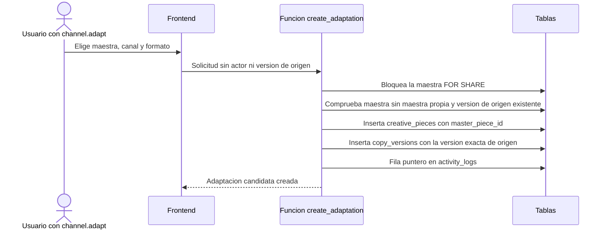

### 7.2 Aprobar una adaptación

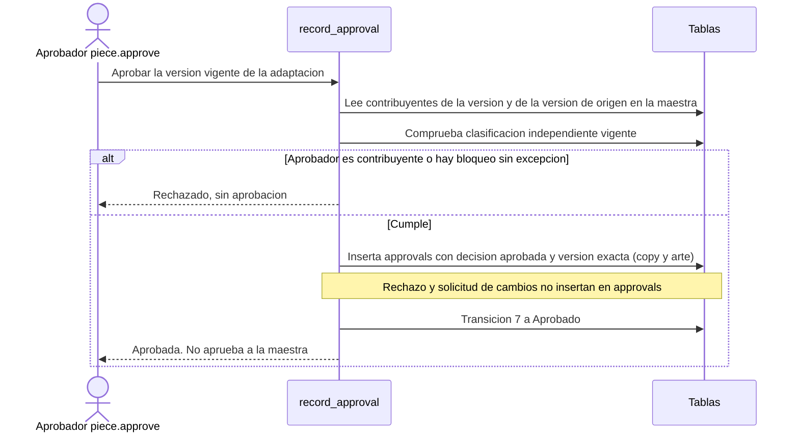

### 7.3 Modificar una maestra

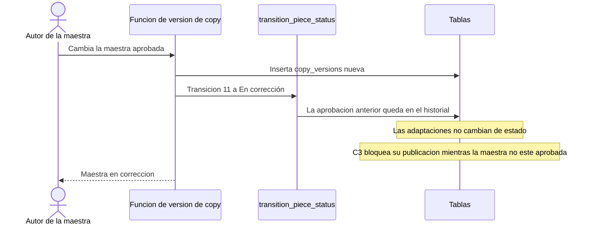

### 7.4 Evaluar impacto

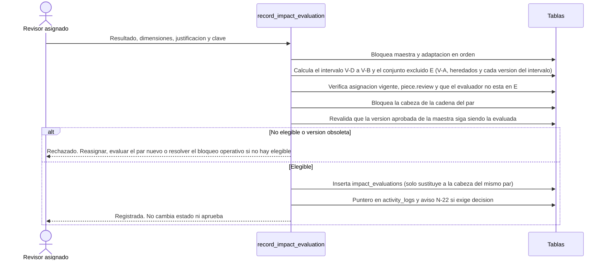

### 7.5 Reabrir una adaptación

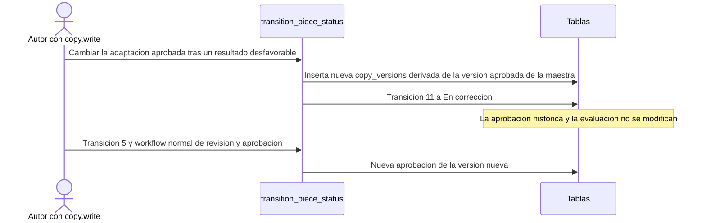

### 7.6 Intentar publicar sin aprobación

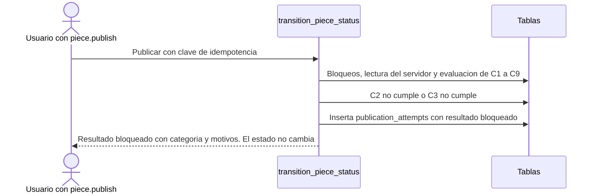

### 7.7 Intentar publicar con impacto desconocido

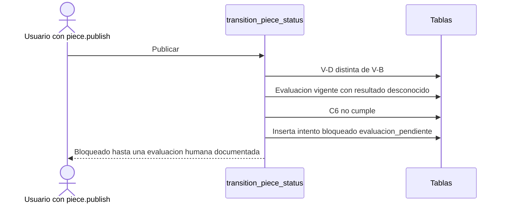

### 7.8 Publicar correctamente

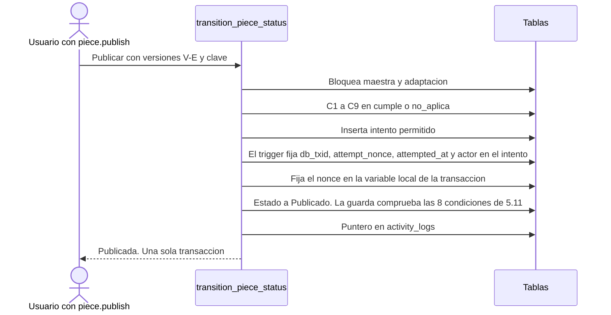

### 7.9 Fallo técnico durante la validación

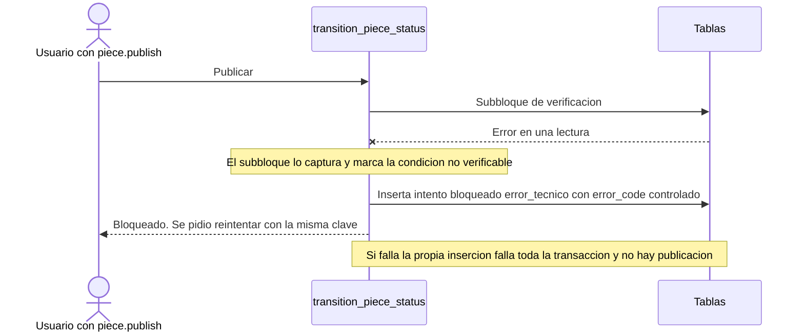

### 7.10 Falla la inserción del intento (escenario C)

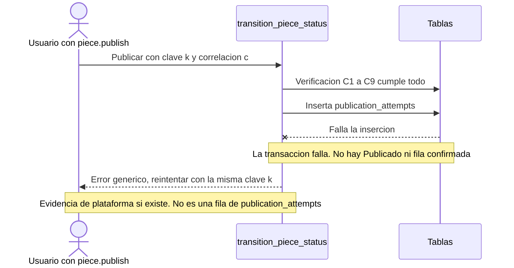

### 7.11 Solicitud sin autenticación o sin membresía (escenario D)

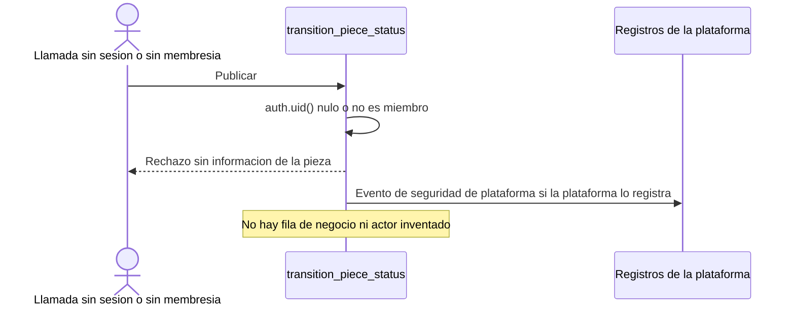

### 7.12 Cambia la maestra con una adaptación ya publicada (DG-15)

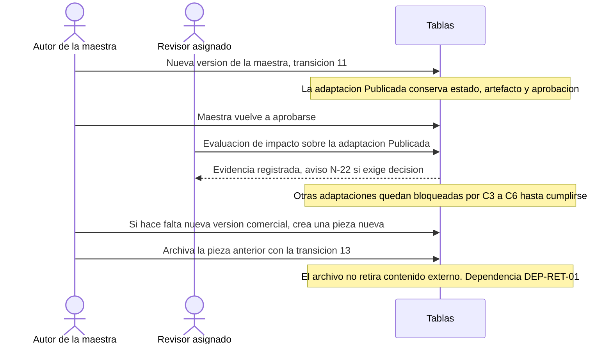

### 7.13 Crear una pieza con canal y formato del catálogo (G-1)

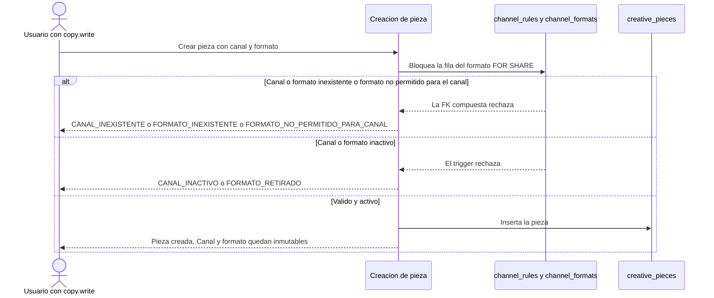

### 7.14 Dar de baja un canal o un formato (G-1)

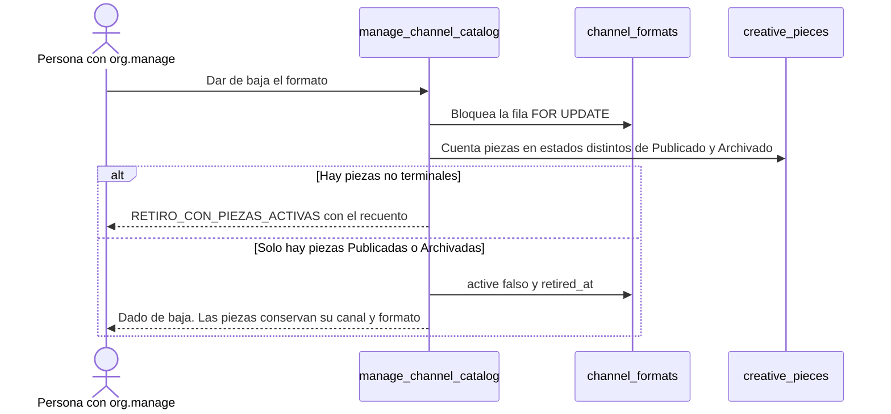

### 7.15 Sustituir una evaluación del mismo par (G-5)

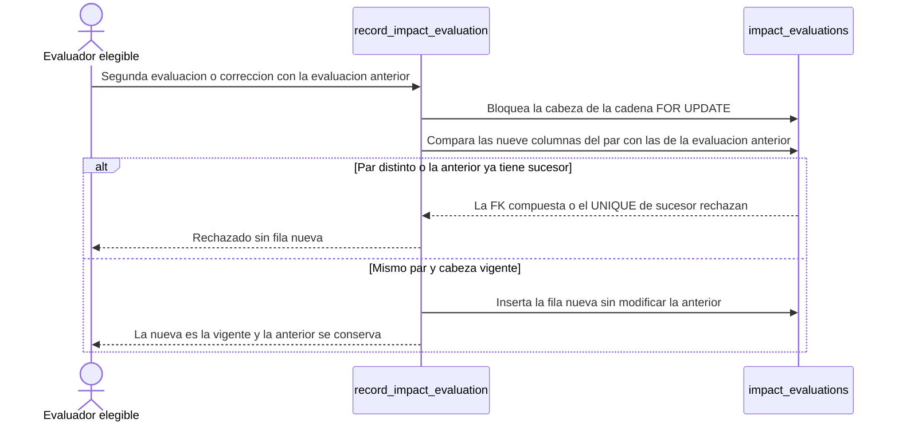

### 7.16 Guarda de db_txid y límites transaccionales (G-10)

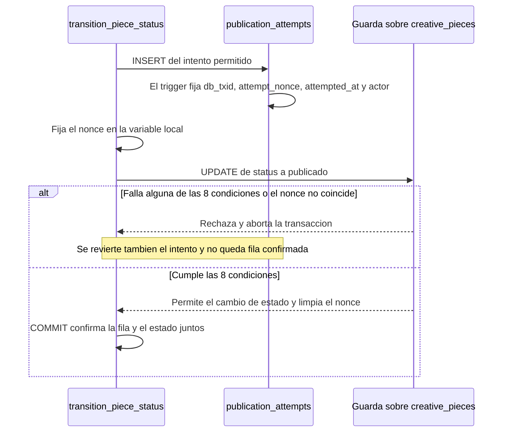


### 7.17 Orden único de creación y habilitación (H-01)

Cada nodo es una subfase y sus objetos; la flecha indica «se crea después». Es el orden de 14.1; las FK diferidas de v3.3 se crean en la subfase de la tabla destino.

```mermaid
flowchart TD
  S1_8["1.8<br/>organizations, profiles, memberships, role_permissions, membership_permission_grants, activity_logs, campaigns, channel_rules, channel_formats, creative_pieces<br/>+ cci_state_owner y cci_records_owner; manage_channel_catalog; BEFORE INSERT sobre creative_pieces; BEFORE INSERT y BEFORE UPDATE OF status sobre cr"]
  S2_x["2.x<br/>brand_guidelines, brand_guideline_versions, briefs, ai_runs, ai_prompt_versions, ai_quotas<br/>+ creative_pieces → briefs"]
  S2_1["2.1<br/>brief_versions, contribution_events, brief_field_changes, brief_field_attributions<br/>+ record_contribution_event; BEFORE INSERT sobre brief_versions; BEFORE UPDATE, DELETE y TRUNCATE sobre contribut; create_brief_version; BEFORE UPDATE, DELETE y TRUNCATE sobre brief_fie"]
  S2_3["2.3<br/>copy_versions, copy_version_provenance<br/>+ contribution_events.copy_version_id; contribution_events.copy_version_piece_id; contribution_events → copy_versions; creative_pieces → copy_versions; create_copy_version; BEFORE UPDATE, DELETE y TRUNCATE sobre copy_vers"]
  S2_5["2.5<br/>sin tablas nuevas<br/>+ detect_material_change"]
  S2_7["2.7<br/>sin tablas nuevas<br/>+ verify_version_chain"]
  S3_x["3.x<br/>creative_assets, audit_rubric_versions, audits, audit_findings<br/>+ contribution_events.asset_copy_version_id; contribution_events.asset_piece_id; contribution_events.creative_asset_id; copy_version_provenance.origin_asset_id; copy_version_provenance.used_asset_id; copy_versions → creative_assets; contribution_events → creative_assets; copy_version_provenance → creative_assets; creative_pieces → creative_assets; register_asset_contribution"]
  S4_x["4.x<br/>promotion_rules, promotion_snapshots, promotion_field_changes, promotion_field_attributions, validation_settings_versions<br/>+ contribution_events.promotion_snapshot_id; copy_versions.promotion_snapshot_id; copy_versions → promotion_snapshots; contribution_events → promotion_snapshots; audits → validation_settings_versions; create_promotion_snapshot; BEFORE INSERT sobre promotion_snapshots; BEFORE UPDATE, DELETE y TRUNCATE sobre promotion"]
  S5_1["5.1<br/>sin tablas nuevas<br/>+ Columnas anulables de reglas"]
  S5_3["5.3<br/>piece_classification_events, attribution_discard_resolutions, piece_reviewer_assignments<br/>+ create_adaptation; verify_field_provenance; version_contributors; resolve_attribution_discard; eligible_evaluators; propose_independence; resolve_independence; assign_reviewer"]
  S6_x["6.x<br/>comments, commercial_block_exceptions"]
  S6_1["6.1<br/>sin tablas nuevas<br/>+ transition_piece_status"]
  S6_5["6.5<br/>approvals, impact_evaluations<br/>+ BEFORE INSERT sobre approvals; record_approval; record_impact_evaluation"]
  S6_6["6.6<br/>publication_attempts<br/>+ BEFORE INSERT sobre publication_attempts; Sustituye el cuerpo de piece_status_guard por la; transition_piece_status ampliada"]
  S8_x["8.x<br/>performance_metrics, ab_tests"]
  S1_8 --> S2_x
  S2_x --> S2_1
  S2_1 --> S2_3
  S2_3 --> S2_5
  S2_5 --> S2_7
  S2_7 --> S3_x
  S3_x --> S4_x
  S4_x --> S5_1
  S5_1 --> S5_3
  S5_3 --> S6_x
  S6_x --> S6_1
  S6_1 --> S6_5
  S6_5 --> S6_6
  S6_6 --> S8_x
  S6_5 -. approvals antes de impact_evaluations .-> S6_6
```

## 8. Seguridad, PostgreSQL y Supabase

### 8.1 Responsabilidades: qué garantiza cada mecanismo y qué no

| Mecanismo | Garantiza | No garantiza |
|---|---|---|
| Restricciones (FK, CHECK, UNIQUE) | Integridad estructural: versiones existentes, misma organización, un solo nivel, cadenas sin ramas, resultados coherentes | Quién actúa, independencia, orden de operaciones ni reglas entre varias filas |
| Triggers | Reglas entre filas y tablas: coherencia de vínculos, inmutabilidad, protección del historial, guarda del estado publicado | Autorización por sí mismos; se pueden deshabilitar con privilegios altos |
| Funciones transaccionales de backend | La lógica de C1 a C9, bloqueos, actor, idempotencia y registro en una transacción | Atomicidad con sistemas externos; protegerse de un privilegio de superusuario |
| RLS | Aislamiento por organización y visibilidad de lectura | **La lógica de publicación**; no controla lo que una función de seguridad definer hace por dentro ni a los roles con BYPASSRLS |
| Privilegios (GRANT y REVOKE) | Que ningún rol de aplicación escriba directamente en los registros ni en `status` | La corrección de la función a la que sí se le concede |
| Aplicación y Edge Functions | Orquestación, mensajes, clave de idempotencia, correlación | Ninguna autoridad: nada que dependa de ellas es un control |

### 8.2 Funciones de backend propuestas

| Función (nombre propuesto) | Qué hace | Permiso |
|---|---|---|
| create_adaptation | Crea la pieza candidata y su primera versión con el vínculo | channel.adapt |
| propose_independence / resolve_independence | Registra propuesta, confirmación, no confirmación o reversión | autor o responsable / piece.review asignado |
| assign_reviewer | Registra asignaciones y retiros | org.manage |
| record_impact_evaluation | Registra la evaluación con todas las validaciones | piece.review asignado |
| version_contributors / eligible_evaluators | Auxiliares de solo lectura que calculan contribuyentes y elegibles | internas |
| transition_piece_status (ampliada) | Verificación C1 a C9, registro del intento y cambio de estado | según la transición |

Todas son `SECURITY DEFINER` con `search_path` vacío y propietario dedicado; ninguna recibe el actor, la fecha ni el resultado como parámetro. Las existentes `record_approval`, `review_finding` y `verify_assets_integrity` no pueden publicar (R-4 de G-7).

### 8.3 Prevención de escrituras directas y de manipulación del actor

- `REVOKE` de INSERT, UPDATE, DELETE y TRUNCATE sobre las catorce tablas nuevas (incluidas `channel_formats`, `brief_versions`, `contribution_events`, `copy_version_provenance`, `promotion_snapshots` y las cuatro de cambio y atribución por campo) y sobre `channel_rules` a `anon`, `authenticated` y `service_role`; `REVOKE UPDATE (status)` sobre `creative_pieces` a los mismos roles. Los privilegios por defecto de Supabase conceden permisos amplios a esos roles en el esquema público: debe **verificarse y revocarse expresamente** (T-60, T-73; requieren infraestructura real).
- **Dos propietarios de funciones** (nombres propuestos; su creación y viabilidad en Supabase no están verificadas): `cci_state_owner`, dueño solo de `transition_piece_status`, con UPDATE sobre `status` e INSERT en `publication_attempts`; y `cci_records_owner`, dueño de las demás funciones (aprobación, hallazgos, clasificación, asignación, evaluación), con INSERT en sus tablas y **sin** UPDATE sobre `status` ni INSERT en `publication_attempts`. Así ninguna auxiliar puede publicar por privilegios, no solo por no contener el código.
- `REVOKE EXECUTE ... FROM PUBLIC`; EXECUTE de las funciones de usuario solo para `authenticated`. `service_role` no las ejecuta, y las funciones rechazan `auth.uid()` nulo.
- El actor se toma de `auth.uid()`; ninguna función recibe actor, fecha ni resultado. **Dependencia no verificada:** `auth.uid()` lee la identidad de la sesión de la solicitud; quien tenga credenciales de base de datos de administración puede fijarla. Por eso las credenciales de administración de la base no pueden estar en el navegador, en una Edge Function ni en la aplicación.
- El frontend usa solo la clave pública con la sesión del usuario. Una Edge Function que invoque estas funciones debe reenviar el token del usuario, no la clave de servicio: con la de servicio no puede ejecutarlas ni actualizar `status`.

### 8.4 Protección de registros históricos

Privilegios revocados, trigger que rechaza UPDATE y DELETE incluso al propietario de la función y RLS de solo lectura. Contra un superusuario de la plataforma, la mitigación es el hash encadenado opcional y la exportación periódica (DG-12, RR-04).

### 8.5 Concurrencia y bloqueo de versiones

Orden único de bloqueo y matriz de revalidación en 4.10: maestra, adaptaciones por `id`, membresía del actor. Las unicidades parciales y la clave de idempotencia son una segunda barrera. No se presupone aislamiento serializable.

### 8.6 Límites transaccionales y fallos parciales

| Situación | Comportamiento y límite |
|---|---|
| Límite de la transacción | Una llamada a una función es una transacción de PostgreSQL. Dos llamadas encadenadas desde una Edge Function son **dos** transacciones; una Edge Function no da atomicidad entre ellas ni con sistemas externos |
| Storage | Los bytes de un arte no están dentro de la transacción de la base. C8 comprueba filas, hash registrado y objeto, y el resultado de `verify_assets_integrity`; una alteración fuera de la aplicación solo se descarta si el bucket impide sobrescribir objetos (RR-05, prueba T-50) |
| Sistemas externos | El diseño no incluye publicación a canales externos. Si se agregara, requeriría un patrón de bandeja de salida y un estado intermedio no previsto en T-02; no se inventa |
| IA (Cohere) | No participa en ninguna condición; no hay análisis semántico automático |
| Verificación fallida | Bloquea; nunca se supone cumplida |
| Registro fallido | Falla toda la operación; ver 5.8 |
| Reintento | Con la misma clave devuelve el resultado almacenado |

### 8.7 Matriz de acceso por rol

Lo que el diseño **propone** conceder (todo lo demás está revocado). La verificación real de los privilegios exige infraestructura que no existe.

| Objeto | anon | authenticated | service_role | Propietario de funciones de estado (cci_state_owner) | Propietario de funciones de registros (cci_records_owner) | Roles internos de la plataforma (postgres, administración) |
|---|---|---|---|---|---|---|
| creative_pieces.status | Ninguno | SELECT por RLS; sin UPDATE | Sin UPDATE (revocado) | UPDATE (solo transition_piece_status) | Sin UPDATE | No se afirma control (RR-04) |
| creative_pieces, otras columnas | Ninguno | Según las políticas vigentes de v3.3 | Sin escritura directa | Lo necesario para la transición | Lo necesario para sus funciones | No restringido |
| publication_attempts | Ninguno | SELECT propio o con org.manage | Sin acceso de escritura; sin SELECT | INSERT | Sin INSERT | No restringido |
| impact_evaluations | Ninguno | SELECT según visibilidad de la adaptación | Sin escritura | Sin INSERT | INSERT | No restringido |
| piece_classification_events | Ninguno | SELECT según visibilidad de la pieza | Sin escritura | Sin INSERT | INSERT | No restringido |
| piece_reviewer_assignments | Ninguno | SELECT según visibilidad de la pieza | Sin escritura | Sin INSERT | INSERT | No restringido |
| approvals | Ninguno | SELECT según v3.3; sin escritura directa | Sin escritura | Lectura | INSERT (record_approval) | No restringido |
| EXECUTE de transition_piece_status | Ninguno | Sí | No | Propietaria | No | No restringido |
| EXECUTE de funciones de registros | Ninguno | Sí, con sus permisos de negocio | No | No | Propietaria | No restringido |

### 8.8 Demostración documental de las rutas de publicación

Es una demostración **sobre el diseño**: cada fila indica el mecanismo, la regla y la prueba, y si depende de infraestructura no verificada.

| Garantía | Mecanismo | Reglas | Pruebas | Depende de infraestructura no verificada |
|---|---|---|---|---|
| La única ruta que deja Publicado es la función transaccional autorizada | Único propietario con UPDATE(status) más guarda de trigger con db_txid y attempt_nonce | IS-01, IG10-21 | T-60, T-70 | Sí: roles y privilegios de Supabase |
| Ningún usuario actualiza status directamente | Revocación de UPDATE(status) a anon, authenticated y service_role | IS-02 | T-60 | Sí: privilegios por defecto |
| Ninguna función auxiliar publica | Propietario distinto sin UPDATE(status) ni INSERT en intentos | IS-03 | T-40, T-71 | Sí: creación de roles |
| La Edge Function no suplanta con una clave privilegiada | EXECUTE revocado a service_role; la función rechaza auth.uid() nulo | IS-04 | T-61 | Sí; y que las credenciales de administración no estén en la Edge Function |
| El actor sale de la identidad autenticada | auth.uid() dentro de la función; sin parámetro de actor | IS-05 | T-43 | Sí: modelo de sesión de la plataforma |
| Los registros no admiten escritura directa | Privilegios revocados más trigger | IS-06 | T-38, T-73 | Sí |
| RLS y privilegios se distinguen | RLS: lectura y aislamiento; privilegios y funciones: escritura y lógica | IS-07 | T-73 | No: es una distinción de diseño |
| C1 a C9 se verifican en backend | Dentro de la función, con datos del servidor | IS-08 | T-72 | No: diseño; Sí para probarlo |
| Una condición no verificable bloquea | Tres valores; solo cumple o no aplica permiten | IS-09 | T-33, T-46, T-50 | No |
| Un fallo de registro nunca habilita la publicación | Fila y estado en la misma transacción; guarda de trigger | IS-10, IG10-08 | T-34, T-57 | Sí: comportamiento real de la base |

### 8.9 Definición de las funciones (propuesta; ninguna existe en v3.3 salvo las indicadas)

**Atributos comunes de las funciones de usuario:** `SECURITY DEFINER` con `SET search_path = ''` (objetos con esquema explícito); `REVOKE ALL ... FROM PUBLIC`; `EXECUTE` solo para `authenticated`; la identidad es `auth.uid()` (nulo se rechaza) y ningún parámetro es actor, fecha, resultado, `db_txid` ni condición; el error al cliente es un código controlado, sin texto de excepción. Atomicidad: cada función es una sola transacción. Propietarios propuestos: `cci_state_owner` y `cci_records_owner` (8.3; viabilidad en Supabase no verificada).

| Función | Propietario | Parámetros (sin actor) | Validaciones y bloqueos | Resultado |
|---|---|---|---|---|
| create_adaptation | records_owner | organización, maestra, canal, formato, clave, texto de la primera versión, versión de origen | channel.adapt; maestra Aprobado o Publicado con versión vigente aprobada; catálogo activo (3.14); clave única. Bloqueos: maestra FOR SHARE, catálogo FOR SHARE | Pieza y versión; errores de catálogo o clave |
| propose_independence | records_owner | adaptación, justificación no vacía | Autor o responsable; secuencia vigente. Bloqueos: maestra FOR SHARE, adaptación FOR UPDATE | Evento de propuesta |
| resolve_independence | records_owner | evento de propuesta, decisión, justificación no vacía | piece.review asignado y fuera del conjunto excluido; revalida la secuencia. Bloqueos: 1, 2, 3 | Evento de confirmación, no confirmación o reversión |
| assign_reviewer | records_owner | adaptación, revisor, acción, motivo no vacío | org.manage (DG-07); el revisor tiene piece.review y no está en E (informativo); no concede permisos. Bloqueos: 1, 2 | Fila de asignación; historial |
| verify_field_provenance | records_owner, interna | organización, versión exacta de brief o snapshot exacto | Solo lectura (STABLE): recorre la cadena (IG5-74, IG5-75), recalcula las atribuciones esperadas desde la raíz y las compara con las filas (IG5-76); devuelve BRIEF_CHAIN_INCONSISTENTE, PROMOTION_CHAIN_INCONSISTENTE, BRIEF_FIELD_PROVENANCE_INCOMPLETE o PROMOTION_FIELD_PROVENANCE_INCOMPLETE; EXECUTE solo para otras funciones | Resultado de verificación o error concreto |
| version_contributors | records_owner, interna | organización, pieza, versión exacta | Solo lectura (STABLE); contrato de 4.4.5: lee las fuentes físicas de 4.4.4, delega las cadenas en verify_field_provenance, elimina duplicados por persona conservando evidencia y devuelve conjunto, evidencias, categorías, completitud y errores; **nunca un conjunto parcial** (IG5-63, IG5-42, IG5-77); EXECUTE solo para otras funciones | Conjunto, evidencias y completitud, o el código de error |
| eligible_evaluators | records_owner | adaptación, V-A, V-D y V-B | Solo lectura; usa version_contributors sobre el intervalo y agrega P, el proponente de la clasificación vigente (IG5-45, IG5-56); si el cálculo no es completo, falla en vez de devolver una lista parcial; el llamador necesita org.manage o piece.review | Identificadores elegibles; vacío si no hay (IG5-34) |
| create_brief_version | records_owner | brief, campos (sin actor) | Permiso de edición de briefs de v3.3; `created_by` = `auth.uid()`; versión consecutiva; hash; en una sola transacción calcula las 12 filas de `brief_field_changes` con IG5-70 y las atribuciones con IG5-72 y registra brief_editor si cambia un campo material (IG5-51, IG5-58, IG5-71); si falta una fila la versión queda no_verificable | Versión nueva inmutable con sus filas por campo |
| create_copy_version | records_owner | pieza, texto, brief_version_id, assets (sin actor) | Permiso de edición de v3.3; versión inmutable; fija referencias exactas; registra copy_author y la procedencia directa; `detect_material_change` decide copy_editor y la herencia (IG5-49, IG5-50, IG5-62) | Versión y filas de contribución y procedencia |
| register_asset_contribution | records_owner | arte, versión (sin actor) | Permiso de carga de v3.3; identidad del servidor; registra asset_uploader solo en carga o reemplazo, no en reutilización (IG5-53) | Evento de contribución |
| create_promotion_snapshot | records_owner | promoción, datos (sin actor) | Permiso de edición de promociones de v3.3; `created_by` = `auth.uid()`; hash; asigna o hereda `promotion_line_id`; en una sola transacción calcula las 9 filas de `promotion_field_changes` y las atribuciones y registra promotion_editor si cambia un campo material (IG5-52, IG5-59, IG5-71) | Snapshot inmutable con sus filas por campo |
| resolve_attribution_discard | records_owner | atribución, motivo, evidencia | `piece.review`; miembro activo distinto del afectado, del solicitante y de los contribuyentes del campo (IG5-92); sin autoridad por cargo; registro nuevo en `attribution_discard_resolutions`; nunca retroactiva; fail-closed | Registro nuevo de resolución |
| record_approval (existente en v3.3, ampliada) | records_owner | pieza, versión, auditoría considerada, excepciones | piece.approve; independencia; estado; bloqueos confirmados; escribe `decision = 'aprobada'`. Bloqueos: 1 FOR SHARE, 2 | Fila de approvals; no cambia el estado por sí sola |
| record_impact_evaluation | records_owner | adaptación, versiones citadas, resultado, siete dimensiones, justificación, motivo si desconocido, clave, `client_correlation_id` opcional y, si sustituye, la evaluación anterior | Asignación vigente, piece.review, fuera de E, V-B vigente aprobada, par y cabeza de la cadena; trigger repite la comprobación. Bloqueos: 1 FOR SHARE, 2, 3 y cabeza FOR UPDATE | Fila de impact_evaluations; errores de elegibilidad, versión obsoleta o par |
| transition_piece_status (existente, ampliada) | state_owner | pieza, transición pedida, comentario o motivo, versiones citadas y clave cuando es Publicado | Permiso de T-02 por transición; para #10, C1 a C9, el INSERT del intento, el nonce en la variable de la transacción y la guarda (5.11). **Antes de 6.6 la transición a Publicado no está habilitada (14.1)**. Bloqueos: 1 FOR SHARE, 2, 3 | Estado nuevo; fila de publication_attempts en #10 |
| manage_channel_catalog | records_owner | acción (crear, dar de baja, reactivar), canal, formato | org.manage; normalización; baja solo sin piezas no terminales. Bloqueo: 4 (catálogo FOR UPDATE) | Fila del catálogo; recuento de piezas afectadas |

`record_approval`, `review_finding` y `verify_assets_integrity` no pueden publicar (R-4 de G-7). Los triggers de guarda y de asset_match pertenecen a `cci_state_owner` y `cci_records_owner` respectivamente.


## 9. Impacto en las 27 tablas

| Requisito | Tabla actual relacionada | Capacidad existente | Brecha | Cambio requerido |
|---|---|---|---|---|
| Identidad de maestra y adaptación | creative_pieces | Pieza por canal y formato, con estado y versión vigente | Sin vínculo a maestra; columnas de canal y formato sin tipos (G-2) | Columnas master_piece_id, is_adaptation, master_ref_is_adaptation, channel, format, adaptation_key y restricciones |
| Canal y formato válidos | channel_rules y channel_formats | channel_rules: una fila por organización y canal (v3.3); channel_formats es tabla nueva propuesta | v3.3 no define formatos | Estructura mínima de ambas en 1.8; unique(organización, canal) y unique(organización, canal, formato); FK compuesta desde creative_pieces desde la primera pieza |
| Versión exacta de la maestra de origen | copy_versions | Versiones inmutables; parent_version_id solo dentro de una pieza | No hay versión de origen entre piezas | Tres columnas y FK compuestas |
| Arte de origen | creative_assets | Arte por versión con hash SHA-256 | Sin FK compuesta que valide arte y copy | unique(organization_id, piece_id, id, copy_version_id) |
| Integridad entre organizaciones | Todas (T-09, no aprobada) | FK compuestas propuestas | T-09 sin aprobar | Mismo patrón en las tablas nuevas; si T-09 no se aprueba, se mantiene en estas |
| Autoría y procedencia de contenido | copy_versions.created_by; creative_assets.uploaded_by | Autoría por versión (T-04, no aprobada en v3.3) | No hay versionado de brief ni de datos promocionales ni procedencia heredada | brief_versions, promotion_snapshots, contribution_events y copy_version_provenance; columnas brief_version_id y promotion_snapshot_id en copy_versions y reused_from_asset_id en creative_assets |
| Clasificación y su historial | activity_logs | Auditoría general e inmutable | No demuestra contenido ni impone «distinto del proponente» | piece_classification_events |
| Revisor asignado | memberships, role_permissions | Roles y permisos por clave | Sin asignación por pieza (D-02) | piece_reviewer_assignments |
| Aprobación positiva ligada a la versión exacta | approvals | Inmutable, versión exacta, independencia (record_approval y trigger) | v3.3 no distingue aprobación de rechazo en la fila (RR-17) y la FK no fija el arte | decision text NOT NULL CHECK = 'aprobada' (DG-20), unique(organization_id, id, copy_version_id) y trigger asset_match (4.13) |
| Registro de evaluación de impacto | activity_logs | Genérico | Sin estructura (G-5) | impact_evaluations |
| Control de publicación | creative_pieces.status y transition_piece_status | Única vía de cambio de estado; #10 solo pide que la versión aprobada sea la vigente | No verifica maestra, evaluación ni registra intentos | Ampliar la función; guarda de trigger |
| Bloqueos comerciales | audit_findings, commercial_block_exceptions | Hallazgo confirmado y excepción por versión | Ninguna | Se reutiliza para C7 |
| Integridad de artes | creative_assets, verify_assets_integrity | Hash y verificación | No es transaccional con Storage | C8 con límite declarado |
| Registro de intentos | activity_logs | Registra transiciones | No demuestra intentos rechazados ni sobrevive a una reversión (G-10) | publication_attempts |
| Permisos | role_permissions (17 claves) | channel.adapt, piece.review, piece.publish, org.manage | Ninguna | Sin claves nuevas |
| Aislamiento y lectura | RLS por organization_id | Aislamiento por organización | Tablas nuevas | Mismo patrón |
| Notificaciones | Matriz de notificaciones (N-22) | Definidas con limitación | Ninguna estructural | Sin cambio |

**Reutilizable sin cambio (22 de 27):** organizations, profiles, memberships, role_permissions, membership_permission_grants, brand_guidelines, brand_guideline_versions, campaigns, briefs, audits, audit_findings, comments, promotion_rules, performance_metrics, ab_tests, ai_runs, ai_prompt_versions, activity_logs, audit_rubric_versions, validation_settings_versions, ai_quotas y commercial_block_exceptions. **Con cambio:** creative_pieces y copy_versions (columnas), channel_rules (una columna y una única), creative_assets y approvals (solo una restricción única) y la función transition_piece_status. **Nuevas:** 14 (cinco de la v4, cuatro de la v5 —brief_versions, promotion_snapshots, contribution_events y copy_version_provenance— y cuatro de la v6 —brief_field_changes, brief_field_attributions, promotion_field_changes y promotion_field_attributions—). Total propuesto: **41 tablas**; las 27 permanecen como línea base histórica.

**Justificación de cada elemento nuevo:**

| Elemento | Por qué es necesario |
|---|---|
| brief_versions | El brief debe versionarse para saber quién cambió cada campo material; v3.3 no lo define |
| promotion_snapshots | Los datos promocionales usados deben congelarse; una promoción mutable no reconstruye una auditoría |
| brief_field_changes | Una fila por campo material y versión (12 por versión) con hash anterior y nuevo, segmentos retenidos, evento y persona: sin ella no se puede saber si un campo cambió, se sustituyó o se eliminó (H-02) |
| brief_field_attributions | Atribución materializada por versión exacta y campo: quién sigue siendo contribuyente activo y quién quedó en el historial (H-02) |
| promotion_field_changes | Igual que brief_field_changes para los 9 campos materiales de la promoción (H-02) |
| promotion_field_attributions | Igual que brief_field_attributions para promociones; evita que cambiar el descuento borre las condiciones que permanecen (H-02) |
| contribution_events | Fuente append-only de contribuciones con FK compuestas por origen; activity_logs no la sustituye |
| copy_version_provenance | Procedencia directa y heredada por unidad de contenido, y exclusión documentada de atribuciones |
| piece_classification_events | Historial con restricción de proponente distinto y secuencia; no cabe en activity_logs genérico |
| piece_reviewer_assignments | Sin asignación no hay «revisor asignado»; una columna perdería el historial de reasignaciones que prueba la independencia |
| impact_evaluations | Evidencia ligada a un par exacto de versiones con claves y CHECK; no cabe en comments ni en activity_logs |
| publication_attempts | Debe sobrevivir a la no publicación; activity_logs no demuestra intentos rechazados ni su persistencia |
| master_piece_id, is_adaptation, master_ref_is_adaptation | Vínculo y garantía de un nivel |
| replaces_piece_id (opcional, DG-18) | Trazabilidad estructural de una pieza nueva que reemplaza a una Publicada |
| channel_formats (tabla nueva) | Validar el formato de cada pieza contra su canal mediante FK |
| channel, format, adaptation_key | Identificar canal y formato (G-2) y distinguir adaptaciones múltiples |
| master_copy_version_id y master_creative_asset_id en copy_versions | Versión exacta de origen; sin ellas no existen V-D ni contribuciones heredadas |

## 10. Matriz de permisos y matriz RLS

### 10.1 Permisos

| Operación | Función propuesta | Permiso | Restricciones | Quién no puede |
|---|---|---|---|---|
| Crear adaptación | create_adaptation | channel.adapt (copy.write y asset.upload para el contenido) | Maestra de su organización y sin maestra propia | Quien no vea la maestra |
| Proponer independencia | propose_independence | Autor o responsable de la pieza (sin clave nueva) | No concede permisos | Cualquier otro |
| Confirmar, no confirmar o revertir | resolve_independence | piece.review del revisor asignado | Distinto del proponente; la reversión no procede si está Publicada | El proponente, Admin y el propietario por ese solo título |
| Asignar o retirar revisor | assign_reviewer | org.manage | El asignado debe tener piece.review; asignar no concede permisos | Quien no tenga org.manage |
| Evaluar impacto | record_impact_evaluation | piece.review y asignación vigente | Fuera del conjunto excluido E (V-A, herencia y versiones del intervalo V-D a V-B); otro evaluador para levantar un bloqueo; solo sustituye a la cabeza del mismo par | Contribuyentes, Admin, propietario, cualquier rol sin asignación |
| Aprobar la adaptación | record_approval (existente, escribe decision = 'aprobada') | piece.approve | Independencia con contribución heredada; la evaluación no la sustituye; el rechazo no inserta en approvals | Contribuyentes |
| Publicar | transition_piece_status | piece.publish | C1 a C9 | Cualquiera que incumpla una condición |
| Leer clasificaciones, asignaciones y evaluaciones | Consulta con RLS | content.read y visibilidad de la pieza | Mismos límites que la pieza | Otras organizaciones |
| Leer detalle de intentos | Consulta con RLS | org.manage; cada actor sus propios intentos | Sin clave nueva | Resto |
| Administrar el catálogo de canales y formatos | manage_channel_catalog | org.manage | Baja solo sin piezas no terminales; sin DELETE | Quien no tenga org.manage |
| Escribir en los registros | — | Ninguno | Solo las funciones | Todos los roles de aplicación |

Las 17 claves físicas quedan igual; ninguna operación requiere una clave 18. `delegation.manage` y `block.exception.revoke` siguen siendo capacidades conceptuales.

### 10.2 RLS

| Tabla | SELECT | INSERT | UPDATE | DELETE |
|---|---|---|---|---|
| piece_classification_events | Miembros que pueden ver la pieza (misma organización) | Sin política; solo la función | Sin política; privilegio revocado y trigger | Sin política; privilegio revocado y trigger |
| piece_reviewer_assignments | Ídem | Ídem | Ídem | Ídem |
| impact_evaluations | Miembros que pueden ver la adaptación | Ídem | Ídem | Ídem |
| publication_attempts | El propio actor, o quien tenga org.manage en la organización | Ídem | Ídem | Ídem |
| channel_rules y channel_formats | Miembros de la organización (RLS por organización) | Sin política; solo manage_channel_catalog; privilegio revocado | Sin política; privilegio revocado y trigger (channel y format no se modifican) | Sin política; privilegio revocado y trigger |
| approvals | Miembros de la organización según v3.3 | Sin política; solo record_approval | Sin UPDATE | Sin DELETE |
| creative_pieces y copy_versions | Sin cambio de política | Sin cambio; las columnas de vínculo las valida la función y los triggers | master_piece_id inmutable; status solo por la función | Sin DELETE desde la aplicación |

RLS es **lectura y aislamiento**; la autoridad sobre la publicación es de la función, no de RLS (8.1).

## 11. Matriz de pruebas

Tipos: **Diseño** (comprobable documentalmente), **Ejecutable futura** (pruebas con esquema local cuando se autorice) e **Infraestructura real** (requieren Supabase real, concurrencia real o Storage). **Ninguna se ha ejecutado**: lo que sí se hizo es una validación documental por script (11.2).

**Nota de nomenclatura.** Los identificadores T-01 a T-11 de esta matriz coinciden con los de las decisiones técnicas de v3.3 (T-01 a T-11). En el texto, T-02 (transiciones), T-03, T-04, T-05, T-06 y T-09 sin otra indicación se refieren a v3.3; las filas de la tabla siguiente son pruebas. A partir de T-12 no hay ambigüedad.

| ID | Requisito cubierto | Condición inicial | Acción | Resultado esperado | Riesgo cubierto | Criterio de aceptación | Tipo | Reglas |
|---|---|---|---|---|---|---|---|---|
| T-01 | Relación maestra–adaptación válida | Maestra M aprobada; adaptación A creada por quien tiene channel.adapt | Crear A con master_piece_id = M y primera versión derivada de la versión 1 de M | Se crean A y su versión con vínculo a M v1 | Adaptación sin vínculo trazable | Fila creada; la versión guarda M, v1 y arte si lo hay | Ejecutable futura | IG1-01, IG1-02, IG1-08 |
| T-02 | Adaptación sin maestra | Pieza marcada como adaptación (candidata) sin master_piece_id | Intentar crear una versión con master_copy_version_id y sin maestra en la pieza | Rechazo por trigger de coherencia | Versión derivada de una maestra inexistente | La operación falla; no queda fila | Ejecutable futura | IG1-02, IG1-11 |
| T-03 | Referencia a versión inexistente | Maestra M con versiones 1 y 2 | Crear versión de A derivada de una versión 9 o de una versión de otra pieza | Rechazo por la FK compuesta | Referencia colgante o cruzada | La operación falla por violación de FK | Ejecutable futura | IG1-08, IG1-09, IG1-05 |
| T-04 | Referencia circular | A es adaptación de M | Poner M como adaptación de A, o A como maestra de sí misma | Rechazo: CHECK, FK compuesta de un nivel y trigger | Ciclos y cadenas | Ninguna actualización prospera | Ejecutable futura | IG1-03, IG1-04, IG1-06, IG1-07 |
| T-05 | Varias adaptaciones de una maestra | M aprobada | Crear A1 (Instagram), A2 (WhatsApp) y A3 (Instagram, otra clave) | Las tres existen; un duplicado con la misma clave se rechaza | Colisión de adaptaciones | Tres filas; la cuarta con clave repetida falla | Ejecutable futura | IG1-13, IG1-14 |
| T-06 | Versiones independientes | A1 en v3 y A2 en v1; M en v2 | Crear versión nueva de A1 | Solo A1 avanza; A2 y M no cambian | Versionado acoplado | Contadores y estados independientes por pieza | Ejecutable futura | IG1-14, IG1-10 |
| T-07 | — | Adaptación propuesta por su autor | El autor intenta confirmar su propia propuesta | Rechazo | Autoconfirmación de independencia | Rechazo con motivo; sin evento de confirmación | Ejecutable futura | IG1-17 |
| T-08 | — | Adaptación candidata sin confirmación | Intentar #7 o publicar | Rechazo de T-02 #7 y #10 | Publicar variación como pieza independiente | Ambas transiciones bloqueadas y la de publicación registrada | Ejecutable futura | IG1-15, IG1-16, IG10-01 |
| T-09 | — | Adaptación independiente aprobada | Reversión a variación interna | Evento de reversión; aprobaciones y versiones intactas; no publicable | Pérdida de historial | El historial muestra los eventos en orden; hash de aprobaciones sin cambio | Ejecutable futura | IG1-18, IG1-19, IG1-16 |
| T-10 | — | Versión de A derivada de v1 de M escrita por X; v1 de M escrita por Y | Y intenta aprobar la versión de A | Rechazo por contribución heredada | Aprobación no independiente | El conjunto de contribuyentes de la versión incluye a Y | Ejecutable futura | IG1-12, IG1-21 |
| T-11 | — | Maestra con adaptaciones | Intentar borrar la maestra, una versión o un arte | Rechazo RESTRICT | Pérdida de versiones históricas | Sin DELETE posible; solo archivado | Ejecutable futura | IG1-20 |
| T-12 | Evaluación sin impacto | A v1 aprobada derivada de M v1; M v2 aprobada; revisor asignado independiente | Registrar evaluación sin_impacto_material con siete dimensiones no afectadas | Fila inmutable; la aprobación de A se conserva; C4 satisfecha | Aprobación sin evidencia | Evaluación vigente; ningún cambio de estado | Ejecutable futura | IG5-01, IG5-09, IG5-10, IG5-11, IG5-17 |
| T-13 | Evaluación con impacto | Igual que T-12 | Registrar requiere_revision con precio afectado | A no se publica; se exige nueva versión (#11) y workflow | Publicar con contenido desactualizado | C5 bloquea; tras versión nueva derivada de M v2 y aprobada, C4 deja de aplicar | Ejecutable futura | IG5-10, IG5-11, IG5-17, IG10-03 |
| T-14 | Impacto desconocido | Igual que T-12 | Registrar desconocido con motivo | Publicación bloqueada hasta una evaluación documentada | Suponer validez sin evidencia | C6 bloquea; sin motivo la inserción falla | Ejecutable futura | IG5-09, IG5-14, IG10-04 |
| T-15 | Evaluador que contribuyó a la versión | El revisor asignado escribió el copy de V-A, o de la versión de M evaluada | Intentar registrar la evaluación | Rechazo | Autoevaluación | Sin fila; el motivo es de independencia | Ejecutable futura | IG5-05, IG5-06 |
| T-16 | Revisor no elegible | El revisor asignado no es independiente; existe otro elegible | Registrar con el no elegible; luego reasignar y registrar con el otro | Primera rechazada; segunda aceptada; ambas asignaciones conservadas | Revisor no autorizado | Historial de asignaciones con dos filas; una evaluación | Ejecutable futura | IG5-04, IG5-08 |
| T-17 | Revisor no elegible | Nadie elegible en la organización | Intentar registrar y publicar | No se registra nada; la publicación sigue bloqueada; ningún rol obtiene la facultad | Escalada de autoridad | Intento de publicación bloqueado con evaluacion_pendiente | Ejecutable futura | IG5-07, IG10-01 |
| T-18 | Segunda evaluación | Evaluación desconocida vigente | Registrar segunda evaluación sin_impacto_material por otra persona | Nueva fila; la anterior se conserva; la nueva es la vigente | Perder el rastro | Cadena de dos filas; cabeza correcta | Ejecutable futura | IG5-13, IG5-14, IG5-15 |
| T-19 | Segunda evaluación | Evaluación desfavorable del evaluador P | P intenta levantarla con sin_impacto_material | Rechazo | Un solo evaluador cambia su dictamen para desbloquear | Debe ser otra persona elegible | Ejecutable futura | IG5-15 |
| T-20 | Corrección de evaluación | Evaluación equivocada | Registrar corrección con motivo no vacío (el mínimo de 30 caracteres es propuesta pendiente de T-03) | Nueva fila kind = correccion; la anterior intacta | Reescritura del historial | Dos filas; sin UPDATE ni DELETE posible | Ejecutable futura | IG5-12, IG5-13 |
| T-21 | Corrección de evaluación | Evaluación vigente | Dos correcciones simultáneas sobre la misma evaluación | Una prospera; la otra falla por unique(supersedes) | Ramas de la cadena | Cadena lineal | Ejecutable futura | IG5-14, IG5-19 |
| T-22 | — | Evaluación sin_impacto vigente y A aprobada | Intentar usar la evaluación para publicar con A sin aprobación de su versión | Bloqueo por C2 | Evaluación que sustituye una aprobación | La evaluación nunca satisface C2 | Ejecutable futura | IG5-17, IG10-17 |
| T-23 | — | Una evaluación se prepara sobre M v2 | M se aprueba en v3 antes de confirmar | Rechazo por versión obsoleta | Evaluar una versión que ya no es la vigente | Se pide evaluar el par V-D → v3 | Ejecutable futura | IG5-16 |
| T-24 | — | Reintento de la misma evaluación con la misma clave | Repetir la solicitud | Se devuelve la fila existente | Duplicados por reintento | Una sola fila | Ejecutable futura | IG5-19 |
| T-25 | — | A ya Publicada; M cambia y se aprueba | Registrar evaluación | Se registra evidencia y aviso; el estado de A no cambia | Transición inventada | Sin cambio en T-02; 13 transiciones | Ejecutable futura | IG5-20, IG5-17 |
| T-26 | Intento de publicación sin aprobación maestra | A aprobada; M en En corrección | Publicar A | Bloqueado; categoría sin_aprobacion_maestra | Publicar sin maestra aprobada | Fila bloqueada con C3 en no_cumple | Ejecutable futura | IG10-01, IG10-03, IS-08 |
| T-27 | Intento sin aprobación de adaptación | A en Pendiente de aprobación; M aprobada | Publicar A | Bloqueado; C2 | Publicar sin aprobación | Estado de A intacto | Ejecutable futura | IG10-01, IG10-03 |
| T-28 | Intento con impacto pendiente | A aprobada; M aprobada en versión posterior; sin evaluación | Publicar A | Bloqueado; evaluacion_pendiente | Publicar con maestra cambiada | C4 no_cumple | Ejecutable futura | IG10-03, IG10-04 |
| T-29 | Intento con impacto desfavorable | Evaluación requiere_revision vigente sobre el par | Publicar A | Bloqueado; evaluacion_desfavorable | Publicar sin revisar impacto | C5 no_cumple | Ejecutable futura | IG10-03 |
| T-30 | Intento con bloqueo comercial | Hallazgo crítico confirmado sin excepción en A o en M | Publicar | Bloqueado; bloqueo_comercial_critico; con excepción vigente, C7 cumple | Burlar bloqueos comerciales | C7 según PO-02, PO-12 y PO-15 | Ejecutable futura | IG10-03 |
| T-31 | Intento sin permisos | Actor sin piece.publish | Publicar | Bloqueado; falta_de_permisos; las demás condiciones no se evalúan | Fuga de información a quien no puede publicar | Fila con C1 no_cumple y el resto no_evaluada | Ejecutable futura | IG10-02, IG10-15 |
| T-32 | Intento con versiones inconsistentes | A vigente v4 aprobada en v4; cliente cita v3 | Publicar | Bloqueado; inconsistencia_versiones | Publicar una versión distinta de la aprobada | C9 no_cumple con ambas versiones registradas | Ejecutable futura | IG10-03, IG10-05 |
| T-33 | Intento con error de backend | Se fuerza una falla dentro de la verificación (por ejemplo, un dato ilegible) | Publicar | Resultado bloqueado con error_tecnico; fila escrita; estado intacto | Publicar por falla de la verificación | Fila con error_code controlado | Ejecutable futura | IG10-04, IG10-09, IG10-10, IG10-16, IS-09 |
| T-34 | Fallo al registrar auditoría | Se fuerza una falla al insertar el intento | Publicar (que cumpliría todo) | Toda la transacción falla: A no queda Publicada y no existe fila confirmada | Publicar sin evidencia confirmada | Estado intacto; ninguna fila; la evidencia de plataforma, si existe, no se presenta como fila | Infraestructura real | IG10-08, IG10-11, IS-10, IG10-01 |
| T-35 | Duplicación concurrente | Dos solicitudes de publicación idénticas con distinta clave | Ejecutarlas a la vez | Una publica; la otra queda bloqueada y registrada | Doble publicación | Una transición #10; dos filas de intento | Infraestructura real | IG10-06, IG10-07, IG10-08, IG10-20 |
| T-36 | Duplicación por reintento | Misma clave repetida | Reenviar | Se devuelve el resultado almacenado | Reintentos que repiten efectos | Una fila; efectos únicos | Ejecutable futura | IG10-06, IG10-20 |
| T-37 | Modificación concurrente de maestra | A se publica mientras M se modifica o se revoca su aprobación | Ejecutarlas a la vez | Se serializan por el bloqueo maestra → adaptación; la verificación ve un estado consistente | Verificar y publicar con datos cambiados | Resultado válido en cualquier orden; sin interbloqueo | Infraestructura real | IG10-08, IG10-03, IG5-25 |
| T-38 | Intento de modificar historial | Filas existentes | UPDATE o DELETE por authenticated, service_role y por la función de un usuario | Rechazo por privilegios y trigger | Reescritura de auditoría | Ningún cambio; el intento de modificar queda en los registros de la plataforma | Ejecutable futura | IG10-14, IG5-12, IG1-18, IS-06 |
| T-39 | Intento de omitir validación por llamada directa | Sesión de usuario con piece.publish | UPDATE directo de creative_pieces.status a publicado o llamada con credencial de servicio | Rechazo: sin privilegio y por la guarda del trigger | Evadir C1 a C9 | Estado intacto | Infraestructura real | IG10-12, IG10-13, IS-01, IS-02 |
| T-40 | Intento de omitir validación por llamada directa | Función auxiliar record_approval o review_finding | Llamarla con la intención de publicar | No puede publicar; solo registra su resultado | Ruta alterna | R-4 de G-7 cumplido | Ejecutable futura | IG10-13, IG10-17, IS-03 |
| T-41 | Acceso no autorizado a registros | Usuario de otra organización | SELECT sobre las tablas nuevas | Cero filas | Fuga entre organizaciones | RLS devuelve vacío en las cuatro | Infraestructura real | IG10-15, IS-07 |
| T-42 | Acceso no autorizado a registros | Usuario sin org.manage | Consultar el detalle completo de intentos ajenos | Cero filas; solo ve sus propios intentos | Exposición de contexto de auditoría | Política por actor y por org.manage | Infraestructura real | IG10-15, IS-07 |
| T-43 | — | Parámetro actor_id en la llamada | Enviar un actor distinto | El parámetro no existe; se usa auth.uid() | Suplantación | Firma sin parámetro de actor | Ejecutable futura | IG10-05, IS-05 |
| T-44 | — | Intento permitido | Publicar con todo en regla | Fila permitido con C1 a C9 en cumple o no_aplica y la transición #10 | Cobertura sin ledger de éxitos | Una fila por publicación | Ejecutable futura | IG10-03, IG10-08, IG10-01 |
| T-45 | — | Pieza ya Publicada | Publicar de nuevo con otra clave | Bloqueado con ESTADO_NO_APROBADO | Re-publicación | Fila bloqueada | Ejecutable futura | IG10-07 |
| T-46 | — | Dos evaluaciones con la misma raíz o una cadena ramificada simulada | Publicar | Bloqueado por EVALUACION_AMBIGUA | Dictamen ambiguo | imposibilidad_verificar | Ejecutable futura | IG5-14, IG10-04, IS-09 |
| T-47 | — | Catorce tablas nuevas y columnas propuestas | Revisar claves, T-02 y 27 tablas | 17 claves y 13 transiciones sin cambio | Ampliación encubierta | Sin cambio en role_permissions ni en la tabla de transiciones | Diseño | IG5-17, IG1-21, IP-01 |
| T-48 | — | Registro de intentos bloqueados | Contar retención | Ningún mecanismo de borrado desde la aplicación | Pérdida de evidencia | Retención solo por archivo | Diseño | IG10-18 |
| T-49 | — | Evaluación con revisor asignado | Revisar estado de resolución | Derivado, no almacenado | Estado almacenado que se desincroniza | No hay columna de estado en impact_evaluations | Diseño | IG5-18 |
| T-50 | — | Candidata con arte de V-A | Alterar el arte en Storage fuera de la aplicación | C8 bloquea por INTEGRIDAD_NO_VERIFICABLE o ARTE_INCONSISTENTE | Publicar un arte alterado | Depende de la inmutabilidad del bucket y de verify_assets_integrity | Infraestructura real | IG10-04, IG10-03, IS-09 |
| T-51 | — | Versión de A sin aprobación, o versión de M sin aprobación | Registrar una evaluación sobre ellas | Rechazo por las FK compuestas a approvals | Evaluar versiones no aprobadas | Sin fila; el motivo cita la aprobación faltante | Ejecutable futura | IG5-02 |
| T-52 | — | La versión de origen V-D de A es igual a la versión aprobada V-B de M | Registrar una evaluación | Rechazo: no hay cambio que evaluar | Evaluaciones sin objeto | El CHECK de pares distintos falla | Ejecutable futura | IG5-03 |
| T-53 | Evaluador con asignación de otra pieza | Revisor asignado a la adaptación A2, no a A1 | Registrar una evaluación de A1 citando la asignación de A2 | Rechazo por la FK compuesta con piece_id | Credencial de elegibilidad prestada | La FK falla; no queda fila | Ejecutable futura | IG5-21 |
| T-54 | Asignación retirada antes de evaluar | El revisor tuvo asignación y se registró su retiro | Evaluar citando la asignación antigua o la fila de retiro | Rechazo: no es una fila «asignado» ni es la vigente | Evaluar sin asignación vigente | Sin fila; el historial conserva ambas asignaciones | Ejecutable futura | IG5-22, IG5-23, IG5-08 |
| T-55 | Evaluador que perdió piece.review | La persona estaba asignada pero perdió el rol Revisor/Aprobador | Intentar evaluar | Rechazo por la comprobación de permiso bajo bloqueo de la membresía | Autoridad residual de una asignación | Sin fila; la asignación sigue en el historial | Ejecutable futura | IG5-24 |
| T-56 | Reasignación concurrente con evaluación | Sesión A evalúa y sesión B reasigna al revisor, a la vez | Ejecutar A y B en simultáneo | Se serializan por el mismo orden de bloqueo: gana una y la otra revalida; nunca queda una evaluación con asignación no vigente | Evaluación posterior a la reasignación | Resultado válido en cualquier orden; sin interbloqueo | Infraestructura real | IG5-25, IG5-23, IG5-08 |
| T-57 | Error de inserción de publication_attempts | Se fuerza una falla en la inserción del intento | Publicar un caso que cumpliría todo | La transacción falla: no hay Publicado ni fila confirmada. Si la plataforma conserva registros, la solicitud queda en ellos como evidencia de plataforma, nunca como fila de publication_attempts | Presentar evidencia externa como registro confirmado | Estado intacto; ninguna fila; la respuesta indica error y reintento | Infraestructura real | IG10-11, IG10-01, IS-10 |
| T-58 | Solicitud no autenticada | Llamada sin sesión válida | Intentar publicar | Rechazo; ninguna fila de negocio; evento de seguridad de la plataforma | Inventar un actor | No existe fila con actor nulo (actor_id es NOT NULL con FK) | Infraestructura real | IG10-19, IS-04, IS-05 |
| T-59 | Solicitud autenticada sin membresía | Usuario autenticado que no es miembro de la organización de la pieza | Intentar publicar | Rechazo; ninguna fila de negocio; RLS no le muestra la pieza | Publicar en otra organización | Sin fila y sin cambio de estado | Infraestructura real | IG10-19, IS-07 |
| T-60 | Llamada directa que intenta cambiar status | Sesión de usuario con piece.publish | UPDATE directo de creative_pieces.status | Rechazo por privilegios de columna; aunque se concediera, la guarda lo rechaza | Evadir C1 a C9 | Estado intacto | Infraestructura real | IS-02, IS-01, IG10-21 |
| T-61 | Edge Function que intenta utilizar identidad de servicio | Edge Function con la clave de servicio | Invocar la función de publicación o actualizar status | service_role no tiene EXECUTE ni UPDATE(status); la función rechaza auth.uid() nulo | Publicar «como sistema» | Rechazo en ambos caminos | Infraestructura real | IS-04, IS-02, IS-05 |
| T-62 | Publicación de una pieza cuya maestra cambió después de publicarse | A1 Publicada; la maestra M (no Publicada) cambia y se corrige | Intentar publicar A2, otra adaptación de M, y registrar la evaluación sobre A1 | A2 bloqueada por C3 a C6; A1 conserva su estado, artefacto y aprobación; la evaluación deja evidencia y aviso | Publicar con una maestra distinta de la aprobada | Sin transición nueva; 13 transiciones | Ejecutable futura | IP-02, IG5-20, IG5-17 |
| T-63 | Creación de nueva pieza tras una pieza publicada | M1 y A1 Publicadas | Crear M2 como nueva versión comercial y archivar M1 y A1 por #13 | M2 es otra pieza; M1 y A1 conservan versiones, aprobaciones e historial | Modificar una pieza Publicada | T-02 sin cambios; replaces_piece_id solo si se aprueba DG-18 | Ejecutable futura | IP-03, IP-01, IG1-24, IG1-20, IG10-27 |
| T-64 | Diferencia entre archivo interno y retiro de contenido externo | A1 Publicada y archivada por #13 | Consultar su estado interno y la disponibilidad externa | El archivo cambia el estado interno; no existe en el modelo ni se presume retiro externo; queda como dependencia operativa sin procedimiento documentado | Creer que archivar retira contenido | El diseño no afirma ningún retiro externo | Diseño | IP-04, IP-03 |
| T-65 | Canal y formato fuera del catálogo | Canal X registrado; el formato F no figura para ese canal | Crear una pieza con un canal inexistente, un formato inexistente o un formato registrado en otro canal | Rechazo por la FK compuesta hacia channel_formats | Piezas con canal o formato no definidos | La operación falla con código distinto para canal inexistente, formato inexistente y formato no permitido | Ejecutable futura | IG1-22 |
| T-66 | Dos adaptaciones con la misma clave | A1 activa con (M, canal, formato, clave k) | Crear A2 con la misma maestra, canal, formato y clave | Rechazo por el único parcial; con A1 archivada sí se permite | Adaptaciones indistinguibles | Violación de único; reaparece tras archivar | Ejecutable futura | IG1-23 |
| T-67 | Adaptaciones con claves diferentes en el mismo canal | A1 con clave a | Crear A2 con la clave b y la misma maestra, canal y formato | Conviven | Falsos rechazos | Dos filas activas | Ejecutable futura | IG1-23, IG1-13 |
| T-68 | Reintento tras una transacción abortada | La primera solicitud con clave k abortó sin fila | Reenviar con la misma clave k | Se evalúa desde cero y deja una fila | Quedar atrapado por una clave sin fila | Una fila; resultado actual | Ejecutable futura | IG10-20, IG10-01 |
| T-69 | Clave repetida con resultado bloqueado | Intento bloqueado con clave k; luego se corrige la causa | Reenviar con k; después con una clave nueva | Con k: el mismo resultado bloqueado almacenado; con la clave nueva: nueva evaluación | Que un reintento de red cambie el resultado, o que una corrección quede bloqueada | Dos filas con claves distintas | Ejecutable futura | IG10-20, IG10-06 |
| T-70 | Guarda y transacción | Existe una fila permitida de otra transacción para la misma pieza | Intentar cambiar status a Publicado fuera de esa transacción | Rechazo: db_txid o attempted_at distintos de los de la transacción actual | Reutilizar un permiso antiguo | La guarda compara db_txid, attempted_at, pieza y versión | Infraestructura real | IG10-21, IS-01 |
| T-71 | Función auxiliar con intención de publicar | record_approval o review_finding bajo su propietario | Intentar UPDATE de status o INSERT en publication_attempts desde ellas | Rechazo por privilegios del propietario | Ruta alterna | Sin privilegio en el propietario de las auxiliares | Infraestructura real | IS-03, IS-01, IS-11 |
| T-72 | Condiciones en la base de datos | Cliente que envía datos adulterados (versión, aprobación, resultado) | Publicar | Se ignoran; solo cuenta lo leído del servidor; V-E distinta bloquea por C9 | Confiar en el cliente | Ningún dato del cliente satisface una condición | Ejecutable futura | IS-08, IS-09, IS-05 |
| T-73 | RLS frente a privilegios | Usuario con política de lectura sobre las tablas nuevas | INSERT directo aunque la política lo permitiera | Rechazo por privilegio | Creer que RLS protege la escritura | Sin INSERT concedido; RLS solo SELECT | Infraestructura real | IS-07, IS-06 |
| T-74 | Aprobación positiva de la versión exacta | Pieza en Pendiente de aprobación con versión V; aprobador independiente con piece.approve | record_approval inserta la aprobación (#7) y se evalúa C2 | approvals tiene decision = 'aprobada' para V; C2 cumple | Confundir fila con decisión | C2 solo cumple con esa fila, la pieza Aprobada y V vigente | Ejecutable futura | IG5-26, IG5-27 |
| T-75 | Aprobación: rechazo de la versión exacta | Pieza Pendiente de aprobación con V | Rechazar (#8) con motivo | No se inserta fila en approvals; C2 no cumple | Tratar un rechazo como aprobación | approvals sin fila para V; la pieza queda Rechazado | Ejecutable futura | IG5-26, IG5-27 |
| T-76 | Aprobación: solicitud de cambios | Pieza Pendiente de aprobación con V | Enviar a En corrección (#6) con comentario | Sin fila en approvals; C2 no cumple | Tratar una solicitud de cambios como aprobación | Estado distinto de Aprobado y sin fila | Ejecutable futura | IG5-26, IG5-27 |
| T-77 | Aprobación de una versión anterior | V1 aprobada; V2 creada después | Publicar con la aprobación de V1 citada para V2 | C2 bloquea (APROBACION_DE_OTRA_VERSION) | Heredar una aprobación | Bloqueo; sin publicación | Ejecutable futura | IG5-27, IG5-30 |
| T-78 | Aprobación de otra pieza | Aprobación de la pieza P2; solicitud sobre P1 | Citar la aprobación de P2 en una evaluación o intento de P1 | Rechazo por las FK compuestas (la versión no es de P1) | Aprobación cruzada | Violación de FK | Ejecutable futura | IG5-27 |
| T-79 | Aprobación inexistente | Pieza sin fila en approvals | Publicar o evaluar | C2 bloquea (SIN_APROBACION_V_A) | Suponer aprobación | Bloqueo | Ejecutable futura | IG5-27, IG5-29 |
| T-80 | Aprobación de una persona que contribuyó | El aprobador creó la versión | record_approval o INSERT directo | Rechazo por la función y por el trigger de v3.3 | Autoaprobación | No hay fila | Ejecutable futura | IG5-27 |
| T-81 | Versión nueva después de una aprobación | V aprobada; alguien crea V-1 | Publicar V-1 sin nueva aprobación | Bloqueo: la aprobación de V no valida V-1 (#11) | Aprobación heredada | Requiere una aprobación nueva de V-1 | Ejecutable futura | IG5-30 |
| T-82 | Revisión duplicada o contradictoria | Dos filas positivas de la misma versión (ciclo #12) y un rechazo posterior | Evaluar C2 | Resultado único: cumple solo si la pieza está Aprobada o Publicada con esa versión; con el rechazo posterior no cumple | Resultado ambiguo | Un solo resultado determinista | Ejecutable futura | IG5-29, IG5-27 |
| T-83 | Registro con decisión desconocida | Fila con decision distinta de 'aprobada' (CHECK retirado hipotéticamente) | Evaluar C2 | Bloqueo por imposibilidad de verificar (APROBACION_NO_POSITIVA) | Interpretar lo desconocido como positivo | Fail-closed | Ejecutable futura | IG5-26, IG5-29 |
| T-84 | Arte distinto en la aprobación | Aprobación de (V, arte X); intento cita (V, arte Y) | Insertar el intento o la evaluación | Rechazo por el trigger asset_match | FK que no distingue el arte | Rechazo | Ejecutable futura | IG5-28 |
| T-85 | Publicación válida en una sola transacción | Pieza con C1 a C9 cumplidas | transition_piece_status a Publicado | Una fila permitida con db_txid de la transacción y el estado Publicado, ambos confirmados juntos | Estado sin evidencia | Una fila y un cambio de estado en la misma transacción | Infraestructura real | IG10-22, IG10-23, IG10-24, IS-01, IS-02, IG10-25, IG10-26 |
| T-86 | Fila permitida de otra transacción | Fila permitida confirmada antes para la misma pieza | UPDATE status = publicado en otra transacción | Rechazo por db_txid y attempted_at distintos | Reutilizar un permiso | Guarda rechaza | Infraestructura real | IG10-23, IG10-24 |
| T-87 | Fila permitida de otra pieza | Fila permitida de P2 en la transacción actual | UPDATE status de P1 a publicado | Rechazo: la fila no es de P1 | Reutilizar entre piezas | Guarda rechaza | Ejecutable futura | IG10-24 |
| T-88 | Fila permitida de otra versión | Fila permitida de la versión V1; la pieza ya vigente en V2 | UPDATE a publicado | Rechazo: versión distinta | Reutilizar entre versiones | Guarda rechaza | Ejecutable futura | IG10-24 |
| T-89 | Intento bloqueado | Una condición no se cumple | Solicitar publicación | Fila bloqueada confirmada; sin publicación | Publicar con un bloqueo | result = bloqueado y estado sin cambio | Ejecutable futura | IG10-24, IG10-30 |
| T-90 | Falla la inserción de publication_attempts | Se fuerza un error en el INSERT | Solicitar publicación | Falla la transacción: no hay Publicado ni fila confirmada | Publicar sin registro | Estado sin cambio y sin fila | Infraestructura real | IG10-30, IG10-01 |
| T-91 | Falla la actualización del estado | Se fuerza un error en el UPDATE de status | Solicitar publicación | Se revierte la fila del intento permitido: no queda fila ni estado | Fila permitida sin publicación | Ambos revertidos | Infraestructura real | IG10-30 |
| T-92 | Actualización directa del estado | Usuario authenticated | UPDATE creative_pieces SET status = 'publicado' | Rechazo por privilegio y por la guarda | Ruta alterna | Sin cambio | Ejecutable futura | IG10-26, IS-02 |
| T-93 | Función auxiliar que intenta publicar | record_approval o review_finding | INSERT en publication_attempts o UPDATE de status desde ellas | Rechazo por falta de privilegio del propietario | Ruta alterna | Sin privilegio | Infraestructura real | IG10-25, IS-03 |
| T-94 | db_txid enviado por el cliente | Cliente con un db_txid de otra transacción en el payload | Solicitar publicación | El valor se ignora; el trigger lo sobrescribe; ninguna ruta lo acepta | Manipular el identificador | El valor almacenado es el del servidor | Ejecutable futura | IG10-22, IS-05 |
| T-95 | Reintento tras aborto | La primera solicitud con clave k abortó | Reenviar con k | Se evalúa desde cero y deja una fila | Clave atrapada | Una fila | Ejecutable futura | IG10-20, IG10-30 |
| T-96 | Reintento idempotente tras resultado confirmado | Fila confirmada con clave k | Reenviar con k y los mismos datos | Se devuelve la fila almacenada; sin efectos nuevos | Duplicados | Una sola fila | Ejecutable futura | IG10-20, IG10-29 |
| T-97 | Clave idempotente reutilizada con otra pieza | Fila con k para P1 | Reenviar k para P2 | Rechazo por request_fingerprint distinto; sin fila | Colisión de claves | Rechazo | Ejecutable futura | IG10-29 |
| T-98 | Error técnico durante C1 a C9 | Una lectura de condición falla de forma capturada | Solicitar publicación | Fila bloqueada con error_tecnico y código controlado | Convertir un error en éxito | Bloqueo | Ejecutable futura | IG10-30, IS-09 |
| T-99 | Solicitud sin autenticación | Sin sesión válida | Invocar la función | Rechazo; sin fila de negocio; evento de plataforma | Actor inventado | Sin fila | Infraestructura real | IG10-19, IS-04 |
| T-100 | Solicitud sin membresía | Sesión válida de otra organización | Invocar la función | Rechazo; sin fila de negocio | Actor inventado | Sin fila | Infraestructura real | IG10-19 |
| T-101 | Actor que pierde permisos durante la operación | El actor pierde piece.publish mientras la función espera el bloqueo de su membresía | Continuar la publicación | Revalida bajo bloqueo y bloquea por falta de permisos | Publicar con permiso retirado | Bloqueo o espera según el orden de bloqueo | Infraestructura real | IG10-24, IS-08 |
| T-102 | Subtransacción o bloque de excepción | La función usa un bloque con EXCEPTION | Fila insertada y estado actualizado en la misma transacción | db_txid idéntico en el INSERT y en la guarda (valida la semántica de top-level) | Falso rechazo o falsa aceptación | Misma transacción; si difiriera, la guarda bloquea (fail-closed) | Infraestructura real | IG10-22, IG10-24 |
| T-103 | INSERT con estado publicado | Usuario con INSERT permitido en creative_pieces | Crear una pieza con status = publicado | Rechazo por trigger | Saltarse el flujo | Sin fila | Ejecutable futura | IG10-26 |
| T-104 | Pieza Publicada solo se archiva | Pieza Publicada | Intentar cambiar su versión vigente, canal o estado a Borrador | Rechazo; solo #13 es válido | Modificar una pieza Publicada | Sin cambio | Ejecutable futura | IG10-27 |
| T-105 | Catálogo: pieza con canal y formato válidos antes de la Fase 5 | channel_rules y channel_formats creados en 1.8 con un canal y un formato activos | Crear una pieza en Fase 2 | Se crea; FK satisfecha | Piezas antes del catálogo | Fila creada | Ejecutable futura | IG1-25, IG1-26 |
| T-106 | Catálogo: canal inexistente | Catálogo sin ese canal | Crear una pieza | Rechazo por FK | Texto arbitrario | Violación de FK | Ejecutable futura | IG1-26, IG1-27 |
| T-107 | Catálogo: formato inexistente | Canal existente sin ese formato | Crear una pieza | Rechazo por FK | Texto arbitrario | Violación de FK | Ejecutable futura | IG1-26, IG1-27 |
| T-108 | Catálogo: formato no permitido para el canal | Formato registrado solo en otro canal | Crear una pieza | Rechazo por FK compuesta | Combinación inválida | Violación de FK | Ejecutable futura | IG1-26, IG1-30 |
| T-109 | Catálogo: canal inactivo | Canal con active = false | Crear una pieza | Rechazo por trigger (CANAL_INACTIVO) | Piezas nuevas en canal retirado | Rechazo | Ejecutable futura | IG1-27 |
| T-110 | Catálogo: formato retirado | Formato con active = false | Crear una pieza nueva; revisar una existente | La nueva se rechaza; la existente conserva su FK | Invalidar piezas | La existente no cambia | Ejecutable futura | IG1-27, IG1-29, IG1-33 |
| T-111 | Catálogo: cambio del catálogo con piezas existentes | Hay piezas Aprobadas con el formato F | Retirar F | Rechazo mientras haya piezas no terminales; permitido si solo hay Publicadas o Archivadas | Invalidación silenciosa | Mensaje con el recuento | Ejecutable futura | IG1-29 |
| T-112 | Catálogo: adaptación con formato incompatible | Formato fuera del catálogo del canal | Crear la adaptación | Rechazo; igual a una pieza común | Adaptación fuera del catálogo | Rechazo | Ejecutable futura | IG1-31, IG1-26 |
| T-113 | Catálogo: piezas históricas | Pieza Publicada con formato luego retirado | Consultar y archivar la pieza | Conserva canal y formato; #13 funciona | Perder trazabilidad | Datos íntegros | Ejecutable futura | IG1-33 |
| T-114 | Catálogo: migración a la estructura definitiva | Catálogo estructural de 1.8 | Aplicar 5.1 (columnas de reglas anulables) | Las filas y las FK no cambian; no se tocan piezas | Migración que rompe piezas | Sin cambio en piezas | Diseño | IG1-25, IG1-33 |
| T-115 | Catálogo: dos formatos válidos para el mismo canal | Canal c con formatos f1 y f2 | Crear una pieza con cada uno | Ambas válidas | Un formato por canal | Dos filas | Ejecutable futura | IG1-30 |
| T-116 | Catálogo: dos canales que comparten un formato | Canales c1 y c2 con el formato f | Crear una pieza en cada uno | Ambas válidas | Formato exclusivo | Dos filas de channel_formats | Ejecutable futura | IG1-30 |
| T-117 | Catálogo vacío: no se crean piezas | Sin filas en channel_formats | Crear una pieza | Rechazo; no se inventan valores | Valores ficticios | Rechazo | Ejecutable futura | IG1-32 |
| T-118 | Catálogo: canal de otra organización | El canal c existe solo en la organización B | Crear en la organización A una pieza con el canal c de B | Rechazo por la FK compuesta con organization_id | Fuga entre organizaciones | Violación de FK | Ejecutable futura | IG1-26 |
| T-119 | channel y format inmutables | Pieza existente | UPDATE de channel o format | Rechazo | Cambiar canal sin pieza nueva | Sin cambio | Ejecutable futura | IG1-28 |
| T-120 | Justificación corta no vacía | Justificación de pocos caracteres | Registrar una evaluación | Se acepta: no existe un mínimo aprobado (T-03 pendiente); la propuesta de 30 no rige | Convertir una propuesta en decisión | Sin CHECK de longitud | Ejecutable futura | IP-05, IG5-09 |
| T-121 | Justificación vacía | Justificación vacía o solo espacios | Registrar una evaluación | Rechazo por el CHECK de no vacío | Evidencia vacía | Rechazo | Ejecutable futura | IG5-09, IP-05 |
| T-122 | Justificación válida | Justificación con contenido | Registrar una evaluación | Se conserva | Pérdida de evidencia | Fila creada | Ejecutable futura | IG5-09 |
| T-123 | Revisión de CHECK con 30 o 10 | Documentos activos | Buscar >= 30 y >= 10 | Ningún CHECK ni requisito los impone; solo propuestas identificadas | Contradicción entre documentos | Resultado de la búsqueda documental | Diseño | IP-05 |
| T-124 | Consistencia modelo, reglas, pruebas y roadmap de DG-16 | Los cuatro documentos | Contrastarlos | Coinciden | Contradicción | Sin diferencias | Diseño | IP-05, IG5-09 |
| T-125 | Evaluador que contribuyó a V-A | P creó la versión V-A | Asignar y evaluar | Rechazo (IG5-32) | Autoevaluación | Rechazo | Ejecutable futura | IG5-32, IG5-33 |
| T-126 | Evaluador que contribuyó a V-D | P creó la versión V-D de la maestra | Evaluar | Rechazo | Evaluar la base propia | Rechazo | Ejecutable futura | IG5-32 |
| T-127 | Evaluador que contribuyó a V-B | P creó V-B | Evaluar | Rechazo | Evaluar su cambio | Rechazo | Ejecutable futura | IG5-32, IG5-06 |
| T-128 | Evaluador que contribuyó solo a una versión intermedia | Maestra con V-D, V-D+1 (autor P) y V-B; P no contribuyó a V-D ni a V-B | Evaluar el par (V-D, V-B) | Rechazo: P pertenece a E por V-D+1 | El defecto original de DG-17 | Rechazo | Ejecutable futura | IG5-31, IG5-32 |
| T-129 | Evaluador con contribución heredada | P contribuyó a una versión de la que V-A hereda | Evaluar | Rechazo | Contribución heredada | Rechazo | Ejecutable futura | IG5-32 |
| T-130 | Evaluador sin contribución relevante | Q no contribuyó a V-A, V-D, intermedias ni V-B; Q tiene piece.review y asignación | Evaluar | Se registra | Excluir de más | Fila creada | Ejecutable futura | IG5-33 |
| T-131 | Evaluador que pierde permiso | Q pierde piece.review antes de confirmar | Evaluar | Rechazo bajo bloqueo de la membresía | Permiso retirado | Rechazo | Infraestructura real | IG5-33, IG5-24 |
| T-132 | Contribuyente incorporado después de una evaluación | Evaluación de Q registrada; luego Q crea una versión posterior de la maestra | Consultar la evaluación y pedir una nueva sobre el par siguiente | La evaluación anterior no cambia; para el par nuevo Q queda excluido | Reescribir historia | Fila anterior intacta | Ejecutable futura | IG5-35 |
| T-133 | Reasignación concurrente | Q evalúa mientras se reasigna a R | Ejecutar ambas | Serializadas por el orden de bloqueo; la que pierde revalida y se rechaza o procede según la secuencia | Evaluación con asignación retirada | Un solo resultado coherente | Infraestructura real | IG5-25, IG5-35 |
| T-134 | Ningún evaluador elegible | Todos los miembros con piece.review pertenecen a E | Asignar o evaluar | No se permite; sin autoridad automática a Admin o propietario; bloqueo operativo registrado | Presumir independencia | C4 bloquea la publicación | Ejecutable futura | IG5-34 |
| T-135 | Editor menor no contribuyente según T-04 | S solo comentó o editó sin crear versión | Evaluar | Se permite: T-04 no lo considera contribuyente | Excluir de más | Fila creada | Ejecutable futura | IG5-32 |
| T-136 | Cadena: sustitución correcta del mismo par | Evaluación e1 del par X | Registrar e2 con supersedes = e1 y el mismo par | Se acepta; e2 es la vigente | Sustitución inválida | Fila nueva; e1 intacta | Ejecutable futura | IG5-36, IG5-37 |
| T-137 | Cadena: sustitución de otro V-A | e1 del par con V-A1 | e2 con V-A2 y supersedes = e1 | Rechazo por la FK de sustitución | Enlazar pares distintos | Violación de FK | Ejecutable futura | IG5-37 |
| T-138 | Cadena: sustitución de otro V-D | e1 con V-D1 | e2 con V-D2 | Rechazo | Enlazar pares distintos | Violación de FK | Ejecutable futura | IG5-37 |
| T-139 | Cadena: sustitución de otro V-B | e1 con V-B1 | e2 con V-B2 | Rechazo | Enlazar pares distintos | Violación de FK | Ejecutable futura | IG5-37 |
| T-140 | Cadena: sustitución de otra adaptación | e1 de A1 | e2 de A2 con supersedes = e1 | Rechazo | Enlazar adaptaciones | Violación de FK | Ejecutable futura | IG5-37 |
| T-141 | Cadena: ciclo de evaluaciones | e1, e2 encadenadas | Intentar que e1 sustituya a e2 | Imposible: solo inserción, FK a fila existente y CHECK id distinto | Ciclos | Sin UPDATE posible | Ejecutable futura | IG5-38 |
| T-142 | Cadena: dos evaluaciones sustituyen a la misma | Sesiones A y B con supersedes = e1 a la vez | Ejecutar A y B en simultáneo | Una prospera; la otra falla por UNIQUE (supersedes) y reintenta | Ramas | Una cabeza | Infraestructura real | IG5-38, IG5-39 |
| T-143 | Cadena: dos vigentes para el mismo par | Par X con e1 | Insertar otra raíz del mismo par | Rechazo por UNIQUE parcial de raíz | Dos vigentes | Rechazo | Ejecutable futura | IG5-38 |
| T-144 | Cadena: evaluación nueva sin referencia previa | Par X sin evaluaciones | Registrar una inicial sin supersedes | Se acepta; si ya hay una, se rechaza | Doble raíz | Una raíz por par | Ejecutable futura | IG5-38 |
| T-145 | Cadena: evaluación histórica conservada | Cadena e1 a e3 | Consultar e1 | Intacta; vigente = e3 derivada | Pérdida de historia | Filas completas | Ejecutable futura | IG5-13, IG5-38 |
| T-146 | Correlación generada por el servidor | Solicitud sin correlación | Publicar o evaluar | El servidor genera correlation_id | Fila sin trazabilidad | correlation_id no nulo | Ejecutable futura | IG10-28 |
| T-147 | Correlación enviada y válida | client_correlation_id uuid canónico | Solicitar | Se guarda en client_correlation_id; correlation_id sigue siendo del servidor | Correlación impuesta | Ambos presentes | Ejecutable futura | IG10-28 |
| T-148 | Correlación inválida | client_correlation_id con formato inválido | Solicitar | Se descarta y la solicitud continúa; la respuesta indica que se ignoró | Fallar por un dato auxiliar | Sin valor guardado | Ejecutable futura | IG10-28 |
| T-149 | Correlación repetida | Misma correlación del cliente en dos solicitudes distintas | Solicitar dos veces | Ambas filas válidas; la correlación no es única | Tratarla como clave | Dos filas | Ejecutable futura | IG10-28 |
| T-150 | Correlación: reintento idempotente | Clave k con fila | Reenviar k con otra correlación | Se devuelve la fila original con su correlación; el reintento solo se traza en los registros de plataforma | Duplicar | Una fila | Ejecutable futura | IG10-28, IG10-29 |
| T-151 | Correlación distinta con la misma clave | k con fila | Reenviar k con otra correlación y datos distintos | Rechazo por request_fingerprint | Eludir la clave con otra correlación | Rechazo | Ejecutable futura | IG10-29, IG10-28 |
| T-152 | Manipulación de actor o resultado con correlación válida | Payload con actor y resultado falsos y una correlación válida | Solicitar | Se ignoran; el actor sale de auth.uid() y el resultado del servidor | Correlación como credencial | Sin efecto | Ejecutable futura | IG10-28, IS-05 |
| T-153 | Orden de creación: plan único y coherente | Plan de creación de 14.1 | Comparar la tabla de orden de la especificación, el roadmap, el informe y la auditoría | Las tablas son idénticas y todas las subfases existen en el roadmap de 76 | Dos órdenes distintos en documentos distintos | Igualdad exacta y ninguna subfase nueva | Diseño | IM-01, IM-07 |
| T-154 | Orden de creación: FK hacia una tabla todavía no creada | Plan en el que impact_evaluations se crea en 5.3 y approvals en 6.5 | Ejecutar la comprobación de FK contra el plan | Error: FK de impact_evaluations hacia una tabla posterior | Repetir el defecto de la v3 | La comprobación falla con el plan defectuoso y pasa con el plan vigente | Diseño | IM-02 |
| T-155 | Orden de creación: FK hacia columnas sin PK o UNIQUE | Modelo sin el UNIQUE (organization_id, id, copy_version_id) de approvals | Ejecutar la comprobación de claves destino | Error: FK sin único en el destino | FK que PostgreSQL rechazaría | La comprobación falla sin el UNIQUE y pasa con él | Diseño | IM-03 |
| T-156 | Orden de creación: dependencia circular | Plan con una arista adicional approvals hacia impact_evaluations | Ejecutar la detección de ciclos | Error: ciclo impact_evaluations, approvals | Dos tablas que se exigen mutuamente | Se detecta el ciclo; la dependencia copy_versions y creative_assets no es ciclo porque la FK diferida se crea al final | Diseño | IM-04 |
| T-157 | Orden de creación: función creada antes de su tabla o columna | Plan con record_impact_evaluation en 5.3 o con una columna inexistente en el requisito de una función | Ejecutar la comprobación de funciones | Error: función anterior a su tabla y columna inexistente | Función que no compilaría o fallaría al ejecutarse | Ambos defectos se detectan; el plan vigente pasa | Diseño | IM-05 |
| T-158 | Orden de creación: índice sobre columna inexistente | Modelo con un índice sobre una columna que no existe | Ejecutar la comprobación de índices | Error: columna inexistente | Índice que no podría crearse | Se detecta el defecto; los índices vigentes pasan | Diseño | IM-06 |
| T-159 | Orden de creación: subfase incompatible con el roadmap | Roadmap con 6.5 dependiendo de 6.6 | Ejecutar la comprobación de dependencias de subfases | Error: dependencia posterior | Un plan que exige una subfase antes de que exista | Se detecta; el roadmap vigente pasa | Diseño | IM-07 |
| T-160 | Orden de creación: diagrama con un orden distinto | Diagrama de orden con dos pasos permutados | Comparar el orden del diagrama con el plan | Error: el diagrama difiere del plan | Diagramas desalineados | Se detecta; el diagrama vigente coincide | Diseño | IM-08 |
| T-161 | Orden de creación: estructura sin operación | approvals creada en 6.5 antes de habilitar record_approval | Cualquier rol de aplicación intenta INSERT directo o ejecutar una función inexistente | Rechazo: la tabla existe con RLS y sin privilegios | Una tabla vacía que ya acepta escrituras | Ningún rol de aplicación tiene INSERT | Ejecutable futura | IM-09 |
| T-162 | Orden de creación: fase posterior no ejecutada | Migraciones hasta 6.5 aplicadas; 6.6 sin ejecutar | Solicitar la transición a Publicado de una pieza Aprobada | Rechazo: la guarda base rechaza Publicado; no hay intentos ni Publicado; sin 6.5 tampoco hay aprobaciones ni evaluaciones | Publicar sin la guarda completa | El estado Publicado no se alcanza | Ejecutable futura | IM-10, IS-01 |
| T-163 | Orden de creación: reversión con datos | Migración de 6.6 con filas de publication_attempts | Revertir deshabilitando | Se revoca EXECUTE y privilegios; las filas se conservan; no hay DROP | Perder auditoría al revertir | Las filas permanecen consultables por el administrador autorizado | Infraestructura real | IM-11 |
| T-164 | Orden de creación: compatibilidad con las 27 tablas | Modelo v3.3 de las 27 tablas | Comparar columnas históricas antes y después | Ninguna columna histórica cambia de nombre o tipo; solo se agregan | Romper la línea base | Diferencia vacía en columnas históricas | Diseño | IM-12 |
| T-165 | Contribuyentes: editor del brief | P editó el brief usado por V-A | Intentar evaluar el par | Rechazo: P es contribuyente de brief | Ignorar contribuciones de brief | P pertenece a E | Ejecutable futura | IG5-40, IG5-32 |
| T-166 | Contribuyentes: datos promocionales de origen no determinable | V-A usa un snapshot promocional con integrity_status no_verificable o ausente | Calcular los contribuyentes | PROMOTION_SNAPSHOT_NO_VERIFICABLE; la operación se bloquea | Calcular con un conjunto incompleto | Sin evaluación ni publicación | Ejecutable futura | IG5-42, IG5-48 |
| T-167 | Contribuyentes: conjunto incompleto nunca se usa | Una fuente de contribución falla o no existe | eligible_evaluators | Error controlado; no se devuelve una lista parcial | Lista parcial interpretada como completa | Falla cerrada | Ejecutable futura | IG5-42 |
| T-168 | Contribuyentes: controles no son contribuciones | S comentó, revisó, solicitó cambios y confirmó hallazgos de V-A, sin crear versión ni subir arte | Evaluar el par | S no pertenece a E por esos actos | Excluir por consulta o administración | S elegible si cumple lo demás | Ejecutable futura | IG5-41 |
| T-169 | Contribuyentes: IA y sistema no son personas | La versión se generó por IA; solicitó P | Calcular Ctr(V-A) | Ctr contiene a P; la IA y el sistema no figuran | Atribuir a la IA o dejar sin solicitante | P pertenece a E; ningún actor no humano | Ejecutable futura | IG5-41, IG5-40 |
| T-170 | Contribuyentes: duda sobre aportación sustantiva heredada | V-A hereda de V-D; no se puede decidir si el aporte de R continúa presente | Calcular Inh(V-A) | R se conserva en E | Excluir a un heredado por duda | En duda se conserva la atribución | Ejecutable futura | IG5-43 |
| T-171 | Contribuyentes: versión descartada fuera del intervalo | Versión de la maestra descartada, anterior a V-D, de la que V-A no hereda | Calcular E | Su autor no pertenece a E | Ampliar la exclusión más allá del intervalo | Autor fuera de E | Ejecutable futura | IG5-46 |
| T-172 | Contribuyentes: evaluador que modificó la evaluación que valida | Q registró e1 con resultado desfavorable | Q registra e2 que sustituye a e1 y levanta el bloqueo | Rechazo: lo levanta otra persona | Autovalidar la propia evaluación | Sin fila | Ejecutable futura | IG5-44 |
| T-173 | Contribuyentes: proponente de la clasificación | R propuso la clasificación independiente de A y es revisor asignado | R evalúa el impacto de A | Rechazo (DT-02): R pertenece a E como proponente de la clasificación vigente | Proponer y evaluar la misma adaptación | R fuera de los elegibles | Ejecutable futura | IG5-45, IG5-67 |
| T-174 | Contribuyentes: quien confirmó la clasificación | R2 confirmó la clasificación; no contribuyó; es revisor asignado | R2 evalúa el impacto | Permitido si cumple lo demás (IG5-68) | Excluir de más al revisor independiente | Elegible | Ejecutable futura | IG5-45, IG5-68 |
| T-175 | Contribuyentes: asignación revocada antes de guardar | Q es revisor asignado; se revoca su asignación mientras guarda | Continuar el guardado | Revalida bajo bloqueo y rechaza | Evaluar con una asignación revocada | Sin fila | Ejecutable futura | IG5-23, IG5-33 |
| T-176 | Contribuyentes: nueva versión de la maestra mientras se evalúa | Q evalúa el par (V-D, V-B) y otra persona crea V-B+1 en la maestra; Q es autor de V-B+1 | Ambas operaciones concurrentes | La evaluación del par anterior queda; el par nuevo recalcula E e incluye a Q | Contribución agregada que pasa inadvertida | Q no puede evaluar el par nuevo | Ejecutable futura | IG5-35, IG5-32 |
| T-177 | Contribuyentes: dos evaluadores sobre el mismo par | Q y R asignados al mismo par sin evaluación | Ambos guardan a la vez | Uno confirma; el otro recibe PAR_YA_EVALUADO | Dos dictámenes iniciales | Una fila raíz por par | Ejecutable futura | IG5-47, IG5-38 |
| T-178 | Contribuyentes: T-04 sin aprobación retroactiva y G-5 no cerrada | Los cinco documentos activos | Leer el estado de T-04 y G-5 | DT-01, PC-02 y DT-02 figuran como diseño complementario v5; T-04 de v3.3 no se declara aprobada; G-5 no se declara cerrada ni aceptada | Presentar la independencia como resuelta | La declaración distingue lo resuelto de lo pendiente | Diseño | IG5-40, IG5-48 |
| T-179 | Estado de fase: tres niveles | Los cinco documentos activos | Buscar la declaración de los tres niveles | Cada documento distingue Fase 0 v3.3, el diseño complementario y Fase 1 | Mezclar niveles | Presentes en los cinco | Diseño | IE-01 |
| T-180 | Estado de fase: sin reabrir v3.3 | Los cinco documentos activos y el SHA de v3.3 | Buscar expresiones que declaren abierta o sin cerrar la Fase 0 v3.3 y comparar el SHA | Ninguna expresión; SHA idéntico | Reabrir la aceptación histórica | Sin contradicciones | Diseño | IE-02 |
| T-181 | Estado de fase: v3.3 no autoriza Fase 1 | Los cinco documentos activos | Buscar la declaración de que la aceptación no autoriza Fase 1, infraestructura, SQL ni implementación | Presente | Aceptación leída como autorización | Presente en los cinco | Diseño | IE-03 |
| T-182 | Estado de fase: G-1, G-5 y G-10 sin aceptación ni validación técnica | Los cinco documentos activos | Buscar declaraciones de aceptación o validación | Ninguna afirma aceptación del propietario ni validación técnica | Aceptación implícita | Solo «pendiente de aceptación formal» | Diseño | IE-04 |
| T-183 | Identidad del intento: mismo txid, mismo intento | Intento permitido de la transacción actual con su nonce | UPDATE de estado dentro de la misma transacción | La guarda lo acepta una sola vez | Rechazar la publicación legítima | Cumple las ocho condiciones | Ejecutable futura | IG10-24, IG10-32 |
| T-184 | Identidad del intento: txid antiguo | Fila permitida de una transacción anterior con la misma pieza | UPDATE en otra transacción | Rechazo: db_txid distinto | Reutilizar una fila antigua | Sin cambio de estado | Ejecutable futura | IG10-24, IG10-21 |
| T-185 | Identidad del intento: nonce antiguo | Variable local con el nonce de un intento anterior | UPDATE con la variable mal fijada | Rechazo: el nonce no coincide con la fila de la transacción | Reutilizar un nonce | Sin cambio de estado | Ejecutable futura | IG10-32, IG10-31 |
| T-186 | Identidad del intento: nonce de otro intento | Dos intentos en transacciones distintas; se fija el nonce del otro | UPDATE de estado | Rechazo | Cruzar intentos | Sin cambio de estado | Ejecutable futura | IG10-32, IG10-33 |
| T-187 | Identidad del intento: reutilización después de restauración | Base restaurada: la nueva transacción tiene el mismo db_txid que una fila de la línea anterior | UPDATE de estado con esa fila | Rechazo: el nonce aleatorio no coincide | Valor repetido tras restaurar o clonar | Sin cambio de estado | Infraestructura real | IG10-34, IG10-23 |
| T-188 | Identidad del intento: identificador enviado por el cliente | Cliente con db_txid, nonce y actor propios en el payload | Solicitar publicación | Todos se ignoran; el servidor los fija | Identidad impuesta | Valores del servidor | Ejecutable futura | IG10-33, IG10-22 |
| T-189 | Identidad del intento: actor falsificado | Cliente con el actor_id de otra persona con piece.publish en el payload | Solicitar publicación | El actor sale de auth.uid(); el valor enviado se ignora; la guarda compara actor_id con auth.uid() | Publicar a nombre de otra persona | actor_id es el de la sesión autenticada | Ejecutable futura | IS-05, IG10-33, IG10-24 |
| T-190 | Identidad del intento: variable de sesión falsificada | Un rol con acceso SQL escribe la variable con un valor inventado | UPDATE de estado | Rechazo: falta la fila y el privilegio; la variable no basta | Creer que la variable es una defensa | Sin cambio de estado | Infraestructura real | IG10-32, IS-02 |
| T-191 | Identidad del intento: service_role | Una Edge Function con service_role | Invocar transition_piece_status o actualizar el estado | Rechazo: sin EXECUTE, sin UPDATE y sin auth.uid() | Suplantar al usuario | Sin cambio de estado | Infraestructura real | IS-04, IS-02 |
| T-192 | Identidad del intento: función SECURITY DEFINER no autorizada | Otra función con propietario distinto | Intentar actualizar el estado o insertar un intento | Rechazo por privilegios del propietario | Ruta alterna | Sin cambio de estado | Infraestructura real | IS-03, IG10-25 |
| T-193 | Identidad del intento: cambio de current_user | Una función intenta SET ROLE a un propietario | Ejecutar el UPDATE de estado | Rechazo: no es miembro del rol propietario | Escalar el rol | Sin cambio de estado | Infraestructura real | IS-03, IS-11 |
| T-194 | Identidad del intento: ROLLBACK | Intento permitido insertado en la transacción | Provocar un error y revertir | Ni fila ni Publicado persisten; no se promete evidencia confirmada | Afirmar una fila que no existe | Sin filas | Ejecutable futura | IG10-36, IG10-30 |
| T-195 | Identidad del intento: savepoint | Savepoint antes del INSERT del intento y reversión del savepoint | UPDATE de estado | Rechazo: la fila no existe y el nonce se limpió | Estado sin fila | Sin cambio de estado | Infraestructura real | IG10-37 |
| T-196 | Identidad del intento: bloque EXCEPTION | El bloque captura un error tras el INSERT | Continuar con el UPDATE | Rechazo si la fila fue revertida; el valor de la transacción no verificado falla cerrado | Valor distinto en subtransacciones | Sin cambio de estado | Infraestructura real | IG10-37, IG10-24 |
| T-197 | Identidad del intento: dos publicaciones concurrentes | Dos sesiones publican la misma pieza | Ejecutar a la vez | Una confirma; la otra recibe un error por el bloqueo y el estado; una fila permitida por pieza y transacción | Doble publicación | Un solo Publicado | Ejecutable futura | IG10-24, IG10-08 |
| T-198 | Identidad del intento: reintento tras timeout | La conexión se perdió después del COMMIT | Reenviar con la misma clave | Se devuelve la fila original sin nonce nuevo | Duplicar efectos | Una fila | Ejecutable futura | IG10-35, IG10-29 |
| T-199 | Identidad del intento: clave con fingerprint distinto | Clave k con fila de P1 | Reenviar k con otra pieza o versiones | Rechazo por request_fingerprint | Eludir la clave | Rechazo | Ejecutable futura | IG10-29, IG10-35 |
| T-200 | Identidad del intento: fallo de escritura de la auditoría | Se fuerza un error en el INSERT del intento | Solicitar publicación | Falla la transacción; no hay Publicado ni fila | Publicar sin registro | Sin cambios | Ejecutable futura | IG10-36, IS-10 |
| T-201 | Identidad del intento: superusuario y edición manual | Operador con rol superusuario o propietario | Desactivar triggers o editar filas | El diseño no lo impide: queda como límite; se registra la discrepancia en la comparación periódica de auditoría con los estados | Prometer protección absoluta | El límite está declarado (IS-11) | Infraestructura real | IS-11 |
| T-202 | DT-01 contribución: autor de copy excluido | A creó la versión V-A (created_by = A) | A, asignado como revisor, intenta evaluar el par que contiene V-A | Rechazo: A pertenece a E | Evaluar la propia versión | Resultado esperado cumplido y ninguno prohibido | Ejecutable futura | IG5-50, IG5-56 |
| T-203 | DT-01 contribución: solicitante de IA excluido | P pidió y guardó una propuesta generada por IA como V-A | P intenta evaluar el par | Rechazo: P es contribuyente; la IA no figura como persona | Excluir a la IA o dejar libre al solicitante | Resultado esperado cumplido y ninguno prohibido | Ejecutable futura | IG5-50 |
| T-204 | DT-01 contribución: editor de una versión excluido | B creó V-A2 modificando el headline de V-A1 | B intenta evaluar V-A2 | Rechazo: B pertenece a E por copy_editor | Editor sin exclusión | Resultado esperado cumplido y ninguno prohibido | Ejecutable futura | IG5-49, IG5-56 |
| T-205 | DT-01 contribución: cambio solo de espacios no crea contribución | V-A1 con headline «Oferta  hoy»; C guarda V-A2 con espacios repetidos y saltos de línea distintos | C crea V-A2; luego C es asignada para evaluar | No se registra copy_editor para C; C no pertenece a E por ese acto | Contribución por cambio mecánico | Resultado esperado cumplido y ninguno prohibido | Ejecutable futura | IG5-49 |
| T-206 | DT-01 contribución: cambio material de headline sí crea contribución | V-A1 con headline H1 | D guarda V-A2 con headline H2 distinto tras normalizar | Se registra copy_editor con campo headline | No registrar al editor | Resultado esperado cumplido y ninguno prohibido | Ejecutable futura | IG5-49 |
| T-207 | DT-01 contribución: cambio de CTA sí crea contribución | V-A1 con CTA c1 | D guarda V-A2 con CTA c2 | Se registra copy_editor con campo cta | Ignorar el CTA | Resultado esperado cumplido y ninguno prohibido | Ejecutable futura | IG5-49 |
| T-208 | DT-01 contribución: cambio solo de metadatos no crea contribución | V-A1 | E modifica solo updated_at o un identificador técnico | No se registra contribución | Contribución por metadatos | Resultado esperado cumplido y ninguno prohibido | Ejecutable futura | IG5-49 |
| T-209 | DT-01 contribución: editor de brief en campo material excluido | F creó la versión de brief bv2 cambiando la propuesta de valor; V-A usa bv2 | F intenta evaluar el par | Rechazo: F pertenece a E por brief_editor | Ignorar el brief | Resultado esperado cumplido y ninguno prohibido | Ejecutable futura | IG5-51, IG5-56 |
| T-210 | DT-01 contribución: editor de brief en campo no material no excluido por ese acto | G corrige solo una nota administrativa del brief | G intenta evaluar el par | G no pertenece a E por ese acto | Excluir por un cambio no material | Resultado esperado cumplido y ninguno prohibido | Ejecutable futura | IG5-51 |
| T-211 | DT-01 contribución: modificador de precio excluido | H creó el snapshot ps2 cambiando el precio promocional; V-A usa ps2 | H intenta evaluar | Rechazo: H pertenece a E por promotion_editor | Ignorar el precio | Resultado esperado cumplido y ninguno prohibido | Ejecutable futura | IG5-52, IG5-56 |
| T-212 | DT-01 contribución: modificador de vigencia excluido | H2 creó el snapshot ps3 cambiando la vigencia | H2 intenta evaluar | Rechazo: H2 pertenece a E | Ignorar la vigencia | Resultado esperado cumplido y ninguno prohibido | Ejecutable futura | IG5-52 |
| T-213 | DT-01 contribución: modificador de dato promocional no material no excluido por ese acto | I corrige solo un campo administrativo que no modifica datos comerciales | I intenta evaluar | I no pertenece a E por ese acto | Excluir sin cambio comercial | Resultado esperado cumplido y ninguno prohibido | Ejecutable futura | IG5-52 |
| T-214 | DT-01 contribución: quien sube el arte exacto queda excluido | J cargó el arte a1 asociado a V-A | J intenta evaluar | Rechazo: J pertenece a E por asset_uploader | Dejar evaluar a quien cargó el arte | Resultado esperado cumplido y ninguno prohibido | Ejecutable futura | IG5-53, IG5-56 |
| T-215 | DT-01 contribución: arte sustituido no altera el historial del arte anterior | J cargó a1; K cargó a2 que reemplaza a a1 en V-A2 | Consultar la procedencia de V-A1 y de V-A2 | V-A1 conserva a J; V-A2 incluye a K; ninguna fila se modificó | Reescribir el historial | Resultado esperado cumplido y ninguno prohibido | Ejecutable futura | IG5-53, IS-13 |
| T-216 | DT-01 contribución: contenido heredado sin cambios conserva su origen | V-A1 con cuerpo escrito por L; M crea V-A2 sin tocar el cuerpo | Consultar la procedencia de V-A2 | Fila heredada del cuerpo con origen L y presence_state vigente | Perder la herencia | Resultado esperado cumplido y ninguno prohibido | Ejecutable futura | IG5-54, IG5-61 |
| T-217 | DT-01 contribución: contenido modificado conserva atribución anterior provisionalmente y añade nuevo editor | V-A1 con cuerpo de L; M reescribe el cuerpo sin que se pueda determinar objetivamente si descarta todo | M crea V-A2 | L se conserva y se añade M como copy_editor | Excluir a L sin evidencia | Resultado esperado cumplido y ninguno prohibido | Ejecutable futura | IG5-54, IG5-49 |
| T-218 | DT-01 contribución: contenido eliminado deja de aportar procedencia en la nueva versión | V-A1 con un bloque de N; O crea V-A2 sin el bloque | Calcular Inh(V-A2) | El bloque de N figura no_presente en V-A2; N sigue en el historial de V-A1 | Atribuir a V-A2 un bloque inexistente | Resultado esperado cumplido y ninguno prohibido | Ejecutable futura | IG5-54 |
| T-219 | DT-01 contribución: eliminación de atribución heredada requiere revisión independiente | Se pretende excluir a L de V-A2 | Un actor sin revisión independiente intenta registrar la exclusión | Rechazo: exige persona independiente con motivo y evidencia | Exclusión unilateral | Resultado esperado cumplido y ninguno prohibido | Ejecutable futura | IG5-55 |
| T-220 | DT-01 contribución: la persona que aportó el contenido no puede validar su exclusión | L aportó el cuerpo | L intenta resolver la exclusión de su propia atribución | Rechazo | Autovalidación | Resultado esperado cumplido y ninguno prohibido | Ejecutable futura | IG5-55 |
| T-221 | DT-01 contribución: versión intermedia de maestra incorpora sus contribuyentes | La maestra tiene V-D, V-X y V-B; P creó V-X | Calcular E del par (V-D, V-B) | P pertenece a E | Omitir intermedias | Resultado esperado cumplido y ninguno prohibido | Ejecutable futura | IG5-56 |
| T-222 | DT-01 contribución: versión descartada fuera del intervalo no se incorpora automáticamente | Autor Q de una versión descartada anterior a V-D de la que nada se hereda | Calcular E | Q no pertenece a E | Ampliar E sin herencia | Resultado esperado cumplido y ninguno prohibido | Ejecutable futura | IG5-46, IG5-56 |
| T-223 | DT-01 contribución: duda sobre herencia conserva atribución | No es objetivamente determinable si el aporte de R permanece | Calcular Inh(V-A) | R permanece en E | Excluir por similitud o por IA | Resultado esperado cumplido y ninguno prohibido | Ejecutable futura | IG5-43, IG5-54 |
| T-224 | DT-01 contribución: duplicados de persona se eliminan del conjunto, no de la evidencia | S contribuyó como copy_author, brief_editor y asset_uploader | version_contributors | S aparece una vez en el conjunto y con tres evidencias | Borrar evidencias o duplicar a S | Resultado esperado cumplido y ninguno prohibido | Ejecutable futura | IG5-63 |
| T-225 | DT-01 contribución: fuente de contribución ausente bloquea | V-A cuyo evento de contribución no existe | version_contributors | CONTRIBUYENTES_NO_DETERMINABLES; se bloquea evaluar | Calcular con fuente ausente | Resultado esperado cumplido y ninguno prohibido | Ejecutable futura | IG5-42, IG5-64 |
| T-226 | DT-01 contribución: cadena de versiones inconsistente bloquea | V-B no pertenece a la cadena de la maestra o rompe el orden | version_contributors | VERSION_CHAIN_INCONSISTENTE; se bloquea evaluar | Evaluar con una cadena rota | Resultado esperado cumplido y ninguno prohibido | Ejecutable futura | IG5-42, IG5-64 |
| T-227 | PC-02 representación: brief sin versión inmutable bloquea | Pieza cuya versión de copy apunta a un brief sin brief_versions | version_contributors | BRIEF_VERSION_NO_VERIFICABLE; se bloquea | Aceptar un brief mutable | Resultado esperado cumplido y ninguno prohibido | Ejecutable futura | IG5-58, IG5-64 |
| T-228 | PC-02 representación: brief con versión exacta permite recuperar contribuyentes | Versión bv2 con created_by = F | version_contributors | F figura con la evidencia de bv2 | No recuperar al editor | Resultado esperado cumplido y ninguno prohibido | Ejecutable futura | IG5-58, IG5-63 |
| T-229 | PC-02 representación: modificación de brief crea versión nueva | bv1 existente | F modifica el brief | Se crea bv2 con previous_version_id = bv1 | Modificar en sitio | Resultado esperado cumplido y ninguno prohibido | Ejecutable futura | IG5-58 |
| T-230 | PC-02 representación: la versión anterior de brief no se modifica | bv1 y bv2 | Un cliente intenta UPDATE de bv1 | Rechazo por privilegios y por trigger | Reescribir la evidencia | Resultado esperado cumplido y ninguno prohibido | Infraestructura real | IG5-58, IS-13 |
| T-231 | PC-02 representación: pieza apunta a versión exacta del brief | V-A creada con bv1; después existe bv2 | Consultar V-A | V-A sigue apuntando a bv1 | Seguir el último brief | Resultado esperado cumplido y ninguno prohibido | Ejecutable futura | IG5-62 |
| T-232 | PC-02 representación: promoción sin snapshot verificable bloquea | V-A referencia un snapshot con integrity_status no_verificable | version_contributors y publicar | PROMOTION_SNAPSHOT_NO_VERIFICABLE; sin evaluación ni publicación | Publicar con dato promocional no verificable | Resultado esperado cumplido y ninguno prohibido | Ejecutable futura | IG5-59, IG5-64 |
| T-233 | PC-02 representación: modificación comercial crea snapshot nuevo | ps1 existente | H cambia el precio promocional | Se crea ps2 con previous_snapshot_id = ps1 | Modificar en sitio | Resultado esperado cumplido y ninguno prohibido | Ejecutable futura | IG5-59 |
| T-234 | PC-02 representación: precio anterior no se sustituye retroactivamente | V-A usa ps1; existe ps2 con otro precio | Auditar V-A | Se usa ps1 | Reconstruir con la promoción mutable | Resultado esperado cumplido y ninguno prohibido | Ejecutable futura | IG5-59 |
| T-235 | PC-02 representación: pieza conserva el snapshot que utilizó | V-A con promotion_snapshot_id = ps1 | Crear V-A2 con ps2 | V-A conserva ps1; V-A2 apunta a ps2 | Cambiar la referencia de V-A | Resultado esperado cumplido y ninguno prohibido | Ejecutable futura | IG5-59, IG5-62 |
| T-236 | PC-02 representación: asset inexistente bloquea | V-A referencia un arte que no existe | version_contributors | ASSET_PROVENANCE_NO_VERIFICABLE; se bloquea | Evaluar sin arte | Resultado esperado cumplido y ninguno prohibido | Ejecutable futura | IG5-42, IG5-64 |
| T-237 | PC-02 representación: asset con versión exacta recupera uploader | Arte a1 de la versión V-A subido por J | version_contributors | J figura con la evidencia de a1 | No recuperar al uploader | Resultado esperado cumplido y ninguno prohibido | Ejecutable futura | IG5-53, IG5-63 |
| T-238 | PC-02 representación: referencia cruzada entre organizaciones se rechaza | Evento de la organización X que referencia una versión de la organización Y | Intentar el registro | Rechazo por la FK compuesta con organization_id | Referencia entre organizaciones | Resultado esperado cumplido y ninguno prohibido | Infraestructura real | IG5-62, IG5-60 |
| T-239 | PC-02 representación: contribución duplicada no duplica personas en E | Dos eventos de la misma persona y tipo en versiones distintas | Calcular E | Una persona en E | Duplicar personas | Resultado esperado cumplido y ninguno prohibido | Ejecutable futura | IG5-63 |
| T-240 | PC-02 representación: registro de contribución no admite UPDATE | Evento ev1 | Un rol de aplicación o el propietario de una función intenta UPDATE | Rechazo | Alterar evidencia | Resultado esperado cumplido y ninguno prohibido | Infraestructura real | IG5-60, IS-13 |
| T-241 | PC-02 representación: registro de contribución no admite DELETE | Evento ev1 | Intentar DELETE o TRUNCATE | Rechazo | Borrar evidencia | Resultado esperado cumplido y ninguno prohibido | Infraestructura real | IG5-60, IS-13 |
| T-242 | PC-02 representación: corrección genera evento nuevo | Evento ev1 con campos modificados erróneos | Registrar la corrección | Evento ev2 con previous_event_id = ev1; ev1 intacto | Editar el evento | Resultado esperado cumplido y ninguno prohibido | Ejecutable futura | IG5-60 |
| T-243 | PC-02 representación: procedencia de copy se reconstruye desde fuentes exactas | V-A con cadena V-A1, V-A2 | Reconstruir la procedencia | Respuesta a quién creó, modificó, de qué versión procede y qué permanece, solo con filas exactas | Inferencias | Resultado esperado cumplido y ninguno prohibido | Ejecutable futura | IG5-61 |
| T-244 | PC-02 representación: fuente incompleta produce CONTRIBUYENTES_NO_DETERMINABLES | Procedencia de V-A sin filas para una unidad | version_contributors | COPY_PROVENANCE_INCOMPLETA o CONTRIBUYENTES_NO_DETERMINABLES; sin conjunto | Conjunto parcial | Resultado esperado cumplido y ninguno prohibido | Ejecutable futura | IG5-42, IG5-61 |
| T-245 | PC-02 representación: version_contributors no devuelve un conjunto parcial como completo | Una fuente falla a mitad del cálculo | version_contributors | Error controlado; completitud falsa; ningún conjunto utilizable | Devolver la parte calculada | Resultado esperado cumplido y ninguno prohibido | Ejecutable futura | IG5-63, IG5-42 |
| T-246 | PC-02 representación: concurrencia de creación de versiones no permite atribuciones contradictorias | Sesiones A y B crean versiones sucesivas del mismo brief | Ejecutar A y B a la vez | unique(brief_id, version_number) y unique(previous_version_id): una confirma y la otra reintenta con la versión nueva; sin dos autores para la misma versión | Dos autores para una versión | Resultado esperado cumplido y ninguno prohibido | Infraestructura real | IG5-58, IG5-60 |
| T-247 | PC-02 representación: escritura directa del cliente sobre contribución o procedencia | authenticated o service_role con acceso a la API | INSERT o UPDATE directo en contribution_events o copy_version_provenance | Rechazo por privilegios; solo escriben las funciones del propietario | Atribución falsificada por el cliente | Resultado esperado cumplido y ninguno prohibido | Infraestructura real | IS-12, IG5-60 |
| T-248 | PC-02 representación: función con propietario dedicado y search_path fijo | Función record_contribution_event | Revisar propietario, search_path y validación del actor | Propietario cci_records_owner, search_path fijo, auth.uid() validado; la condición de SECURITY DEFINER no se toma como prueba de seguridad | Confiar en SECURITY DEFINER sin controles | Resultado esperado cumplido y ninguno prohibido | Infraestructura real | IS-12 |
| T-249 | PC-02 representación: Admin sin privilegio implícito | Admin sin asignación ni piece.review | Admin intenta evaluar, excluir atribuciones o escribir procedencia | Rechazo | Autoridad automática | Resultado esperado cumplido y ninguno prohibido | Ejecutable futura | IS-14, IG5-57 |
| T-250 | PC-02 representación: activity_logs no es fuente | Una atribución solo existe en activity_logs | version_contributors | No se usa: CONTRIBUYENTES_NO_DETERMINABLES | Atribuir contenido a activity_logs | Resultado esperado cumplido y ninguno prohibido | Ejecutable futura | IG5-65, IG5-42 |
| T-251 | DT-02 proponente: proponente de clasificación vigente no puede evaluar | R propuso la clasificación vigente de A y es revisor asignado | R intenta evaluar el impacto de A | Rechazo (P pertenece a E) | Proponer y evaluar | Resultado esperado cumplido y ninguno prohibido | Ejecutable futura | IG5-45, IG5-56 |
| T-252 | DT-02 proponente: otro evaluador independiente puede evaluar | R2 asignado, con piece.review, fuera de E | R2 evalúa A | Se registra la evaluación | Bloquear de más | Resultado esperado cumplido y ninguno prohibido | Ejecutable futura | IG5-57 |
| T-253 | DT-02 proponente: quien confirma la clasificación no queda excluido por confirmar | R2 confirmó la propuesta de R | R2 evalúa A | Permitido si cumple lo demás | Excluir por confirmar | Resultado esperado cumplido y ninguno prohibido | Ejecutable futura | IG5-68, IG5-45 |
| T-254 | DT-02 proponente: quien deshace la clasificación no queda excluido por esa operación | R3 revirtió la clasificación | R3 evalúa A | Permitido si cumple lo demás | Excluir por revertir | Resultado esperado cumplido y ninguno prohibido | Ejecutable futura | IG5-68 |
| T-255 | DT-02 proponente: quien confirma pero es contribuyente sigue excluido por contribución | R4 confirmó y además es autor de V-A | R4 evalúa A | Rechazo por contribución | Perdonar una contribución | Resultado esperado cumplido y ninguno prohibido | Ejecutable futura | IG5-68, IG5-56 |
| T-256 | DT-02 proponente: clasificación sustituida deja de excluir a su antiguo proponente por ese acto | R propuso c1; c1 fue reemplazada por c2 propuesta por T | R evalúa A | R ya no pertenece a E por c1; T sí por c2 | Exclusión perpetua | Resultado esperado cumplido y ninguno prohibido | Ejecutable futura | IG5-45, IG5-56 |
| T-257 | DT-02 proponente: historial de clasificación permanece | c1 reemplazada | Consultar piece_classification_events | c1 y su proponente permanecen | Borrar el historial | Resultado esperado cumplido y ninguno prohibido | Ejecutable futura | IG5-45 |
| T-258 | DT-02 proponente: proponente no puede confirmar su propia propuesta | R propuso c1 | R intenta confirmar c1 | Rechazo | Autovalidación | Resultado esperado cumplido y ninguno prohibido | Ejecutable futura | IG5-67 |
| T-259 | DT-02 proponente: cambio concurrente de clasificación bloquea la evaluación obsoleta | R2 evalúa mientras otra persona revierte la clasificación | Ejecutar a la vez | La evaluación revalida bajo bloqueo la clasificación vigente: se rechaza la obsoleta o se recalcula | Evaluar con clasificación obsoleta | Resultado esperado cumplido y ninguno prohibido | Infraestructura real | IG5-68 |
| T-260 | DT-02 proponente: sin evaluador elegible no hay evaluación | Todos los asignados pertenecen a E | Solicitar la evaluación | Falla cerrada; sin evaluación ni publicación | Autoasignación | Resultado esperado cumplido y ninguno prohibido | Ejecutable futura | IG5-57, IG5-64 |
| T-261 | DT-02 proponente: Admin no obtiene una excepción automática | No hay evaluador elegible; Admin tiene los permisos de administración | Admin intenta evaluar o asignar la facultad | Rechazo | Excepción por Admin | Resultado esperado cumplido y ninguno prohibido | Ejecutable futura | IS-14, IG5-57 |
| T-262 | DT-02 proponente: la exclusión se revalida al guardar | R2 fue elegible al iniciar; pierde la asignación o se convierte en proponente | R2 guarda | Rechazo tras revalidar bajo bloqueo | Guardar con la elegibilidad vieja | Resultado esperado cumplido y ninguno prohibido | Infraestructura real | IG5-57, IG5-68 |
| T-263 | Integración: autor de copy que también editó el brief | U autor de V-A y editor de bv2 | version_contributors | U una vez en E con dos evidencias | Duplicar o perder una evidencia | Resultado esperado cumplido y ninguno prohibido | Ejecutable futura | IG5-63, IG5-56 |
| T-264 | Integración: contribuyente de la maestra en una versión intermedia | W creó V-X de la maestra entre V-D y V-B | Evaluar el par | W excluido | Omitir la intermedia | Resultado esperado cumplido y ninguno prohibido | Ejecutable futura | IG5-56 |
| T-265 | Integración: editor modifica un precio y después se reemplaza el snapshot | H creó ps2; V-A2 usa ps3 de otra persona X | Evaluar V-A (con ps2) y V-A2 (con ps3) | V-A excluye a H; V-A2 excluye a X y, si el contenido de ps2 permanece, también a H | Perder a H o mezclar versiones | Resultado esperado cumplido y ninguno prohibido | Ejecutable futura | IG5-52, IG5-59 |
| T-266 | Integración: asset reutilizado en otra versión | Arte a1 de J reutilizado en V-A2 por K | version_contributors de V-A2 | J figura por herencia; K no es asset_uploader por reutilizar | Atribuir la carga a K | Resultado esperado cumplido y ninguno prohibido | Ejecutable futura | IG5-53, IG5-54 |
| T-267 | Integración: proponente de la clasificación también es autor del copy | R autor de V-A y proponente | R intenta evaluar | Rechazo con dos evidencias (Ctr y P) | Perder una de las razones | Resultado esperado cumplido y ninguno prohibido | Ejecutable futura | IG5-45, IG5-56 |
| T-268 | PC-02 representación: un evaluador elegible asignado por el procedimiento normal sí puede evaluar | Persona con piece.review, no excluida, asignada por el procedimiento definido | Registrar la evaluación | Se registra la evaluación; no depende de ser Admin | Evaluación bloqueada por no ser Admin | Resultado esperado cumplido y ninguno prohibido | Ejecutable futura | IS-14, IG5-57 |
| T-269 | Integración: la clasificación cambia mientras se registra la evaluación | Evaluación en curso | Dos sesiones: S1 registra la evaluación mientras S2 cambia la clasificación | Se serializan por el bloqueo; la evaluación obsoleta se bloquea | Evaluación con clasificación vieja | Resultado esperado cumplido y ninguno prohibido | Infraestructura real | IG5-68, IG5-66 |
| T-270 | Integración: se revoca una asignación antes de guardar | R2 evaluando | Revocar la asignación antes de guardar | Rechazo tras revalidar | Guardar sin asignación vigente | Resultado esperado cumplido y ninguno prohibido | Infraestructura real | IG5-57 |
| T-271 | Integración: una fuente de procedencia deja de estar disponible | La fila de procedencia de V-A no es recuperable | Evaluar | COPY_PROVENANCE_INCOMPLETA; bloqueo | Evaluar con datos incompletos | Resultado esperado cumplido y ninguno prohibido | Ejecutable futura | IG5-42, IG5-64 |
| T-272 | Integración: dos evaluadores intentan registrar el primer dictamen simultáneamente | Q y R elegibles sobre el mismo par | Ejecutar a la vez | Uno confirma y el otro recibe PAR_YA_EVALUADO | Dos dictámenes iniciales | Resultado esperado cumplido y ninguno prohibido | Infraestructura real | IG5-47, IG5-66 |
| T-273 | Integración: una versión nueva de la maestra altera el conjunto de contribuyentes | Q evalúa el par (V-D, V-B) y se crea V-B+1 por X | Evaluar V-B+1 | Se exige el par nuevo y se recalcula E con X; la evaluación anterior no se reutiliza | Reutilizar una evaluación para otra versión | Resultado esperado cumplido y ninguno prohibido | Ejecutable futura | IG5-66, IG5-56 |
| T-274 | Integración: T-04 sin aprobación retroactiva y G-5 no cerrada | Los cinco documentos activos | Buscar si declaran aprobada T-04 de v3.3 o cerrada G-5 | Ninguno: se declara diseño complementario pendiente de aceptación; G-5 no cerrada | Aprobación implícita | Resultado esperado cumplido y ninguno prohibido | Diseño | IG5-40, IG5-48 |
| T-275 | H-02 reconstrucción: brief inicial con cinco campos materiales | Brief b1, versión B1 creada por A con objetivo, audiencia, producto, propuesta de valor y beneficio; el resto de campos opcionales sin valor | A llama a create_brief_version | 12 filas de cambio: cinco introducido y siete sin_cambio con hashes NULL; cinco atribuciones directas activas de A; brief_editor de A con cinco campos | Atribuir la versión completa sin filas por campo | Resultado esperado cumplido y ninguno prohibido | Ejecutable futura | IG5-69, IG5-70, IG5-71, IG5-72 |
| T-276 | H-02 reconstrucción: modificación de un solo campo | B1 de A con cinco campos; B2 creada por C que cambia solo el beneficio principal | C crea B2 | Beneficio: change_kind según IG5-70 con evento de C; los otros once campos sin_cambio y sus atribuciones de A heredadas activas | Atribuir los cinco campos a C | Resultado esperado cumplido y ninguno prohibido | Ejecutable futura | IG5-70, IG5-72 |
| T-277 | H-02 reconstrucción: modificación de un campo que conserva otros autores | B1 de A; B2 de C modifica la propuesta de valor de varias líneas conservando una línea idéntica | C crea B2 | modificado con retained_segments = 1; la propuesta de valor queda atribuida activa a A (heredada) y a C (directa) | Borrar a A del campo | Resultado esperado cumplido y ninguno prohibido | Ejecutable futura | IG5-70, IG5-72 |
| T-278 | H-02 reconstrucción: eliminación de un campo | B2 con claims prohibidos escritos por C; D crea B3 sin ese campo | D crea B3 | eliminado: C permanece como contribuyente activo provisionalmente; D se incorpora como contribuyente directo activo de la eliminación; el historial de C se conserva y solo una resolución independiente puede pasarlo a histórico | Pasar a C a histórico o borrar su fila sin resolución | Resultado esperado cumplido y ninguno prohibido | Ejecutable futura | IG5-70, IG5-72, IG5-73, IG5-90 |
| T-279 | H-02 reconstrucción: sustitución completa de un campo | B1 con CTA escrito por A; E crea B2 con otro CTA | E crea B2 | sustituido (campo de valor único, retained_segments = 0); A permanece como contribuyente activo; E se incorpora como directa activa; ninguna atribución pasa a histórica sin resolución | Retirar a A por la sustitución | Resultado esperado cumplido y ninguno prohibido | Ejecutable futura | IG5-70, IG5-72, IG5-90, IG5-91 |
| T-280 | H-02 reconstrucción: modificación de metadatos sin cambio material | B2; F guarda B3 cambiando solo una nota administrativa fuera de los 12 campos | F crea B3 | Las 12 filas de cambio son sin_cambio; no se registra brief_editor ni atribución nueva para F | Registrar contribución sin cambio material | Resultado esperado cumplido y ninguno prohibido | Ejecutable futura | IG5-51, IG5-70 |
| T-281 | H-02 reconstrucción: cadena de cuatro versiones | B1 (A), B2 (C), B3 (D), B4 (E) del mismo brief; cada una modifica un campo distinto | version_contributors para un copy que fija B4 | Conjunto activo con A, C, D y E según los campos presentes; verify_field_provenance recorrió B4, B3, B2, B1 con version_number 4, 3, 2, 1 | Considerar solo a E como creador de B4 | Resultado esperado cumplido y ninguno prohibido | Ejecutable futura | IG5-74, IG5-76, IG5-77 |
| T-282 | H-02 reconstrucción: versión intermedia con actor no verificable | B3 cuyo evento apunta a una persona que no es miembro de la organización | version_contributors para un copy que fija B4 | BRIEF_FIELD_PROVENANCE_INCOMPLETE; no se entrega conjunto completo y se bloquea la evaluación | Ignorar la versión intermedia | Resultado esperado cumplido y ninguno prohibido | Ejecutable futura | IG5-76, IG5-78 |
| T-283 | H-02 reconstrucción: cadena rota | B4 con previous_version_id que no existe en la organización | version_contributors | BRIEF_CHAIN_INCONSISTENTE; se bloquea | Completar la cadena con la versión que parece anterior | Resultado esperado cumplido y ninguno prohibido | Ejecutable futura | IG5-74, IG5-78 |
| T-284 | H-02 reconstrucción: ciclo de referencias | B2 apunta a B3 y B3 apunta a B2; en la promoción, S2 apunta a S3 y S3 apunta a S2 | version_contributors para un copy que fija B3 y para otro que fija S3 | BRIEF_CHAIN_INCONSISTENTE y PROMOTION_CHAIN_INCONSISTENTE al superar el número de pasos permitido; se bloquea | Recorrido sin fin | Resultado esperado cumplido y ninguno prohibido | Ejecutable futura | IG5-74, IG5-78 |
| T-285 | H-02 reconstrucción: cambio de organización | B2 con previous_version_id hacia una versión de otra organización | Insertar B2 o consultar la cadena | La inserción se rechaza por la FK compuesta; si el dato existiera, BRIEF_CHAIN_INCONSISTENTE | Aceptar una versión de otra organización | Resultado esperado cumplido y ninguno prohibido | Ejecutable futura | IG5-74, IG5-80 |
| T-286 | H-02 reconstrucción: snapshot promocional con cambio de descuento | S1 de H con condiciones y descuento 10 por ciento; S2 de I cambia solo el descuento | I crea S2 | descuento: sustituido con evento de I; condiciones sin_cambio con H activo heredado | Borrar a H por cambiar el descuento | Resultado esperado cumplido y ninguno prohibido | Ejecutable futura | IG5-70, IG5-72, IG5-75 |
| T-287 | H-02 reconstrucción: snapshot con cambio de condiciones | S2 con condiciones de tres líneas; J crea S3 que conserva dos líneas y agrega una | J crea S3 | condiciones: modificado con retained_segments = 2; H heredado activo y J directo activo | Sustituir toda la atribución | Resultado esperado cumplido y ninguno prohibido | Ejecutable futura | IG5-70, IG5-72 |
| T-288 | H-02 reconstrucción: snapshot con modificación de precio | S3; K crea S4 con otro precio promocional | K crea S4 | precio promocional: sustituido; K directo activo; el autor anterior del precio permanece activo; las condiciones conservan sus atribuciones | Retirar al autor anterior o modificar atribuciones de otros campos | Resultado esperado cumplido y ninguno prohibido | Ejecutable futura | IG5-70, IG5-72, IG5-90 |
| T-289 | H-02 reconstrucción: campo promocional eliminado | S4 con restricciones comerciales de L; M crea S5 sin ellas | M crea S5 | eliminado: L permanece activa provisionalmente; M directo activo de la eliminación; el historial de L se conserva | Retirar a L sin resolución independiente | Resultado esperado cumplido y ninguno prohibido | Ejecutable futura | IG5-70, IG5-72, IG5-73, IG5-90 |
| T-290 | H-02 reconstrucción: campo promocional heredado | S5 con moneda definida por N en S1 y sin cambios desde entonces | version_contributors para un copy que fija S5 | N figura como contribuyente heredado activo de moneda con origen S1 y su evento | Perder a N porque no editó S5 | Resultado esperado cumplido y ninguno prohibido | Ejecutable futura | IG5-72, IG5-77 |
| T-291 | H-02 reconstrucción: evento duplicado | Un segundo evento con el mismo operation_id, tipo y contribuyente | record_contribution_event | Rechazo por la unicidad (organization_id, operation_id, contribution_type, contributor_id); no se duplica la atribución | Dos eventos para la misma acción | Resultado esperado cumplido y ninguno prohibido | Ejecutable futura | IG5-81, IG5-87 |
| T-292 | H-02 reconstrucción: evento que no corresponde a la versión | Fila de cambio de B3 que referencia un evento cuyo brief_version_id es B2 | Insertar la fila | Rechazo por la FK compuesta (organization_id, evento, brief_version_id, actor) | Asociar el evento a otra versión | Resultado esperado cumplido y ninguno prohibido | Ejecutable futura | IG5-80, IG5-84 |
| T-293 | H-02 reconstrucción: actor diferente del autenticado | O autenticada intenta crear B2 enviando contributor_id = P | create_brief_version | La función no acepta actor del cliente: rechaza la solicitud o escribe auth.uid() = O; nunca P | Registrar a P como editor | Resultado esperado cumplido y ninguno prohibido | Ejecutable futura | IG5-82, IS-15 |
| T-294 | H-02 reconstrucción: copy que utiliza un snapshot anterior y no el último | Copy V1 fija S3; existen S4 y S5 | version_contributors para V1 | Conjunto calculado con las atribuciones de S3 únicamente | Usar el último snapshot | Resultado esperado cumplido y ninguno prohibido | Ejecutable futura | IG5-79 |
| T-295 | H-02 reconstrucción: copy que utiliza una versión antigua de brief | Copy V1 fija B2; existe B4 | version_contributors para V1 | Conjunto con las atribuciones de B2; los autores de B3 y B4 no se incorporan | Seguir el último brief | Resultado esperado cumplido y ninguno prohibido | Ejecutable futura | IG5-79 |
| T-296 | H-02 reconstrucción: cambio de brief después de generar copy | Copy V1 fija B2; Q crea B3 | Consultar V1 y repetir version_contributors | V1 sigue apuntando a B2 y su conjunto no cambia; una V2 que fije B3 incorporaría a Q | Cambiar retroactivamente la fuente de V1 | Resultado esperado cumplido y ninguno prohibido | Ejecutable futura | IG5-79, IG5-85 |
| T-297 | H-02 reconstrucción: cambio promocional después de generar copy | Copy V1 fija S2; R crea S3 | Consultar V1 | V1 conserva S2; las atribuciones de S3 no se aplican a V1 | Actualizar la fuente de V1 | Resultado esperado cumplido y ninguno prohibido | Ejecutable futura | IG5-79, IG5-85 |
| T-298 | H-02 reconstrucción: contribuyente heredado que no debe desaparecer | Brief B1 con objetivo de A; B2 de C cambia solo la audiencia; B3 de D cambia solo el CTA | version_contributors para un copy que fija B3 | A permanece como heredado activo del objetivo; C del campo de audiencia; D del CTA | Eliminar a A por existir versiones nuevas | Resultado esperado cumplido y ninguno prohibido | Ejecutable futura | IG5-72, IG5-77 |
| T-299 | H-02 reconstrucción: contribuyente cuyo campo fue realmente sustituido solo sale con resolución | Beneficio de A sustituido por C en B2 sin segmentos retenidos y sin resolución de descarte | version_contributors para un copy que fija B2 | A permanece como contribuyente activo; C se incorpora como contribuyente activo; la sustitución textual no retira a A; solo una resolución independiente válida puede pasar a A a histórico; sin evidencia A permanece dentro de E | Retirar a A de E por ausencia de segmentos idénticos | Resultado esperado cumplido y ninguno prohibido | Ejecutable futura | IG5-70, IG5-72, IG5-90, IG5-91, IG5-94 |
| T-300 | H-02 reconstrucción: procedencia incompleta que bloquea la evaluación | Falta la fila de cambio de un campo material de B3 | El evaluador asignado intenta registrar la evaluación del par | BRIEF_FIELD_PROVENANCE_INCOMPLETE; la evaluación se bloquea y Admin no puede levantar el bloqueo | Tratar la ausencia como ausencia de contribuyente | Resultado esperado cumplido y ninguno prohibido | Ejecutable futura | IG5-71, IG5-76, IG5-78 |
| T-301 | H-03 integridad: evento con actor falso | Cliente envía recorded_by distinto de auth.uid() | record_contribution_event desde la API | La función no tiene parámetro de actor; el valor del cliente se rechaza o se descarta y se registra auth.uid() | Actor libre desde el cliente | Resultado esperado cumplido y ninguno prohibido | Ejecutable futura | IG5-82, IS-15 |
| T-302 | H-03 integridad: evento asociado a una versión de otra organización | Evento de la organización X que referencia una versión de copy de la organización Y | Insertar el evento | Rechazo por la FK compuesta con organization_id | Cruzar organizaciones | Resultado esperado cumplido y ninguno prohibido | Ejecutable futura | IG5-80, IG5-81 |
| T-303 | H-03 integridad: evento de brief asociado a un snapshot promocional | Evento con origin_kind = brief y promotion_snapshot_id informado | Insertar el evento o la atribución promocional que lo referencia | Rechazo por la restricción de exactamente un origen y por la FK compuesta tipada | Asociación entre tipos de origen | Resultado esperado cumplido y ninguno prohibido | Ejecutable futura | IG5-81, IG5-84 |
| T-304 | H-03 integridad: procedencia de brief que apunta a un evento promocional | Fila de atribución de brief_field_attributions con un evento de origin_kind = promotion | Insertar la fila | Rechazo: la FK exige un evento con brief_version_id y el contribuyente coincidentes | Mezclar procedencias | Resultado esperado cumplido y ninguno prohibido | Ejecutable futura | IG5-84 |
| T-305 | H-03 integridad: asset no utilizado asociado a una procedencia | Arte a9 que ninguna fila de la versión V usa | Insertar procedencia de arte de V con used_asset_id = a9 | Rechazo por la FK compuesta (organización, versión de copy, arte) | Atribuir un arte no usado | Resultado esperado cumplido y ninguno prohibido | Ejecutable futura | IG5-84, IS-16 |
| T-306 | H-03 integridad: procedencia de arte que apunta a una versión de copy que no lo utiliza | Arte a1 de la versión V1 y procedencia declarada para V2 | Insertar la procedencia en V2 | Rechazo | Procedencia de arte en una versión ajena | Resultado esperado cumplido y ninguno prohibido | Ejecutable futura | IG5-84, IS-16 |
| T-307 | H-03 integridad: reutilizar un arte no convierte al reutilizador en asset_uploader | J cargó a1; K crea V2 con una fila de arte reused_from_asset_id = a1 | register_asset_contribution para V2 | No se registra asset_uploader para K; J permanece como contribuyente heredado de arte | Atribuir la carga a K | Resultado esperado cumplido y ninguno prohibido | Ejecutable futura | IS-16, IG5-53 |
| T-308 | H-03 integridad: alterar la procedencia histórica | Fila de copy_version_provenance existente | UPDATE de presence_state o del evento | Rechazo del trigger; la corrección es una fila nueva | Reescribir el historial | Resultado esperado cumplido y ninguno prohibido | Ejecutable futura | IG5-87, IS-13 |
| T-309 | H-03 integridad: eliminar contribuciones previas | Eventos y atribuciones de versiones anteriores | DELETE y TRUNCATE sobre contribution_events y las tablas de atribución | Rechazo del trigger en ambos casos | Borrar evidencia | Resultado esperado cumplido y ninguno prohibido | Ejecutable futura | IG5-87, IS-13 |
| T-310 | H-03 integridad: cambiar el actor de un evento | Evento e1 con contributor_id = A | UPDATE contributor_id = B | Rechazo; la corrección es un evento nuevo con previous_event_id | Reasignar la autoría | Resultado esperado cumplido y ninguno prohibido | Ejecutable futura | IG5-87, IS-13 |
| T-311 | H-03 integridad: crear una versión de copy sin fuente verificable | brief_version_id con integrity_status = no_verificable | create_copy_version | BRIEF_VERSION_NO_VERIFICABLE; no se crea la versión | Versión sin fuente verificable | Resultado esperado cumplido y ninguno prohibido | Ejecutable futura | IG5-86 |
| T-312 | H-03 integridad: modificar directamente una versión inmutable | Versión de copy V1 con brief_version_id = B2 | UPDATE copy_versions SET brief_version_id = B3 | Rechazo del trigger de inmutabilidad de las columnas fijadas | Cambiar la fuente retroactivamente | Resultado esperado cumplido y ninguno prohibido | Ejecutable futura | IG5-85, IS-13 |
| T-313 | H-03 integridad: snapshot promocional que no es de la promoción | Atribución de S4 con previous_attribution_id de una promotion_line_id distinta | Insertar la fila | Rechazo por la cadena compuesta (organización, promotion_line_id, snapshot) | Mezclar promociones | Resultado esperado cumplido y ninguno prohibido | Ejecutable futura | IG5-75, IG5-80 |
| T-314 | H-03 integridad: versión sin una de las filas por campo material | Versión de brief con 11 de 12 filas de cambio | create_brief_version | La versión queda no_verificable y bloquea; la operación no confirma una versión incompleta | Versión parcialmente atribuida | Resultado esperado cumplido y ninguno prohibido | Ejecutable futura | IG5-71 |
| T-315 | H-03 integridad: función privilegiada sin search_path fijo o sin validación de actor | Función de escritura con search_path mutable o sin comprobar auth.uid() | Revisión de 8.9 y del contrato de integridad | Se rechaza el diseño: cada función declara propietario, search_path fijo, EXECUTE mínimo y validación interna del actor | Confiar en SECURITY DEFINER por sí solo | Resultado esperado cumplido y ninguno prohibido | Diseño | IS-15 |
| T-316 | H-03 integridad: ninguna FK de integridad es simple | Contrato de integridad 4.4.8 | Revisar cada relación | Toda relación incluye organization_id y la clave exacta de la entidad | FK simple que permita cruzar organizaciones | Resultado esperado cumplido y ninguno prohibido | Diseño | IG5-80 |
| T-317 | H-03 integridad: procedencia con actor distinto del evento | Evento e1 con contributor_id = A | Insertar copy_version_provenance con contributor_id = B y contribution_event_id = e1 | Rechazo por la FK compuesta (organización, evento, contribuyente, tipo de origen) | Procedencia a nombre de otra persona | Resultado esperado cumplido y ninguno prohibido | Ejecutable futura | IG5-83, IG5-82 |
| T-318 | H-03 integridad: procedencia con tipo de origen distinto del evento | Evento e2 de origin_kind = asset | Insertar procedencia con origin_kind = copy que referencia e2 | Rechazo por la FK compuesta y por la CHECK de columnas de origen | Mezclar origen de copy y de arte | Resultado esperado cumplido y ninguno prohibido | Ejecutable futura | IG5-83, IG5-81 |
| T-319 | H-03 integridad: procedencia heredada con antecesor de otra cadena | Fila heredada de V3 cuyo previous_provenance_id pertenece a una versión que no es la anterior de V3 | Insertar la fila | Rechazo del trigger de coherencia: el antecesor debe ser de la versión anterior de la misma cadena | Antecesor ajeno | Resultado esperado cumplido y ninguno prohibido | Ejecutable futura | IG5-83 |
| T-320 | H-01 auditoría: 28 controles con evidencia individual | Matriz de auditoría | Ejecutar el verificador | 28 controles, cada uno con ID, regla, sección, evidencia, procedimiento, resultado, estado y nivel | Control sin evidencia | Resultado esperado cumplido y ninguno prohibido | Diseño | IE-05, IE-07 |
| T-321 | H-01 auditoría: ningún control OK sin comprobación | Matriz y salida del verificador | Contrastar estado y resultado de cada control | Todo OK tiene comprobaciones ejecutadas y aprobadas; lo no comprobado figura PENDIENTE | OK por mención | Resultado esperado cumplido y ninguno prohibido | Diseño | IE-06 |
| T-322 | H-01 auditoría: el número ejecutado coincide con el resultado | Salida del verificador y auditoría | Comparar el número de comprobaciones declaradas con las filas de resultados | Coinciden; no hay tabla de resultados vacía | Cero comprobaciones con controles OK | Resultado esperado cumplido y ninguno prohibido | Diseño | IE-06, IE-08 |
| T-323 | H-01 auditoría: salida reproducible | Mismos archivos | Ejecutar el verificador dos veces | Salida idéntica | Resultados no reproducibles | Resultado esperado cumplido y ninguno prohibido | Diseño | IE-08 |
| T-324 | H-01 auditoría: control negativo detecta un ID duplicado | Copia temporal de la especificación con un ID de regla repetido | Ejecutar el verificador sobre la copia | La comprobación de IDs únicos falla | Verificador que no detecta duplicados | Resultado esperado cumplido y ninguno prohibido | Diseño | IE-08 |
| T-325 | H-01 auditoría: control negativo detecta una regla sin escenario | Copia temporal sin los escenarios de una regla | Ejecutar el verificador | La comprobación de cobertura falla | Verificador que no detecta reglas sin escenario | Resultado esperado cumplido y ninguno prohibido | Diseño | IE-08 |
| T-326 | H-01 auditoría: no se confunde verificación documental con validación técnica | Los cinco documentos | Buscar declaraciones de validación técnica | Ninguna sin negación o pendiente; todos los controles tienen nivel Diseñado o Verificado documentalmente | Validación técnica no ejecutada | Resultado esperado cumplido y ninguno prohibido | Diseño | IE-05 |
| T-327 | H-01 auditoría: los controles técnicos permanecen pendientes | Pruebas de PostgreSQL, RLS, Supabase, concurrencia, locks y rollback | Leer la matriz | Figuran PENDIENTES; no figuran OK | Cerrar controles técnicos sin ejecución | Resultado esperado cumplido y ninguno prohibido | Diseño | IE-06 |
| T-328 | Integración v6: flujo completo de 19 pasos con procedencia completa | Brief B3, snapshot S2, arte a1, copy V1 y adaptación asignada a un evaluador elegible | Ejecutar los 19 pasos en orden | La evaluación se registra, C1 a C9 se comprueban, la publicación exige la aprobación humana independiente de la versión exacta | Saltar o reordenar pasos | Resultado esperado cumplido y ninguno prohibido | Ejecutable futura | IG5-88, IG5-77 |
| T-329 | Integración v6: procedencia incompleta bloquea hasta la publicación | Falta la atribución de un campo del snapshot fijado | Intentar evaluar, confirmar independencia, aprobar y publicar | PROMOTION_FIELD_PROVENANCE_INCOMPLETE en cada paso dependiente; el intento de publicación queda registrado como bloqueado | Publicar con procedencia incompleta | Resultado esperado cumplido y ninguno prohibido | Ejecutable futura | IG5-78, IG5-88 |
| T-330 | Integración v6: evaluación anterior no se reutiliza tras un cambio de brief | Evaluación registrada con V1 fijando B2; luego Q crea B3 y R crea V2 fijando B3 | Intentar publicar V2 con la evaluación de V1 | Rechazo: la evaluación corresponde a otra versión exacta; se repiten las verificaciones | Reutilizar la evaluación | Resultado esperado cumplido y ninguno prohibido | Ejecutable futura | IG5-89 |
| T-331 | Integración v6: el contribuyente heredado activo no puede evaluar | A introdujo el objetivo en B1 y sigue activo en B3 fijado por V1; A es revisor asignado | A intenta evaluar | Rechazo: A pertenece a E como heredado activo | Evaluar propio aporte | Resultado esperado cumplido y ninguno prohibido | Ejecutable futura | IG5-77, IG5-56 |
| T-332 | Integración v6: el contribuyente con descarte aceptado no pertenece a E por ese campo | A solo contribuyó un campo cuyo descarte fue aceptado por una resolución independiente válida y ninguna otra contribución | A intenta evaluar | Permitido si cumple las demás condiciones; su atribución histórica y la resolución permanecen como evidencia | Excluir sin resolución válida o conservar en E con resolución válida | Resultado esperado cumplido y ninguno prohibido | Ejecutable futura | IG5-73, IG5-77, IG5-92 |
| T-333 | Integración v6: Admin no levanta un error de procedencia | BRIEF_CHAIN_INCONSISTENTE y Admin con org.manage | Admin intenta una excepción o una asignación para continuar | Rechazo; el bloqueo solo se levanta cuando la fuente está representada y verificada | Excepción administrativa | Resultado esperado cumplido y ninguno prohibido | Ejecutable futura | IG5-78, IS-14 |
| T-334 | Integración v6: modificación posterior de la clasificación o de la maestra repite las verificaciones | Evaluación vigente; cambia la clasificación o aparece una versión nueva de la maestra | Intentar publicar | Se bloquea hasta repetir la elegibilidad y la evaluación sobre la fuente vigente | Publicación con evaluación obsoleta | Resultado esperado cumplido y ninguno prohibido | Ejecutable futura | IG5-89, IG5-68 |
| T-335 | Integración v6: regresión de las 13 transiciones y las 17 claves | Documentos activos | Comparar con v3.3 | Sin transición nueva ni clave nueva; T-02 intacta | Nuevo permiso o transición | Resultado esperado cumplido y ninguno prohibido | Diseño | IG5-88 |
| T-336 | H-02 v7 atribución: sustitución total de redacción con la misma propuesta comercial | B1 de A: «Compra dos productos y recibe uno gratis» en la oferta comercial; sin segmentos en común con el texto de B2 | B crea B2 con «Llévate tres unidades y paga solamente dos» | change_kind sustituido; A permanece contribuyente activo; B se incorpora como contribuyente activo; A permanece en E | Retirar a A por no haber segmentos idénticos | Resultado esperado cumplido y ninguno prohibido | Ejecutable futura | IG5-70, IG5-72, IG5-90, IG5-91 |
| T-337 | H-02 v7 atribución: sustitución de una condición comercial | S1 de H con condición de vigencia; S2 de I sustituye la condición | I crea S2 | sustituido; H activo provisionalmente; I directo activo; las demás condiciones conservan su atribución | Pasar a H a histórico por la sustitución | Resultado esperado cumplido y ninguno prohibido | Ejecutable futura | IG5-72, IG5-90 |
| T-338 | H-02 v7 atribución: cambio de descuento sin modificar condiciones | S1 de H con condiciones y descuento 10 por ciento; S2 de I cambia solo el descuento | I crea S2 | descuento: sustituido con atribución de I; condiciones: sin_cambio con H activo; H no sale de E por las condiciones | Borrar a H de las condiciones o del descuento | Resultado esperado cumplido y ninguno prohibido | Ejecutable futura | IG5-72, IG5-75, IG5-90 |
| T-339 | H-02 v7 atribución: eliminación de un campo | B2 con claims prohibidos escritos por C; D crea B3 sin ese campo | D crea B3 | eliminado: C permanece activo provisionalmente; D directo activo; el historial de C se conserva | Borrar la procedencia de C por eliminar el campo | Resultado esperado cumplido y ninguno prohibido | Ejecutable futura | IG5-72, IG5-73, IG5-90 |
| T-340 | H-02 v7 atribución: resolución independiente válida | A activo en el campo; B sustituyó el campo; R independiente con piece.review, distinto de A, de B y del solicitante, con evidencia de que la aportación de A dejó de estar presente | R resuelve con resultado aceptada | Se registra la resolución; la atribución de A se deriva como histórica con la referencia a la resolución; la fila original se conserva; A sale de E por ese campo | Reescribir la atribución original o dejar a A en E tras una resolución válida | Resultado esperado cumplido y ninguno prohibido | Ejecutable futura | IG5-92, IG5-93, IG5-94 |
| T-341 | H-02 v7 atribución: resolución solicitada y resuelta por el propio contribuyente afectado | Atribución activa de A | A figura como resolutor de su propia exclusión | Rechazo por resolved_by <> affected_contributor_id; A permanece activo | Aceptar la autoexclusión | Resultado esperado cumplido y ninguno prohibido | Ejecutable futura | IG5-92 |
| T-342 | H-02 v7 atribución: resolución efectuada por el editor que realizó la sustitución | B sustituyó el campo de A y solicita retirar a A | B figura como resolutor | Rechazo: el autor de la modificación no puede resolver nunca (R5, IG5-95); A permanece activo | Aceptar la resolución de B | Resultado esperado cumplido y ninguno prohibido | Ejecutable futura | IG5-92 |
| T-343 | H-02 v7 atribución: resolución sin evidencia | Atribución activa de A; resolutor independiente R | R resuelve con evidencia vacía | Rechazo por la restricción de evidencia no vacía; A permanece activo | Guardar una resolución sin evidencia | Resultado esperado cumplido y ninguno prohibido | Ejecutable futura | IG5-92, IG5-93 |
| T-344 | H-02 v7 atribución: resolución con actor no elegible | R sin piece.review o sin membresía activa; propietario o Admin sin autoridad de revisión | R resuelve | Rechazo fail-closed; no se concede autoridad por el cargo; A permanece activo | Aceptar por ser propietario o Admin | Resultado esperado cumplido y ninguno prohibido | Ejecutable futura | IG5-92, IG5-93 |
| T-345 | H-02 v7 atribución: resolución duplicada | Resolución aceptada existente sobre la atribución de A | Segunda resolución aceptada sobre la misma atribución | Rechazo por la unicidad de una resolución aceptada por atribución; la primera permanece | Duplicar el cambio de estado | Resultado esperado cumplido y ninguno prohibido | Ejecutable futura | IG5-93 |
| T-346 | H-02 v7 atribución: resolución sobre una versión distinta | Atribución de A en B2; la resolución declara la versión B3 | Registrar la resolución | Rechazo: la versión actual debe ser la de la atribución referenciada | Aplicar la resolución a otra versión | Resultado esperado cumplido y ninguno prohibido | Ejecutable futura | IG5-93 |
| T-347 | H-02 v7 atribución: intento de modificar el registro histórico | Atribución original y resolución aceptada existentes | UPDATE, DELETE o TRUNCATE sobre la atribución o la resolución | Rechazo del trigger; la corrección es una resolución o un evento nuevo | Reescribir o borrar la historia | Resultado esperado cumplido y ninguno prohibido | Ejecutable futura | IG5-87, IG5-93, IS-13 |
| T-348 | H-02 v7 atribución: atribución de brief heredada | B1 de A con propuesta de valor; B2 de C modifica el CTA | version_contributors para un copy que fija B2 | A sigue como heredado activo en la propuesta de valor; C directo activo en el CTA | Perder la herencia de A | Resultado esperado cumplido y ninguno prohibido | Ejecutable futura | IG5-72, IG5-74, IG5-90 |
| T-349 | H-02 v7 atribución: atribución de promoción heredada | S1 de H con condiciones; S2 de I cambia el precio | version_contributors para un copy que fija S2 | H sigue como heredado activo en las condiciones | Perder la herencia de H | Resultado esperado cumplido y ninguno prohibido | Ejecutable futura | IG5-72, IG5-75, IG5-90 |
| T-350 | H-02 v7 atribución: atribución de copy heredada | V1 de A con headline; V2 de B modifica el cuerpo | version_contributors para V2 | A conserva la procedencia heredada del headline; B directo del cuerpo | Retirar a A del headline | Resultado esperado cumplido y ninguno prohibido | Ejecutable futura | IG5-54, IG5-83 |
| T-351 | H-02 v7 atribución: atribución de asset reutilizado | Arte cargado por U y reutilizado por W en otra versión de copy | version_contributors para la versión que reutiliza | U sigue como cargador original; W no es asset_uploader; la atribución es heredada | Convertir a W en cargador original | Resultado esperado cumplido y ninguno prohibido | Ejecutable futura | IG5-53, IS-16 |
| T-352 | H-02 v7 atribución: sin resolutor independiente elegible | Todas las personas con piece.review son contribuyentes del campo | Solicitar la resolución | Resultado fail-closed: la atribución permanece activa | Resolver con un actor no independiente | Resultado esperado cumplido y ninguno prohibido | Ejecutable futura | IG5-92 |
| T-353 | H-02 v7 atribución: resolución incompleta mantiene a la persona en E | Resolución con campo o evidencia no verificable | eligible_evaluators | La atribución sigue activa y la persona permanece excluida de evaluar | Sacar a la persona de E con una resolución incompleta | Resultado esperado cumplido y ninguno prohibido | Ejecutable futura | IG5-94, IG5-78 |
| T-354 | H-02 v7 atribución: la IA no retira atribuciones | Servicio de IA propone que la aportación de A es equivalente a la de B | Aplicar la propuesta | Sin efecto: ninguna comparación de texto, hash, similitud o embeddings cambia una atribución | Retirar a A por una puntuación semántica | Resultado esperado cumplido y ninguno prohibido | Ejecutable futura | IG5-43, IG5-70, IG5-91 |
| T-355 | H-03 v7 integridad: resolución con atribución de otra organización | Atribución de la organización X; resolución de la organización Y | Insertar la resolución | Rechazo por la FK compuesta con organization_id | Resolver atribuciones ajenas | Resultado esperado cumplido y ninguno prohibido | Ejecutable futura | IG5-80, IG5-93 |
| T-356 | H-03 v7 integridad: resolución con campo distinto al de la atribución | Atribución del campo cta; resolución con field_key distinto | Insertar la resolución | Rechazo por la FK compuesta con field_key | Descartar otro campo | Resultado esperado cumplido y ninguno prohibido | Ejecutable futura | IG5-80, IG5-93 |
| T-357 | H-03 v7 integridad: resolución con persona distinta a la de la atribución | Atribución de A; resolución con affected_contributor_id de B | Insertar la resolución | Rechazo por la FK compuesta con contributor_id | Retirar a la persona equivocada | Resultado esperado cumplido y ninguno prohibido | Ejecutable futura | IG5-80, IG5-93 |
| T-358 | H-03 v7 integridad: resolución con más de una fuente | Resolución con brief_attribution_id y promotion_attribution_id informados | Insertar la resolución | Rechazo por num_nonnulls = 1 | Fuente ambigua | Resultado esperado cumplido y ninguno prohibido | Ejecutable futura | IG5-81, IG5-93 |
| T-359 | H-03 v7 verificador: FK con organización incorrecta | Contrato 4.4.9 válido | Sustituir organization_id por otra columna en una FK | El verificador rechaza (K44) | Aceptar la FK sin organización | Resultado esperado cumplido y ninguno prohibido | Diseño | IE-09, IE-11 |
| T-360 | H-03 v7 verificador: FK con columnas destino en orden incorrecto | Contrato válido | Invertir el orden de las columnas referenciadas | El verificador rechaza (K44) | Aceptar el orden distinto | Resultado esperado cumplido y ninguno prohibido | Diseño | IE-09, IE-11 |
| T-361 | H-03 v7 verificador: FK sin clave única de destino | Contrato válido | Quitar la clave única de destino | El verificador rechaza (K44) | Aceptar la FK sin respaldo | Resultado esperado cumplido y ninguno prohibido | Diseño | IE-09, IE-11 |
| T-362 | H-03 v7 verificador: evento de brief asociado a atribución promocional | Contrato válido | Hacer que la atribución de brief referencie la columna de snapshot promocional del evento | El verificador rechaza (K45) | Mezclar orígenes | Resultado esperado cumplido y ninguno prohibido | Diseño | IE-09, IE-11, IG5-84 |
| T-363 | H-03 v7 verificador: actor de evento distinto del actor de atribución | Contrato válido | Cambiar la columna de actor de la FK | El verificador rechaza (K45) | Atribuir a otro actor | Resultado esperado cumplido y ninguno prohibido | Diseño | IE-09, IE-11, IG5-82 |
| T-364 | H-03 v7 verificador: asset no utilizado asociado a una versión | Contrato válido | Quitar copy_version_id de la FK al arte | El verificador rechaza (K45) | Asociar un asset de otra versión | Resultado esperado cumplido y ninguno prohibido | Diseño | IE-09, IE-11, IS-16 |
| T-365 | H-03 v7 verificador: asset de otra organización | Contrato válido | Quitar organization_id de la FK al arte | El verificador rechaza (K44) | Asociar un asset ajeno | Resultado esperado cumplido y ninguno prohibido | Diseño | IE-09, IE-11 |
| T-366 | H-03 v7 verificador: versión de brief de otro brief | Contrato válido | Quitar brief_id de la FK de la cadena de versiones | El verificador rechaza (K45) | Encadenar versiones de otro brief | Resultado esperado cumplido y ninguno prohibido | Diseño | IE-09, IE-11, IG5-74 |
| T-367 | H-03 v7 verificador: snapshot de otra promoción | Contrato válido | Quitar promotion_line_id de la FK de la cadena de snapshots | El verificador rechaza (K45) | Encadenar snapshots de otra promoción | Resultado esperado cumplido y ninguno prohibido | Diseño | IE-09, IE-11, IG5-75 |
| T-368 | H-03 v7 verificador: atribución heredada sin antecesor | Contrato válido | Quitar la regla que exige previous_attribution_id en las heredadas | El verificador rechaza (K45) | Heredar sin antecesor | Resultado esperado cumplido y ninguno prohibido | Diseño | IE-09, IE-11, IG5-83 |
| T-369 | H-03 v7 verificador: resolución de descarte realizada por el contribuyente afectado | Contrato válido | Quitar la restricción resolved_by distinto del afectado | El verificador rechaza (K46) | Permitir la autoexclusión | Resultado esperado cumplido y ninguno prohibido | Diseño | IE-11, IG5-92 |
| T-370 | H-03 v7 verificador: resolución realizada por quien solicitó la exclusión | Contrato válido | Quitar la restricción resolved_by distinto del solicitante | El verificador rechaza (K46) | Permitir resolver la propia solicitud | Resultado esperado cumplido y ninguno prohibido | Diseño | IE-11, IG5-92 |
| T-371 | H-03 v7 verificador: resolución sin evidencia | Contrato válido | Quitar la restricción de evidencia no vacía | El verificador rechaza (K46) | Permitir resoluciones sin evidencia | Resultado esperado cumplido y ninguno prohibido | Diseño | IE-11, IG5-92 |
| T-372 | H-03 v7 verificador: sustitución textual que retira automáticamente al contribuyente anterior | Reglas y algoritmo válidos | Reintroducir en el algoritmo que sustituido o retained_segments = 0 pasa las atribuciones a históricas | El verificador rechaza (K47) | Exclusión automática | Resultado esperado cumplido y ninguno prohibido | Diseño | IE-11, IG5-72, IG5-90 |
| T-373 | H-01 v7 hash: el hash calculado del original v3.3 coincide | Archivo original v3.3 disponible y su hash aceptado | Calcular SHA-256 sobre los bytes y comparar | Resultado APRUEBA con ruta, hash calculado y hash esperado | Aceptar el hash escrito en un documento | Resultado esperado cumplido y ninguno prohibido | Diseño | IE-10 |
| T-374 | H-01 v7 hash: el hash calculado no coincide | Copia con un byte distinto | Calcular y comparar | El control falla | Aprobar con un hash distinto | Resultado esperado cumplido y ninguno prohibido | Diseño | IE-10, IE-11 |
| T-375 | H-01 v7 hash: original no disponible | Sin archivo original | Ejecutar el verificador | Resultado PENDIENTE_ARCHIVO_ORIGINAL_NO_DISPONIBLE; el hash registrado se distingue del calculado | Declarar verificada la integridad del original | Resultado esperado cumplido y ninguno prohibido | Diseño | IE-10 |
| T-376 | H-02 v8 resolutor: resolución válida de un resolutor independiente | A activo en el campo oferta de B3; C sustituyó en B2; R miembro activo con piece.review que no contribuyó a ninguna fuente de la cadena; solicitante Q; evidencia que cita la misma atribución y versión | R resuelve aceptada con su propia identidad | La resolución se acepta y solo la atribución de A en ese campo pasa a histórica | Rechazar una resolución legítima | Resultado esperado cumplido y ninguno prohibido | Diseño | IG5-95, IG5-92 |
| T-377 | H-02 v8 resolutor: el resolutor es el contribuyente afectado | Caso válido; se cambia resolved_by a A | Evaluar la resolución | Rechazo por R3; la atribución permanece activa | Aceptar la autoexclusión | Resultado esperado cumplido y ninguno prohibido | Diseño | IG5-95, IE-12 |
| T-378 | H-02 v8 resolutor: el resolutor es el solicitante | Caso válido; resolved_by igual a requested_by | Evaluar la resolución | Rechazo por R4 | Aceptar que quien solicita resuelva | Resultado esperado cumplido y ninguno prohibido | Diseño | IG5-95, IE-12 |
| T-379 | H-02 v8 resolutor: el resolutor es el editor que ejecutó la sustitución | Caso válido; resolved_by igual al actor del evento motivador | Evaluar la resolución | Rechazo por R5 | Aceptar que quien sustituyó resuelva | Resultado esperado cumplido y ninguno prohibido | Diseño | IG5-95, IE-12 |
| T-380 | H-02 v8 resolutor: el resolutor contribuyó al mismo campo en una versión anterior | Caso válido; R tiene un evento directo del campo en B1 | Evaluar la resolución | Rechazo por R6 con la cadena completa | Comprobar solo la versión actual | Resultado esperado cumplido y ninguno prohibido | Diseño | IG5-95, IE-12 |
| T-381 | H-02 v8 resolutor: el resolutor heredó una contribución activa | Caso válido; R tiene una atribución heredada activa del campo en B3 | Evaluar la resolución | Rechazo por R7 | Ignorar la herencia activa del resolutor | Resultado esperado cumplido y ninguno prohibido | Diseño | IG5-95, IE-12 |
| T-382 | H-02 v8 resolutor: el resolutor es contribuyente de otra fuente de la cadena | Caso válido; R tiene un evento de copy_editor en la versión de copy que fija B3 | Evaluar la resolución | Rechazo por R8 | Limitar la comprobación a la fuente de la atribución | Resultado esperado cumplido y ninguno prohibido | Diseño | IG5-95, IE-12 |
| T-383 | H-02 v8 resolutor: el resolutor no pertenece a la organización | Caso válido; la membresía de R es de otra organización | Evaluar la resolución | Rechazo por R1 | Aceptar un resolutor ajeno | Resultado esperado cumplido y ninguno prohibido | Diseño | IG5-95, IE-12 |
| T-384 | H-02 v8 resolutor: el resolutor no tiene piece.review | Caso válido; R sin piece.review | Evaluar la resolución | Rechazo por R2; ningún cargo sustituye al permiso | Aceptar por cargo | Resultado esperado cumplido y ninguno prohibido | Diseño | IG5-95, IE-12 |
| T-385 | H-02 v8 resolutor: evidencia vacía | Caso válido; evidence vacía | Evaluar la resolución | Rechazo por evidencia vacía | Aceptar sin evidencia | Resultado esperado cumplido y ninguno prohibido | Diseño | IG5-95, IG5-92, IE-12 |
| T-386 | H-02 v8 resolutor: evidencia de otra atribución o versión | Caso válido; evidence_attribution_id o evidence_version_id distintos de los de la atribución | Evaluar la resolución | Rechazo por evidencia no ligada | Aceptar evidencia ajena | Resultado esperado cumplido y ninguno prohibido | Diseño | IG5-95, IG5-93, IE-12 |
| T-387 | H-02 v8 resolutor: actor de la resolución distinto de la identidad autenticada | Caso válido; created_by distinto de auth.uid() | Evaluar la resolución | Rechazo por actor no autenticado | Aceptar un actor enviado por el cliente | Resultado esperado cumplido y ninguno prohibido | Diseño | IG5-95, IG5-82, IE-12 |
| T-388 | H-02 v8 resolutor: ningún resolutor elegible | Caso válido; todos los miembros con piece.review quedan excluidos por R3 a R9 | Solicitar la resolución | Fail-closed: no se acepta ninguna resolución y la atribución permanece activa | Resolver con un actor no independiente | Resultado esperado cumplido y ninguno prohibido | Diseño | IG5-95, IE-12 |
| T-389 | H-02 v8 correspondencias: estado válido de la matriz | Eventos y atribuciones de brief, promoción, copy y asset coherentes con la matriz 4.4.10 | Evaluar K45 | Sin violaciones | Rechazar un estado válido | Resultado esperado cumplido y ninguno prohibido | Diseño | IG5-96, IE-12 |
| T-390 | H-02 v8 correspondencias: brief_editor asociado a origen de promoción | Caso válido; evento brief_editor con origin_kind promotion | Evaluar K45 | Rechazo por tipo de contribución incompatible con el origen | Aceptar la combinación | Resultado esperado cumplido y ninguno prohibido | Diseño | IG5-96, IE-12 |
| T-391 | H-02 v8 correspondencias: promotion_editor asociado a origen de brief | Caso válido; evento promotion_editor con origin_kind brief | Evaluar K45 | Rechazo | Aceptar la combinación | Resultado esperado cumplido y ninguno prohibido | Diseño | IG5-96, IE-12 |
| T-392 | H-02 v8 correspondencias: copy_editor asociado a origen de asset | Caso válido; evento copy_editor con origin_kind asset | Evaluar K45 | Rechazo | Aceptar la combinación | Resultado esperado cumplido y ninguno prohibido | Diseño | IG5-96, IE-12 |
| T-393 | H-02 v8 correspondencias: asset_uploader asociado a origen de copy | Caso válido; evento asset_uploader con origin_kind copy | Evaluar K45 | Rechazo | Aceptar la combinación | Resultado esperado cumplido y ninguno prohibido | Diseño | IG5-96, IE-12 |
| T-394 | H-02 v8 correspondencias: actor del evento distinto del actor de la atribución | Caso válido; contributor_id de la atribución distinto del actor del evento | Evaluar K45 | Rechazo | Atribuir a otro actor | Resultado esperado cumplido y ninguno prohibido | Diseño | IG5-96, IG5-82, IE-12 |
| T-395 | H-02 v8 correspondencias: evento de otra organización | Caso válido; organization_id del evento distinto del de la atribución | Evaluar K45 | Rechazo | Asociar eventos ajenos | Resultado esperado cumplido y ninguno prohibido | Diseño | IG5-96, IG5-80, IE-12 |
| T-396 | H-02 v8 correspondencias: evento de otra pieza | Caso válido; pieza del evento de copy distinta de la de la procedencia | Evaluar K45 | Rechazo | Asociar eventos de otra pieza | Resultado esperado cumplido y ninguno prohibido | Diseño | IG5-96, IE-12 |
| T-397 | H-02 v8 correspondencias: evento de otra versión | Caso válido; versión del evento distinta de origin_version_id | Evaluar K45 | Rechazo | Asociar eventos de otra versión | Resultado esperado cumplido y ninguno prohibido | Diseño | IG5-96, IE-12 |
| T-398 | H-02 v8 correspondencias: campo material inexistente en la fuente | Caso válido; la atribución cita un campo que la versión no tiene | Evaluar K45 | Rechazo | Aceptar un campo inexistente | Resultado esperado cumplido y ninguno prohibido | Diseño | IG5-96, IE-12 |
| T-399 | H-02 v8 correspondencias: atribución de brief que referencia un evento de promoción | Caso válido; la atribución de brief referencia un evento promotion_editor | Evaluar K45 | Rechazo | Mezclar fuentes | Resultado esperado cumplido y ninguno prohibido | Diseño | IG5-96, IG5-84, IE-12 |
| T-400 | H-02 v8 correspondencias: reutilizador registrado como uploader original | Caso válido; evento asset_uploader del reutilizador sobre el arte reutilizado | Evaluar K45 | Rechazo | Convertir al reutilizador en uploader | Resultado esperado cumplido y ninguno prohibido | Diseño | IG5-96, IE-12 |
| T-401 | H-02 v8 correspondencias: procedencia heredada sin versión de origen | Caso válido; atribución heredada sin origin_version_id | Evaluar K45 | Rechazo | Heredar sin origen | Resultado esperado cumplido y ninguno prohibido | Diseño | IG5-96, IG5-83, IE-12 |
| T-402 | H-02 v8 correspondencias: evento sin correspondencia con la fuente tipada | Caso válido; el evento referencia una versión de copy inexistente | Evaluar K45 | Rechazo | Aceptar un evento huérfano | Resultado esperado cumplido y ninguno prohibido | Diseño | IG5-96, IE-12 |
| T-403 | H-02 v8 correspondencias: combinación de tipo de contribución y origen no permitida | Caso válido; inherited_contributor con origin_kind asset | Evaluar K45 | Rechazo por la matriz | Aceptar la combinación | Resultado esperado cumplido y ninguno prohibido | Diseño | IG5-96, IE-12 |
| T-404 | H-02 v8 conservación: sin_cambio en brief, promoción y copy | Versión anterior con atribuciones activas de A en brief, promoción y copy | Aplicar la clasificación sin_cambio con el actor X en cada fuente | Las tres fuentes producen el mismo resultado: conserva todas las activas y no crea contribuyente | Reglas distintas por fuente | Resultado esperado cumplido y ninguno prohibido | Ejecutable futura | IG5-97, IG5-72, IE-12 |
| T-405 | H-02 v8 conservación: introducido en brief, promoción y copy | Versión anterior con atribuciones activas de A en brief, promoción y copy | Aplicar la clasificación introducido con el actor X en cada fuente | Las tres fuentes producen el mismo resultado: incorpora al actor | Reglas distintas por fuente | Resultado esperado cumplido y ninguno prohibido | Ejecutable futura | IG5-97, IG5-72, IE-12 |
| T-406 | H-02 v8 conservación: modificado en brief, promoción y copy | Versión anterior con atribuciones activas de A en brief, promoción y copy | Aplicar la clasificación modificado con el actor X en cada fuente | Las tres fuentes producen el mismo resultado: conserva todas las activas e incorpora al editor | Reglas distintas por fuente | Resultado esperado cumplido y ninguno prohibido | Ejecutable futura | IG5-97, IG5-72, IE-12 |
| T-407 | H-02 v8 conservación: sustituido en brief, promoción y copy | Versión anterior con atribuciones activas de A en brief, promoción y copy | Aplicar la clasificación sustituido con el actor X en cada fuente | Las tres fuentes producen el mismo resultado: conserva provisionalmente todas las activas e incorpora al sustituidor | Reglas distintas por fuente | Resultado esperado cumplido y ninguno prohibido | Ejecutable futura | IG5-97, IG5-72, IE-12 |
| T-408 | H-02 v8 conservación: eliminado en brief, promoción y copy | Versión anterior con atribuciones activas de A en brief, promoción y copy | Aplicar la clasificación eliminado con el actor X en cada fuente | Las tres fuentes producen el mismo resultado: conserva el historial, incorpora al actor y mantiene activas las anteriores | Reglas distintas por fuente | Resultado esperado cumplido y ninguno prohibido | Ejecutable futura | IG5-97, IG5-72, IE-12 |
| T-409 | H-02 v8 conservación: sustitución sin segmentos idénticos elimina automáticamente la atribución | Tabla de efectos válida | Cambiar a sustituido el efecto a retirada automática | Rechazo (K47) | Retirar por segmentos | Resultado esperado cumplido y ninguno prohibido | Diseño | IG5-97, IE-12 |
| T-410 | H-02 v8 conservación: eliminación de campo elimina automáticamente la atribución | Tabla de efectos válida | Cambiar a eliminado el efecto a retirada automática | Rechazo (K47) | Retirar por eliminar | Resultado esperado cumplido y ninguno prohibido | Diseño | IG5-97, IE-12 |
| T-411 | H-02 v8 conservación: modificación material pierde una atribución previa | Tabla de efectos válida | Cambiar modificado a no conservar las anteriores | Rechazo (K47) | Perder atribuciones | Resultado esperado cumplido y ninguno prohibido | Diseño | IG5-97, IE-12 |
| T-412 | H-02 v8 conservación: introducción no incorpora al actor | Tabla de efectos válida | Cambiar introducido a no incorporar | Rechazo (K47) | Omitir al actor | Resultado esperado cumplido y ninguno prohibido | Diseño | IG5-97, IE-12 |
| T-413 | H-02 v8 conservación: resolución rechazada modifica E | Tabla de efectos válida | Hacer que la resolución rechazada saque a la persona de E | Rechazo (K47) | Cambiar E sin resolución válida | Resultado esperado cumplido y ninguno prohibido | Diseño | IG5-97, IG5-93, IE-12 |
| T-414 | H-02 v8 conservación: resolución aceptada elimina otra atribución distinta | Tabla de efectos válida | Hacer que la resolución afecte todas las atribuciones del campo | Rechazo (K47) | Alcance mayor que la atribución referenciada | Resultado esperado cumplido y ninguno prohibido | Diseño | IG5-97, IG5-93, IE-12 |
| T-415 | H-02 v8 conservación: resolución altera una versión histórica | Tabla de efectos válida | Hacer que la resolución reescriba versiones anteriores | Rechazo (K47) | Reescribir historia | Resultado esperado cumplido y ninguno prohibido | Diseño | IG5-97, IG5-87, IE-12 |
| T-416 | H-02 v8 conservación: atribución heredada desaparece al crear una versión | Tabla de efectos válida | Hacer que la versión nueva no herede | Rechazo (K47) | Perder herencia | Resultado esperado cumplido y ninguno prohibido | Diseño | IG5-97, IG5-72, IE-12 |
| T-417 | H-02 v8 conservación: procedencia incompleta presentada como completa | Tabla de efectos válida | Hacer que una cadena incompleta produzca un E parcial | Rechazo (K47) | E parcial como completo | Resultado esperado cumplido y ninguno prohibido | Diseño | IG5-97, IG5-94, IE-12 |
| T-418 | H-02 v8 conservación: resolución válida elimina de E a quien conserva otra contribución activa | Tabla de efectos válida | Hacer que la resolución saque siempre a la persona de E | Rechazo (K47) | Perder a un contribuyente real | Resultado esperado cumplido y ninguno prohibido | Diseño | IG5-97, IG5-94, IE-12 |
| T-419 | H-02 v8 conservación: lógica de sustitución distinta entre copy y brief | Tabla de efectos válida | Cambiar solo la fila sustituido de copy | Rechazo (K47) | Reglas por fuente | Resultado esperado cumplido y ninguno prohibido | Diseño | IG5-97, IE-12 |
| T-420 | H-02 v8 conservación: lógica de eliminación distinta entre brief y promoción | Tabla de efectos válida | Cambiar solo la fila eliminado de promoción | Rechazo (K47) | Reglas por fuente | Resultado esperado cumplido y ninguno prohibido | Diseño | IG5-97, IE-12 |
| T-421 | H-02 v8 conservación: la similitud textual decide por sí sola el descarte | Tabla de efectos válida | Activar la decisión por similitud en una fila | Rechazo (K47) | Descartar por similitud | Resultado esperado cumplido y ninguno prohibido | Diseño | IG5-97, IG5-43, IE-12 |
| T-422 | H-02 v8 conservación: un cambio de clasificación elimina atribuciones sin resolución | Tabla de efectos válida | Hacer que reclasificar retire atribuciones | Rechazo (K47) | Retirar por reclasificar | Resultado esperado cumplido y ninguno prohibido | Diseño | IG5-97, IG5-91, IE-12 |
| T-423 | H-02 v10 resoluciones inmutables: resolución rechazada y reconsideración aceptada con registro nuevo | Resolución r1 rechazada (evidencia vacía); resolutor independiente R | Registrar r2 que referencia a r1 con evidencia válida y aceptarla | r1 permanece intacta con su sello; r2 es un registro nuevo con previous_resolution_id = r1; la decisión vigente es r2; solo se retira la atribución exacta | Reescribir r1 para simular la decisión posterior | Resultado esperado cumplido y ninguno prohibido | Diseño | IG5-98, IG5-92, IE-12 |
| T-424 | H-02 v10 resoluciones inmutables: resolución nacida con resultado definitivo | Solicitud de resolución recibida | Registrar la resolución | La fila nace aceptada o rechazada; no existe estado provisional persistido ni solicitud pendiente en la tabla | Persistir un estado provisional y cambiarlo después | Resultado esperado cumplido y ninguno prohibido | Diseño | IG5-98, IE-12 |
| T-425 | H-02 v10 resoluciones inmutables: intentos directos de alterar el registro | Registro con tres resoluciones selladas | Intentar asignar, eliminar, actualizar, reemplazar con el mismo ID, vaciar y reaplicar | Los nueve intentos se rechazan con ResolucionInmutable y el registro queda idéntico | Confiar en la convención de no modificar | Resultado esperado cumplido y ninguno prohibido | Diseño | IG5-98, IE-12 |
| T-426 | H-02 v10 resoluciones inmutables: una resolución rechazada deja activa la atribución | Atribución activa; resolución rechazada | Calcular E | La atribución permanece activa y E no cambia | Retirar por una resolución rechazada | Resultado esperado cumplido y ninguno prohibido | Diseño | IG5-98, IG5-93, IE-12 |
| T-427 | H-02 v10 resoluciones inmutables: una resolución aceptada reutilizada para otra atribución | Resolución aceptada de la atribución X | Citarla como baja de la atribución Y | El auditor rechaza la baja (I15); solo se retira la atribución exacta | Retirar varias atribuciones con una resolución | Resultado esperado cumplido y ninguno prohibido | Diseño | IG5-98, IG5-97, IE-12 |
| T-428 | H-02 v10 resoluciones inmutables: mutación R01, modificar el resultado de una resolución existente | Escenario RS válido con tres resoluciones selladas y cadena de reconsideración | Aplicar un único cambio al registro fuera del motor y ejecutar el auditor independiente | El auditor detecta la alteración con la invariante I13 aunque el motor la acepte | Aceptar un registro alterado | Resultado esperado cumplido y ninguno prohibido | Diseño | IG5-98, IE-12 |
| T-429 | H-02 v10 resoluciones inmutables: mutación R02, modificar la evidencia de una resolución existente | Escenario RS válido con tres resoluciones selladas y cadena de reconsideración | Aplicar un único cambio al registro fuera del motor y ejecutar el auditor independiente | El auditor detecta la alteración con la invariante I13 aunque el motor la acepte | Aceptar un registro alterado | Resultado esperado cumplido y ninguno prohibido | Diseño | IG5-98, IE-12 |
| T-430 | H-02 v10 resoluciones inmutables: mutación R03, modificar el resolutor de una resolución existente | Escenario RS válido con tres resoluciones selladas y cadena de reconsideración | Aplicar un único cambio al registro fuera del motor y ejecutar el auditor independiente | El auditor detecta la alteración con la invariante I13 aunque el motor la acepte | Aceptar un registro alterado | Resultado esperado cumplido y ninguno prohibido | Diseño | IG5-98, IE-12 |
| T-431 | H-02 v10 resoluciones inmutables: mutación R04, modificar el solicitante de una resolución existente | Escenario RS válido con tres resoluciones selladas y cadena de reconsideración | Aplicar un único cambio al registro fuera del motor y ejecutar el auditor independiente | El auditor detecta la alteración con la invariante I13 aunque el motor la acepte | Aceptar un registro alterado | Resultado esperado cumplido y ninguno prohibido | Diseño | IG5-98, IE-12 |
| T-432 | H-02 v10 resoluciones inmutables: mutación R05, cambiar la atribución afectada por una resolución | Escenario RS válido con tres resoluciones selladas y cadena de reconsideración | Aplicar un único cambio al registro fuera del motor y ejecutar el auditor independiente | El auditor detecta la alteración con la invariante I15 aunque el motor la acepte | Aceptar un registro alterado | Resultado esperado cumplido y ninguno prohibido | Diseño | IG5-98, IE-12 |
| T-433 | H-02 v10 resoluciones inmutables: mutación R06, cambiar la versión afectada por una resolución | Escenario RS válido con tres resoluciones selladas y cadena de reconsideración | Aplicar un único cambio al registro fuera del motor y ejecutar el auditor independiente | El auditor detecta la alteración con la invariante I13 aunque el motor la acepte | Aceptar un registro alterado | Resultado esperado cumplido y ninguno prohibido | Diseño | IG5-98, IE-12 |
| T-434 | H-02 v10 resoluciones inmutables: mutación R07, eliminar una resolución histórica | Escenario RS válido con tres resoluciones selladas y cadena de reconsideración | Aplicar un único cambio al registro fuera del motor y ejecutar el auditor independiente | El auditor detecta la alteración con la invariante I13 aunque el motor la acepte | Aceptar un registro alterado | Resultado esperado cumplido y ninguno prohibido | Diseño | IG5-98, IE-12 |
| T-435 | H-02 v10 resoluciones inmutables: mutación R08, reemplazar una resolución usando el mismo ID | Escenario RS válido con tres resoluciones selladas y cadena de reconsideración | Aplicar un único cambio al registro fuera del motor y ejecutar el auditor independiente | El auditor detecta la alteración con la invariante I13 aunque el motor la acepte | Aceptar un registro alterado | Resultado esperado cumplido y ninguno prohibido | Diseño | IG5-98, IE-12 |
| T-436 | H-02 v10 resoluciones inmutables: mutación R09, convertir una resolución rechazada en aceptada | Escenario RS válido con tres resoluciones selladas y cadena de reconsideración | Aplicar un único cambio al registro fuera del motor y ejecutar el auditor independiente | El auditor detecta la alteración con la invariante I15 aunque el motor la acepte | Aceptar un registro alterado | Resultado esperado cumplido y ninguno prohibido | Diseño | IG5-98, IE-12 |
| T-437 | H-02 v10 resoluciones inmutables: mutación R10, reutilizar una resolución aceptada para otra atribución | Escenario RS válido con tres resoluciones selladas y cadena de reconsideración | Aplicar un único cambio al registro fuera del motor y ejecutar el auditor independiente | El auditor detecta la alteración con la invariante I15 aunque el motor la acepte | Aceptar un registro alterado | Resultado esperado cumplido y ninguno prohibido | Diseño | IG5-98, IE-12 |
| T-438 | H-02 v10 resoluciones inmutables: mutación R11, alterar la cadena de reconsideraciones | Escenario RS válido con tres resoluciones selladas y cadena de reconsideración | Aplicar un único cambio al registro fuera del motor y ejecutar el auditor independiente | El auditor detecta la alteración con la invariante I14 aunque el motor la acepte | Aceptar un registro alterado | Resultado esperado cumplido y ninguno prohibido | Diseño | IG5-98, IE-12 |
| T-439 | H-02 v10 resoluciones inmutables: mutación R12, reescribir una resolución anterior para simular una decisión posterior | Escenario RS válido con tres resoluciones selladas y cadena de reconsideración | Aplicar un único cambio al registro fuera del motor y ejecutar el auditor independiente | El auditor detecta la alteración con la invariante I14 aunque el motor la acepte | Aceptar un registro alterado | Resultado esperado cumplido y ninguno prohibido | Diseño | IG5-98, IE-12 |
| T-440 | H-02 v10 arte: caso positivo P01, asset nuevo con uploader y evento de carga correctos | Versión de copy con arte declarado en el modelo estructural | Ejecutar el escenario con el motor y el auditor | Cero violaciones del auditor y aserciones esperadas = observadas | Rechazar un caso válido de arte | Resultado esperado cumplido y ninguno prohibido | Diseño | IG5-99, IE-12 |
| T-441 | H-02 v10 arte: caso positivo P02, asset reutilizado con uploader y reutilizador diferenciados | Versión de copy con arte declarado en el modelo estructural | Ejecutar el escenario con el motor y el auditor | Cero violaciones del auditor y aserciones esperadas = observadas | Rechazar un caso válido de arte | Resultado esperado cumplido y ninguno prohibido | Diseño | IG5-99, IE-12 |
| T-442 | H-02 v10 arte: caso positivo P03, asset modificado con conservación de atribuciones | Versión de copy con arte declarado en el modelo estructural | Ejecutar el escenario con el motor y el auditor | Cero violaciones del auditor y aserciones esperadas = observadas | Rechazar un caso válido de arte | Resultado esperado cumplido y ninguno prohibido | Diseño | IG5-99, IE-12 |
| T-443 | H-02 v10 arte: caso positivo P04, versión sin arte declarada no_aplica | Versión de copy con arte declarado en el modelo estructural | Ejecutar el escenario con el motor y el auditor | Cero violaciones del auditor y aserciones esperadas = observadas | Rechazar un caso válido de arte | Resultado esperado cumplido y ninguno prohibido | Diseño | IG5-99, IE-12 |
| T-444 | H-02 v10 arte: caso positivo P05, asset sustituido con conservación provisional | Versión de copy con arte declarado en el modelo estructural | Ejecutar el escenario con el motor y el auditor | Cero violaciones del auditor y aserciones esperadas = observadas | Rechazar un caso válido de arte | Resultado esperado cumplido y ninguno prohibido | Diseño | IG5-99, IE-12 |
| T-445 | H-02 v10 arte: caso positivo P06, asset eliminado con historial conservado | Versión de copy con arte declarado en el modelo estructural | Ejecutar el escenario con el motor y el auditor | Cero violaciones del auditor y aserciones esperadas = observadas | Rechazar un caso válido de arte | Resultado esperado cumplido y ninguno prohibido | Diseño | IG5-99, IE-12 |
| T-446 | H-02 v10 arte: caso positivo P07, reutilización encadenada completa | Versión de copy con arte declarado en el modelo estructural | Ejecutar el escenario con el motor y el auditor | Cero violaciones del auditor y aserciones esperadas = observadas | Rechazar un caso válido de arte | Resultado esperado cumplido y ninguno prohibido | Diseño | IG5-99, IE-12 |
| T-447 | H-02 v10 arte: mutación A01, una versión usa un asset sin uploader | Escenario de arte válido | Aplicar un único cambio y ejecutar el auditor independiente | El auditor detecta la alteración con la invariante I16 | Aceptar una procedencia de arte incompleta o alterada | Resultado esperado cumplido y ninguno prohibido | Diseño | IG5-99, IE-12 |
| T-448 | H-02 v10 arte: mutación A02, una versión usa un asset sin evento de carga | Escenario de arte válido | Aplicar un único cambio y ejecutar el auditor independiente | El auditor detecta la alteración con la invariante I16 | Aceptar una procedencia de arte incompleta o alterada | Resultado esperado cumplido y ninguno prohibido | Diseño | IG5-99, IE-12 |
| T-449 | H-02 v10 arte: mutación A03, el asset pertenece a otra organización | Escenario de arte válido | Aplicar un único cambio y ejecutar el auditor independiente | El auditor detecta la alteración con la invariante I19 | Aceptar una procedencia de arte incompleta o alterada | Resultado esperado cumplido y ninguno prohibido | Diseño | IG5-99, IE-12 |
| T-450 | H-02 v10 arte: mutación A04, el asset pertenece a otra pieza sin relación válida | Escenario de arte válido | Aplicar un único cambio y ejecutar el auditor independiente | El auditor detecta la alteración con la invariante I19 | Aceptar una procedencia de arte incompleta o alterada | Resultado esperado cumplido y ninguno prohibido | Diseño | IG5-99, IE-12 |
| T-451 | H-02 v10 arte: mutación A05, la reutilización apunta a otra versión de copy | Escenario de arte válido | Aplicar un único cambio y ejecutar el auditor independiente | El auditor detecta la alteración con la invariante I18 | Aceptar una procedencia de arte incompleta o alterada | Resultado esperado cumplido y ninguno prohibido | Diseño | IG5-99, IE-12 |
| T-452 | H-02 v10 arte: mutación A06, el reutilizador sustituye al uploader original | Escenario de arte válido | Aplicar un único cambio y ejecutar el auditor independiente | El auditor detecta la alteración con la invariante I17 | Aceptar una procedencia de arte incompleta o alterada | Resultado esperado cumplido y ninguno prohibido | Diseño | IG5-99, IE-12 |
| T-453 | H-02 v10 arte: mutación A07, asset reutilizado sin evento de reutilización | Escenario de arte válido | Aplicar un único cambio y ejecutar el auditor independiente | El auditor detecta la alteración con la invariante I17 | Aceptar una procedencia de arte incompleta o alterada | Resultado esperado cumplido y ninguno prohibido | Diseño | IG5-99, IE-12 |
| T-454 | H-02 v10 arte: mutación A08, asset heredado sin referencia al origen | Escenario de arte válido | Aplicar un único cambio y ejecutar el auditor independiente | El auditor detecta la alteración con la invariante I19 | Aceptar una procedencia de arte incompleta o alterada | Resultado esperado cumplido y ninguno prohibido | Diseño | IG5-99, IE-12 |
| T-455 | H-02 v10 arte: mutación A09, la cadena de assets contiene un ciclo | Escenario de arte válido | Aplicar un único cambio y ejecutar el auditor independiente | El auditor detecta la alteración con la invariante I19 | Aceptar una procedencia de arte incompleta o alterada | Resultado esperado cumplido y ninguno prohibido | Diseño | IG5-99, IE-12 |
| T-456 | H-02 v10 arte: mutación A10, el asset de origen no existe | Escenario de arte válido | Aplicar un único cambio y ejecutar el auditor independiente | El auditor detecta la alteración con la invariante I19 | Aceptar una procedencia de arte incompleta o alterada | Resultado esperado cumplido y ninguno prohibido | Diseño | IG5-99, IE-12 |
| T-457 | H-02 v10 arte: mutación A11, un asset modificado pierde la atribución anterior | Escenario de arte válido | Aplicar un único cambio y ejecutar el auditor independiente | El auditor detecta la alteración con la invariante I1 | Aceptar una procedencia de arte incompleta o alterada | Resultado esperado cumplido y ninguno prohibido | Diseño | IG5-99, IE-12 |
| T-458 | H-02 v10 arte: mutación A12, un asset sustituido elimina la atribución anterior automáticamente | Escenario de arte válido | Aplicar un único cambio y ejecutar el auditor independiente | El auditor detecta la alteración con la invariante I1 | Aceptar una procedencia de arte incompleta o alterada | Resultado esperado cumplido y ninguno prohibido | Diseño | IG5-99, IE-12 |
| T-459 | H-02 v10 arte: mutación A13, un asset eliminado borra su historial | Escenario de arte válido | Aplicar un único cambio y ejecutar el auditor independiente | El auditor detecta la alteración con la invariante I6 | Aceptar una procedencia de arte incompleta o alterada | Resultado esperado cumplido y ninguno prohibido | Diseño | IG5-99, IE-12 |
| T-460 | H-02 v10 arte: mutación A14, un arte incompleto permite declarar E completo | Escenario de arte válido | Aplicar un único cambio y ejecutar el auditor independiente | El auditor detecta la alteración con la invariante I20 | Aceptar una procedencia de arte incompleta o alterada | Resultado esperado cumplido y ninguno prohibido | Diseño | IG5-99, IE-12 |
| T-461 | H-02 v10 arte: mutación A15, el cálculo de E omite a los contribuyentes del arte | Escenario de arte válido | Aplicar un único cambio y ejecutar el auditor independiente | El auditor detecta la alteración con la invariante I21 | Aceptar una procedencia de arte incompleta o alterada | Resultado esperado cumplido y ninguno prohibido | Diseño | IG5-99, IE-12 |
| T-462 | H-02 v10 arte: mutación A16, la ausencia de registros de arte se acepta como no_aplica | Escenario de arte válido | Aplicar un único cambio y ejecutar el auditor independiente | El auditor detecta la alteración con la invariante I20 | Aceptar una procedencia de arte incompleta o alterada | Resultado esperado cumplido y ninguno prohibido | Diseño | IG5-99, IE-12 |
| T-463 | H-02 v10 arte: E incluye a los contribuyentes del arte exacto | Versión de copy con arte nuevo y reutilizado | Calcular E | E contiene al autor, al uploader original y al reutilizador | Calcular E sin el arte | Resultado esperado cumplido y ninguno prohibido | Diseño | IG5-99, IG5-94, IE-12 |
| T-464 | H-02 v10 arte: cadena de reutilización incompleta bloquea E | Reutilización cuyo asset de origen no existe | Calcular E | E no determinable (fail-closed); completitud falsa | E parcial presentado como completo | Resultado esperado cumplido y ninguno prohibido | Diseño | IG5-99, IG5-94, IE-12 |
| T-465 | H-02 v10 arte: no_aplica exige declaración explícita | Versión sin ningún registro de arte y sin declaración | Calcular la completitud | Incompleta; solo la declaración explícita no_aplica la completa | Interpretar la ausencia de registros como no_aplica | Resultado esperado cumplido y ninguno prohibido | Diseño | IG5-99, IE-12 |
| T-466 | H-02 v11 identidad de assets: mutación A17, el uploader pertenece a otra organización | Escenario de arte válido: cero violaciones del auditor y E completo | Aplicar una única modificación a una relación del modelo y ejecutar el auditor independiente y el cálculo de E | El auditor detecta la alteración con la invariante I22 y la condición específica; la procedencia queda incompleta y E no se declara completo | Aceptar una asociación semánticamente incorrecta de uploader, evento, atribución o reutilización | Resultado esperado cumplido y ninguno prohibido | Diseño | IG5-100, IG5-99, IE-12 |
| T-467 | H-02 v11 identidad de assets: mutación A18, el uploader tiene membresía inactiva | Escenario de arte válido: cero violaciones del auditor y E completo | Aplicar una única modificación a una relación del modelo y ejecutar el auditor independiente y el cálculo de E | El auditor detecta la alteración con la invariante I22 y la condición específica; la procedencia queda incompleta y E no se declara completo | Aceptar una asociación semánticamente incorrecta de uploader, evento, atribución o reutilización | Resultado esperado cumplido y ninguno prohibido | Diseño | IG5-100, IG5-99, IE-12 |
| T-468 | H-02 v11 identidad de assets: mutación A19, el evento de carga pertenece a otra organización | Escenario de arte válido: cero violaciones del auditor y E completo | Aplicar una única modificación a una relación del modelo y ejecutar el auditor independiente y el cálculo de E | El auditor detecta la alteración con la invariante I23 y la condición específica; la procedencia queda incompleta y E no se declara completo | Aceptar una asociación semánticamente incorrecta de uploader, evento, atribución o reutilización | Resultado esperado cumplido y ninguno prohibido | Diseño | IG5-100, IG5-99, IE-12 |
| T-469 | H-02 v11 identidad de assets: mutación A20, el evento de carga pertenece a otra pieza | Escenario de arte válido: cero violaciones del auditor y E completo | Aplicar una única modificación a una relación del modelo y ejecutar el auditor independiente y el cálculo de E | El auditor detecta la alteración con la invariante I23 y la condición específica; la procedencia queda incompleta y E no se declara completo | Aceptar una asociación semánticamente incorrecta de uploader, evento, atribución o reutilización | Resultado esperado cumplido y ninguno prohibido | Diseño | IG5-100, IG5-99, IE-12 |
| T-470 | H-02 v11 identidad de assets: mutación A21, el evento de carga corresponde a otra versión del asset | Escenario de arte válido: cero violaciones del auditor y E completo | Aplicar una única modificación a una relación del modelo y ejecutar el auditor independiente y el cálculo de E | El auditor detecta la alteración con la invariante I23 y la condición específica; la procedencia queda incompleta y E no se declara completo | Aceptar una asociación semánticamente incorrecta de uploader, evento, atribución o reutilización | Resultado esperado cumplido y ninguno prohibido | Diseño | IG5-100, IG5-99, IE-12 |
| T-471 | H-02 v11 identidad de assets: mutación A22, el actor del evento de carga no es el uploader | Escenario de arte válido: cero violaciones del auditor y E completo | Aplicar una única modificación a una relación del modelo y ejecutar el auditor independiente y el cálculo de E | El auditor detecta la alteración con la invariante I23 y la condición específica; la procedencia queda incompleta y E no se declara completo | Aceptar una asociación semánticamente incorrecta de uploader, evento, atribución o reutilización | Resultado esperado cumplido y ninguno prohibido | Diseño | IG5-100, IG5-99, IE-12 |
| T-472 | H-02 v11 identidad de assets: mutación A23, la atribución directa corresponde a otra versión de copy | Escenario de arte válido: cero violaciones del auditor y E completo | Aplicar una única modificación a una relación del modelo y ejecutar el auditor independiente y el cálculo de E | El auditor detecta la alteración con la invariante I24 y la condición específica; la procedencia queda incompleta y E no se declara completo | Aceptar una asociación semánticamente incorrecta de uploader, evento, atribución o reutilización | Resultado esperado cumplido y ninguno prohibido | Diseño | IG5-100, IG5-99, IE-12 |
| T-473 | H-02 v11 identidad de assets: mutación A24, la atribución directa corresponde a otra pieza | Escenario de arte válido: cero violaciones del auditor y E completo | Aplicar una única modificación a una relación del modelo y ejecutar el auditor independiente y el cálculo de E | El auditor detecta la alteración con la invariante I24 y la condición específica; la procedencia queda incompleta y E no se declara completo | Aceptar una asociación semánticamente incorrecta de uploader, evento, atribución o reutilización | Resultado esperado cumplido y ninguno prohibido | Diseño | IG5-100, IG5-99, IE-12 |
| T-474 | H-02 v11 identidad de assets: mutación A25, la atribución directa corresponde a otra organización | Escenario de arte válido: cero violaciones del auditor y E completo | Aplicar una única modificación a una relación del modelo y ejecutar el auditor independiente y el cálculo de E | El auditor detecta la alteración con la invariante I24 y la condición específica; la procedencia queda incompleta y E no se declara completo | Aceptar una asociación semánticamente incorrecta de uploader, evento, atribución o reutilización | Resultado esperado cumplido y ninguno prohibido | Diseño | IG5-100, IG5-99, IE-12 |
| T-475 | H-02 v11 identidad de assets: mutación A26, el evento de reutilización pertenece a otra organización | Escenario de arte válido: cero violaciones del auditor y E completo | Aplicar una única modificación a una relación del modelo y ejecutar el auditor independiente y el cálculo de E | El auditor detecta la alteración con la invariante I25 y la condición específica; la procedencia queda incompleta y E no se declara completo | Aceptar una asociación semánticamente incorrecta de uploader, evento, atribución o reutilización | Resultado esperado cumplido y ninguno prohibido | Diseño | IG5-100, IG5-99, IE-12 |
| T-476 | H-02 v11 identidad de assets: mutación A27, el evento de reutilización pertenece a otra pieza | Escenario de arte válido: cero violaciones del auditor y E completo | Aplicar una única modificación a una relación del modelo y ejecutar el auditor independiente y el cálculo de E | El auditor detecta la alteración con la invariante I25 y la condición específica; la procedencia queda incompleta y E no se declara completo | Aceptar una asociación semánticamente incorrecta de uploader, evento, atribución o reutilización | Resultado esperado cumplido y ninguno prohibido | Diseño | IG5-100, IG5-99, IE-12 |
| T-477 | H-02 v11 identidad de assets: mutación A28, el evento de reutilización identifica a otro actor | Escenario de arte válido: cero violaciones del auditor y E completo | Aplicar una única modificación a una relación del modelo y ejecutar el auditor independiente y el cálculo de E | El auditor detecta la alteración con la invariante I25 y la condición específica; la procedencia queda incompleta y E no se declara completo | Aceptar una asociación semánticamente incorrecta de uploader, evento, atribución o reutilización | Resultado esperado cumplido y ninguno prohibido | Diseño | IG5-100, IG5-99, IE-12 |
| T-478 | H-02 v11 identidad de assets: mutación A29, el evento de reutilización referencia otra versión de asset | Escenario de arte válido: cero violaciones del auditor y E completo | Aplicar una única modificación a una relación del modelo y ejecutar el auditor independiente y el cálculo de E | El auditor detecta la alteración con la invariante I25 y la condición específica; la procedencia queda incompleta y E no se declara completo | Aceptar una asociación semánticamente incorrecta de uploader, evento, atribución o reutilización | Resultado esperado cumplido y ninguno prohibido | Diseño | IG5-100, IG5-99, IE-12 |
| T-479 | H-02 v11 identidad de assets: mutación A30, la reutilización no referencia la versión exacta de copy | Escenario de arte válido: cero violaciones del auditor y E completo | Aplicar una única modificación a una relación del modelo y ejecutar el auditor independiente y el cálculo de E | El auditor detecta la alteración con la invariante I25 y la condición específica; la procedencia queda incompleta y E no se declara completo | Aceptar una asociación semánticamente incorrecta de uploader, evento, atribución o reutilización | Resultado esperado cumplido y ninguno prohibido | Diseño | IG5-100, IG5-99, IE-12 |
| T-480 | H-02 v11 identidad de assets: mutación A31, la reutilización intenta reemplazar al uploader original | Escenario de arte válido: cero violaciones del auditor y E completo | Aplicar una única modificación a una relación del modelo y ejecutar el auditor independiente y el cálculo de E | El auditor detecta la alteración con la invariante I17 y la condición específica; la procedencia queda incompleta y E no se declara completo | Aceptar una asociación semánticamente incorrecta de uploader, evento, atribución o reutilización | Resultado esperado cumplido y ninguno prohibido | Diseño | IG5-100, IG5-99, IE-12 |
| T-481 | H-02 v11 identidad de assets: mutación A32, la atribución heredada de asset carece de antecesor verificable | Escenario de arte válido: cero violaciones del auditor y E completo | Aplicar una única modificación a una relación del modelo y ejecutar el auditor independiente y el cálculo de E | El auditor detecta la alteración con la invariante I26 y la condición específica; la procedencia queda incompleta y E no se declara completo | Aceptar una asociación semánticamente incorrecta de uploader, evento, atribución o reutilización | Resultado esperado cumplido y ninguno prohibido | Diseño | IG5-100, IG5-99, IE-12 |
| T-482 | H-02 v11 identidad de assets: mutación A33, el evento de carga corresponde a otra versión de copy | Escenario de arte válido: cero violaciones del auditor y E completo | Aplicar una única modificación a una relación del modelo y ejecutar el auditor independiente y el cálculo de E | El auditor detecta la alteración con la invariante I23 y la condición específica; la procedencia queda incompleta y E no se declara completo | Aceptar una asociación semánticamente incorrecta de uploader, evento, atribución o reutilización | Resultado esperado cumplido y ninguno prohibido | Diseño | IG5-100, IG5-99, IE-12 |
| T-483 | H-02 v11 identidad de assets: mutación A34, el reutilizador tiene membresía inactiva | Escenario de arte válido: cero violaciones del auditor y E completo | Aplicar una única modificación a una relación del modelo y ejecutar el auditor independiente y el cálculo de E | El auditor detecta la alteración con la invariante I25 y la condición específica; la procedencia queda incompleta y E no se declara completo | Aceptar una asociación semánticamente incorrecta de uploader, evento, atribución o reutilización | Resultado esperado cumplido y ninguno prohibido | Diseño | IG5-100, IG5-99, IE-12 |
| T-484 | H-02 v11 identidad de assets: mutación A35, dos reutilizaciones comparten el mismo evento | Escenario de arte válido: cero violaciones del auditor y E completo | Aplicar una única modificación a una relación del modelo y ejecutar el auditor independiente y el cálculo de E | El auditor detecta la alteración con la invariante I25 y la condición específica; la procedencia queda incompleta y E no se declara completo | Aceptar una asociación semánticamente incorrecta de uploader, evento, atribución o reutilización | Resultado esperado cumplido y ninguno prohibido | Diseño | IG5-100, IG5-99, IE-12 |
| T-485 | H-02 v11 identidad de assets: mutación A36, el actor autenticado del evento de carga no es el uploader | Escenario de arte válido: cero violaciones del auditor y E completo | Aplicar una única modificación a una relación del modelo y ejecutar el auditor independiente y el cálculo de E | El auditor detecta la alteración con la invariante I23 y la condición específica; la procedencia queda incompleta y E no se declara completo | Aceptar una asociación semánticamente incorrecta de uploader, evento, atribución o reutilización | Resultado esperado cumplido y ninguno prohibido | Diseño | IG5-100, IG5-99, IE-12 |
| T-486 | H-02 v11 identidad de assets: mutación A37, no_aplica oculta un asset registrado | Escenario de arte válido: cero violaciones del auditor y E completo | Aplicar una única modificación a una relación del modelo y ejecutar el auditor independiente y el cálculo de E | El auditor detecta la alteración con la invariante I20 y la condición específica; la procedencia queda incompleta y E no se declara completo | Aceptar una asociación semánticamente incorrecta de uploader, evento, atribución o reutilización | Resultado esperado cumplido y ninguno prohibido | Diseño | IG5-100, IG5-99, IE-12 |
| T-487 | H-02 v11 identidad de assets: caso positivo P08, uploader válido con organización, pieza, evento y versión exactos | Modelo con arte declarado y relaciones exactas | Ejecutar el escenario con el motor y el auditor | Cero violaciones, reconstrucción correcta y E correcto | Rechazar un caso válido | Resultado esperado cumplido y ninguno prohibido | Diseño | IG5-100, IE-12 |
| T-488 | H-02 v11 identidad de assets: caso positivo P09, uploader original y reutilizador diferentes, ambos atribuidos | Modelo con arte declarado y relaciones exactas | Ejecutar el escenario con el motor y el auditor | Cero violaciones, reconstrucción correcta y E correcto | Rechazar un caso válido | Resultado esperado cumplido y ninguno prohibido | Diseño | IG5-100, IE-12 |
| T-489 | H-02 v11 identidad de assets: caso positivo P10, mismo asset reutilizado en dos versiones de copy con eventos independientes | Modelo con arte declarado y relaciones exactas | Ejecutar el escenario con el motor y el auditor | Cero violaciones, reconstrucción correcta y E correcto | Rechazar un caso válido | Resultado esperado cumplido y ninguno prohibido | Diseño | IG5-100, IE-12 |
| T-490 | H-02 v11 identidad de assets: caso positivo P11, atribución heredada válida con antecesor verificable | Modelo con arte declarado y relaciones exactas | Ejecutar el escenario con el motor y el auditor | Cero violaciones, reconstrucción correcta y E correcto | Rechazar un caso válido | Resultado esperado cumplido y ninguno prohibido | Diseño | IG5-100, IE-12 |
| T-491 | H-02 v11 identidad de assets: caso positivo P12, uploader original conservado tras modificar el asset | Modelo con arte declarado y relaciones exactas | Ejecutar el escenario con el motor y el auditor | Cero violaciones, reconstrucción correcta y E correcto | Rechazar un caso válido | Resultado esperado cumplido y ninguno prohibido | Diseño | IG5-100, IE-12 |
| T-492 | H-02 v11 identidad de assets: caso positivo P13, cadena de reutilización válida de más de dos versiones | Modelo con arte declarado y relaciones exactas | Ejecutar el escenario con el motor y el auditor | Cero violaciones, reconstrucción correcta y E correcto | Rechazar un caso válido | Resultado esperado cumplido y ninguno prohibido | Diseño | IG5-100, IE-12 |
| T-493 | H-02 v11 identidad de assets: caso positivo P14, ausencia real de arte declarada no_aplica | Modelo con arte declarado y relaciones exactas | Ejecutar el escenario con el motor y el auditor | Cero violaciones, reconstrucción correcta y E correcto | Rechazar un caso válido | Resultado esperado cumplido y ninguno prohibido | Diseño | IG5-100, IE-12 |
| T-494 | H-02 v11 identidad de assets: prueba adversarial ADV1, uploader de otra organización | Motor principal que no valida la procedencia del arte y estado alterado | Calcular E con el motor y con el auditor independiente; evaluar impacto y publicar | El motor declara el caso válido, el auditor lo detecta, E se bloquea y la evaluación de impacto y la publicación fallan de forma cerrada | Confiar en el resultado del motor principal | Resultado esperado cumplido y ninguno prohibido | Diseño | IG5-100, IE-12 |
| T-495 | H-02 v11 identidad de assets: prueba adversarial ADV2, evento de carga de otra pieza | Motor principal que no valida la procedencia del arte y estado alterado | Calcular E con el motor y con el auditor independiente; evaluar impacto y publicar | El motor declara el caso válido, el auditor lo detecta, E se bloquea y la evaluación de impacto y la publicación fallan de forma cerrada | Confiar en el resultado del motor principal | Resultado esperado cumplido y ninguno prohibido | Diseño | IG5-100, IE-12 |
| T-496 | H-02 v11 identidad de assets: prueba adversarial ADV3, evento de reutilización de otro actor | Motor principal que no valida la procedencia del arte y estado alterado | Calcular E con el motor y con el auditor independiente; evaluar impacto y publicar | El motor declara el caso válido, el auditor lo detecta, E se bloquea y la evaluación de impacto y la publicación fallan de forma cerrada | Confiar en el resultado del motor principal | Resultado esperado cumplido y ninguno prohibido | Diseño | IG5-100, IE-12 |
| T-497 | H-02 v11 identidad de assets: prueba adversarial ADV4, atribución heredada sin antecesor | Motor principal que no valida la procedencia del arte y estado alterado | Calcular E con el motor y con el auditor independiente; evaluar impacto y publicar | El motor declara el caso válido, el auditor lo detecta, E se bloquea y la evaluación de impacto y la publicación fallan de forma cerrada | Confiar en el resultado del motor principal | Resultado esperado cumplido y ninguno prohibido | Diseño | IG5-100, IE-12 |
| T-498 | H-02 v11 identidad de assets: prueba adversarial ADV5, uploader con membresía inactiva | Motor principal que no valida la procedencia del arte y estado alterado | Calcular E con el motor y con el auditor independiente; evaluar impacto y publicar | El motor declara el caso válido, el auditor lo detecta, E se bloquea y la evaluación de impacto y la publicación fallan de forma cerrada | Confiar en el resultado del motor principal | Resultado esperado cumplido y ninguno prohibido | Diseño | IG5-100, IE-12 |
| T-499 | H-02 v11 identidad de assets: un uploader ausente no se sustituye | Asset sin uploader registrado | Reconstruir la procedencia | Procedencia incompleta; no se atribuye al reutilizador, al creador de la pieza, a un administrador ni al propietario | Sustituir un uploader ausente | Resultado esperado cumplido y ninguno prohibido | Diseño | IG5-100, IG5-99, IE-12 |
| T-500 | H-02 v11 identidad de assets: ninguna atribución de otra versión, pieza u organización satisface la procedencia | Atribución directa del uploader de otra versión de copy, pieza u organización | Reconstruir la procedencia | Procedencia incompleta (I24) | Aceptar coincidencia solo de persona y asset | Resultado esperado cumplido y ninguno prohibido | Diseño | IG5-100, IE-12 |
| T-501 | H-02 v11 identidad de assets: evaluación de impacto y publicación fallan de forma cerrada | Procedencia incompleta | Evaluar impacto y publicar | ProcedenciaIncompleta; no se publica | Publicar con procedencia incompleta | Resultado esperado cumplido y ninguno prohibido | Diseño | IG5-100, IG5-94, IE-12 |
| T-502 | H-02 v11 identidad de assets: no_aplica no oculta un asset | Versión declarada no_aplica con un asset registrado | Calcular la completitud | Incompleta (I20) | Ocultar un asset con no_aplica | Resultado esperado cumplido y ninguno prohibido | Diseño | IG5-100, IG5-99, IE-12 |

### 11.1 Resumen

| Concepto | Cantidad |
|---|---|
| Pruebas totales | 502 |
| Diseño | 172 |
| Ejecutable futura | 281 |
| Infraestructura real | 49 |
| Reglas de integridad | 215 |
| Reglas con al menos una prueba | 215 |

### 11.2 Validación documental realizada (no técnica)

Un verificador documental reproducible y publicado (`docs/fase0/herramientas/verificar_expediente.py`, solo biblioteca estándar de Python 3, sin SQL ni lógica de producto; comando y salida real en `AUDITORIA_FINAL_G1_G5_G10.md`, sección 3) lee exclusivamente los cinco documentos activos y los históricos y devuelve un resultado individual por comprobación. Comprueba sobre los documentos activos: identificadores únicos y sin referencias inexistentes, cobertura regla-escenario y escenario-regla, cifras coherentes entre documentos, la fórmula del conjunto excluido E, los diez errores de procedencia, el contrato de integridad, el orden de creación de tablas, los 17 permisos, las 13 transiciones y las 76 subfases, los pendientes del propietario y la ausencia de afirmaciones de validación técnica. **Desde la v7 comprueba además, por cada relación compuesta,** la longitud y el orden exacto de las columnas, la PK o UNIQUE de destino, los tipos, organization_id, la versión, la entidad, el origen y el actor del evento, el asset ligado a la versión exacta de copy y el antecesor de las atribuciones heredadas; la independencia y la evidencia de las resoluciones de descarte; que ninguna regla retire a un contribuyente por sustitución, eliminación, hash o retained_segments = 0; y **calcula el SHA-256 del archivo original de v3.3** cuando se indica con `--v33 RUTA` (sin el archivo, K48 queda PENDIENTE_ARCHIVO_ORIGINAL_NO_DISPONIBLE y el hash escrito en el registro es solo un registro histórico, no una comprobación). **Desde la v9** ejecuta pruebas estructurales de modelo en memoria con el módulo `modelo_estructural.py` (secciones 4.4.11 y 4.4.12): un modelo relacional para K45 (controles C01 a C15), un motor de atribuciones con registro de resoluciones sellado y de solo agregado, procedencia del arte y auditor independiente para K47 (26 invariantes, escenarios A a L, RS, catorce casos positivos de arte, cinco pruebas adversariales, E calculado por recorrido y cierre en falso) y el caso con cadena de K46, y ejecuta 149 mutaciones negativas, cada una desde un estado válido y con un único cambio; un control no se aprueba si no detecta la suya. Son pruebas de modelo en memoria, no de PostgreSQL. No ejecuta SQL ni valida PostgreSQL, RLS ni Supabase: su resultado es verificación documental y no validación técnica (IE-05, IE-08). El verificador de generación interno usado para producir los documentos no se publica y no sustituye al publicado.

**Cobertura regla → pruebas:**

| Regla | Texto | Pruebas |
|---|---|---|
| IG1-01 | Toda pieza, maestra o adaptación, es una fila de creative_pieces con identidad, estado, responsable y versiones propias | T-01 |
| IG1-02 | master_piece_id es NULL en una maestra o pieza sin adaptaciones y NO NULL en una adaptación | T-01, T-02 |
| IG1-03 | CHECK: master_piece_id distinto del id de la propia pieza | T-04 |
| IG1-04 | Un solo nivel: la maestra referenciada no puede ser a su vez una adaptación (FK compuesta con is_adaptation, o trigger si la FK no es viable) | T-04 |
| IG1-05 | Maestra y adaptación son de la misma organización (FK compuesta con organization_id) | T-03 |
| IG1-06 | master_piece_id es inmutable una vez asignado | T-04 |
| IG1-07 | Una maestra que tiene adaptaciones no puede convertirse en adaptación | T-04 |
| IG1-08 | Cada versión de copy de una adaptación guarda la versión exacta de la maestra de origen y debe existir en esa maestra (FK compuesta) | T-01, T-03 |
| IG1-09 | El arte de origen debe acompañar a esa versión de copy de la maestra (FK compuesta con copy_version_id) | T-03 |
| IG1-10 | El vínculo de cada versión es inmutable porque copy_versions es inmutable | T-06 |
| IG1-11 | El master_piece_id de la versión coincide con el de su pieza (trigger) | T-02 |
| IG1-12 | Los contribuyentes de una versión de adaptación incluyen, por derivación y sin copiarlos, los de la versión de maestra de origen | T-10 |
| IG1-13 | Una maestra admite varias adaptaciones; solo se impiden duplicados activos con el mismo canal, formato y clave | T-05, T-67 |
| IG1-14 | Cada adaptación tiene su estado y sus versiones; T-02 se aplica por pieza | T-05, T-06 |
| IG1-15 | Una adaptación es independiente solo si su último evento de clasificación es una confirmación | T-08 |
| IG1-16 | Una adaptación no independiente no pasa por T-02 #7 ni #10 | T-08, T-09 |
| IG1-17 | Quien propone la independencia no la confirma; confirma el revisor asignado con piece.review | T-07 |
| IG1-18 | El historial de clasificación es de solo inserción con secuencia contigua por pieza | T-09, T-38 |
| IG1-19 | La reversión a variación interna no borra aprobaciones ni versiones | T-09 |
| IG1-20 | Ninguna pieza, versión ni arte con dependientes se borra (RESTRICT); se archiva | T-11, T-63 |
| IG1-22 | channel y format son texto normalizado y no vacío (máximo 40); (organization_id, channel, format) tiene FK compuesta a channel_formats(organization_id, channel, format) desde la primera creación de una pieza (3.14); no se usa un arreglo de formatos en channel_rules | T-65 |
| IG1-23 | adaptation_key normalizada; vacía en piezas sin maestra; única entre adaptaciones activas del mismo canal y formato; claves distintas conviven | T-66, T-67 |
| IG1-24 | Una nueva versión comercial de una pieza Publicada es una pieza nueva; la anterior y su historial se conservan (DG-15) | T-63 |
| IG1-21 | La aprobación sigue ligada a la versión exacta; aprobar la maestra no aprueba la adaptación ni al revés | T-10, T-47 |
| IG1-25 | El catálogo channel_rules y channel_formats existe desde la subfase 1.8, antes de la primera creación de una pieza; en 5.1 solo se agregan columnas de reglas anulables | T-105, T-114 |
| IG1-26 | FK compuesta (organization_id, channel, format) de creative_pieces hacia channel_formats(organization_id, channel, format) RESTRICT: no hay periodo con piezas de canal o formato no registrado | T-105, T-106, T-107, T-108, T-112, T-118 |
| IG1-27 | Crear una pieza exige canal y formato activos (trigger BEFORE INSERT con el catálogo bloqueado FOR SHARE); canal inexistente, formato inexistente, formato no permitido y canal o formato inactivo se rechazan con códigos distintos | T-106, T-107, T-109, T-110 |
| IG1-28 | channel y format de una pieza son inmutables; cambiar de canal o formato es una pieza nueva | T-119 |
| IG1-29 | Dar de baja un canal o un formato (active = false) se rechaza mientras exista una pieza que lo use en un estado distinto de Publicado y Archivado; no hay DELETE; ninguna modificación del catálogo invalida silenciosamente piezas existentes | T-110, T-111 |
| IG1-30 | Un formato pertenece a un canal; el mismo texto de formato puede existir en dos canales (una fila por canal) y un canal puede tener varios formatos | T-108, T-115, T-116 |
| IG1-31 | Una adaptación valida canal y formato contra el mismo catálogo; no se exige igualdad con la maestra | T-112 |
| IG1-32 | No se inventan valores: los canales y formatos reales siguen pendientes de la organización (DG-19); sin filas en el catálogo no se crean piezas | T-117 |
| IG1-33 | Las piezas históricas conservan canal y formato y su FK aunque el canal o el formato se den de baja (el catálogo no se borra) | T-110, T-113, T-114 |
| IG5-01 | La evaluación registra la versión evaluada de la adaptación y el par exacto de versiones de la maestra (origen V-D y aprobada V-B) | T-12 |
| IG5-02 | Solo se evalúa una versión de adaptación con aprobación positiva vigente y una versión de maestra con aprobación positiva (FK compuestas a approvals más el trigger de arte; decision = 'aprobada') | T-51 |
| IG5-03 | Solo existe evaluación de un par cuando V-D es distinta de V-B | T-52 |
| IG5-04 | El evaluador es el revisor asignado vigente y tiene piece.review | T-16 |
| IG5-05 | El evaluador no pertenece al conjunto excluido E = Ctr(V-A) ∪ Inh(V-A) ∪ ⋃ Ctr(v) para v ∈ [V-D, V-B] ∪ P (IG5-56): Ctr según la definición única de contribuyente (4.4.3), con el arte exacto de cada versión usada y P la persona que propuso la clasificación independiente vigente | T-15 |
| IG5-06 | No hay autoevaluación: quien contribuyó a V-B o a cualquier versión intermedia entre V-D y V-B no evalúa ese cambio | T-15, T-127 |
| IG5-07 | Sin revisor elegible no se registra evaluación y la publicación sigue bloqueada; no pasa autoridad a Admin, propietario ni otro rol | T-17 |
| IG5-08 | La reasignación del revisor crea una asignación nueva y conserva la anterior | T-16, T-54, T-56 |
| IG5-09 | Evidencia mínima: siete dimensiones, justificación no vacía y motivo no vacío cuando el resultado es desconocido; el mínimo de 30 caracteres es una propuesta pendiente de T-03 y no es restricción (DG-16) | T-12, T-14, T-120, T-121, T-122, T-124 |
| IG5-10 | El resultado es coherente con las dimensiones (todas no afectadas, alguna afectada o alguna desconocida) | T-12, T-13 |
| IG5-11 | La acción posterior la determina el resultado (CHECK) | T-12, T-13 |
| IG5-12 | Las evaluaciones son de solo inserción | T-20, T-38 |
| IG5-13 | Una segunda evaluación o una corrección es una fila nueva que sustituye en vigencia a la anterior del mismo par exacto (FK compuesta de sustitución, IG5-37), con motivo no vacío, sin borrarla | T-18, T-20, T-145 |
| IG5-14 | La evaluación vigente de un par es la única sin sucesor de su cadena lineal; no hay ramas, ciclos ni dos vigentes (IG5-38); una ambigüedad bloquea | T-14, T-18, T-21, T-46 |
| IG5-15 | Una evaluación que levanta un bloqueo (de desfavorable o desconocida a sin impacto) la hace una persona distinta del evaluador reemplazado | T-18, T-19 |
| IG5-16 | Una evaluación sobre una versión de la maestra que dejó de ser la aprobada vigente se rechaza al confirmar, bajo bloqueo | T-23 |
| IG5-17 | La evaluación no cambia el estado de ninguna pieza, no inserta aprobaciones y no crea transiciones | T-12, T-13, T-22, T-25, T-47, T-62 |
| IG5-18 | El estado de resolución se deriva y no se almacena | T-49 |
| IG5-19 | Idempotencia por evaluador y clave | T-21, T-24 |
| IG5-20 | Sobre una adaptación ya Publicada la evaluación deja evidencia y aviso, sin transición | T-25, T-62 |
| IG5-21 | La asignación que acredita al evaluador es de la adaptación evaluada (FK compuesta con piece_id) | T-53 |
| IG5-22 | El evaluador es el revisor de esa asignación y la fila es de asignación, no de retiro (FK compuesta con constante) | T-54 |
| IG5-23 | La asignación es la vigente (última de la secuencia) al momento de evaluar; se comprueba bajo bloqueo (función y trigger, no FK) | T-54, T-56, T-175 |
| IG5-24 | El evaluador tiene piece.review al momento de evaluar; se comprueba con la fila de membresía bloqueada | T-55, T-131 |
| IG5-25 | Reasignación, evaluación, cambio de la maestra y publicación usan el mismo orden de bloqueo y revalidan lo que leyeron | T-37, T-56, T-133 |
| IG5-26 | approvals.decision es NOT NULL con CHECK = 'aprobada': toda fila es una aprobación positiva; el rechazo, la solicitud de cambios y el registro de revisión no se guardan en approvals | T-74, T-75, T-76, T-83 |
| IG5-27 | C2 y C3 solo aceptan una aprobación de la pieza exacta y de la versión exacta (copy y arte) con decision = 'aprobada', con la pieza Aprobada o Publicada y esa versión como vigente | T-74, T-75, T-76, T-77, T-78, T-79, T-80, T-82 |
| IG5-28 | El arte de la aprobación coincide con el arte citado por la evaluación o el intento (trigger BEFORE INSERT con IS NOT DISTINCT FROM), porque la FK compuesta solo fija la versión de copy | T-84 |
| IG5-29 | Una decisión desconocida, ausente, ambigua o no verificable bloquea; nunca se interpreta como aprobación | T-79, T-82, T-83 |
| IG5-30 | Una versión nueva después de una aprobación exige una aprobación nueva; la aprobación de V-A no valida V-A-1 ni V-A-2 ni la de otra pieza | T-77, T-81 |
| IG5-31 | El intervalo evaluado I(V-D, V-B) contiene todas las versiones de la maestra con orden entre V-D y V-B, ambas incluidas, y sus artes | T-128 |
| IG5-32 | El conjunto excluido E reúne a los contribuyentes según la definición única de 4.4.3 (autoría de copy, edición material, brief, datos promocionales y arte exacto, más la herencia con procedencia verificable) de V-A, de su herencia y de cada versión del intervalo (IG5-56); un cambio no material según IG5-49 no convierte a nadie en contribuyente | T-125, T-126, T-127, T-128, T-129, T-135, T-165, T-176 |
| IG5-33 | La elegibilidad se calcula en backend (eligible_evaluators) y se revalida bajo bloqueo al registrar la evaluación (función y trigger BEFORE INSERT); la interfaz no es un control | T-125, T-130, T-131, T-175 |
| IG5-34 | Si no existe una persona elegible no se permite la evaluación, no se presume independencia y no se asigna autoridad a Admin ni al propietario; queda un bloqueo operativo documentado (C4 bloquea la publicación) | T-134 |
| IG5-35 | La independencia se recalcula en cada asignación, reasignación, evaluación y corrección; un contribuyente incorporado después no altera una evaluación ya registrada y sí condiciona toda evaluación nueva | T-132, T-133, T-176 |
| IG5-36 | El par evaluado se identifica por nueve columnas: organization_id, adaptation_piece_id, adaptation_copy_version_id, adaptation_asset_key, master_piece_id, master_basis_copy_version_id y su arte, master_changed_copy_version_id y su arte | T-136 |
| IG5-37 | supersedes_evaluation_id solo apunta a una evaluación del mismo par (FK compuesta con las ocho columnas del par) | T-136, T-137, T-138, T-139, T-140 |
| IG5-38 | Hay a lo sumo una evaluación raíz por par (UNIQUE parcial) y a lo sumo un sucesor por evaluación (UNIQUE): la cadena es lineal, sin ramas, sin ciclos (CHECK id distinto y solo inserción) y con una sola vigente | T-141, T-142, T-143, T-144, T-145, T-177 |
| IG5-39 | Los reemplazos concurrentes bloquean la cabeza de la cadena FOR UPDATE; el segundo falla por UNIQUE o por versión obsoleta y reintenta revalidando | T-142 |
| IG5-40 | Existe una definición única de contribuyente (4.4.3). Una persona es contribuyente si es autora de copy, editora material del contenido, editora de un campo material del brief, editora de un campo material de los datos promocionales o quien cargó o reemplazó el arte exacto de una versión; o si lo es por herencia con procedencia verificable. La definición operativa deriva de OD-03, PO-08, PO-11 y PO-16 y se incorpora como diseño complementario de esta revisión: T-04 de v3.3 no fue aprobada y no se aprueba retroactivamente, y la Adenda v9 no está aceptada (PO-05) | T-165, T-169, T-178, T-274 |
| IG5-41 | No son contribuciones de contenido los controles, los actos administrativos ni la operación automática: comentar, consultar, comparar, revisar, registrar hallazgos, solicitar cambios, aprobar, confirmar o descartar hallazgos, conceder o revocar excepciones, asignar revisores, delegar; la IA y el sistema no son personas contribuyentes | T-168, T-169 |
| IG5-42 | version_contributors devuelve el conjunto de personas, la evidencia por persona, el tipo de contribución, el campo material, la versión y el evento de origen, la relación directa o heredada, la cadena consultada, el estado de integridad, el indicador de completitud y los errores específicos (IG5-77); si falta una fuente física (brief_versions y sus tablas de cambio y atribución, promotion_snapshots y sus tablas de cambio y atribución, contribution_events, copy_version_provenance, arte exacto o cadena de versiones) falla con el error concreto en vez de devolver una lista parcial; la ausencia de evidencia nunca equivale a ausencia de contribuyente | T-166, T-167, T-225, T-226, T-236, T-244, T-245, T-250, T-271 |
| IG5-43 | En duda sobre si una aportación anterior continúa presente en una versión posterior se conserva la atribución (PO-16): la procedencia se decide por contenido y por referencias exactas, nunca por porcentajes de similitud, embeddings ni puntuaciones semánticas, y la IA no la decide | T-170, T-223, T-354, T-421 |
| IG5-44 | Quien registró una evaluación no puede validar su sustitución cuando el nuevo resultado levanta un bloqueo (DG-06): el evaluador de la evaluación sustituta es otra persona | T-172 |
| IG5-45 | La persona que propuso la clasificación independiente vigente de una adaptación no puede evaluar el impacto de esa adaptación (DT-02): la exclusión es por adaptación y por clasificación vigente, deja de aplicarse si la clasificación se reemplaza o revierte, nunca borra el historial y no se extiende a quien solo confirma o revierte la clasificación | T-173, T-174, T-251, T-253, T-256, T-257, T-267 |
| IG5-46 | Una versión descartada o reemplazada fuera del intervalo [V-D, V-B] no aporta contribuyentes al conjunto excluido, salvo por herencia sustantiva (IG5-43) | T-171, T-222 |
| IG5-47 | Dos evaluadores que intentan registrar el primer dictamen del mismo par se serializan por el bloqueo de la cabeza: uno confirma y el otro recibe PAR_YA_EVALUADO; solo puede sustituir con motivo (IG5-13) | T-177, T-272 |
| IG5-48 | G-5 no se declara completamente cerrada: la representación física de las contribuciones (PC-02), la procedencia por campo de brief y promoción (H-02), la integridad compuesta (H-03), la definición operativa (DT-01) y la elegibilidad del proponente (DT-02) quedan precisadas en el diseño complementario v11, pero ninguna está aceptada por el propietario ni validada técnicamente; T-04 de v3.3 no se aprueba retroactivamente | T-166, T-178, T-274 |
| IG5-49 | Contribución material de copy: una versión nueva registra a su editor (copy_editor) si, tras normalizar exclusivamente Unicode NFKC, saltos de línea, espacios repetidos y espacios al inicio o final, cambia el contenido de al menos un campo evaluable; no es contribución un cambio exclusivo de updated_at, metadatos técnicos, identificadores, orden visual sin cambio de contenido, espacios o saltos de línea, ni el registro de consulta; si hay un cambio de contenido y no puede determinarse con certeza que sea exclusivamente mecánico, se conserva la atribución anterior y se añade al nuevo editor; una IA no decide por sí sola que un cambio carece de importancia | T-204, T-205, T-206, T-207, T-208, T-217 |
| IG5-50 | Autoría de copy: la persona que crea una versión es su autora (copy_author); la identidad es auth.uid() del servidor y se conserva en created_by; una modificación crea una versión nueva y nunca sobrescribe la autoría de las anteriores; si la versión se generó con IA, la contribuyente es quien solicitó y guardó la propuesta, y la IA no es persona contribuyente | T-202, T-203 |
| IG5-51 | Contribución al brief: quien crea o modifica una versión del brief y cambia uno o más de objetivo comercial, audiencia o segmento, producto o servicio promovido, propuesta de valor, beneficio principal, mensajes o claims obligatorios, restricciones o claims prohibidos, oferta o condición comercial solicitada, CTA, canal o formato solicitado, o tono o directriz que afecte el contenido, registra brief_editor; un cambio administrativo o técnico que no altere esos campos no es contribución | T-209, T-210, T-280 |
| IG5-52 | Contribución a datos promocionales: quien crea o modifica un snapshot y cambia código de promoción, SKU o productos incluidos, precio de referencia, precio promocional, descuento, vigencia, condiciones, moneda o restricciones comerciales registra promotion_editor; un cambio administrativo que no modifique datos comerciales no lo es; no se inventa integración con inventario ni disponibilidad de existencias | T-211, T-212, T-213, T-265 |
| IG5-53 | Contribución de arte: quien carga o reemplaza el archivo de arte asociado a una versión registra asset_uploader con identidad del servidor y arte de identidad y versión exactas; la contribución se conserva mientras el arte siga asociado a la versión evaluada o se herede en una posterior; reemplazar el arte genera una contribución nueva y no modifica el registro del arte anterior; quien reutiliza un arte ya cargado no es asset_uploader | T-214, T-215, T-237, T-266, T-307, T-351 |
| IG5-54 | Herencia por procedencia verificable: cada unidad de contenido conserva referencias a sus contribuciones de origen; (1) un contenido conservado sin cambios materiales conserva sus referencias; (2) un contenido modificado materialmente registra al nuevo editor; (3) un contenido nuevo que reemplaza a otro conserva provisionalmente la atribución anterior mientras no haya evidencia verificable de que la aportación anterior fue completamente descartada; (4) un bloque o campo eliminado por completo conserva provisionalmente la atribución anterior como activa y su historial no se borra: solo una resolución independiente (IG5-92) puede pasarla a histórica; (5) un contenido transformado cuya aportación anterior no puede determinarse objetivamente se conserva; (6) la IA no puede eliminar, reducir ni modificar atribuciones | T-216, T-217, T-218, T-223, T-266, T-350 |
| IG5-55 | Exclusión de una atribución heredada: solo mediante una decisión documentada de una persona independiente, con motivo y evidencia, registrada como una fila nueva de procedencia que nunca modifica versiones anteriores; la persona que realizó la aportación original no puede validar su propia exclusión; la resuelve quien tiene piece.review (clave existente, sin permiso nuevo) | T-219, T-220 |
| IG5-56 | El conjunto excluido para evaluar la independencia es E = Ctr(V-A) ∪ Inh(V-A) ∪ ⋃ Ctr(v) para v ∈ [V-D, V-B] ∪ P, donde Ctr(V-A) son los contribuyentes directos de la versión exacta de la adaptación, Inh(V-A) los heredados cuya procedencia permanece en esa versión, Ctr(v) los contribuyentes directos de cada versión de la maestra del intervalo (ambos extremos incluidos), con el arte exacto de cada versión usada, y P la persona que propuso la clasificación independiente vigente; no incluye autores de versiones descartadas fuera del intervalo salvo herencia material; no cambia la definición de V-D ni V-B; Ctr e Inh incluyen toda atribución activa por campo de brief y promoción fijados por la versión y los assets exactos usados; una atribución sale de E solo por una resolución independiente aceptada y verificable (IG5-92) y, con una resolución incompleta, no verificable o no independiente, permanece activa; E nunca se entrega como completo si alguna de sus fuentes está incompleta (IG5-94) | T-202, T-204, T-209, T-211, T-214, T-221, T-222, T-251, T-255, T-256, T-263, T-264, T-267, T-273, T-331 |
| IG5-57 | Una persona solo puede evaluar si (1) es miembro activo, (2) tiene piece.review, (3) está asignada a la adaptación y su asignación sigue vigente, (4) no pertenece a E, (5) no está impedida por las reglas de sustitución de DG-06 y (6) mantiene todos los requisitos al guardar, revalidados bajo bloqueo; si no existe una persona elegible no hay evaluación válida ni publicación, y la facultad no se asigna automáticamente a Admin, al propietario de la organización ni a quien concedió una excepción | T-249, T-252, T-260, T-261, T-262, T-268, T-270 |
| IG5-58 | brief_versions es inmutable: un brief no se modifica en sitio, cada cambio genera una versión nueva con version_number, created_by fijado por el servidor con auth.uid() (inmodificable), versión anterior, campos materiales, snapshot_hash y estado de integridad; se conserva el historial completo; copy_versions fija brief_version_id exacto y ninguna pieza depende de la referencia mutable al último brief | T-227, T-228, T-229, T-230, T-246 |
| IG5-59 | promotion_snapshots es inmutable: los datos promocionales que usa una pieza quedan congelados en un snapshot exacto; cada cambio comercial genera un snapshot nuevo con autor del servidor, referencia al anterior y hash; no se consulta una promoción mutable para reconstruir una auditoría; no se publica con una referencia promocional cuyo snapshot no pueda recuperarse o verificarse | T-232, T-233, T-234, T-235, T-265 |
| IG5-60 | contribution_events es la fuente de verdad relacional y append-only de las contribuciones: registra organización, evento, contribuyente, tipo (copy_author, copy_editor, brief_editor, promotion_editor, asset_uploader, inherited_contributor), fuente y versión exactas, campos materiales modificados, fecha y operación del servidor, hash de integridad y evento anterior; cada origen tiene su columna tipada con FK compuesta que valida organización y versión exacta y una restricción garantiza exactamente un origen; no admite UPDATE ni DELETE; la corrección es un evento nuevo que referencia el anterior | T-238, T-240, T-241, T-242, T-246, T-247 |
| IG5-61 | copy_version_provenance relaciona la versión exacta de copy, el evento de contribución, la unidad de contenido, la versión de origen, la relación directa o heredada, el evento de procedencia anterior, el estado de vigencia y la resolución independiente; es append-only; permite responder sin inferencias quién creó cada unidad, quién la modificó, de qué versión procede, qué heredó, qué permanece, qué dejó de estar presente y quién validó una exclusión y por qué; la procedencia de una versión nueva nunca reescribe la de una anterior | T-216, T-243, T-244 |
| IG5-62 | Cada versión de copy fija las referencias exactas que usó: brief_version_id, promotion_snapshot_id cuando aplica, los assets exactos (filas de creative_assets de la versión) y la versión de copy anterior; no hay referencias implícitas a versiones actuales o últimas; toda FK incluye organization_id e impide referencias cruzadas entre organizaciones | T-231, T-235, T-238 |
| IG5-63 | version_contributors es una función determinista (STABLE, solo lectura) que recibe organización, pieza y versión exacta; lee la autoría de la versión, los eventos, la procedencia directa y heredada, los briefs y snapshots exactos y los assets exactos; recorre la cadena requerida; elimina duplicados por persona sin eliminar la evidencia de sus múltiples contribuciones; devuelve el conjunto excluido, la lista de evidencias de cada exclusión, un indicador de completitud y un código de error específico cuando falta una fuente | T-224, T-228, T-237, T-239, T-245, T-263 |
| IG5-64 | Ante cualquiera de los diez códigos de error de version_contributors se bloquean la evaluación de impacto, la confirmación de independencia y la aprobación o publicación que dependan de la evaluación; el bloqueo solo se levanta cuando la fuente faltante está representada y verificada, nunca por excepción administrativa ni por intervención de Admin | T-225, T-226, T-227, T-232, T-236, T-260, T-271 |
| IG5-65 | activity_logs no es fuente de verdad de contribuciones ni de procedencia y no se le atribuye contenido que v3.3 no define: brief_versions, promotion_snapshots, contribution_events y copy_version_provenance son entidades propias | T-250 |
| IG5-66 | Flujo integrado: versión inmutable de copy, que fija brief, snapshot promocional y assets exactos; registro de contribuciones directas; conservación de la procedencia heredada; reconstrucción del conjunto con version_contributors; clasificación vigente y su proponente; construcción de E; elegibilidad del evaluador asignado; validación del par exacto; registro de la evaluación; un cambio posterior en la maestra o la adaptación obliga a usar el nuevo par y recalcular E; una evaluación anterior nunca se reutiliza para una versión distinta; la evaluación solo se registra con procedencia completa, evaluador elegible, asignación vigente, clasificación vigente, versiones exactas coincidentes y bloqueo; no sustituye a la aprobación humana ni a la aprobación independiente de la versión | T-269, T-272, T-273 |
| IG5-67 | Quien propuso una clasificación independiente no puede confirmar su propia propuesta (DT-02); propose_independence registra al actor autenticado y la clasificación propuesta, y su identidad queda vinculada al evento de clasificación | T-173, T-258 |
| IG5-68 | La evaluación de impacto revalida bajo bloqueo la clasificación vigente y la identidad de su proponente antes de guardar; si la clasificación cambió, la evaluación obsoleta se bloquea; quien confirma o revierte la clasificación no queda excluido solo por esa operación, pero sí si es contribuyente por otra causa; no se crea permiso, no se modifica T-02 y no hay autoridad automática para Admin, el propietario ni quien asigna el revisor | T-174, T-253, T-254, T-255, T-259, T-262, T-269, T-334 |
| IG5-69 | La procedencia del brief y de los datos promocionales se reconstruye por campo material y no por el creador de la versión completa: brief_field_changes registra una fila por cada uno de los 12 campos materiales del brief y promotion_field_changes una por cada uno de los 9 campos materiales de la promoción (código, SKU o productos, precio de referencia, precio promocional, descuento, vigencia, condiciones, moneda, restricciones) en cada versión, con change_kind, hash anterior, hash nuevo, segmentos anteriores y retenidos, evento y persona; la versión completa nunca se atribuye en bloque a quien la creó | T-275 |
| IG5-70 | Regla determinista de cambio por campo (sin IA, embeddings, similitud ni inferencias probabilísticas): tras normalizar exclusivamente Unicode NFKC, saltos de línea, espacios repetidos y espacios al inicio o final, un campo se divide en segmentos (una línea no vacía por segmento; los campos de valor único tienen un solo segmento); retained_segments es el número de segmentos del valor anterior que aparecen idénticos en el valor nuevo; sin_cambio si ambos hashes son iguales; introducido si no había valor anterior; eliminado si el valor nuevo está vacío o ausente; sustituido si había valor anterior, el valor es distinto y retained_segments = 0 (clasificación técnica: no retira ninguna atribución, IG5-91); modificado si el valor es distinto y retained_segments >= 1. Cualquier cambio de un campo de valor único (por ejemplo canal, formato, moneda, descuento) es sustituido. Si el resultado no puede determinarse con esta regla se declara procedencia incompleta | T-275, T-276, T-277, T-278, T-279, T-280, T-286, T-287, T-288, T-289, T-299, T-336, T-354 |
| IG5-71 | Las filas de cambio y de atribución de una versión se crean únicamente dentro de create_brief_version o create_promotion_snapshot, en la misma transacción que la versión, con una fila de cambio por campo material (12 para brief, 9 para promoción); si falta alguna la versión queda no_verificable; triggers BEFORE UPDATE, DELETE y TRUNCATE rechazan toda modificación y un trigger BEFORE INSERT fija created_by = auth.uid() y comprueba que la fila corresponde a la versión y a la organización | T-275, T-300, T-314 |
| IG5-72 | Propagación de atribuciones por campo de V_n-1 a V_n: (A) sin_cambio: se conservan y propagan todas las atribuciones con su condición activa o histórica y no se crea ningún contribuyente nuevo; (B) introducido: una atribución directa activa para quien introdujo el campo y ningún contribuyente anterior inventado; (C) modificado: se conservan todas las atribuciones activas anteriores, las históricas siguen históricas y se incorpora como activo a quien modificó materialmente el campo; no se elimina a un autor porque cambie la redacción; (D) sustituido: se conservan provisionalmente todas las atribuciones activas anteriores, se incorpora como activo a quien sustituyó, las históricas siguen históricas y una atribución activa solo pasa a histórica mediante una resolución independiente de descarte (IG5-92); no se deduce el descarte por comparación textual, hash, similitud, embeddings ni coincidencia de segmentos; (E) eliminado: se conserva el historial, se incorpora como contribuyente de la modificación material al actor que eliminó el campo, las atribuciones anteriores permanecen activas provisionalmente y solo una resolución independiente que demuestre que la contribución dejó de estar presente en el contenido vigente puede pasarlas a históricas; eliminar un campo no borra su procedencia. Una modificación de un campo no altera las atribuciones de otro campo | T-275, T-276, T-277, T-278, T-279, T-286, T-287, T-288, T-289, T-290, T-298, T-299, T-336, T-337, T-338, T-339, T-348, T-349, T-372, T-404, T-405, T-406, T-407, T-408, T-416 |
| IG5-73 | El historial de atribución se conserva íntegro: ninguna atribución se borra ni se reescribe; la condición histórica no se almacena en la fila, se deriva de una resolución aceptada en attribution_discard_resolutions y no vuelve nunca a activa; el conjunto activo de contribuyentes de una versión incluye toda atribución sin resolución aceptada; las atribuciones históricas por resolución se devuelven como evidencia separada con la referencia a la resolución que produjo el cambio | T-278, T-289, T-332, T-339 |
| IG5-74 | Cadena de versiones de brief: para la versión exacta B_n, verify_field_provenance recorre previous_version_id hasta la raíz y exige misma organización, mismo brief, version_number consecutivo descendente de n a 1, una sola raíz con previous_version_id NULL, ningún ciclo (el recorrido se detiene tras n pasos) y ninguna referencia rota; cualquier incumplimiento devuelve BRIEF_CHAIN_INCONSISTENTE y bloquea | T-281, T-283, T-284, T-285, T-348, T-366 |
| IG5-75 | Cadena de snapshots promocionales: para el snapshot exacto S_n, verify_field_provenance recorre previous_snapshot_id hasta la raíz y exige misma organización, misma promotion_line_id, una sola raíz, ningún ciclo (el recorrido se detiene tras el número de snapshots de la línea) y ninguna referencia rota; cualquier incumplimiento devuelve PROMOTION_CHAIN_INCONSISTENTE y bloquea | T-286, T-313, T-338, T-349, T-367 |
| IG5-76 | Recalculo y comparación por campo: verify_field_provenance recalcula, desde la raíz y aplicando IG5-70 e IG5-72 a las filas de cambio, las atribuciones esperadas de la versión exacta y las compara una por una con las filas almacenadas; cualquier fila faltante, sobrante, con estado distinto o con evento que no coincida con el de la fila de cambio devuelve BRIEF_FIELD_PROVENANCE_INCOMPLETE o PROMOTION_FIELD_PROVENANCE_INCOMPLETE según el dominio y bloquea; un evento de cambio sin persona verificable en memberships equivale a procedencia incompleta | T-281, T-282, T-300 |
| IG5-77 | Contrato de salida de version_contributors: por cada persona devuelve contributor_id, tipo de contribución, campo material (si aplica), versión de origen, evento de origen, relación (directa o heredada), categoría, evidencia y la cadena de versiones consultada; categorías: contribuyente directo, contribuyente heredado activo, contribuyente histórico por resolución independiente aceptada (evidencia separada con la referencia a la resolución; no integra E salvo que además conserve otra contribución activa o directa), actor no contribuyente (recorded_by sin aportación) y procedencia no verificable; devuelve además integrity_state, el indicador de completitud (verdadero solo si las diez comprobaciones del contrato terminaron sin error) y la lista de errores; con cualquier error el conjunto no se entrega como completo | T-281, T-290, T-298, T-328, T-331, T-332 |
| IG5-78 | Los diez errores de procedencia (CONTRIBUYENTES_NO_DETERMINABLES, BRIEF_VERSION_NO_VERIFICABLE, PROMOTION_SNAPSHOT_NO_VERIFICABLE, BRIEF_CHAIN_INCONSISTENTE, PROMOTION_CHAIN_INCONSISTENTE, BRIEF_FIELD_PROVENANCE_INCOMPLETE, PROMOTION_FIELD_PROVENANCE_INCOMPLETE, ASSET_PROVENANCE_NO_VERIFICABLE, COPY_PROVENANCE_INCOMPLETA, VERSION_CHAIN_INCONSISTENTE) se devuelven con su código propio, sin sustituirlos por un mensaje genérico; cada uno bloquea la evaluación de impacto, la confirmación de independencia y la aprobación o publicación que dependan de esa evaluación; ninguna excepción administrativa ni Admin los levanta | T-282, T-283, T-284, T-300, T-329, T-333, T-353 |
| IG5-79 | Un copy que usa una versión anterior del brief o un snapshot anterior (no el último) conserva esa fuente exacta: sus contribuyentes se calculan con las atribuciones de la versión fijada; un cambio posterior del brief o de la promoción crea una versión nueva y no altera el conjunto de esa versión de copy; incorporar el cambio exige una versión nueva de copy que fije la fuente nueva y repetir las verificaciones | T-294, T-295, T-296, T-297 |
| IG5-80 | Toda relación de las catorce tablas nuevas y de las columnas agregadas valida organization_id junto con el identificador de la entidad: ninguna FK de integridad es simple; las claves compuestas y las claves únicas que las respaldan son las del contrato de integridad (4.4.9), que lista para cada relación la tabla de origen y de destino, las columnas, la condición, el mecanismo, el momento de validación, el error y la consecuencia | T-285, T-292, T-302, T-313, T-316, T-355, T-356, T-357, T-395 |
| IG5-81 | Cada evento de contribution_events tiene exactamente un origen tipado (brief, copy, arte o promoción) mediante columnas FK compuestas y la restricción num_nonnulls(...) = 1; origin_kind lo deriva el servidor de la columna informada y una CHECK exige que origin_kind coincida con la columna no nula; las tablas dependientes referencian al evento con claves que incluyen origin_kind o la columna tipada, de modo que un evento de brief no pueda asociarse a un snapshot promocional ni a una versión de copy | T-291, T-302, T-303, T-318, T-358 |
| IG5-82 | El actor de todo evento y de toda fila de procedencia procede de la identidad autenticada en el backend: las funciones de escritura no tienen parámetro de actor, calculan contributor_id y recorded_by con auth.uid() (salvo inherited_contributor y copy_author de una versión generada por IA, donde contributor_id es la persona que solicitó y guardó) y rechazan, sin escribir, cualquier valor de actor recibido del cliente; el actor debe ser miembro activo de la organización del evento; ni el frontend ni RLS por sí sola establecen la identidad | T-293, T-301, T-317, T-363, T-387, T-394 |
| IG5-83 | Cada fila de copy_version_provenance valida conjuntamente: (1) organización; (2) versión de copy que recibe la procedencia (FK a copy_versions); (3) versión o arte de origen; (4) evento de contribución; (5) tipo de origen (origin_kind coincide con el del evento); (6) actor (contributor_id coincide con el del evento); (7) unidad de contenido o campo; (8) relación directa o heredada con sus columnas obligatorias; (9) fila antecesora cuando es heredada, que debe pertenecer a la versión anterior de la misma cadena (trigger); cualquier incumplimiento rechaza la inserción con COPY_PROVENANCE_INCOMPLETA o ASSET_PROVENANCE_NO_VERIFICABLE | T-317, T-318, T-319, T-350, T-368, T-401 |
| IG5-84 | Una procedencia de brief solo puede referenciar eventos de origin_kind = brief y una de promoción solo eventos de origin_kind = promotion (FK compuestas de las tablas de atribución al evento con la columna tipada y contributor_id); una procedencia de arte exige que la fila de arte used_asset_id pertenezca a la versión de copy que la usa (FK compuesta a creative_assets por organización, versión de copy e identificador); una procedencia heredada de arte exige que origin_asset_id sea alcanzable desde used_asset_id por reused_from_asset_id dentro de la misma organización (trigger, sin ciclos) | T-292, T-303, T-304, T-305, T-306, T-362, T-399 |
| IG5-85 | Cada versión de copy fija de forma inmutable su brief_version_id exacto, su promotion_snapshot_id exacto cuando aplica, sus filas de arte exactas (creative_assets con su copy_version_id), la versión anterior de copy (parent_version_id), la organización, el autor autenticado y la evidencia de creación (hash del contenido y de las fuentes fijadas); un trigger rechaza todo UPDATE de esas columnas; una modificación posterior del brief, de la promoción o de un arte genera filas nuevas y no cambia retroactivamente la fuente de una versión anterior; si la fuente fijada no es verificable, el copy no pasa las validaciones dependientes | T-296, T-297, T-312 |
| IG5-86 | create_copy_version rechaza crear la versión si el brief_version_id fijado, el snapshot, un arte o la versión anterior no existen en la organización, no tienen integrity_status = verificado o su cadena no es verificable (BRIEF_VERSION_NO_VERIFICABLE, PROMOTION_SNAPSHOT_NO_VERIFICABLE, ASSET_PROVENANCE_NO_VERIFICABLE, VERSION_CHAIN_INCONSISTENTE); no existen versiones sin fuente verificable | T-311 |
| IG5-87 | Las correcciones de contribuciones y de procedencia producen registros nuevos: un evento se corrige con otro evento con previous_event_id, una exclusión es una resolución nueva en attribution_discard_resolutions que no modifica la atribución original, una atribución histórica no se reactiva; el actor de un evento no puede cambiarse ni los eventos eliminarse; ninguna operación reescribe el historial | T-291, T-308, T-309, T-310, T-347, T-415 |
| IG5-88 | Orden lógico obligatorio del flujo integrado (19 pasos, 4.4.7): versión inmutable de brief; snapshot promocional cuando corresponda; assets exactos; versión inmutable de copy con referencias exactas; contribuciones directas; procedencia heredada; validación de cadenas; version_contributors; conjunto completo E; clasificación vigente y su proponente; elegibilidad; verificación de miembro activo, piece.review, asignación vigente y fuera de E; revalidación bajo bloqueo; par exacto de master y adaptación; evaluación de impacto; C1 a C9; intento de publicación (G-10); bloqueo ante cualquier evidencia o condición faltante; aprobación humana independiente de la versión exacta; no cambia las 13 transiciones de T-02 y la evaluación de impacto no sustituye la aprobación humana | T-328, T-329, T-335 |
| IG5-89 | Toda modificación material posterior (contenido, brief, promoción, arte, maestra o clasificación) requiere una versión o un registro nuevo y repetir las verificaciones que le corresponden: una evaluación, una confirmación de independencia o una aprobación anteriores no se reutilizan sobre una fuente distinta de la que evaluaron | T-330, T-334 |
| IG5-90 | Principio de conservación: una atribución activa anterior se conserva cuando el campo se modifica o se sustituye, salvo que exista una resolución humana independiente, documentada y respaldada por evidencia que determine que la contribución anterior fue realmente descartada; se aplica a copy, brief, snapshots promocionales y a todo campo material con atribución heredada; ni la ausencia de coincidencias textuales, ni un cambio de redacción, ni una sustitución de formato, ni una diferencia de hash retiran automáticamente a un contribuyente | T-278, T-279, T-288, T-289, T-299, T-336, T-337, T-338, T-339, T-348, T-349, T-372 |
| IG5-91 | La clasificación técnica del cambio (sin_cambio, introducido, modificado, sustituido, eliminado) y el estado de la atribución de los contribuyentes anteriores son conceptos separados: la clasificación sustituido no permite excluir automáticamente a los contribuyentes anteriores y la clasificación eliminado no autoriza a borrar la historia de atribución; ninguna regla de segmentos ni retained_segments = 0 cambia una atribución | T-279, T-299, T-336, T-354, T-422 |
| IG5-92 | Resolución independiente de descarte: único mecanismo que pasa una atribución de activa a histórica; el registro contiene organización, fuente, versión de origen, versión actual, campo material, persona cuya atribución se propone retirar, actor que solicita, actor independiente que resuelve, motivo, evidencia concreta, fecha, resultado, referencia a la atribución anterior y referencia a la resolución que produce el cambio de estado; el contribuyente afectado no puede resolver su propia exclusión; el autor de la modificación que motivó la solicitud no puede resolver nunca, ni solo ni con otros (R5, IG5-95); el resolutor es independiente de la contribución y de la solicitud, miembro activo con piece.review conforme a las reglas vigentes; no se crea una clave de permiso ni se modifica T-02; el propietario y Admin no eliminan contribuyentes por su cargo; sin resolutor independiente elegible el resultado es fail-closed y la atribución permanece activa | T-332, T-340, T-341, T-342, T-343, T-344, T-352, T-369, T-370, T-371, T-376, T-385, T-423 |
| IG5-93 | Efecto y límites de la resolución: es un registro nuevo e inmutable que no reescribe registros históricos y deja la atribución original como evidencia; sin evidencia suficiente, con actor no elegible, duplicada (una sola resolución aceptada por atribución), sobre una versión distinta de la de la atribución referenciada o incompleta, la resolución se rechaza y la atribución permanece activa; la corrección de una resolución es un registro nuevo (IG5-87) | T-340, T-343, T-344, T-345, T-346, T-347, T-355, T-356, T-357, T-358, T-386, T-413, T-414, T-426 |
| IG5-94 | El conjunto E incorpora los contribuyentes directos de la versión exacta de adaptación, los heredados activos, los de la versión exacta de la maestra y de las versiones intermedias del intervalo definido, los de briefs y promociones exactos incluidos los heredados activos por campo, los de los assets exactos usados y el proponente de la clasificación de independencia vigente; las atribuciones históricas se entregan como evidencia separada y no integran E solo cuando una resolución independiente válida estableció el descarte; si una resolución está incompleta, no es verificable o no es independiente, la atribución sigue activa; E no se calcula como completo si alguna fuente está incompleta (IG5-78) | T-299, T-340, T-353, T-417, T-418, T-463, T-464, T-501 |
| IG5-95 | Elegibilidad del resolutor: una resolución de descarte solo es válida si el resolutor es independiente de todas las personas y operaciones de la atribución que pretende excluir. Se reconstruyen organización, fuente, pieza y cadena de versiones, campo material exacto, atribución de origen, contribuyente afectado, evento motivador, actor del cambio, solicitante, resolutor y evidencia, y se exige simultáneamente (R1) membresía activa de la organización, (R2) piece.review existente, (R3) distinto del contribuyente afectado, (R4) distinto del solicitante, (R5) distinto del actor de la modificación material que motivó la solicitud, (R6) no contribuyente directo del campo en ninguna versión de la cadena, (R7) no contribuyente heredado activo del campo, (R8) no excluido por otra contribución relevante de la misma cadena (copy, brief, promoción o arte que fija la versión), (R9) no beneficiario directo ni indirecto de la atribución; además, la evidencia no está vacía y cita la misma atribución y la misma versión, y el actor registrado coincide con la identidad autenticada. La elegibilidad se calcula con el conjunto completo de contribuyentes y eventos de la cadena, no solo con la fila actual. Ni propietario, Admin, creador de la organización ni asignador del revisor obtienen independencia por su cargo. Sin persona elegible la resolución falla cerrada y la atribución permanece activa | T-376, T-377, T-378, T-379, T-380, T-381, T-382, T-383, T-384, T-385, T-386, T-387, T-388 |
| IG5-96 | Matriz de correspondencias semánticas entre fuente, contribution_type, origin_kind, columna y tabla de origen, evento y atribución (sección 4.4.10): brief_editor solo con origin_kind brief y brief_version_id; promotion_editor solo con promotion y promotion_snapshot_id; copy_author, copy_editor e inherited_contributor solo con copy y copy_version_id; asset_uploader solo con asset y creative_asset_id. Una atribución solo referencia eventos de su propia fuente, organización, pieza, versión exacta, campo material y actor; la procedencia heredada conserva su versión, fuente y campo de origen; la reutilización de un asset no convierte al reutilizador en asset_uploader original (no existe tipo nuevo: el reutilizador se registra solo como autor o editor de su versión de copy) y la fuente de un evento no puede alterarse sin invalidar la cadena. El verificador detecta cualquier combinación no permitida por contradicción entre las relaciones reales de un modelo de datos (organización, pieza, versión exacta, campo, evento, actor, atribución, herencia y reutilización; controles C01 a C15 de 4.4.11), no por la presencia de una frase que la prohíba | T-389, T-390, T-391, T-392, T-393, T-394, T-395, T-396, T-397, T-398, T-399, T-400, T-401, T-402, T-403 |
| IG5-97 | Efectos estructurales por clasificación y fuente: brief, promoción y copy siguen exactamente la misma tabla. sin_cambio conserva todas las atribuciones activas y no crea contribuyentes; introducido incorpora al actor; modificado conserva todas las activas e incorpora al editor; sustituido conserva provisionalmente todas las activas e incorpora al sustituidor; eliminado conserva el historial, incorpora al actor que elimina cuando su actuación es una contribución material y mantiene activas provisionalmente las anteriores. Ninguna clasificación retira atribuciones por sí sola ni ningún algoritmo de similitud, segmentos, hash, embeddings o diferencia textual decide la salida de E. Una resolución aceptada afecta solo a la atribución y campo referenciados, no borra evidencia, no reescribe versiones anteriores y mantiene en E a la persona que conserve otra contribución activa; una resolución rechazada o inválida no modifica E; una cadena incompleta nunca produce un E parcial presentado como completo; una versión nueva hereda todas las atribuciones activas y no reescribe versiones anteriores; un cambio de clasificación no retira atribuciones. E se calcula recorriendo las atribuciones individuales activas de las versiones exactas de cada fuente, nunca a partir de una tabla que indique quién debe pertenecer a E | T-404, T-405, T-406, T-407, T-408, T-409, T-410, T-411, T-412, T-413, T-414, T-415, T-416, T-417, T-418, T-419, T-420, T-421, T-422, T-427 |
| IG5-98 | Resoluciones inmutables y cadena de reconsideración: una resolución de descarte nace con un resultado definitivo (aceptada o rechazada) y no existe ningún estado provisional persistido. Cada registro conserva su identificador, organización, fuente, atribución exacta, pieza, versión de origen, campo material, contribuyente afectado, evento motivador, actor del cambio, solicitante, resolutor, motivo, evidencia, resultado, fecha y resolución anterior, más un sello SHA-256 de su contenido. El registro original no cambia nunca: ni el resultado, ni la evidencia, ni el resolutor, ni el solicitante, ni la atribución, ni la versión, ni el campo; no se reemplaza con el mismo identificador ni se elimina. Reconsiderar es crear un registro nuevo con identificador nuevo que referencia al anterior, lo deja intacto, vuelve a comprobar la independencia del resolutor (R1 a R9) y exige evidencia válida; solo puede reconsiderarse una resolución rechazada de la misma atribución. La decisión vigente se deriva recorriendo la cadena. Efectos: una resolución rechazada deja activa la atribución; una aceptada y válida retira únicamente esa atribución exacta; una resolución inválida, sin evidencia, de un resolutor no independiente o sobre otra versión o campo no cambia E. Una resolución aceptada no puede reutilizarse para otra atribución. El auditor independiente comprueba la inmutabilidad, el sello, la cadena y la correspondencia entre cada resolución y su atribución exacta recorriendo los registros, sin confiar en el motor | T-423, T-424, T-425, T-426, T-427, T-428, T-429, T-430, T-431, T-432, T-433, T-434, T-435, T-436, T-437, T-438, T-439 |
| IG5-99 | Procedencia completa del arte: cuando una versión de copy usa un asset, el arte es procedencia obligatoria y forma parte de la reconstrucción y de E. Cada relación de arte identifica organización, pieza, asset exacto, versión del asset, uploader original, evento de carga, versión exacta de copy que lo usa, actor que lo reutilizó o vinculó, evento de reutilización, asset de origen, relación de herencia, atribuciones directas y heredadas, evidencia y estado de completitud; uploader, reutilizador, modificador del asset y modificador del copy son personas y eventos distintos que nunca se confunden. Un asset nuevo registra uploader y evento de carga; uno reutilizado conserva al uploader original y registra aparte al reutilizador y su evento de reutilización (evento de copy sobre el campo arte, sin tipo de contribución propio); uno modificado conserva provisionalmente las atribuciones previas, agrega al editor y crea una versión nueva del asset sin sobrescribir la anterior; uno sustituido conserva provisionalmente la atribución anterior y solo una resolución independiente (IG5-98) puede historizarla; uno eliminado conserva el historial y no borra atribuciones. Una cadena de reutilización se reconstruye completa, detecta ciclos, referencias inexistentes e inconsistencias de organización, pieza o versión y bloquea E cuando no es verificable. E incluye a los contribuyentes del arte exacto. La completitud es falsa si falta el asset, el uploader, el evento de carga, la relación con la versión de copy, si el asset es de otra organización o de otra pieza sin relación válida, si la cadena está incompleta, si la referencia apunta a otra versión, si la atribución está incompleta o si el origen no es reconstruible. «no_aplica» exige una declaración explícita y verificable en la versión: la ausencia de registros no prueba que no haya arte | T-440, T-441, T-442, T-443, T-444, T-445, T-446, T-447, T-448, T-449, T-450, T-451, T-452, T-453, T-454, T-455, T-456, T-457, T-458, T-459, T-460, T-461, T-462, T-463, T-464, T-465, T-466, T-467, T-468, T-469, T-470, T-471, T-472, T-473, T-474, T-475, T-476, T-477, T-478, T-479, T-480, T-481, T-482, T-483, T-484, T-485, T-486, T-499, T-502 |
| IG5-100 | Identidad exacta de la procedencia de assets: cada asset usado por una versión de copy se acepta solo si se comprueban, mediante relaciones entre entidades y no por coincidencia de nombres o identificadores parciales, (H-01) que el uploader existe, pertenece a la organización del asset y tiene membresía activa; que el evento de carga existe y pertenece a la misma organización, a la misma pieza, al asset exacto, a la versión de asset atribuida y a la versión de copy que lo incorpora; que identifica al uploader como actor autenticado; y que la atribución directa del uploader corresponde a esa misma cadena; (H-02) que la atribución del uploader recorre organización → pieza → versión de copy → referencia exacta del asset → versión del asset → evento de carga → actor uploader → atribución directa, con el campo, el tipo de contribución y la relación de origen o herencia de cada eslabón; que una atribución de otra versión, pieza u organización nunca satisface la procedencia; y que toda atribución heredada de asset conserva la referencia verificable a su antecesora (misma persona, evento, fuente, campo y origen, dentro de la cadena del asset); (H-03) que el evento de reutilización pertenece a la organización y a la pieza de la versión de copy exacta, identifica al reutilizador autenticado, corresponde al asset exacto y a la versión del asset reutilizada, referencia la versión de copy que incorpora la reutilización, conserva el evento de carga y el uploader originales sin sustituirlos por el reutilizador y forma una cadena íntegra sin ciclos ni referencias ausentes; cada reutilización tiene su propio evento y no sobrescribe los anteriores. Si falla cualquiera de estas comprobaciones, la procedencia es incompleta, E no puede declararse completo, la evaluación de impacto y la publicación fallan de forma cerrada, y un uploader o reutilizador ausente o inválido nunca se sustituye por el reutilizador, el creador de la pieza, un administrador o el propietario. Un auditor independiente reconstruye todas estas relaciones desde las entidades y registros y bloquea el uso de E aunque el motor principal acepte el caso. «no_aplica» solo es válido si la versión no tiene ningún asset, atribución ni evento de arte | T-466, T-467, T-468, T-469, T-470, T-471, T-472, T-473, T-474, T-475, T-476, T-477, T-478, T-479, T-480, T-481, T-482, T-483, T-484, T-485, T-486, T-487, T-488, T-489, T-490, T-491, T-492, T-493, T-494, T-495, T-496, T-497, T-498, T-499, T-500, T-501, T-502 |
| IG10-01 | Toda solicitud autenticada, de un miembro de la organización y aceptada por el mecanismo de publicación termina en una de dos formas excluyentes: (a) exactamente una fila confirmada de publication_attempts, permitida o bloqueada, o (b) la transacción falla, sin publicación y sin fila confirmada | T-08, T-17, T-26, T-27, T-34, T-44, T-57, T-68, T-90 |
| IG10-02 | Se evalúan todas las condiciones aplicables aunque una falle; si C1 falla, las demás se registran como no evaluadas para no revelar información | T-31 |
| IG10-03 | El resultado es permitido solo si las nueve condiciones son cumple o no_aplica y la verificación está completa | T-13, T-26, T-27, T-28, T-29, T-30, T-32, T-37, T-44, T-50 |
| IG10-04 | Una condición que no puede verificarse bloquea | T-14, T-28, T-33, T-46, T-50 |
| IG10-05 | Actor, fecha y hora, correlation_id y db_txid los fija el servidor; el cliente solo puede enviar client_correlation_id opcional, que no es evidencia (IG10-28) | T-32, T-43 |
| IG10-06 | Idempotencia: la misma clave devuelve el resultado almacenado sin repetir efectos | T-35, T-36, T-69 |
| IG10-07 | Un intento con otra clave sobre una pieza ya Publicada queda bloqueado y registrado | T-35, T-45 |
| IG10-08 | La fila del intento permitido y el cambio de estado ocurren en la misma transacción | T-34, T-35, T-37, T-44, T-197 |
| IG10-09 | Un intento bloqueado devuelve un resultado normal tras escribir su fila, sin lanzar excepción que la revierta | T-33 |
| IG10-10 | Un error técnico dentro de la verificación se captura en un subbloque, se registra como error_tecnico y bloquea | T-33 |
| IG10-11 | Si falla la inserción del registro falla toda la transacción: el estado no cambia y no existe fila confirmada; cualquier evidencia fuera de la transacción es evidencia de plataforma y no se presenta como fila de publication_attempts | T-34, T-57 |
| IG10-12 | Ningún rol de aplicación escribe directamente en la tabla de intentos | T-39 |
| IG10-13 | Un trigger BEFORE UPDATE OF status (y BEFORE INSERT) sobre creative_pieces rechaza status = publicado salvo que se cumplan conjuntamente las ocho condiciones de la guarda (IG10-24) | T-39, T-40 |
| IG10-14 | Los registros son de solo inserción por privilegios y por trigger | T-38 |
| IG10-15 | El usuario ve categoría y motivos de su intento; el detalle completo solo lo ve org.manage; cada actor ve sus propios intentos | T-31, T-41, T-42 |
| IG10-16 | Sin secretos: error_code controlado, sin texto de excepción, tokens ni dirección IP | T-33 |
| IG10-17 | El registro no crea ni modifica aprobaciones ni evaluaciones; solo las referencia | T-22, T-40 |
| IG10-18 | Sin borrado desde la aplicación; no se define política de retención (DG-09 diferida) | T-48 |
| IG10-19 | Una solicitud sin autenticación o de una persona sin membresía no publica y no genera fila de negocio: es un evento de seguridad de plataforma; no se inventa un actor | T-58, T-59, T-99, T-100 |
| IG10-20 | Una clave de idempotencia identifica una acción del usuario: repetirla devuelve el resultado almacenado; una acción nueva tras corregir condiciones usa una clave nueva; si no hubo fila confirmada, el reintento con la misma clave se evalúa desde cero | T-35, T-36, T-68, T-69, T-95, T-96 |
| IG10-21 | La guarda exige una fila permitida cuyo db_txid, attempted_at y attempt_nonce son los de la transacción actual, de la misma pieza y de las mismas versiones (IG10-22 a IG10-24 y IG10-31 a IG10-33) | T-60, T-70, T-184 |
| IG10-22 | db_txid se asigna con (pg_current_xact_id())::text::bigint en un trigger BEFORE INSERT que sobrescribe cualquier valor recibido; el cliente no puede suministrarlo | T-85, T-94, T-102, T-188 |
| IG10-23 | attempted_at se asigna con transaction_timestamp() en el mismo trigger; es una comprobación secundaria de coherencia (el valor es el inicio de la transacción), no un identificador ni garantiza unicidad, y no protege por sí sola contra restauraciones o clones (5.11) | T-85, T-86, T-187 |
| IG10-24 | La guarda verifica conjuntamente: (1) fila de la transacción actual, con db_txid y attempted_at coincidentes y el attempt_nonce de la identidad del intento fijada por la función en esa transacción, (2) pieza exacta, (3) versión exacta de la adaptación (copy y arte), (4) versión exacta de la maestra cuando aplica, (5) resultado permitido, (6) C1 a C9 verificadas por completo, (7) actor igual a auth.uid() con membresía y piece.publish, (8) ausencia de ruta alterna | T-85, T-86, T-87, T-88, T-89, T-101, T-102, T-183, T-184, T-189, T-196, T-197 |
| IG10-25 | Solo transition_piece_status inserta filas permitidas; ninguna función auxiliar tiene INSERT en publication_attempts ni UPDATE sobre status | T-85, T-93, T-192 |
| IG10-26 | Publicado solo se alcanza desde Aprobado (T-02 #10); una pieza no puede insertarse con status = publicado | T-85, T-92, T-103 |
| IG10-27 | Una pieza Publicada solo admite pasar a Archivado (#13) sin cambiar su versión vigente ni su canal y formato | T-63, T-104 |
| IG10-28 | correlation_id lo genera siempre el servidor; el cliente puede enviar client_correlation_id opcional (uuid canónico); si no es válido se descarta; ninguno es evidencia, ni autoriza, ni sustituye a la clave de idempotencia | T-146, T-147, T-148, T-149, T-150, T-151, T-152 |
| IG10-29 | request_fingerprint liga actor, pieza y versiones citadas a la clave de idempotencia: la misma clave con otros datos se rechaza y no crea fila | T-96, T-97, T-150, T-151, T-198, T-199 |
| IG10-30 | El comportamiento ante publicación permitida, bloqueada, error de validación, error al insertar el intento, error al actualizar el estado, cancelación, pérdida de conexión y reintento está definido en 5.10 sin prometer filas en transacciones abortadas | T-89, T-90, T-91, T-95, T-98, T-194 |
| IG10-31 | attempt_nonce (uuid) lo genera el servidor con gen_random_uuid() en un trigger BEFORE INSERT que sobrescribe cualquier valor recibido; es único; ningún rol de aplicación (anon, authenticated, service_role) tiene SELECT sobre esa columna; no se devuelve, no se registra y no sale de la función | T-185 |
| IG10-32 | transition_piece_status fija el nonce del intento en una variable local de la transacción tras insertar la fila; la guarda lo compara con la fila de la transacción y lo limpia al consumirlo, de modo que un segundo UPDATE de estado en la misma transacción se rechaza; la variable no es una defensa por sí sola porque quien tenga acceso SQL puede escribirla: por eso la guarda exige también la fila y las privaciones de IS-01 a IS-03 | T-183, T-185, T-186, T-190 |
| IG10-33 | Ningún parámetro, cabecera, variable de sesión ni valor del cliente se acepta como db_txid, nonce, actor o resultado; solo los fija el servidor | T-186, T-188, T-189 |
| IG10-34 | Tras una restauración, un clon o una recuperación a un punto anterior, db_txid puede repetirse respecto de filas de otra línea de tiempo; la guarda exige además el attempt_nonce aleatorio y único de la transacción, de modo que una fila de otra línea no autoriza; el diseño no afirma protección frente a un superusuario ni frente a la edición manual de datos (IS-11) | T-187 |
| IG10-35 | Un reintento idempotente con resultado confirmado devuelve la fila original sin generar nonce nuevo ni volver a actualizar el estado; el nonce original no se reutiliza | T-198, T-199 |
| IG10-36 | Un fallo al insertar la fila de intento o al actualizar el estado revierte la transacción completa: no hay Publicado sin fila ni fila permitida confirmada sin Publicado | T-194, T-200 |
| IG10-37 | Si un bloque EXCEPTION o un savepoint revierte el INSERT del intento, la variable del nonce queda limpiada y el UPDATE de estado se rechaza; el valor de pg_current_xact_id() dentro de subtransacciones no está verificado (RR-25) y la guarda falla cerrada si difiere | T-195, T-196 |
| IS-01 | La única ruta que deja status = Publicado es transition_piece_status, cuyo propietario es un rol dedicado con UPDATE sobre la columna status | T-39, T-60, T-70, T-71, T-85, T-162 |
| IS-02 | Ningún usuario ni rol de aplicación (anon, authenticated, service_role) puede actualizar creative_pieces.status directamente | T-39, T-60, T-61, T-85, T-92, T-190, T-191 |
| IS-03 | Ninguna función auxiliar puede publicar: pertenecen a otro propietario, sin UPDATE sobre status ni INSERT en publication_attempts | T-40, T-71, T-93, T-192, T-193 |
| IS-04 | EXECUTE sobre las funciones de publicación solo para authenticated; service_role no las ejecuta y las funciones rechazan auth.uid() nulo; una Edge Function reenvía el token del usuario | T-58, T-61, T-99, T-191 |
| IS-05 | El actor se obtiene de la identidad autenticada dentro de la función; ninguna función recibe actor, fecha ni resultado como parámetro | T-43, T-58, T-61, T-72, T-94, T-152, T-189 |
| IS-06 | Los registros (clasificación, asignación, evaluación, intentos) no admiten escritura directa | T-38, T-73 |
| IS-07 | RLS controla lectura y aislamiento; los privilegios controlan la escritura; ninguna política sustituye a la función | T-41, T-42, T-59, T-73 |
| IS-08 | Las condiciones C1 a C9 se verifican en la base de datos, con datos del servidor | T-26, T-72, T-101 |
| IS-09 | Una condición no verificable bloquea (tres valores; solo cumple o no aplica permiten) | T-33, T-46, T-50, T-72, T-98 |
| IS-10 | Un fallo de registro nunca habilita la publicación | T-34, T-57, T-200 |
| IS-11 | Quedan fuera de lo que este diseño impide, y se declaran como límite con mitigación operativa y detección por auditoría y no como garantía: el superusuario, el propietario de las tablas, la desactivación de triggers (session_replication_role, ALTER TABLE ... DISABLE TRIGGER), la edición manual de datos y la pertenencia a los roles propietarios | T-71, T-193, T-201 |
| IS-12 | brief_versions, promotion_snapshots, contribution_events y copy_version_provenance nacen con RLS activada y sin privilegios para anon, authenticated y service_role; la escritura solo ocurre por funciones del propietario cci_records_owner con search_path fijo, permisos mínimos y validación interna del actor con auth.uid(); no se afirma que una función SECURITY DEFINER sea segura por el mero hecho de usarla; ningún cliente escribe directamente registros de contribución o procedencia | T-247, T-248 |
| IS-13 | Los cuatro registros son inmutables: triggers BEFORE UPDATE, DELETE y TRUNCATE los rechazan y ninguna función concede UPDATE o DELETE; RLS no es la única defensa; los límites de IS-11 (superusuario, propietario, desactivar triggers, edición manual) se declaran y se mitigan con detección por auditoría | T-215, T-230, T-240, T-241, T-308, T-309, T-310, T-312, T-347 |
| IS-14 | Admin no obtiene privilegio implícito sobre contribuciones, procedencia, exclusiones, evaluaciones ni elegibilidad; no existe autoevaluación ni autovalidación | T-249, T-261, T-268, T-333 |
| IS-15 | Las funciones privilegiadas que escriben contribuciones, procedencia, atribuciones o versiones pertenecen a un propietario dedicado (cci_records_owner) sin privilegios de superusuario, tienen search_path fijo con esquemas explícitos, EXECUTE revocado a PUBLIC y concedido solo a los roles mínimos de 8.9, y validan internamente al actor con auth.uid() no nulo y membresía activa; el diseño no afirma que SECURITY DEFINER sea seguro por sí solo: su seguridad depende de esos cuatro controles y de que ningún parámetro de identidad provenga del cliente; no se usa activity_logs como fuente de contribuciones ni se le atribuyen columnas no verificadas en la línea base | T-293, T-301, T-315 |
| IS-16 | Un evento asset_uploader solo puede referenciar un arte efectivamente usado por la versión de copy indicada (FK compuesta); la reutilización de un arte mediante reused_from_asset_id no genera asset_uploader para quien reutiliza; un arte no usado por ninguna versión de copy no puede asociarse a una procedencia | T-305, T-306, T-307, T-351, T-364 |
| IP-01 | T-02 conserva sus 13 transiciones: una pieza Publicada no se modifica; solo puede archivarse (#13) | T-47, T-63 |
| IP-02 | Si cambia una maestra con adaptaciones ya Publicadas: se conservan artefacto y aprobación histórica, se registra la evaluación, se avisa (N-22) y se bloquean nuevas publicaciones de adaptaciones cuando C3 a C6 lo exigen | T-62 |
| IP-03 | Una nueva versión comercial es una pieza nueva; la anterior se conserva y se archiva por #13; el archivo interno no retira contenido externo | T-63, T-64 |
| IP-04 | El estado interno de la pieza y la disponibilidad en canales externos son cosas distintas; el retiro externo es una dependencia operativa sin procedimiento documentado (DEP-RET-01) | T-64 |
| IP-05 | Los mínimos de 30 y 10 caracteres son propuestas pendientes de T-03 (DG-16): no hay CHECK, regla de aceptación ni requisito que los imponga; la restricción vigente es no vacío | T-120, T-121, T-123, T-124 |
| IM-01 | Existe un único orden de creación de objetos (14.1): tablas, PK, UNIQUE, CHECK, FK, índices, funciones, triggers y habilitación operativa; la especificación, el roadmap, el informe y la auditoría reproducen la misma tabla de orden | T-153 |
| IM-02 | Ninguna FK de una tabla nueva o de una columna añadida referencia una tabla creada en una subfase posterior; la única excepción son las FK diferidas de v3.3 entre tablas históricas, que se crean en la subfase de la tabla destino | T-154 |
| IM-03 | Toda FK referencia columnas con PK o UNIQUE declarada; el UNIQUE se crea antes que la FK que lo referencia | T-155 |
| IM-04 | El orden de creación no tiene ciclos de dependencia; la dependencia mutua entre copy_versions y creative_assets se resuelve con una FK diferida explícita | T-156 |
| IM-05 | Ninguna función ni trigger se crea antes de las tablas y columnas que lee o escribe | T-157 |
| IM-06 | Ningún índice ni restricción única se declara sobre una columna inexistente en su tabla | T-158 |
| IM-07 | Las subfases del plan existen en el roadmap de 76 subfases y respetan sus dependencias; no se agrega ninguna subfase | T-153, T-159 |
| IM-08 | Los diagramas que muestran el orden de creación coinciden con el plan | T-160 |
| IM-09 | Crear una estructura no habilita su operación: toda tabla nueva nace con RLS activada y sin privilegios; políticas, privilegios y funciones se habilitan en la subfase indicada | T-161 |
| IM-10 | Si una fase posterior no se ejecuta, el sistema queda fail-closed: sin 6.6 no hay Publicado; sin 6.5 no hay aprobaciones ni evaluaciones; sin 5.3 no hay adaptaciones; no hay datos huérfanos | T-162 |
| IM-11 | La reversión no destruye registros de auditoría: con datos solo se deshabilita (revocar EXECUTE y privilegios) y se archiva; el borrado de objetos solo es válido antes de que existan datos | T-163 |
| IM-12 | La compatibilidad con las 27 tablas históricas se conserva: solo se agregan tablas, columnas y restricciones; ninguna columna de v3.3 se renombra, elimina ni cambia de tipo | T-164 |
| IE-01 | Cada documento activo distingue tres niveles: Fase 0 v3.3 (completada y aceptada como línea base documental, con limitaciones documentadas), diseño complementario G-1, G-5 y G-10 (pendiente de aceptación formal del propietario) y Fase 1 (no iniciada, no autorizada) | T-179 |
| IE-02 | Ningún documento activo declara abierta, reabierta o sin cerrar la Fase 0 v3.3, ni altera su SHA-256 ni su registro de aceptación | T-180 |
| IE-03 | La aceptación de v3.3 como línea base no autoriza Fase 1, infraestructura, SQL ni implementación | T-181 |
| IE-04 | G-1, G-5 y G-10 no se declaran aceptadas por el propietario ni validadas técnicamente; DT-01, PC-02 y DT-02 se incorporan como diseño complementario de esta revisión, sin aprobar T-04 de v3.3 retroactivamente ni aceptar la Adenda v9 | T-182 |
| IE-05 | Cada control de auditoría se clasifica en exactamente uno de tres niveles de evidencia, sin mezclarlos: Diseñado (existe una regla documentada), Verificado documentalmente (comprobado por el verificador contra archivos, reglas, referencias y escenarios reales del expediente) o Validado técnicamente (existe una ejecución real del mecanismo técnico); ningún control de esta revisión alcanza el tercer nivel | T-320, T-326 |
| IE-06 | Un control solo puede figurar como OK si el verificador publicado lo ejecutó en la corrida registrada y todas sus comprobaciones pasaron; un control que no pudo comprobarse figura como PENDIENTE y un control con una comprobación fallida como NO OK; el número de controles ejecutados debe coincidir con el de resultados individuales de la salida del verificador | T-321, T-322, T-327 |
| IE-07 | La matriz de auditoría registra por control: ID estable, nombre, regla exacta, documento y sección, evidencia concreta (identificadores de reglas, escenarios o secciones), procedimiento, resultado real, estado, nivel de evidencia y observación; no se aceptan referencias a documentos completos | T-320 |
| IE-08 | El verificador publicado en docs/fase0/herramientas lee solo los cinco documentos activos y los archivos históricos, no contiene lógica de producto, SQL ni código de aplicación, devuelve un resultado individual por comprobación y es reproducible: dos ejecuciones sobre los mismos archivos producen la misma salida; su resultado verifica el expediente y no constituye validación técnica de PostgreSQL ni de Supabase | T-322, T-323, T-324, T-325 |
| IE-09 | El verificador publicado comprueba la integridad semántica del contrato de relaciones y no solo su presencia: para cada FK compuesta compara nombre, tabla origen y destino, columnas locales y referenciadas, orden exacto, compatibilidad de tipos, existencia de clave primaria o única de destino con las mismas columnas en el mismo orden, inclusión de organization_id, coherencia entre versión, entidad y origen, tipo de evento y actor; el contrato de 4.4.9 y las definiciones de cada tabla deben coincidir; una relación no es válida solo porque ambos lados contengan organization_id | T-359, T-360, T-361, T-362, T-363, T-364, T-365, T-366, T-367, T-368 |
| IE-10 | La integridad de la línea base v3.3 se comprueba calculando SHA-256 sobre los bytes del archivo original y comparándolo con el hash aceptado b5dccdc73a8103966ab1e1b1e84b2e7ead68cd736fba666ec71d0e790d51c1da; el hash escrito en un documento no sustituye al cálculo; si el archivo original no está disponible el resultado es PENDIENTE_ARCHIVO_ORIGINAL_NO_DISPONIBLE y el registro histórico del hash se distingue de la comprobación criptográfica | T-373, T-374, T-375 |
| IE-11 | Cada defecto corregido tiene una mutación negativa que parte de un estado inicial válido, introduce la modificación, nombra el control que debe detectarla, espera rechazo y registra el resultado real de la ejecución; una mutación no detectada deja el control sin resolver y ningún resultado del verificador se acepta si no detecta sus mutaciones | T-359, T-360, T-361, T-362, T-363, T-364, T-365, T-366, T-367, T-368, T-369, T-370, T-371, T-372, T-374 |
| IE-12 | El verificador publicado ejecuta pruebas estructurales en memoria, no búsquedas de texto: K45 evalúa 15 controles (C01 a C15) sobre un modelo relacional con identidad propia y contrasta la matriz de correspondencias de 4.4.10 con los nombres físicos; K46 reconstruye la cadena y comprueba la independencia del resolutor (R1 a R9); K47 ejecuta un motor de atribuciones individuales con versiones inmutables, un registro de resoluciones de solo agregado con sello SHA-256 y cadena de reconsideración, procedencia del arte por versión de copy con identidad exacta de uploader, evento de carga, atribución y reutilización, doce escenarios (A a L), el escenario de resoluciones inmutables, catorce casos positivos de arte (P01 a P14) y un auditor independiente de veintiséis invariantes (I1 a I26) que compara el estado anterior y el posterior de cada operación y reconstruye resoluciones, cadena, arte, membresías y eventos desde los registros; comprueba además que la tabla de efectos de 4.4.10 coincida con el comportamiento observado del motor, nueve intentos directos de alterar el registro de resoluciones y cinco pruebas adversariales en las que el motor acepta un caso inválido, el auditor lo detecta y el sistema final bloquea E, la evaluación de impacto y la publicación. Cada mutación parte de un caso válido, cambia una sola condición (un registro del modelo, una operación del motor o un registro alterado fuera del motor), ejecuta el control, comprueba que se rechaza con el código y la condición esperados, que la procedencia queda incompleta y que E no se declara completo cuando procede, y registra el código esperado y el observado; una mutación no detectada, una excepción, un skip o un xfail no cuentan como detección. Son pruebas de un modelo en memoria: no sustituyen a PostgreSQL, RLS, Storage, transacciones, concurrencia, bloqueos ni rollback reales y no constituyen validación técnica | T-377, T-378, T-379, T-380, T-381, T-382, T-383, T-384, T-385, T-386, T-387, T-388, T-389, T-390, T-391, T-392, T-393, T-394, T-395, T-396, T-397, T-398, T-399, T-400, T-401, T-402, T-403, T-404, T-405, T-406, T-407, T-408, T-409, T-410, T-411, T-412, T-413, T-414, T-415, T-416, T-417, T-418, T-419, T-420, T-421, T-422, T-423, T-424, T-425, T-426, T-427, T-428, T-429, T-430, T-431, T-432, T-433, T-434, T-435, T-436, T-437, T-438, T-439, T-440, T-441, T-442, T-443, T-444, T-445, T-446, T-447, T-448, T-449, T-450, T-451, T-452, T-453, T-454, T-455, T-456, T-457, T-458, T-459, T-460, T-461, T-462, T-463, T-464, T-465, T-466, T-467, T-468, T-469, T-470, T-471, T-472, T-473, T-474, T-475, T-476, T-477, T-478, T-479, T-480, T-481, T-482, T-483, T-484, T-485, T-486, T-487, T-488, T-489, T-490, T-491, T-492, T-493, T-494, T-495, T-496, T-497, T-498, T-499, T-500, T-501, T-502 |

## 12. Decisiones del propietario

### 12.1 Decisiones recibidas e incorporadas

| ID | Decisión | Estado | Dónde se incorpora |
|---|---|---|---|
| DG-01 | Cuatro tablas nuevas y ajustes necesarios al modelo | APROBADA conceptualmente, sujeta a completar tipos, claves, restricciones y justificación | Completada en las secciones 3 a 5 y 9 (tipos de columnas, claves, únicos, CHECK, índices y justificación por elemento). Falta tu aceptación de la especificación |
| DG-02 | Jerarquía maestra–adaptación de un solo nivel | APROBADA | 3.4 y 3.13; reglas IG1-03 a IG1-07 |
| DG-03 | Las variaciones internas permanecen dentro de las versiones de la maestra | APROBADA | 3.1 y 3.6; IG1-15 y IG1-16 |
| DG-04 | Evaluador independiente de los contribuyentes de V-A y V-B | APROBADA | 4.4 y 4.4.1; IG5-05 y IG5-06. El caso de versiones intermedias de la maestra no está en DG-04 (DG-17) |
| DG-05 | Evaluaciones sobre versiones aprobadas y exactas | APROBADA | 4.1, 4.2; IG5-01 a IG5-03. Las precisiones de C3 a C5 (6.2) son consecuencia de DG-05; la v9 que contiene G-7 sigue sin aceptarse |
| DG-06 | Levantar una evaluación desfavorable o desconocida exige otro evaluador independiente | APROBADA | 4.5; IG5-15 |
| DG-07 | Asignación mediante org.manage, con historial y sin concesión automática de permisos | APROBADA | `piece_reviewer_assignments`; 4.4. Cierra solo la asignación de revisor: **G-9 completo sigue abierto** |
| DG-08 | El actor lee sus intentos; el detalle completo es de org.manage | APROBADA | 5.6; IG10-15 |
| DG-09 | Retención de 24 meses | DIFERIDA; no se habilita borrado desde la aplicación y no se inventa política | 5.7 y IG10-18; se eliminó el plazo de la v1 |
| DG-10 | Registrar intentos permitidos y bloqueados | APROBADA | 5.3; IG10-01 y IG10-03 |
| DG-11 | No almacenar IP ni agente de usuario | APROBADA | 5.6; IG10-16 |
| DG-12 | Hash encadenado | DIFERIDA a la subfase 6.6; no es requisito del cierre del diseño actual | 5.7; fuera del modelo |
| DG-13 | Distinguir arte alterado de imposibilidad de verificarlo | APROBADA | C8 en 6.2; categorías inconsistencia_versiones e imposibilidad_verificar |
| DG-14 | Varias adaptaciones por maestra, canal, formato y clave | APROBADA | 3.13 y 3.14; IG1-13 y IG1-23 |
| DG-15 | T-02 sin cambios; una pieza Publicada no se modifica; una nueva versión comercial es una pieza nueva | APROBADA | 6.3 y 7.12; IP-01 a IP-04; dependencia DEP-RET-01 para el retiro externo |
| DG-16 | Umbrales de texto | DIFERIDA hasta resolver T-03; 30 y 10 caracteres son **propuestas pendientes, no aprobadas** | Se retiraron todos los CHECK de longitud mínima (solo no vacío); IP-05 y IG5-09; 4.2 y 12.3. Los activaría una decisión expresa sobre T-03 |
| DG-17 | Independencia respecto de los contribuyentes de las versiones intermedias de la maestra entre V-D y V-B | DECIDIDA por el propietario en el encargo de corrección: se incluyen (no equivale a aceptar la especificación) | 4.4.2; IG5-05, IG5-06 e IG5-31 a IG5-35; T-125 a T-135 |

### 12.2 Precisiones que identifica esta revisión (no estaban en tu lista)

Ninguna impide aceptar la especificación y cada una tiene un comportamiento por defecto definido; **DT-01 sí impide declarar resuelta la independencia de G-5** (4.4.3).

| ID | Precisión | Recomendación | Efecto de no decidir |
|---|---|---|---|
| DG-18 | Columna opcional `replaces_piece_id` para ligar la pieza nueva con la anterior (DG-15) | Aprobarla | PENDIENTE. Sin ella el reemplazo solo se reconstruye por campaña o texto; el diseño funciona igual. No bloquea |
| DG-19 | Representar el catálogo de canales y formatos | Recomendación técnica única: `channel_rules` más la tabla `channel_formats` desde la subfase 1.8 (3.14) | RESUELTA técnicamente; sujeta a tu aceptación porque adelanta channel_rules (v3.3: «diferible») y suma una tabla (32). Los valores reales de canales y formatos siguen PENDIENTES de la organización; no se inventan |
| DG-20 | Columna `approvals.decision` (CHECK = 'aprobada') para que la aprobación positiva sea inequívoca (RR-17) | Aprobarla | RESUELTA técnicamente; es una ampliación mínima de v3.3, sujeta a tu aceptación. Sin ella C2 y C3 dependerían de una convención del escritor |

### 12.3 Pendientes que se mantienen

**DT-01, PC-02, DT-02, H-01, H-02 y H-03:** precisadas en el diseño complementario v11 y sujetas a aceptación formal; T-04 de v3.3 no se aprueba retroactivamente; la independencia de G-5 sigue sin declararse cerrada mientras no haya aceptación y validación técnica (IG5-48). Además: DG-09 (retención), DG-12 (hash, 6.6), DG-16 (umbrales, T-03), DG-18 (`replaces_piece_id`), DG-19 y DG-20 (pendientes de aceptación), RP-01, P-01 a P-05, P-10, OD-13, PO-05 y la aceptación de la Adenda v9, DEP-RET-01 y los valores reales de canales y formatos (DEP-CAT-01). G-9 completo sigue abierto.

**Efecto de la aceptación:** al aceptar esta especificación se habilita el diseño técnico detallado, no la implementación; sin ella, ninguna adaptación independiente puede publicarse.

## 13. Riesgos residuales

| ID | Riesgo | Tratamiento |
|---|---|---|
| RR-01 | La FK declarativa de un solo nivel con columnas generadas no está verificada | Trigger equivalente previsto; T-04 cubre ambas; se decide en 1.8 |
| RR-02 | Todo es diseño: ninguna restricción, trigger ni función se ejecutó | Validación técnica en 1.8, 6.1, 6.5 y 6.8 tras tu autorización |
| RR-03 | Si falla la inserción del registro, no hay fila confirmada del intento; la evidencia de plataforma, si existe, no es un registro confirmado y su conservación no está verificada | Comportamiento seguro (no publica); T-34 y T-57 |
| RR-04 | Un superusuario o propietario de la base puede alterar cualquier tabla | No se afirma protección contra ellos; el hash encadenado está diferido (DG-12) |
| RR-05 | Los bytes de un arte no son transaccionales con la base (C8) | Inmutabilidad del bucket y verify_assets_integrity; T-50 |
| RR-06 | No hay análisis semántico: el juicio de impacto es humano | La evidencia estructurada obliga a mirar siete dimensiones, no garantiza su calidad |
| RR-07 | Equipos pequeños pueden no tener un revisor elegible | Bloqueo aceptado por PO-21; decidir la dotación del equipo |
| RR-08 | El costo de verificar C1 a C9 en cada publicación no está medido | Medir en 6.8 |
| RR-09 | La suficiencia de activity_logs sigue sin demostrarse (DA-01) | Los registros nuevos son la fuente de verdad; activity_logs solo guarda punteros |
| RR-10 | Retiro de contenido externo sin procedimiento (DEP-RET-01) | Dependencia operativa; no se inventa estado ni transición |
| RR-11 | Los privilegios por defecto de Supabase pueden conceder escritura amplia | Revocar y probar en infraestructura real (T-60, T-73) |
| RR-12 | Una pieza escrita por IA cuenta como autoría de quien la pidió (T-04) | Regla aprobada; no cubre contribuciones externas no registradas |
| RR-13 | Los dos propietarios de funciones y la revocación de EXECUTE no se han comprobado en Supabase | Verificar antes de implementar; si no fuera viable, el diseño de privilegios se revisa |
| RR-14 | auth.uid() depende de la sesión de la solicitud: quien tenga credenciales de administración de la base puede fijar otra identidad | Esas credenciales no deben estar en el navegador ni en una Edge Function |
| RR-15 | Los tiempos de espera, cancelaciones y pérdidas de conexión abortan toda la transacción y no dejan fila | Es el caso C; el cliente reintenta con la misma clave |
| RR-16 | La conservación y el contenido de los registros de la plataforma no están verificados | No se usan como garantía |
| RR-17 | approvals.decision es una ampliación propuesta (DG-20): v3.3 no distingue aprobación de rechazo en la fila | Sujeta a aceptación; hasta entonces C2 y C3 dependerían de la convención del escritor (record_approval) |
| RR-18 | Los umbrales de 30 y 10 caracteres son propuestas pendientes de T-03 | DG-16; sin CHECK ni requisito |
| RR-19 | La versión de PostgreSQL del proyecto de Supabase no está verificada; pg_current_xact_id requiere la 13 o posterior | Verificar antes de implementar; si fuera anterior, revisar 5.11 |
| RR-20 | El comportamiento real de los bloqueos y del orden de bloqueo no se probó | Pruebas de concurrencia en 6.8 y 9.6 |
| RR-21 | T-04 de v3.3 no fue aprobada; la definición operativa de contribuyente de esta revisión (4.4.3) es diseño complementario y no una aprobación retroactiva | Si el propietario no la acepta, E se recalcula con la definición que apruebe; el comportamiento sigue siendo fail-closed |
| RR-22 | Los valores reales de canales y formatos no existen: sin catálogo cargado no se crean piezas | Dependencia operativa de la organización (DG-19) |
| RR-23 | Tras una restauración, un clon o una recuperación a un punto anterior, un db_txid guardado podría repetirse; attempted_at no es un identificador | Mitigado por el attempt_nonce aleatorio y único que la guarda exige (IG10-34); validar en infraestructura real; no mitiga a un superusuario (RR-28) |
| RR-24 | El orden de versión de la maestra (columna de copy_versions) no está fijado en v3.3 | Fijarlo al diseñar 2.7; el intervalo V-D a V-B depende de él |
| RR-25 | El valor de pg_current_xact_id dentro de un savepoint o bloque EXCEPTION no está verificado | La guarda rechaza si difiere (fail-closed); prueba de infraestructura real |
| RR-26 | La FK no distingue «sin arte» de «otro arte» con columnas anulables | Trigger asset_match y claves de arte no nulas en el par de evaluaciones |
| RR-27 | DT-01, PC-02 y DT-02 se resuelven en el diseño complementario v11 (definición operativa, representación física y elegibilidad del proponente), pero no están aceptadas por el propietario ni validadas técnicamente | G-5 no se declara cerrada; si el propietario cambia alguna regla se revisa 4.4.3 a 4.4.7; mientras no se implementen y validen las cuatro fuentes, la evaluación falla cerrada (IG5-42, IG5-64) |
| RR-28 | El superusuario, el propietario de las tablas, la desactivación de triggers y la edición manual de datos no los impide este diseño | Se declara como límite (IS-11); mitigación operativa y detección comparando periódicamente la auditoría con los estados; no se afirma protección absoluta |
| RR-29 | La disponibilidad y la fuente aleatoria de gen_random_uuid() en la versión de PostgreSQL de Supabase no están verificadas (en PostgreSQL 13 o posterior es una función del núcleo) | Prueba de infraestructura real; si no estuviera, se revisa la generación del nonce antes de implementar |
| RR-30 | La variable local de la transacción que lleva el nonce a la guarda puede ser escrita por quien tenga acceso SQL | No es la defensa: la guarda exige además la fila del intento de la transacción, el nonce sin SELECT para roles de aplicación y los privilegios de IS-01 a IS-03 (IG10-32) |
| RR-31 | Los privilegios por columna (sin SELECT sobre attempt_nonce) y los roles propietarios no están verificados en Supabase | Prueba de infraestructura real; si no fueran viables, se revisa el mecanismo antes de implementar (RR-19) |
| RR-32 | version_contributors depende de brief_versions, promotion_snapshots, contribution_events y copy_version_provenance, que se crean en 2.1, 2.3 y 4.x; una versión creada antes de que existan sus fuentes no tiene procedencia | Fail-closed: COPY_PROVENANCE_INCOMPLETA o la variante de la fuente; no hay datos históricos que migrar (solo DEMO, P-09); se valida en las subfases indicadas |
| RR-33 | El orden de creación se verificó contra el modelo de esta revisión y a nivel de tabla contra las 27 tablas de v3.3, cuyas columnas exactas v3.3 no define | Revisar las FK históricas cuando se diseñen las migraciones reales (1.8 en adelante) |
| RR-34 | La normalización Unicode NFKC en la base de datos y la del servidor de aplicación podrían diferir, y la disponibilidad de normalize(text, NFKC) en la versión de PostgreSQL de Supabase no está verificada | Una sola normalización, en la función de la base de datos (detect_material_change); prueba de infraestructura real antes de 2.5; si no estuviera, se revisa el mecanismo y mientras tanto en duda se conserva la atribución |
| RR-35 | v3.3 no enumera las columnas de contenido evaluable de copy_versions ni de los campos de brief y de datos promocionales físicamente | Se fijan al diseñar 2.1, 2.3 y 4.x (dependencia de diseño); un campo no clasificado se trata como material (más exclusión, nunca menos) |
| RR-36 | El costo del recorrido de la cadena de versiones y de la procedencia en version_contributors no está medido | Prueba técnica futura en 2.7 y 5.3; si no hay resultado a tiempo la operación falla cerrada y no devuelve un conjunto parcial |
| RR-37 | La resolución independiente de una exclusión de atribución reutiliza piece.review (clave existente) porque el encargo no define otra facultad | Si el propietario no la acepta, no existe forma de excluir una atribución heredada y se conserva siempre (PO-16); no se crea permiso |
| RR-38 | creative_assets.reused_from_asset_id es una columna propuesta que v3.3 no define; sin ella no se puede determinar la herencia del arte reutilizado | Sin la columna, un arte reutilizado produce ASSET_PROVENANCE_NO_VERIFICABLE y se bloquea; se aprueba con DG-19/DG-20 en la misma aceptación |
| RR-39 | Saber si una versión de copy usa datos promocionales (y por tanto exige promotion_snapshot_id) depende de la Fase 4, no definida en v3.3 | Mientras no se defina, una pieza que declare promoción sin snapshot verificable se bloquea (IG5-59); lo define 4.1 |
| RR-40 | La regla de segmentos (una línea no vacía por segmento) puede sobreatribuir: una línea idéntica conservada por un cambio de formato mantiene al autor anterior como contribuyente activo | Limitación declarada de IG5-70: ante la duda se conserva la atribución (PO-16); la corrección es un evento nuevo (IG5-87) |
| RR-41 | La normalización NFKC, de saltos de línea y de espacios depende de funciones de PostgreSQL y de la configuración regional no verificadas | Validación técnica en 2.1 y 4.1 tras autorización; el diseño fija la regla, no la implementación |
| RR-42 | verify_field_provenance recorre la cadena completa y recalcula las atribuciones: su costo crece con el número de versiones | Medir en validación técnica; el diseño fija el límite de pasos y el error de cadena inconsistente, no el rendimiento |
| RR-43 | La alcanzabilidad del arte heredado (reused_from_asset_id) se impone por trigger, no por FK declarativa | Escenarios de H-03 diseñados; ejecución pendiente de PostgreSQL real |
| RR-44 | El verificador publicado analiza texto Markdown con reglas sintácticas: no ejecuta SQL, no renderiza Mermaid y no valida semántica de negocio | Su resultado es verificación documental; no sustituye la validación técnica ni la aceptación formal del propietario |
| RR-45 | Un nombre de tabla con formato distinto al esperado por el verificador podría omitirse de una comprobación | Los controles negativos del propio verificador detectan los defectos inyectados, no todos los posibles |

## 14. Plan de migración, rollback y orden de implementación

### 14.1 Orden único de creación (H-01)

**Problema corregido.** La v3 creaba `impact_evaluations` en 5.4, pero sus FK dependen de `approvals`, que v3.3 asigna a la Fase 6 y la v3 creaba en 6.1 y 6.6: una tabla no puede crear una FK hacia otra que todavía no existe. Se revisó el orden real de dependencias del modelo completo, no solo la tabla de migraciones.

| Alternativa | Evaluación |
|---|---|
| A. Crear una estructura mínima de `approvals` antes de `impact_evaluations` | Técnicamente posible tras la Fase 3 (necesita `audits`). **No elegida:** adelanta una tabla de v3.3 de la Fase 6, contradice la regla de v3.3 de que las columnas que apuntan a tablas posteriores se agregan en la migración de la tabla destino, deja una tabla de aprobaciones existiendo durante varias fases sin que nadie pueda escribirla, y no aporta nada: una evaluación exige una aprobación vigente de la adaptación y de la maestra (IG5-02), y las aprobaciones no se pueden registrar antes de 6.5 |
| B. Mover la creación de `impact_evaluations` hasta que `approvals` exista | **Elegida.** `approvals` se crea en 6.5 junto con `record_approval`; `impact_evaluations` y `record_impact_evaluation` se crean también en 6.5, a continuación; `publication_attempts` y la guarda completa en 6.6. No mueve ninguna tabla de v3.3 y no pierde función: antes de 6.5 ninguna adaptación puede estar aprobada ni, por tanto, evaluarse |
| C. Otra alternativa | Crear `impact_evaluations` sin las FK a `approvals` y agregarlas después: **descartada**, porque deja una tabla sin integridad referencial durante varias fases y es justo lo que este diseño evita |

**Efecto sobre 5.4.** La subfase 5.4 conserva su alcance de verificador y detección de diferencias entre canales (notificaciones N-06 y N-22); **el registro persistente de la evaluación nace en 6.5**. No cambia ninguna subfase ni se agrega una nueva (76 subfases, sin subfase 77).

**Reglas del orden.** Dentro de una tabla: PK, UNIQUE, CHECK, FK (cuando existen los UNIQUE destino) e índices. Una FK hacia una tabla creada después se crea en la subfase de la tabla destino (regla de v3.3, «FK diferida»); ninguna FK de una tabla nueva puede ser diferida. Las funciones y triggers se crean después de las tablas y columnas que usan. **Crear una estructura no habilita su operación:** toda tabla nueva nace con RLS activada y sin privilegios; las políticas, los privilegios y las funciones se habilitan en la subfase indicada (IM-09).

**Secuencia de subfases:** 1.8 → 2.x → 2.1 → 2.3 → 2.5 → 2.7 → 3.x → 4.x → 5.1 → 5.3 → 6.x → 6.1 → 6.5 → 6.6 → 8.x.

| Orden | Subfase | Tipo | Objeto | Depende de (ya creado) |
|---|---|---|---|---|
| 1 | 1.8 | tabla (estructura) | organizations | — |
| 2 | 1.8 | tabla (estructura) | profiles | — |
| 3 | 1.8 | tabla (estructura) | memberships | organizations, profiles |
| 4 | 1.8 | tabla (estructura) | role_permissions | — |
| 5 | 1.8 | tabla (estructura) | membership_permission_grants | memberships |
| 6 | 1.8 | tabla (estructura) | activity_logs | — |
| 7 | 1.8 | tabla (estructura) | campaigns | organizations |
| 8 | 1.8 | tabla (estructura) | channel_rules | — |
| 9 | 1.8 | tabla (estructura) | channel_formats | channel_rules, memberships |
| 10 | 1.8 | tabla (estructura) | creative_pieces | campaigns, channel_formats |
| 11 | 1.8 | rol | cci_state_owner y cci_records_owner (roles de base de datos) | — |
| 12 | 1.8 | función | manage_channel_catalog | channel_rules, channel_formats |
| 13 | 1.8 | trigger | BEFORE INSERT sobre creative_pieces: catálogo activo (3.14) | channel_formats, creative_pieces |
| 14 | 1.8 | trigger | BEFORE INSERT y BEFORE UPDATE OF status sobre creative_pieces, versión base: INSERT solo en borrador; UPDATE de status solo por cci_state_owner; nunca Publicado | creative_pieces |
| 15 | 1.8 | habilitación | Políticas RLS y privilegios de channel_rules y channel_formats | tablas y funciones anteriores |
| 16 | 2.x | tabla (estructura) | brand_guidelines | — |
| 17 | 2.x | tabla (estructura) | brand_guideline_versions | brand_guidelines |
| 18 | 2.x | tabla (estructura) | briefs | campaigns |
| 19 | 2.x | tabla (estructura) | ai_runs | profiles |
| 20 | 2.x | tabla (estructura) | ai_prompt_versions | — |
| 21 | 2.x | tabla (estructura) | ai_quotas | — |
| 22 | 2.x | FK diferida | creative_pieces → briefs | creative_pieces, briefs |
| 23 | 2.1 | tabla (estructura) | brief_versions | briefs, memberships |
| 24 | 2.1 | tabla (estructura) | contribution_events | brief_versions, memberships |
| 25 | 2.1 | tabla (estructura) | brief_field_changes | brief_versions, contribution_events, memberships |
| 26 | 2.1 | tabla (estructura) | brief_field_attributions | brief_field_changes, contribution_events, memberships |
| 27 | 2.1 | función | record_contribution_event (interna; solo invocable por las funciones del propietario cci_records_owner; sin EXECUTE para roles de aplicación) | contribution_events |
| 28 | 2.1 | trigger | BEFORE INSERT sobre brief_versions: created_by = auth.uid(), version_number, snapshot_hash; BEFORE UPDATE, DELETE y TRUNCATE: rechazo (inmutable) | brief_versions |
| 29 | 2.1 | trigger | BEFORE UPDATE, DELETE y TRUNCATE sobre contribution_events: rechazo; la corrección es un evento nuevo | contribution_events |
| 30 | 2.1 | función | create_brief_version (única ruta de escritura de brief_versions; en una sola transacción calcula las 12 filas de cambio por campo y las atribuciones, y registra brief_editor cuando cambia un campo material) | brief_versions, briefs, contribution_events, brief_field_changes, brief_field_attributions |
| 31 | 2.1 | trigger | BEFORE UPDATE, DELETE y TRUNCATE sobre brief_field_changes y brief_field_attributions: rechazo; BEFORE INSERT: created_by = auth.uid() y coherencia con la versión (IG5-71) | brief_field_changes, brief_field_attributions |
| 32 | 2.1 | habilitación | Políticas RLS y privilegios de brief_versions, contribution_events, brief_field_changes y brief_field_attributions | tablas y funciones anteriores |
| 33 | 2.3 | tabla (estructura) | copy_versions | brief_versions, briefs, creative_pieces |
| 34 | 2.3 | tabla (estructura) | copy_version_provenance | contribution_events, copy_versions, memberships |
| 35 | 2.3 | columna agregada | contribution_events.copy_version_id | contribution_events |
| 36 | 2.3 | columna agregada | contribution_events.copy_version_piece_id | contribution_events |
| 37 | 2.3 | FK agregada | contribution_events → copy_versions | contribution_events, copy_versions |
| 38 | 2.3 | FK diferida | creative_pieces → copy_versions | creative_pieces, copy_versions |
| 39 | 2.3 | función | create_copy_version (versión inmutable de copy; fija brief_version_id; registra copy_author y la procedencia directa) | copy_versions, brief_versions, contribution_events, copy_version_provenance |
| 40 | 2.3 | trigger | BEFORE UPDATE, DELETE y TRUNCATE sobre copy_version_provenance: rechazo; coherencia de la procedencia | copy_version_provenance |
| 41 | 2.3 | habilitación | Políticas RLS y privilegios de copy_version_provenance | tablas y funciones anteriores |
| 42 | 2.5 | función | detect_material_change (interna): normalización NFKC, saltos de línea, espacios repetidos y extremos; decide copy_editor y la herencia; en duda conserva la atribución anterior | copy_versions, contribution_events, copy_version_provenance |
| 43 | 2.7 | función | verify_version_chain (interna): cadena exacta de versiones y orden de versión de la maestra; VERSION_CHAIN_INCONSISTENTE | copy_versions |
| 44 | 3.x | tabla (estructura) | creative_assets | copy_versions, creative_pieces |
| 45 | 3.x | tabla (estructura) | audit_rubric_versions | — |
| 46 | 3.x | tabla (estructura) | audits | ai_runs, audit_rubric_versions, copy_versions, creative_assets |
| 47 | 3.x | tabla (estructura) | audit_findings | audits |
| 48 | 3.x | columna agregada | contribution_events.asset_copy_version_id | contribution_events |
| 49 | 3.x | columna agregada | contribution_events.asset_piece_id | contribution_events |
| 50 | 3.x | columna agregada | contribution_events.creative_asset_id | contribution_events |
| 51 | 3.x | columna agregada | copy_version_provenance.origin_asset_id | copy_version_provenance |
| 52 | 3.x | columna agregada | copy_version_provenance.used_asset_id | copy_version_provenance |
| 53 | 3.x | FK diferida | copy_versions → creative_assets | copy_versions, creative_assets |
| 54 | 3.x | FK agregada | contribution_events → creative_assets | contribution_events, creative_assets |
| 55 | 3.x | FK agregada | copy_version_provenance → creative_assets | copy_version_provenance, creative_assets |
| 56 | 3.x | FK diferida | creative_pieces → creative_assets | creative_pieces, creative_assets |
| 57 | 3.x | función | register_asset_contribution: asset_uploader al cargar o reemplazar arte (identidad del servidor) | creative_assets, contribution_events |
| 58 | 4.x | tabla (estructura) | promotion_rules | campaigns |
| 59 | 4.x | tabla (estructura) | promotion_snapshots | memberships, promotion_rules |
| 60 | 4.x | tabla (estructura) | promotion_field_changes | contribution_events, memberships, promotion_snapshots |
| 61 | 4.x | tabla (estructura) | promotion_field_attributions | contribution_events, memberships, promotion_field_changes |
| 62 | 4.x | tabla (estructura) | validation_settings_versions | — |
| 63 | 4.x | columna agregada | contribution_events.promotion_snapshot_id | contribution_events |
| 64 | 4.x | columna agregada | copy_versions.promotion_snapshot_id | copy_versions |
| 65 | 4.x | FK agregada | copy_versions → promotion_snapshots | copy_versions, promotion_snapshots |
| 66 | 4.x | FK agregada | contribution_events → promotion_snapshots | contribution_events, promotion_snapshots |
| 67 | 4.x | FK diferida | audits → validation_settings_versions | audits, validation_settings_versions |
| 68 | 4.x | función | create_promotion_snapshot (única ruta de escritura de promotion_snapshots; en una sola transacción calcula las 9 filas de cambio por campo y las atribuciones, y registra promotion_editor cuando cambia un campo material) | promotion_snapshots, promotion_rules, contribution_events, promotion_field_changes, promotion_field_attributions |
| 69 | 4.x | trigger | BEFORE INSERT sobre promotion_snapshots: created_by = auth.uid(), snapshot_hash; BEFORE UPDATE, DELETE y TRUNCATE: rechazo (inmutable) | promotion_snapshots |
| 70 | 4.x | trigger | BEFORE UPDATE, DELETE y TRUNCATE sobre promotion_field_changes y promotion_field_attributions: rechazo; BEFORE INSERT: created_by = auth.uid() y coherencia con el snapshot (IG5-71) | promotion_field_changes, promotion_field_attributions |
| 71 | 4.x | habilitación | Políticas RLS y privilegios de promotion_snapshots, promotion_field_changes y promotion_field_attributions | tablas y funciones anteriores |
| 72 | 5.1 | columnas | Columnas anulables de reglas (extensión, tono, estructura, CTA) agregadas a channel_rules | channel_rules |
| 73 | 5.3 | tabla (estructura) | piece_classification_events | creative_pieces, memberships |
| 74 | 5.3 | tabla (estructura) | attribution_discard_resolutions | brief_field_attributions, contribution_events, copy_version_provenance, memberships, promotion_field_attributions |
| 75 | 5.3 | tabla (estructura) | piece_reviewer_assignments | creative_pieces, memberships |
| 76 | 5.3 | función | create_adaptation | creative_pieces, copy_versions, channel_formats |
| 77 | 5.3 | función | verify_field_provenance (interna, STABLE): recorre la cadena de versiones de brief y de promoción, recalcula por campo las atribuciones esperadas y las compara con las filas; BRIEF_CHAIN_INCONSISTENTE, PROMOTION_CHAIN_INCONSISTENTE, BRIEF_FIELD_PROVENANCE_INCOMPLETE, PROMOTION_FIELD_PROVENANCE_INCOMPLETE | brief_versions, brief_field_changes, brief_field_attributions, promotion_snapshots, promotion_field_changes, promotion_field_attributions, contribution_events |
| 78 | 5.3 | función | version_contributors (interna, STABLE): conjunto de contribuyentes, evidencias, completitud y error; lee solo fuentes físicas versionadas | copy_versions, brief_versions, brief_field_changes, brief_field_attributions, promotion_snapshots, promotion_field_changes, promotion_field_attributions, creative_assets, contribution_events, copy_version_provenance, attribution_discard_resolutions |
| 79 | 5.3 | función | resolve_attribution_discard: resolución independiente de descarte de una atribución (registro nuevo en attribution_discard_resolutions; nunca retroactiva; fail-closed sin evidencia o sin resolutor elegible) | attribution_discard_resolutions, brief_field_attributions, promotion_field_attributions, copy_version_provenance, contribution_events, memberships |
| 80 | 5.3 | función | eligible_evaluators | piece_reviewer_assignments, memberships, copy_versions, creative_assets, piece_classification_events, contribution_events, copy_version_provenance |
| 81 | 5.3 | función | propose_independence | piece_classification_events, creative_pieces |
| 82 | 5.3 | función | resolve_independence | piece_classification_events, piece_reviewer_assignments |
| 83 | 5.3 | función | assign_reviewer | piece_reviewer_assignments, memberships |
| 84 | 5.3 | habilitación | Políticas RLS y privilegios de piece_classification_events y piece_reviewer_assignments | tablas y funciones anteriores |
| 85 | 6.x | tabla (estructura) | comments | audit_findings, creative_pieces |
| 86 | 6.x | tabla (estructura) | commercial_block_exceptions | audit_findings, memberships |
| 87 | 6.1 | función | transition_piece_status (T-02 sin la transición a Publicado habilitada) | creative_pieces, comments, memberships |
| 88 | 6.5 | tabla (estructura) | approvals | audits, copy_versions, creative_assets, memberships |
| 89 | 6.5 | tabla (estructura) | impact_evaluations | approvals, copy_versions, creative_assets, creative_pieces, memberships, piece_reviewer_assignments |
| 90 | 6.5 | trigger | BEFORE INSERT sobre approvals: coherencia del arte (4.13) | approvals, creative_assets |
| 91 | 6.5 | función | record_approval (ampliada) | approvals, copy_versions, creative_assets, audits, memberships |
| 92 | 6.5 | función | record_impact_evaluation | impact_evaluations, approvals, piece_reviewer_assignments, memberships |
| 93 | 6.5 | habilitación | Políticas RLS y privilegios de approvals e impact_evaluations | tablas y funciones anteriores |
| 94 | 6.6 | tabla (estructura) | publication_attempts | approvals, copy_versions, creative_pieces, impact_evaluations, memberships |
| 95 | 6.6 | trigger | BEFORE INSERT sobre publication_attempts: db_txid, attempted_at, attempt_nonce, actor (5.11) | publication_attempts |
| 96 | 6.6 | trigger | Sustituye el cuerpo de piece_status_guard por la guarda de ocho condiciones (5.11) | publication_attempts, approvals, impact_evaluations, memberships, creative_pieces |
| 97 | 6.6 | función | transition_piece_status ampliada: habilita la transición a Publicado (#10) | publication_attempts, approvals, impact_evaluations, creative_pieces |
| 98 | 6.6 | habilitación | Políticas RLS y privilegios de publication_attempts y la transición a Publicado | tablas y funciones anteriores |
| 99 | 8.x | tabla (estructura) | performance_metrics | creative_pieces |
| 100 | 8.x | tabla (estructura) | ab_tests | creative_pieces, performance_metrics |

**Dependencia circular conocida.** `copy_versions` y `creative_assets` se necesitan mutuamente (la versión de copy cita el arte de la maestra y el arte cita su versión de copy): se resuelve con la FK diferida de `copy_versions` hacia `creative_assets`, creada en la Fase 3 (IM-04). Las relaciones entre las 27 tablas históricas están a nivel de tabla porque v3.3 no define sus columnas exactas (RR-33).

**Protección mientras la guarda completa no existe.** Desde 1.8 un trigger base impide que una pieza se inserte en un estado distinto de borrador y que `status` cambie salvo por el propietario de la función de estado; **nunca Publicado**. En 6.6 el cuerpo de ese trigger se sustituye por la guarda de ocho condiciones (5.11). Así no hay periodo en el que Publicado sea alcanzable sin guarda.

**Ruta alterna si ya existiera un esquema:** migraciones aditivas por expansión: agregar columnas nullables, agregar restricciones como no validadas y validarlas después, crear las tablas nuevas, no rellenar datos (las piezas existentes quedan como maestras: `master_piece_id` nulo) y activar la función ampliada tras probarla. Nunca se reescriben versiones ni aprobaciones.

### 14.2 Plan de rollback

| Situación | Acción |
|---|---|
| Documental | Las versiones históricas se conservan (`historico/`); la v3.3 y la Adenda v9 no se tocan |
| Físico, antes de que existan datos | Retirar en orden inverso al de 14.1: habilitaciones, guarda, funciones, tablas posteriores primero; restaurar el trigger base y la función anterior |
| Físico, con datos | **No se borran registros de auditoría:** se exportan y archivan; la reversión es una **deshabilitación** (revocar EXECUTE y privilegios, restaurar el trigger base que impide Publicado); las tablas y filas permanecen. Sin las tablas, C3 a C6 no pueden verificarse y bloquean (fail-closed). Volver a la función de v3.3 exige tu autorización expresa y que no haya adaptaciones independientes habilitadas |
| Compatibilidad con las 27 tablas | Solo se agregan tablas, columnas y restricciones; ninguna columna de v3.3 cambia de nombre, tipo ni se elimina; revertir elimina lo agregado sin alterar los datos históricos (IM-12) |

### 14.3 Orden recomendado de implementación

1. Aceptar esta especificación (y resolver DT-01 y DT-02, o dejar sus comportamientos seguros).
2. Cerrar la decisión de un solo nivel con una prueba de concepto en 1.8.
3. Catálogo de canales y formatos, columnas y claves de las tablas existentes y el trigger base (1.8 y Fases 2 a 4).
4. Clasificación y asignaciones (5.3).
5. Aprobaciones y evaluaciones (6.5, en ese orden).
6. Intentos, guarda completa y habilitación de Publicado (6.6).
7. Matriz de pruebas, incluidas las de infraestructura real (6.8).
8. Solo entonces, habilitar adaptaciones independientes.

### 14.4 Estructura y operación; qué ocurre si una fase posterior no se ejecuta

| Objeto | Se crea la estructura | Se habilita la operación | Si la fase posterior no se ejecuta |
|---|---|---|---|
| channel_rules y channel_formats | 1.8 | 1.8 (`manage_channel_catalog`) | Si no se cargan valores (DEP-CAT-01) no se crean piezas |
| piece_classification_events y piece_reviewer_assignments | 5.3 | 5.3 (funciones de clasificación y asignación) | Sin 5.3 no hay adaptaciones independientes; C3 a C6 bloquean |
| approvals | 6.5 | 6.5 (`record_approval`) | Sin 6.5 no hay aprobaciones: no se alcanza Aprobado por la función ampliada ni Publicado |
| impact_evaluations | 6.5 | 6.5 (`record_impact_evaluation`) | Sin evaluaciones C4 a C6 bloquean la publicación de adaptaciones independientes |
| publication_attempts y la transición a Publicado | 6.6 | 6.6 (guarda y `transition_piece_status` ampliada) | Sin 6.6 el trigger base rechaza todo Publicado: fail-closed |

### 14.5 Reglas de orden de creación (IM-01 a IM-12)

| ID | Regla |
|---|---|
| IM-01 | Existe un único orden de creación de objetos (14.1): tablas, PK, UNIQUE, CHECK, FK, índices, funciones, triggers y habilitación operativa; la especificación, el roadmap, el informe y la auditoría reproducen la misma tabla de orden |
| IM-02 | Ninguna FK de una tabla nueva o de una columna añadida referencia una tabla creada en una subfase posterior; la única excepción son las FK diferidas de v3.3 entre tablas históricas, que se crean en la subfase de la tabla destino |
| IM-03 | Toda FK referencia columnas con PK o UNIQUE declarada; el UNIQUE se crea antes que la FK que lo referencia |
| IM-04 | El orden de creación no tiene ciclos de dependencia; la dependencia mutua entre copy_versions y creative_assets se resuelve con una FK diferida explícita |
| IM-05 | Ninguna función ni trigger se crea antes de las tablas y columnas que lee o escribe |
| IM-06 | Ningún índice ni restricción única se declara sobre una columna inexistente en su tabla |
| IM-07 | Las subfases del plan existen en el roadmap de 76 subfases y respetan sus dependencias; no se agrega ninguna subfase |
| IM-08 | Los diagramas que muestran el orden de creación coinciden con el plan |
| IM-09 | Crear una estructura no habilita su operación: toda tabla nueva nace con RLS activada y sin privilegios; políticas, privilegios y funciones se habilitan en la subfase indicada |
| IM-10 | Si una fase posterior no se ejecuta, el sistema queda fail-closed: sin 6.6 no hay Publicado; sin 6.5 no hay aprobaciones ni evaluaciones; sin 5.3 no hay adaptaciones; no hay datos huérfanos |
| IM-11 | La reversión no destruye registros de auditoría: con datos solo se deshabilita (revocar EXECUTE y privilegios) y se archiva; el borrado de objetos solo es válido antes de que existan datos |
| IM-12 | La compatibilidad con las 27 tablas históricas se conserva: solo se agregan tablas, columnas y restricciones; ninguna columna de v3.3 se renombra, elimina ni cambia de tipo |


## 15. Estado de validación y declaración

| Elemento | Resultado | Estado |
|---|---|---|
| G-1 | Modelo técnico **consistente en diseño**: identidad, un nivel, versión de origen, arte, ciclo de vida del catálogo de canales y formatos desde 1.8, clave, clasificación, autoría heredada y conservación | Decisiones DG-01 a DG-03, DG-14 y DG-15 incorporadas; DG-19 resuelta técnicamente (sujeta a aceptación); pendiente de aceptación formal y de validación técnica |
| G-5 | Aprobación positiva inequívoca (DG-20), registro y elegibilidad **verificables en diseño**: par exacto, cadena lineal de evaluaciones, asignación, vigencia, permiso y bloqueo uniforme; independencia con versiones intermedias (DG-17), definición operativa de contribuyente (DT-01), representación física (PC-02) y exclusión del proponente (DT-02) **resueltas en el diseño complementario v5**; **no se declara completamente cerrada**: sin aceptación del propietario, sin validación técnica y con comportamiento fail-closed si falta una fuente (IG5-42, IG5-48, IG5-64) | DG-04 a DG-07, DG-17 y DT-01, PC-02, DT-02 incorporadas; DG-20 sujeta a aceptación; pendiente de aceptación formal y de validación técnica |
| G-10 | Registro e idempotencia con **comportamiento de fallo honesto**: `db_txid` con mecanismo PostgreSQL concreto, guarda de ocho condiciones, ruta única de publicación, política única de `correlation_id` y cuatro escenarios | DG-08, DG-10, DG-11 y DG-13 incorporadas; DG-09 y DG-12 diferidas; pendiente de aceptación formal y de validación técnica |
| Flujo único | Las tres forman un solo flujo (6.1) con reglas, tablas, funciones y pruebas contrastadas por script | No se detectaron contradicciones en el contraste documental |
| G-9 | Solo la asignación de revisor | **G-9 completo sigue abierto** |
| Validación | Consistencia interna comprobada por script; ninguna prueba técnica ejecutada | No se marca nada como técnicamente validado |

**Declaración por nivel (IE-01 a IE-08).** **Fase 0 v3.3:** COMPLETADA Y ACEPTADA COMO LÍNEA BASE DOCUMENTAL, CON LIMITACIONES DOCUMENTADAS; su SHA-256 y su registro de aceptación no cambian y no se reabre. **Diseño complementario G-1, G-5 y G-10 (v11):** COMPLETADO DOCUMENTALMENTE Y PREPARADO PARA ACEPTACIÓN FORMAL DEL PROPIETARIO, CON LIMITACIONES TÉCNICAS EXPLÍCITAS; **no** está aceptado por el propietario ni validado técnicamente, y no es una reapertura de v3.3. **G-1, G-5 y G-10:** con diseño documental completo; G-5 no se declara completamente cerrada. **Fase 1:** NO INICIADA / NO AUTORIZADA; la aceptación de v3.3 no autoriza Fase 1, infraestructura, SQL ni implementación.

### 15.1 Reglas de estado

| ID | Regla |
|---|---|
| IE-01 | Cada documento activo distingue tres niveles: Fase 0 v3.3 (completada y aceptada como línea base documental, con limitaciones documentadas), diseño complementario G-1, G-5 y G-10 (pendiente de aceptación formal del propietario) y Fase 1 (no iniciada, no autorizada) |
| IE-02 | Ningún documento activo declara abierta, reabierta o sin cerrar la Fase 0 v3.3, ni altera su SHA-256 ni su registro de aceptación |
| IE-03 | La aceptación de v3.3 como línea base no autoriza Fase 1, infraestructura, SQL ni implementación |
| IE-04 | G-1, G-5 y G-10 no se declaran aceptadas por el propietario ni validadas técnicamente; DT-01, PC-02 y DT-02 se incorporan como diseño complementario de esta revisión, sin aprobar T-04 de v3.3 retroactivamente ni aceptar la Adenda v9 |
| IE-05 | Cada control de auditoría se clasifica en exactamente uno de tres niveles de evidencia, sin mezclarlos: Diseñado (existe una regla documentada), Verificado documentalmente (comprobado por el verificador contra archivos, reglas, referencias y escenarios reales del expediente) o Validado técnicamente (existe una ejecución real del mecanismo técnico); ningún control de esta revisión alcanza el tercer nivel |
| IE-06 | Un control solo puede figurar como OK si el verificador publicado lo ejecutó en la corrida registrada y todas sus comprobaciones pasaron; un control que no pudo comprobarse figura como PENDIENTE y un control con una comprobación fallida como NO OK; el número de controles ejecutados debe coincidir con el de resultados individuales de la salida del verificador |
| IE-07 | La matriz de auditoría registra por control: ID estable, nombre, regla exacta, documento y sección, evidencia concreta (identificadores de reglas, escenarios o secciones), procedimiento, resultado real, estado, nivel de evidencia y observación; no se aceptan referencias a documentos completos |
| IE-08 | El verificador publicado en docs/fase0/herramientas lee solo los cinco documentos activos y los archivos históricos, no contiene lógica de producto, SQL ni código de aplicación, devuelve un resultado individual por comprobación y es reproducible: dos ejecuciones sobre los mismos archivos producen la misma salida; su resultado verifica el expediente y no constituye validación técnica de PostgreSQL ni de Supabase |
| IE-09 | El verificador publicado comprueba la integridad semántica del contrato de relaciones y no solo su presencia: para cada FK compuesta compara nombre, tabla origen y destino, columnas locales y referenciadas, orden exacto, compatibilidad de tipos, existencia de clave primaria o única de destino con las mismas columnas en el mismo orden, inclusión de organization_id, coherencia entre versión, entidad y origen, tipo de evento y actor; el contrato de 4.4.9 y las definiciones de cada tabla deben coincidir; una relación no es válida solo porque ambos lados contengan organization_id |
| IE-10 | La integridad de la línea base v3.3 se comprueba calculando SHA-256 sobre los bytes del archivo original y comparándolo con el hash aceptado b5dccdc73a8103966ab1e1b1e84b2e7ead68cd736fba666ec71d0e790d51c1da; el hash escrito en un documento no sustituye al cálculo; si el archivo original no está disponible el resultado es PENDIENTE_ARCHIVO_ORIGINAL_NO_DISPONIBLE y el registro histórico del hash se distingue de la comprobación criptográfica |
| IE-11 | Cada defecto corregido tiene una mutación negativa que parte de un estado inicial válido, introduce la modificación, nombra el control que debe detectarla, espera rechazo y registra el resultado real de la ejecución; una mutación no detectada deja el control sin resolver y ningún resultado del verificador se acepta si no detecta sus mutaciones |
| IE-12 | El verificador publicado ejecuta pruebas estructurales en memoria, no búsquedas de texto: K45 evalúa 15 controles (C01 a C15) sobre un modelo relacional con identidad propia y contrasta la matriz de correspondencias de 4.4.10 con los nombres físicos; K46 reconstruye la cadena y comprueba la independencia del resolutor (R1 a R9); K47 ejecuta un motor de atribuciones individuales con versiones inmutables, un registro de resoluciones de solo agregado con sello SHA-256 y cadena de reconsideración, procedencia del arte por versión de copy con identidad exacta de uploader, evento de carga, atribución y reutilización, doce escenarios (A a L), el escenario de resoluciones inmutables, catorce casos positivos de arte (P01 a P14) y un auditor independiente de veintiséis invariantes (I1 a I26) que compara el estado anterior y el posterior de cada operación y reconstruye resoluciones, cadena, arte, membresías y eventos desde los registros; comprueba además que la tabla de efectos de 4.4.10 coincida con el comportamiento observado del motor, nueve intentos directos de alterar el registro de resoluciones y cinco pruebas adversariales en las que el motor acepta un caso inválido, el auditor lo detecta y el sistema final bloquea E, la evaluación de impacto y la publicación. Cada mutación parte de un caso válido, cambia una sola condición (un registro del modelo, una operación del motor o un registro alterado fuera del motor), ejecuta el control, comprueba que se rechaza con el código y la condición esperados, que la procedencia queda incompleta y que E no se declara completo cuando procede, y registra el código esperado y el observado; una mutación no detectada, una excepción, un skip o un xfail no cuentan como detección. Son pruebas de un modelo en memoria: no sustituyen a PostgreSQL, RLS, Storage, transacciones, concurrencia, bloqueos ni rollback reales y no constituyen validación técnica |

